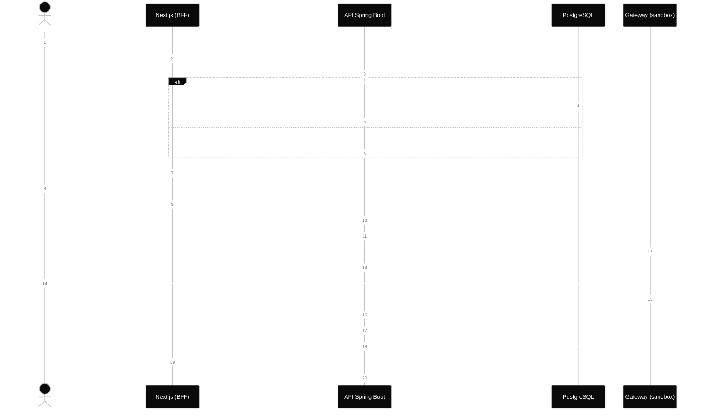
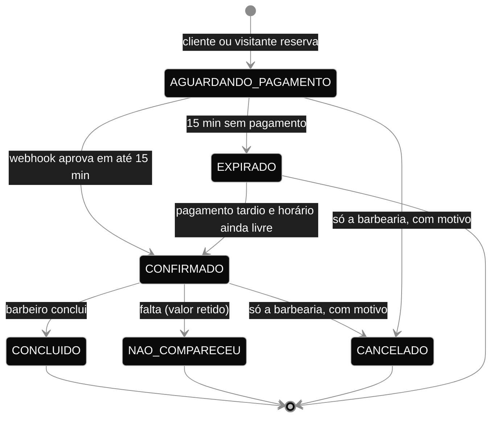
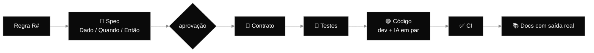

<div align="center">


[](#-roadmap-em-fatias)
[](docs/contrato/openapi.yaml)
[](https://github.com/k3vinrich4rd/barbearia-altas-horas/actions/workflows/backend-ci.yml)
[](#-a-barbearia)

[](https://openjdk.org/projects/jdk/25/)
[](https://spring.io/projects/spring-boot)
[](https://docs.spring.io/spring-security/reference/)
[](docs/adr/0003-anti-double-booking-no-banco.md)
[](docs/banco/erd.md)
[](https://testcontainers.com/)
[](https://nextjs.org/)
[](docs/adr/0005-erros-rfc-9457.md)
[](#-pagamento-100-antecipado)
[](https://github.com/k3vinrich4rd/barbearia-altas-horas/commits/develop)

[](#-a-história)
[](#-em-30-segundos)
[](#-a-barbearia)
[](#-pagamento-100-antecipado)
[](#-arquitetura)
<br/>
[-0A0A0A?style=for-the-badge)](#-decisões-de-arquitetura-adrs)
[](#-segurança-e-lgpd)
[](#-rodar-e-testar)
[](#-como-o-projeto-é-feito-sdd--ia)
[](#-roadmap-em-fatias)

</div>


> [!IMPORTANT]
> **Onde o projeto está.** A agenda já responde, pela API, quais horários estão livres de verdade (descontando almoço, folgas e reservas), e o banco já impede dois clientes no mesmo horário. São **69 testes** rodando em PostgreSQL real, com 0 falhas. Conta, pagamento, painel e telas chegam nas próximas fatias: o [roadmap](#-roadmap-em-fatias) mostra o que está pronto e o que falta.
>
> Cada entrega nasce de uma **especificação** e só entra com teste para cada critério. Os números desta página saem sempre de execução real.

<table>
<tr>
<td align="center" width="33%"><b>👀 Tenho 2 minutos</b><br/><a href="#-a-história">A história</a> · <a href="#-em-30-segundos">Em 30 segundos</a></td>
<td align="center" width="33%"><b>🧑‍💻 Quero ver a engenharia</b><br/><a href="#-as-regras-da-casa-e-quem-garante-cada-uma">Regras e garantias</a> · <a href="#-decisões-de-arquitetura-adrs">ADRs</a> · <a href="#-como-o-projeto-é-feito-sdd--ia">SDD + IA</a></td>
<td align="center" width="33%"><b>⌨️ Quero rodar</b><br/><a href="#-rodar-e-testar">2 comandos</a> · <a href="docs/guia-testes.md">guia de testes</a></td>
</tr>
</table>

## 📖 A história

<table>
<tr>
<td width="200" align="center" valign="top">

<br/><b>Eduardo Cândido</b><br/><sub>barbeiro desde 1997</sub>
</td>
<td valign="top">

Desde **1997**, quem senta na cadeira da **Barbearia Altas Horas**, no Jardim Bonança, em Osasco, é atendido pelo **Eduardo Cândido**. Ele é o barbeiro da casa e é meu pai. São quase três décadas de terça a sábado, das sete da manhã às oito da noite, fazendo do corte social ao degradê navalhado.

A agenda dele sempre coube num caderno e no WhatsApp, e é aí que mora o problema de toda barbearia de bairro: o cliente marca, não aparece, e aquele horário não volta. Para quem atende sozinho, **cadeira vazia é meia hora de trabalho que ninguém paga**.

Este projeto é a agenda online da Altas Horas. O cliente escolhe o serviço e o horário, **paga antes**, por Pix ou cartão, e só então o horário é dele. Quem não paga em 15 minutos libera a vaga para o próximo. No fim, o Eduardo abre o painel de manhã e encontra o dia já organizado, com cada horário confirmado e pago. É para esse dia que o projeto está sendo construído, uma fatia de cada vez.

</td>
</tr>
</table>

<details>
<summary><b>📒 Antes: o caderno e o WhatsApp</b></summary>

<br/>

| Momento | O que acontecia |
|---|---|
| Cliente quer marcar | manda mensagem e espera o Eduardo terminar um corte para responder |
| Dois clientes querem o mesmo horário | quem respondeu primeiro leva; o outro descobre depois |
| Cliente desiste | às vezes avisa, às vezes não |
| Cliente falta | cadeira vazia, sem receita, e sem tempo de encaixar outra pessoa |
| Fim do dia | a agenda de amanhã está espalhada entre o caderno e as conversas |

</details>

<details open>
<summary><b>💈 Agora: a agenda online</b></summary>

<br/>

| Momento | O que acontece | Quem garante |
|---|---|---|
| Cliente quer marcar | vê os horários livres na hora, a qualquer hora | a API calcula jornada, almoço, folgas e reservas |
| Dois clientes querem o mesmo horário | só um consegue, mesmo clicando no mesmo instante | o PostgreSQL, com uma regra no próprio banco |
| Cliente reserva | o horário fica guardado por 15 minutos enquanto ele paga | prazo gravado na reserva |
| Cliente paga | a confirmação é automática | o aviso do meio de pagamento, aceito uma vez só |
| Cliente falta | o valor já foi pago: a cadeira vazia não vira prejuízo | regra do produto, aceita pelo cliente antes de pagar |
| Começo do dia | o Eduardo vê a agenda pronta no painel | painel do barbeiro |

<sub>✅ Já roda: horários livres pela API e a trava contra horário duplicado. 🚧 Em construção: reserva, pagamento e painel ([roadmap](#-roadmap-em-fatias)).</sub>

</details>

## ⚡ Em 30 segundos

| | |
|---|---|
| **Problema** | Na barbearia de bairro, a agenda vive no WhatsApp e no caderno. Horário marcado e não cumprido é cadeira vazia e dinheiro perdido. |
| **Solução** | Agendamento online com horários livres em tempo real e **pagamento 100% antecipado** (Pix ou cartão de crédito). O horário só é confirmado quando o gateway avisa que o dinheiro entrou. |
| **Para quem** | Para o **Eduardo Cândido**, meu pai, que atende sozinho e administra tudo num painel protegido, e para os clientes da **Barbearia Altas Horas** (Osasco, desde 1997). |
| **Como é construído** | Especificação antes do código, um teste para cada critério e CI barrando o que não cumpre. Backend em Java e Spring; IA como par de programação e na geração do frontend. [Como funciona](#-como-o-projeto-é-feito-sdd--ia). |
| **Por que é nível Pleno** | Concorrência resolvida no banco, webhook idempotente, máquina de estados explícita, erros padronizados, LGPD desde a primeira linha e testes com PostgreSQL real. |
| **Stack** | Java 25 · Spring Boot 4 · Spring Security · JPA · Flyway · PostgreSQL · Testcontainers · Next.js |
| **Deploy (Fase 1)** | Vercel (front) · Render (API em Docker) · Aiven (PostgreSQL) |

### ✂️ As regras da casa, e quem garante cada uma

Cada regra do negócio tem uma garantia de engenharia por trás. Abra para ver.

<details>
<summary><b>1. Dois clientes nunca ficam com o mesmo horário</b></summary>

<br/>

Quem garante é o banco, não um `if` no código: uma constraint `EXCLUDE USING gist` com `tstzrange '[)'` no PostgreSQL. Com duas requisições no mesmo milissegundo, ou duas instâncias da API no ar, o banco deixa passar só uma. O teste coloca 12 conexões disputando o mesmo horário e confere que exatamente uma vence. [ADR 0003](docs/adr/0003-anti-double-booking-no-banco.md)

</details>

<details>
<summary><b>2. Horário só é confirmado com o dinheiro na conta</b></summary>

<br/>

A reserva nasce `AGUARDANDO_PAGAMENTO` e só vira `CONFIRMADO` quando o meio de pagamento avisa. Esse aviso pode chegar repetido, então o id do evento é chave única: o mesmo aviso duas vezes não confirma duas vezes. E a API não confia só no corpo do aviso: consulta a cobrança antes de confirmar. [ADR 0007](docs/adr/0007-gateway-de-pagamento-sandbox.md)

</details>

<details>
<summary><b>3. Quem não paga em 15 minutos libera a vaga</b></summary>

<br/>

A reserva guarda o prazo. Passou dele, o horário volta a aparecer como livre **na mesma hora**, sem esperar nenhuma rotina de limpeza rodar: a consulta de horários já ignora reserva vencida. Importa porque a hospedagem gratuita hiberna, e uma rotina agendada atrasaria.

</details>

<details>
<summary><b>4. O número do cartão nunca passa pela API</b></summary>

<br/>

O pagamento com cartão acontece na página do próprio meio de pagamento. A API só recebe o resultado, o que tira o projeto do escopo pesado do PCI DSS. O CPF, exigido para gerar a cobrança, é validado, repassado e não fica guardado. [ADR 0009](docs/adr/0009-lgpd-marketing-cpf-e-retencao.md)

</details>

<details>
<summary><b>5. Preço, horário e regra mudam sem mexer no código</b></summary>

<br/>

Serviços, preços, jornada, almoço, antecedência mínima e prazo de pagamento são dados no banco. O Eduardo muda o horário de almoço no painel e a agenda acompanha, sem depender de uma nova versão do sistema.

</details>

## 💈 A barbearia

| | |
|---|---|
| 📍 **Endereço** | R. São Judas Tadeu, 313 · Jd. Bonança · Osasco/SP |
| 💈 **Quem atende** | Eduardo Cândido (Carlos Eduardo Cândido), em todos os serviços |
| 🕖 **Funcionamento** | terça a sábado, **07h00 às 20h00** (almoço 12h00 às 13h00) |
| 📸 **Instagram** | [@altashorascabeleireiros](https://www.instagram.com/altashorascabeleireiros/) · [@eduardo_candido_barber](https://www.instagram.com/eduardo_candido_barber/) |

### 🗓 A agenda da semana


<details>
<summary><b>📖 Abrir a página de um dia</b> (resposta real da API para uma terça livre)</summary>

<br/>

`GET /disponibilidade` do **Corte Degradê** (30 min): **24 horários**.

| Manhã | | | | | Tarde | | | | | |
|:-:|:-:|:-:|:-:|:-:|:-:|:-:|:-:|:-:|:-:|:-:|
| 07:00 | 07:30 | 08:00 | 08:30 | 09:00 | 13:00 | 13:30 | 14:00 | 14:30 | 15:00 | 15:30 |
| 09:30 | 10:00 | 10:30 | 11:00 | 11:30 | 16:00 | 16:30 | 17:00 | 17:30 | 18:00 | 18:30 |
| | | | | | 19:00 | 19:30 | | | | |

O **Corte Moderno / Visagismo** (60 min) tem **22**: some o 11:30 (invadiria o almoço) e o 19:30 (passaria das 20h). Horário reservado, mesmo ainda aguardando pagamento, sai da lista; se o prazo de 15 min vence, ele volta sozinho.

</details>

<details>
<summary><b>✂️ Testar agora, no seu terminal</b></summary>

<br/>

```bash
curl "http://localhost:8080/disponibilidade?servicoId=6f1c2a8e-0000-4000-8000-000000000002&data=2026-12-01"
```

Como subir a API em 2 comandos: [Rodar e testar](#-rodar-e-testar).

</details>

### Serviços

| Serviço | Duração | Preço |
|---|:-:|--:|
| Corte Clássico / Social | 30 min | R$ 45,00 |
| Corte Degradê / Fade / Navalhado | 30 min | R$ 55,00 |
| Corte Moderno / Visagismo (tesoura) | 60 min · 2 horários | R$ 60,00 |
| Barba Completa / Desenhada | 30 min | R$ 30,00 |
| Acabamento (pezinho) / Sobrancelha | 30 min | R$ 20,00 |

<sub>Sem combos. Preços, horários e regras são **dados** que o admin edita no painel, nunca valores fixos no código.</sub>

<details>
<summary><b>📷 A fachada</b></summary>

<br/>
<div align="center">

</div>

</details>

## 💳 Pagamento 100% antecipado

| Regra | Como o sistema garante |
|---|---|
| **Todo** agendamento (com conta ou sem conta) paga 100% antes | a reserva nasce `AGUARDANDO_PAGAMENTO` e só vira `CONFIRMADO` pelo webhook do gateway |
| Pix ou cartão de crédito | Pix devolve QR Code e copia e cola; cartão abre o checkout hospedado do gateway |
| O horário fica travado por **15 min** enquanto o cliente paga | a constraint do banco conta a reserva pendente como ocupada até `expira_em` |
| Não pagou em 15 min | a reserva vira `EXPIRADO` e o horário volta para a agenda |
| **Sem cancelamento, remarcação ou estorno** por desistência ou falta | não há botão nem rota para o cliente cancelar; antes de pagar, ele marca o aceite obrigatório (`aceitePolitica: true`, com a versão do texto gravada) |
| Falta (*no-show*) | o barbeiro marca `NAO_COMPARECEU` no painel; o valor fica com a barbearia |
| Pagamento que chega depois dos 15 min | com o horário ainda livre, confirma normalmente; com o horário já ocupado, vira pendência no painel do admin |

> [!NOTE]
> O CPF é pedido **só** na tela de pagamento, porque o gateway exige. Ele é validado, repassado ao gateway e **não é guardado** no banco.

### Checkout por dentro



### Ciclo de vida do agendamento



<sub>Qualquer transição fora do diagrama responde `422 TRANSICAO_INVALIDA`. Tabela completa em [`docs/dominio/modelo-de-dominio.md`](docs/dominio/modelo-de-dominio.md#2-máquina-de-estados).</sub>

## 🧱 Arquitetura

**Monólito modular** (Spring Modulith): um deploy só, oito módulos com fronteiras verificadas por teste (ArchUnit + `ApplicationModules.verify()`), conversando por API pública e eventos com *outbox*. Detalhes em [`docs/arquitetura/`](docs/arquitetura/README.md).


<details>
<summary><b>Estrutura do monorepo</b></summary>

<br/>

```text
barbearia-altas-horas/
├── backend/                         # API Java 25 + Spring Boot 4
│   └── src/main/java/io/github/k3vinrich4rd/altashoras/
│       ├── comum/        # Dinheiro, Cpf, Cep (mascaram no toString), erros RFC 9457
│       ├── plataforma/   # segurança, Clock, observabilidade, ShedLock
│       ├── conta/        # cadastro, login, JWT, refresh rotativo
│       ├── agenda/       # serviços, barbeiro, jornada, disponibilidade, reservas
│       ├── pagamento/    # cobrança 100% (Pix/cartão), webhook idempotente
│       ├── cep/          # ViaCEP → BrasilAPI, cache e degradação
│       ├── privacidade/  # consentimento, exportação e exclusão (LGPD)
│       └── admin/        # painel: agenda, catálogo, pagamentos, auditoria
├── frontend/             # Next.js (BFF guarda os tokens em cookie HttpOnly)
├── docs/                 # contrato, ADRs, domínio, banco, guia de testes
└── compose.yaml          # PostgreSQL 18 local (API e front entram na Fatia 8)
```

</details>

## 🧭 Decisões de arquitetura (ADRs)

| Decisão | Alternativa descartada | Por quê | ADR |
|---|---|---|---|
| **Anti double booking no banco** com `EXCLUDE USING gist` + `tstzrange '[)'` + `btree_gist` | `synchronized` / lock em memória / `SELECT` antes do `INSERT` | lock em memória não protege duas instâncias e o `SELECT` tem corrida; a constraint vale para qualquer caminho de escrita | [0003](docs/adr/0003-anti-double-booking-no-banco.md) |
| **Webhook idempotente** pelo id do evento + reconsulta da cobrança | confiar no corpo do aviso | o gateway entrega "pelo menos uma vez"; o corpo pode ser forjado (OWASP API10) | [0007](docs/adr/0007-gateway-de-pagamento-sandbox.md) |
| **Erros RFC 9457** (`application/problem+json`) com `code` e `traceId` | JSON de erro próprio | padrão atual (substitui a RFC 7807); o front decide pelo `code`, não pelo texto | [0005](docs/adr/0005-erros-rfc-9457.md) |
| **Monólito modular** (Spring Modulith) | microsserviços | 1 pessoa, 1 deploy, fronteiras testadas; extrair serviço só com motivo real | [0001](docs/adr/0001-monolito-modular-com-spring-modulith.md) |
| **Hexagonal só onde paga o custo** (regra difícil pura; sistema externo atrás de porta) | hexagonal completo em todo módulo | CRUD com porta, adaptador e mapeador é cerimônia; a regra dos horários, pura, tem 12 testes em milissegundos | [0011](docs/adr/0011-hexagonal-seletivo-no-monolito-modular.md) |
| **Tempo em `timestamptz` + `Clock` injetado; dinheiro em centavos (`long`)** | `LocalDateTime` e `double` | fuso `America/Sao_Paulo` explícito e testes que "adiantam o relógio"; sem erro de arredondamento | [0004](docs/adr/0004-tempo-e-dinheiro.md) |
| **JWT curto + refresh rotativo em cookie `HttpOnly`** via BFF | token no `localStorage` | XSS não rouba sessão; reuso de refresh revoga a família | [0006](docs/adr/0006-sessao-jwt-refresh-cookie-bff.md) |
| **LGPD**: CPF só em trânsito, marketing por consentimento | guardar CPF cifrado | princípio da necessidade (art. 6º, III): o que não é guardado não vaza | [0009](docs/adr/0009-lgpd-marketing-cpf-e-retencao.md) |
| **Testcontainers** com PostgreSQL real | H2 em memória | `EXCLUDE`, `tstzrange` e `SKIP LOCKED` não existem no H2 | [0010](docs/adr/0010-versoes-da-plataforma.md) |

<sub>Todas as decisões com data e fonte: [`docs/planejamento/decisoes.md`](docs/planejamento/decisoes.md).</sub>

## 🔐 Segurança e LGPD

| Tema | Decisão |
|---|---|
| Sessão | JWT de acesso curto + refresh rotativo guardado com hash, em cookie `HttpOnly; Secure; SameSite` pelo BFF |
| Recurso alheio | busca já filtrada pelo dono; responde **404** em vez de confirmar que o id existe (OWASP API1, BOLA) |
| Pagamento | webhook só com o token do gateway; cobrança com `X-Idempotency-Key`; cartão só no checkout do gateway |
| CPF | pedido só no pagamento, validado, repassado e **nunca gravado nem logado** |
| Aceite da política | versão do texto e data gravadas na reserva (prova em caso de contestação) |
| Admin | criado na subida por `ADMIN_EMAIL` / `ADMIN_SENHA` (variáveis de ambiente, hash), com limite de tentativas e auditoria de cada ação |
| Abuso | limite de tentativas no login, no cadastro e na reserva sem conta (`429` com `Retry-After`) |
| Titular | exporta e exclui os próprios dados; marketing só com consentimento opcional e desmarcado |

## 🛠 Painel admin

Área do papel `ADMIN`/`BARBEIRO` (hoje uma pessoa só, o Eduardo). É onde ele vê o dia, fecha os atendimentos e ajusta preços e horários sem depender de mim.

| O admin pode | Detalhe |
|---|---|
| Ver a agenda do dia e da semana | com o status de cada horário |
| Fechar o atendimento | `CONCLUIDO`, `NAO_COMPARECEU` (valor retido) ou cancelar com motivo |
| Gerenciar serviços e preços | nome, duração e preço, sem deploy |
| Editar jornada e folgas | inclusive a pausa de almoço |
| Acompanhar pagamentos | pendentes, confirmados e **pendências de pagamento tardio** |
| Ajustar regras | antecedência, horizonte, prazo de pagamento, texto da política |

## 🧪 Rodar e testar

Precisa de **Docker Desktop** e **JDK 25**. Sem `.env`: o perfil `dev` usa os padrões locais.

```bash
git clone https://github.com/k3vinrich4rd/barbearia-altas-horas.git
cd barbearia-altas-horas
docker compose up -d                                         # PostgreSQL 18 (porta 5433)
cd backend && ./mvnw spring-boot:run -Dspring-boot.run.profiles=dev
```

```bash
cd backend && ./mvnw verify      # 69 testes com PostgreSQL real via Testcontainers
```

| O que | Endereço local | |
|---|---|:-:|
| Health | `http://localhost:8080/actuator/health` | ✅ |
| Serviços, política e horários livres | `/servicos` · `/politica-pagamento` · `/disponibilidade` | ✅ |
| Conta, agendamento, pagamento e painel | — | ⏳ Fatias 3 a 5 |
| Front | `http://localhost:3000` | ⏳ Fatia 7 |

O passo a passo para **testar à mão, sem depender de ninguém** (o que já roda hoje e os cenários de visitante, cliente e admin de cada fatia) está em **[`docs/guia-testes.md`](docs/guia-testes.md)**. A história completa da construção está em **[`docs/como-foi-construido.md`](docs/como-foi-construido.md)**.

## 📐 Como o projeto é feito: SDD + IA

O backend é escrito em Java e Spring com IA como par de programação, e o frontend é gerado com IA a partir do contrato da API. O que mantém a qualidade com tanta IA no processo é o método: nada entra sem especificação, e cada critério da especificação vira um teste que o CI cobra.

| Parte | Como é feita | Como a qualidade é garantida |
|---|---|---|
| **Especificação** | escrita antes de qualquer código, com as decisões de desenho e os critérios de aceite | cada fatia tem uma [spec](docs/sdd/README.md) com critérios numerados; nada de código antes da aprovação |
| **Backend** (Java 25 + Spring Boot 4) | escrito à mão, com IA como par de programação | um teste por critério da spec, PostgreSQL real (Testcontainers), regras de arquitetura (Spring Modulith + ArchUnit), CI com CodeQL e gitleaks |
| **Frontend** (Next.js) | gerado com IA a partir do contrato OpenAPI e das specs de tela, com revisão humana | tipos gerados do contrato, testes das telas críticas (checkout com aceite obrigatório), checagem de acessibilidade |
| **Deploy** | Vercel + Render + Aiven, com IA apoiando os passos de infraestrutura | o guia de testes rodado contra o ambiente publicado |

### Por que Spec-Driven Development

Quando a IA escreve boa parte do código, quem garante a qualidade é a **especificação**, não o prompt. Sem spec, a IA preenche as lacunas com suposições; com spec, ela implementa critérios que viram testes, e a revisão é feita **contra a spec**.



| Ferramenta | Para quê |
|---|---|
| [Specs das fatias](docs/sdd/README.md) | a fonte da verdade de cada entrega ([modelo](docs/sdd/modelo-de-spec.md), [Fatia 1](docs/sdd/fatia-1-esqueleto.md), [Fatia 2](docs/sdd/fatia-2-catalogo-disponibilidade.md)) |
| [`CLAUDE.md`](CLAUDE.md) | o índice que a IA lê antes de mexer: onde está cada regra, decisão e padrão |
| [Skills do projeto](.claude/skills/) | receitas repetíveis: `/especificar-fatia`, `/implementar-fatia`, `/verificar-contrato` |
| [`scripts/conferir-spec.sh`](scripts/conferir-spec.sh) | *eval* do processo: todo critério da spec precisa de um teste com o número dele (roda no CI) |
| [GitHub Copilot + Actions](docs/automacao.md) | o Copilot lê as mesmas regras ([instruções](.github/copilot-instructions.md)), revisa PRs e pega tarefas pequenas; as Actions barram o que não cumpre spec, teste ou segurança |
| [Agente revisor](.claude/agents/revisor-de-fatia.md) | segundo par de olhos, só leitura: confere o código contra a spec antes da PR |
| [RAG vetorial](docs/ia/rag-vetorial.md) | busca semântica na documentação com **Spring AI + pgvector** e embeddings locais. Medido: só vetor acerta 10 de 17 perguntas (nenhum identificador); a busca **híbrida**, 15 de 17 |
| [`scripts/buscar-contexto.sh`](scripts/buscar-contexto.sh) | recuperação por identificador (`R15`, `D40`, `A7`): traz a regra, a decisão, a spec e o teste ligados a ela. Para ~40 documentos com IDs estáveis, isso é mais preciso que um RAG vetorial ([por quê](docs/sdd/README.md#por-que-não-um-rag-com-banco-vetorial)) |

<sub>Ferramentas de IA usadas: Claude Code (backend, specs e revisão) e outras ferramentas de IA no frontend. Números e respostas no README sempre saem de execução real, nunca de estimativa da IA.</sub>

## 🗺 Roadmap em fatias

Cada fatia é uma PR para a `develop`, escrita primeiro como especificação (regras, contrato e critérios de aceite) e só depois como código.

- [x] **Fatia 0 · Especificação:** domínio, máquina de estados, contrato OpenAPI v1.1, DDL proposto e ADRs
- [x] **Fatia 1 · Esqueleto:** Maven, 8 módulos, RFC 9457 com `traceId`, `Clock`, Docker Compose, Flyway V1 com a constraint anti-sobreposição, teste de concorrência, CI (build, CodeQL, gitleaks)
- [x] **Fatia 2 · Catálogo e disponibilidade:** serviços, política de pagamento e horários livres com almoço, folgas, antecedência e reservas pendentes vencidas ([spec](docs/sdd/fatia-2-catalogo-disponibilidade.md): 29 critérios, 29 testes)
- [ ] **Fatia 3 · Conta e acesso:** cadastro, login, refresh rotativo, admin inicial, limite de tentativas (📝 [spec escrita](docs/sdd/fatia-3-conta-e-acesso.md), 39 critérios)
- [ ] **Fatia 4 · Agendamento e checkout:** reserva com trava de 15 min, cobrança 100% Pix/cartão, aceite, webhook idempotente, expiração
- [ ] **Fatia 5 · Painel admin:** agenda, fechamento, catálogo, pagamentos e auditoria
- [ ] **Fatia 6 · CEP e privacidade:** ViaCEP/BrasilAPI com degradação, LGPD
- [ ] **Fatia 7 · Telas Next.js:** agenda, checkout com aceite obrigatório, painel, acessibilidade
- [ ] **Fatia 8 · Deploy:** Vercel + Render + Aiven

## 📚 Documentação

| Documento | O que tem |
|---|---|
| [Contrato da API](docs/contrato/contrato-api.md) · [OpenAPI](docs/contrato/openapi.yaml) | rotas, exemplos, erros e histórico de versões |
| [Dossiê de contexto](docs/contexto.md) | regras de negócio numeradas (R1 a R32) e decisões em aberto |
| [Modelo de domínio](docs/dominio/modelo-de-dominio.md) | agregados, eventos e máquina de estados |
| [Arquitetura](docs/arquitetura/README.md) | módulos, dependências e fluxos críticos |
| [Banco](docs/banco/erd.md) | ERD, constraints e DDL proposto |
| [ADRs](docs/adr/README.md) | as 10 decisões de arquitetura |
| [Painel admin](docs/admin/painel-admin.md) | matriz de acesso |
| [Guia de testes](docs/guia-testes.md) | teste você mesmo, à mão: o banco, os erros e os cenários de visitante, cliente e admin |
| [Como foi construído](docs/como-foi-construido.md) | o projeto de ponta a ponta: método, linha do tempo, código arquivo por arquivo, skills e agente de IA |
| [SDD](docs/sdd/README.md) | o processo, o modelo de spec e a spec de cada fatia |
| [Automação](docs/automacao.md) | por que cada Action existe, o papel do Copilot, como o SDD é cobrado e a regra de recuperação de contexto |
| [RAG vetorial](docs/ia/rag-vetorial.md) | como a busca semântica na documentação funciona e o que a avaliação mostrou |
| [Estudos aplicados](docs/estudos-aplicados.md) | minhas metas de estudo (Java/Spring e IA) ligadas a arquivos e testes deste projeto |

## 🔭 E outros barbeiros?

Hoje, não: o projeto é **a agenda do Eduardo Cândido na Altas Horas**, e todo o esforço vai para ela funcionar bem.

O que fica pronto para o futuro, sem custo agora: o modelo já tem a entidade `Barbeiro` com jornada própria, a disponibilidade responde por barbeiro e preços e horários são dados do banco. Se um dia entrar outro profissional na cadeira ao lado, é cadastro, não reescrita.


## 🖤 Homenagem

<div align="center">


**Para o meu pai, Eduardo Cândido**, que mantém a cadeira da **Barbearia Altas Horas** girando desde **1997**.
Este projeto é a minha forma de levar para o código o cuidado que ele coloca em cada corte.

**★ 19 ✂ 97 ★**

</div>

## 👤 Autor

**Kevin Richard** · desenvolvedor backend Java · Osasco/SP · [GitHub @k3vinrich4rd](https://github.com/k3vinrich4rd)

Construo backends em Java e Spring com foco em regra de negócio bem protegida: concorrência resolvida no banco, integrações que falham sem derrubar o sistema e testes que provam o que a especificação promete.

<sub>Logo, fotos e identidade visual pertencem à Barbearia Altas Horas. Feito com Spec-Driven Development e apoio de IA; cada decisão tem fonte e data.</sub>
