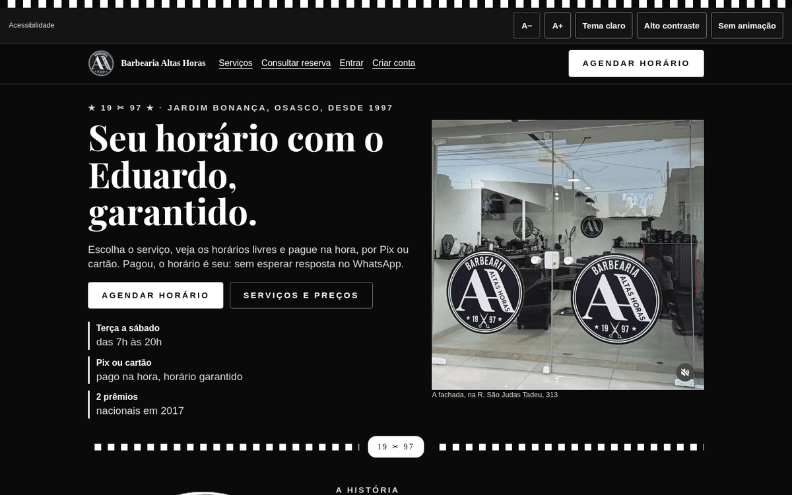
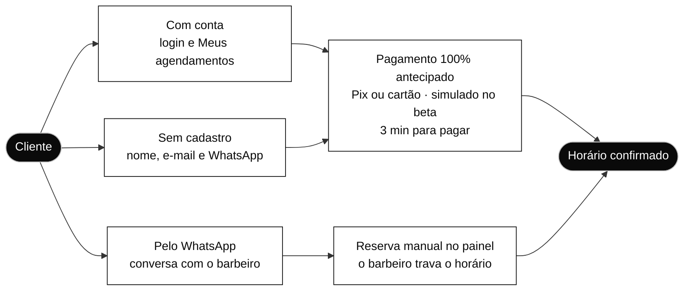
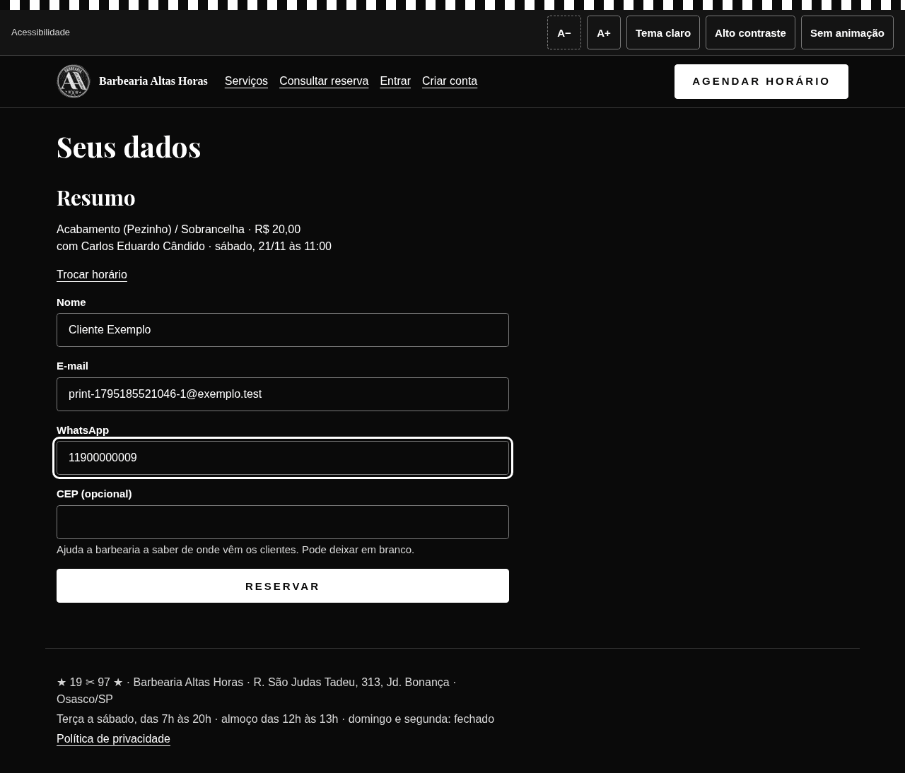
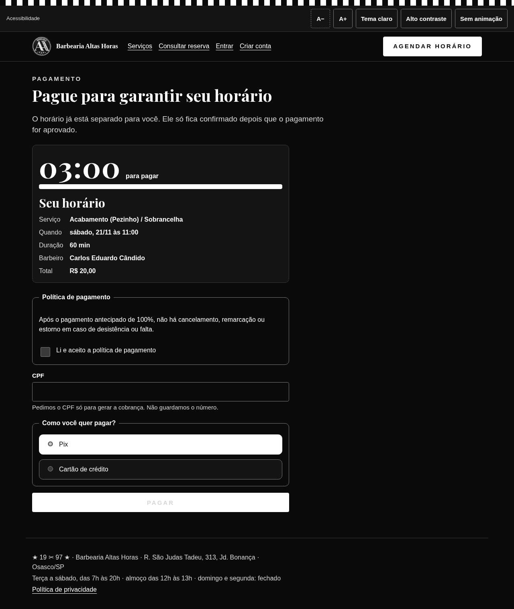
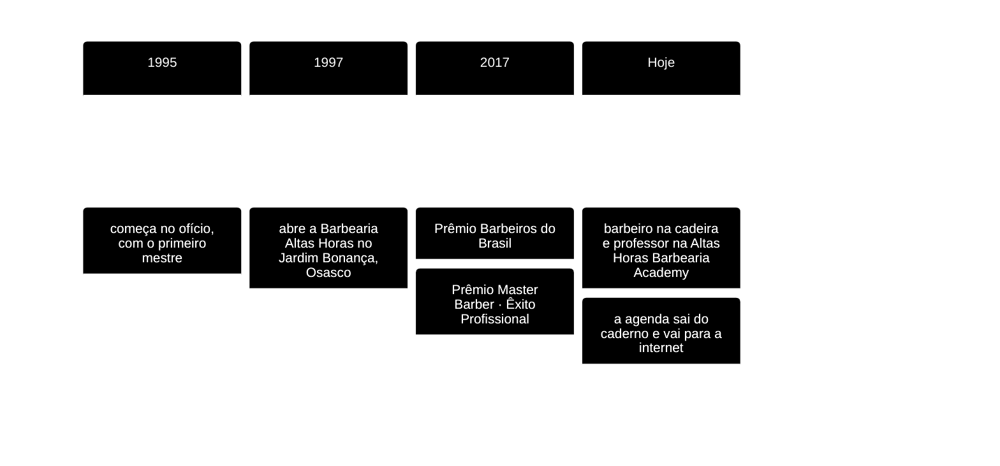
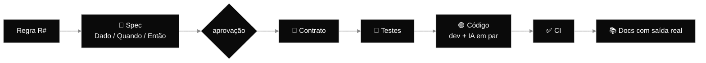

<div align="center">


[](https://barbearia-altas-horas.vercel.app)
[](#-roadmap-em-fatias)
[](https://github.com/k3vinrich4rd/barbearia-altas-horas/actions/workflows/backend-ci.yml)
[](https://github.com/k3vinrich4rd/barbearia-altas-horas/actions/workflows/frontend-ci.yml)
[](https://openjdk.org/projects/jdk/25/)
[](https://spring.io/projects/spring-boot)
[](docs/adr/0003-anti-double-booking-no-banco.md)
[](https://nextjs.org/)
[](https://github.com/k3vinrich4rd/barbearia-altas-horas/actions/runs/44441298116)
[](docs/contrato/openapi.yaml)

<h3><a href="https://barbearia-altas-horas.vercel.app">🌐 Abrir o site (beta)</a> · <a href="https://altas-horas-api.onrender.com/actuator/health">🩺 API</a> · <a href="docs/contrato/openapi.yaml">📑 Contrato</a> · <a href="docs/guia-testes.md">🧪 Testar à mão</a> · <a href="#-rodar-e-testar">🚀 Rodar agora</a></h3>

<b><a href="#-a-história">A história</a></b> ·
<a href="#-o-site-no-ar-beta">O site no ar</a> ·
<a href="#-trajetória-e-prêmios">Trajetória e prêmios</a> ·
<a href="#-a-barbearia">A barbearia</a> ·
<a href="#-o-que-a-agenda-resolve">O que a agenda resolve</a> ·
<a href="#-arquitetura">Arquitetura</a> ·
<a href="#-rodar-e-testar">Rodar e testar</a> ·
<a href="#-roadmap-em-fatias">Roadmap</a>

</div>


## 📖 A história

### Quase três décadas de tradição, agora com agenda inteligente


O caminho do **Eduardo Cândido**, meu pai, na barbearia começou em **1995**, com o primeiro mestre. Dois anos depois, em **1997**, ele abriu a **Barbearia Altas Horas** no Jardim Bonança, em Osasco, e desde então comanda a cadeira: quase 30 anos atendendo de terça a sábado, das 7h às 20h, do corte social clássico ao degradê navalhado. Em 2017, esse trabalho foi reconhecido duas vezes, com o **Prêmio Barbeiros do Brasil**, que ele fez questão de trazer para Osasco, e o **Prêmio Master Barber · Êxito Profissional**. Instrutor formado pela Ibel Formação, hoje ele também ensina na **Altas Horas Barbearia Academy**, preparando a próxima geração de barbeiros.

Com o dia dividido entre os clientes e os alunos, a agenda sempre ficou no caderno e no WhatsApp. É aí que aparece um problema clássico da barbearia de bairro: o cliente marca, não aparece, e aquele horário não volta mais. Para quem atende sozinho, cadeira vazia é tempo perdido e dinheiro que deixa de entrar.

**Como desenvolvedor, criei esta agenda para resolver exatamente essa dor:**

- 💳 **Reserva com pagamento antecipado:** o cliente escolhe o serviço e o horário e paga na hora, por Pix ou cartão.
- 🔒 **Vaga garantida, sem conflito:** o horário só entra na agenda depois que o pagamento é confirmado, e dois clientes nunca ficam com o mesmo horário.
- ⏱️ **Liberação automática:** quem não conclui o pagamento em 3 minutos devolve a vaga para o próximo.

No fim, o Eduardo começa a manhã com um painel limpo e o dia já organizado, cada atendimento confirmado. Sobra tempo para o que importa: a cadeira e os alunos.

> [!NOTE]
> **Onde o projeto está:** a API já mostra os horários livres de verdade (descontando almoço, folgas e reservas), impede dois clientes no mesmo horário e tem cadastro, login e um administrador que nasce sem senha no repositório. Também já tem reserva com pagamento simulado, expiração, consulta de CEP e o painel do barbeiro. Também tem privacidade (LGPD): consentimento, exportar e excluir a conta e retenção automática, e o alcance por região (de onde vêm os atendimentos, com agrupamento mínimo de 5). São **385 testes** no backend em PostgreSQL real, 0 falhas (CI da `main`, merge da PR #62, 18/11/2026). As telas (Fatias 7A e 7B) e o deploy (Fatia 8) já estão no ar em beta: [site](https://barbearia-altas-horas.vercel.app) e [API](https://altas-horas-api.onrender.com/actuator/health). No beta o pagamento é simulado. A Fatia 7C (painel no canvas) está em andamento.

<br clear="right"/>

## 🎬 O site no ar (beta)

Prints reais de [barbearia-altas-horas.vercel.app](https://barbearia-altas-horas.vercel.app), tirados com Playwright em 20/11/2026. O tema segue o do seu GitHub: escuro por padrão, claro com a marca invertida.

<div align="center">
<a href="https://barbearia-altas-horas.vercel.app">
<picture>
  <source media="(prefers-color-scheme: light)" srcset="docs/midia/prints/site-home-claro.png"/>
  
</picture>
</a>
</div>

| A história desde 1997 | Como funciona | No celular | Dúvidas |
|:-:|:-:|:-:|:-:|
|  |  |  |  |

### Três jeitos de marcar



<details>
<summary><b>🖼 O fluxo de reserva sem cadastro, tela a tela</b> (perfil <code>dev</code> local, dados fictícios)</summary>

<br/>

O catálogo do beta publicado ainda está vazio, então estes prints são do mesmo front rodando na máquina, contra a API no perfil `dev` (serviços e barbeiros de exemplo, cliente e CPF de teste, pagamento simulado).

| 1. Escolher o horário | 2. Seus dados | 3. Pagar em 3 min |
|:-:|:-:|:-:|
|  |  |  |

| 4. Pix (simulado) | 5. Horário confirmado |
|:-:|:-:|
|  |  |

</details>

## 🧭 O que tem para quem visita o projeto

- ▶️ **O que já funciona e dá para testar:** catálogo, horários livres, reserva (com e sem conta), pagamento simulado, expiração, conta e sessão, CEP com degradação (6A) e o painel completo. Como rodar e testar à mão, com a saída real de cada passo: **[guia de testes](docs/guia-testes.md)**.
- 🗺 **Alcance por região (6C):** a vitrine pública `GET /alcance` mostra, sem login e sem números, as cidades e os bairros que a barbearia atende (últimos 12 meses); o painel `GET /admin/alcance` dá a contagem e o percentual ao Eduardo. Nenhum grupo com menos de 5 atendimentos aparece com nome. Como testar: [AL1 no guia](docs/guia-testes.md#al1--alcance-por-região-fatia-6c).
- 💬 **WhatsApp e reserva manual (6D):** o site mostra o WhatsApp comercial de cada barbeiro (cadastrado só pelo admin), e o painel trava um horário combinado por fora do app (`POST /admin/agendamentos`: nasce confirmado, sem cobrança, sem WhatsApp do cliente). O prazo de pagamento passou a ser de **3 minutos**.
- 🛤 **Fluxo de ponta a ponta:** visitante, cliente e painel, com rotas, classes e diagramas: **[docs/fluxo-ponta-a-ponta.md](docs/fluxo-ponta-a-ponta.md)**.
- 🧩 **Padrões usados**, cada um com a classe real:

| Padrão | Onde está | Por quê |
|---|---|---|
| Monólito modular | Spring Modulith, verificado por `ModulithTest` | um deploy, fronteiras testadas ([ADR 0001](docs/adr/0001-monolito-modular-com-spring-modulith.md)) |
| Ports & adapters e Strategy | `GatewayDePagamento` → `GatewaySimulado` e `AsaasGateway` (escolhidos por `app.pagamento.modo`) | trocar o gateway sem tocar na regra |
| Fallback | `ProvedorDeCep`: `ViaCepCliente` → `BrasilApiCliente` → degradação | o cadastro segue se os provedores caírem ([ADR 0008](docs/adr/0008-cep-com-cache-e-degradacao.md)) |
| Cache-aside | Caffeine em `CepConfig` (`CaffeineCache` + `SimpleCacheManager`, sem `@Cacheable`) | menos chamadas a API externa, com prazo para achado e para inexistente |
| Máquina de estados | `StatusReserva.podeIrPara` e `TransicoesDeCobranca` | transição fora do mapa não existe |
| Eventos de domínio e outbox | `ReservaExpirada`, `ReservaCancelada`; tabela `event_publication` | o evento nasce na mesma transação e não se perde |
| Facade de módulo | `CepApi`, `PainelDaAgenda`, `conta.Contas` | o outro módulo só enxerga a API pública |
| Repository, Factory Method, Value Object | `ReservaRepository`; `Reserva.nova`; `Cep`, `Cpf`, `Horario` | regra e validação num lugar só |
| Lock otimista e pessimista | `@Version` em `Reserva`, `Cobranca` e outras; `FOR UPDATE`/`FOR SHARE` em `ReservarHorario` e `CadastrosDoPainel` | duas telas ou reserva e folga ao mesmo tempo |
| Idempotência com HMAC | `CriarCobranca` (`X-Idempotency-Key` + hash HMAC-SHA256 do corpo) | repetir o pedido não cobra duas vezes |

- 🤖 **IA no projeto** (três coisas diferentes):
  - **RAG da documentação: existe.** Está em `ferramentas/rag/` (Spring AI 2.0.2 + pgvector + embeddings locais, busca híbrida). Medido em 17/11/2026: só vetor acerta 10 de 17 perguntas; a híbrida, 15 de 17 ([detalhes](docs/ia/rag-vetorial.md)).
  - **SDD com um teste por critério:** nada entra sem spec, e o CI cobra um teste para cada critério ([como funciona](#-como-o-projeto-é-feito-sdd--ia)).
  - **Assistente de dúvidas para clientes: planejado** (Fatia 9). Vai nascer desligado por padrão, reaproveitando o RAG; a IA generativa só liga no ambiente publicado, por configuração. Não existe código disso ainda.
- 🗺 **Status das fatias:** 1 a 6 (CEP, privacidade/LGPD e alcance por região) prontas · 7A e 7B (telas e painel) e 8 (deploy grátis) **no ar em beta**, com pagamento simulado ([site](https://barbearia-altas-horas.vercel.app)) · 7C (painel no canvas) em andamento · 9 (assistente) planejada. Lista completa no [roadmap](#-roadmap-em-fatias).

## 🏆 Trajetória e prêmios

<table>
<tr>
<td align="center" width="50%">

<br/><b>Prêmio Barbeiros do Brasil</b><br/><sub>2017 · trazido para Osasco</sub>
</td>
<td align="center" width="50%">

<br/><b>Prêmio Master Barber · Êxito Profissional</b><br/><sub>2017</sub>
</td>
</tr>
</table>



<div align="center">
<sub><i>"Amor na ponta da tesoura!"</i> · Eduardo Cândido, ao receber o Prêmio Barbeiros do Brasil</sub>
</div>

## 💈 A barbearia

📍 R. São Judas Tadeu, 313 · Jd. Bonança · Osasco/SP &nbsp;·&nbsp; 🕖 terça a sábado, 07h às 20h (almoço 12h às 13h) &nbsp;·&nbsp; 📸 [@altashorascabeleireiros](https://www.instagram.com/altashorascabeleireiros/) · [@eduardo_candido_barber](https://www.instagram.com/eduardo_candido_barber/)

Um barbeiro só, que faz todos os serviços. É para esse ritmo que a agenda foi pensada:


<sub>Os horários marcados na imagem são ilustrativos: mostram como o dia aparece para o Eduardo, com o que está pago e o que ainda aguarda pagamento.</sub>

<details>
<summary><b>📖 Abrir a página de um dia</b> (resposta real da API para uma terça livre)</summary>

<br/>

`GET /disponibilidade` do **Corte Degradê** (60 min, como todos os serviços): **22 horários**.

| Manhã | | | | | Tarde | | | | | |
|:-:|:-:|:-:|:-:|:-:|:-:|:-:|:-:|:-:|:-:|:-:|
| 07:00 | 07:30 | 08:00 | 08:30 | 09:00 | 13:00 | 13:30 | 14:00 | 14:30 | 15:00 | 15:30 |
| 09:30 | 10:00 | 10:30 | 11:00 | | 16:00 | 16:30 | 17:00 | 17:30 | 18:00 | 18:30 |
| | | | | | 19:00 | | | | | |

Com todos os serviços em 60 min, somem o 11:30 (invadiria o almoço) e o 19:30 (passaria das 20h): sobram os mesmos **22** para qualquer serviço do catálogo. Horário reservado, mesmo ainda aguardando pagamento, sai da lista; se o prazo de 15 min vence, ele volta sozinho.

```bash
curl "http://localhost:8080/disponibilidade?servicoId=6f1c2a8e-0000-4000-8000-000000000002&data=2026-12-01"
```

</details>

### Quadro de serviços

<table>
<tr><th align="left">Serviço</th><th>Tempo</th><th align="right">Valor</th></tr>
<tr><td>✂️ Corte Clássico / Social</td><td align="center">60 min</td><td align="right"><kbd>R$ 45,00</kbd></td></tr>
<tr><td>✂️ Corte Degradê / Fade / Navalhado</td><td align="center">60 min</td><td align="right"><kbd>R$ 55,00</kbd></td></tr>
<tr><td>✂️ Corte Moderno / Visagismo (tesoura)</td><td align="center">60 min</td><td align="right"><kbd>R$ 60,00</kbd></td></tr>
<tr><td>🪒 Barba Completa / Desenhada</td><td align="center">60 min</td><td align="right"><kbd>R$ 30,00</kbd></td></tr>
<tr><td>🪒 Acabamento (pezinho) / Sobrancelha</td><td align="center">60 min</td><td align="right"><kbd>R$ 20,00</kbd></td></tr>
</table>

<sub>Sem combos. Preços, horários e regras são dados que o Eduardo muda no painel, sem mexer no código.</sub>

### Da cadeira

<table>
<tr>
<td align="center" width="33%"><br/><sub>O Eduardo em atendimento</sub></td>
<td align="center" width="33%"><br/><sub>A parede xadrez do logo</sub></td>
<td align="center" width="33%"><br/><sub>Degradê com desenho na navalha</sub></td>
</tr>
</table>

<details>
<summary><b>🚪 A fachada</b></summary>

<br/>
<div align="center">

</div>

</details>

<sub>Preto e branco, como o logo e a parede xadrez do salão. Fotos do acervo da barbearia e do Instagram do Eduardo.</sub>

## ✂️ O que a agenda resolve

Na prática, a diferença aparece no dia do Eduardo:

| No caderno e no WhatsApp | Na agenda online |
|---|---|
| o cliente manda mensagem e espera o fim de um corte para ter resposta | vê os horários livres na hora, a qualquer hora |
| dois clientes no mesmo horário: quem respondeu primeiro leva | só um consegue, mesmo clicando no mesmo instante |
| o cliente desiste e nem sempre avisa | o horário só é dele depois de pagar; sem pagar em 3 min, a vaga volta |
| a falta vira cadeira vazia e prejuízo | o valor já foi pago antes do corte |
| a agenda de amanhã está espalhada entre caderno e conversas | o Eduardo abre o painel e o dia está pronto |

Por trás de cada linha dessa tabela há uma decisão de engenharia. Abra para ver como cada regra é garantida:

<details>
<summary><b>Dois clientes nunca ficam com o mesmo horário</b></summary>

<br/>

Quem garante é o banco, não um `if` no código: uma constraint `EXCLUDE USING gist` com `tstzrange '[)'` no PostgreSQL. Com duas requisições no mesmo milissegundo, ou duas instâncias da API no ar, o banco deixa passar só uma. O teste coloca 12 conexões disputando o mesmo horário e confere que exatamente uma vence. [ADR 0003](docs/adr/0003-anti-double-booking-no-banco.md)

</details>

<details>
<summary><b>O horário só é confirmado com o dinheiro na conta</b></summary>

<br/>

A reserva nasce `AGUARDANDO_PAGAMENTO` e só vira `CONFIRMADO` quando o meio de pagamento avisa. Esse aviso pode chegar repetido, então o id do evento é chave única: o mesmo aviso duas vezes não confirma duas vezes. E a API não confia só no corpo do aviso: consulta a cobrança antes de confirmar. [ADR 0007](docs/adr/0007-gateway-de-pagamento-sandbox.md)

</details>

<details>
<summary><b>Quem não paga em 3 minutos libera a vaga</b></summary>

<br/>

A reserva guarda o prazo. Passou dele, o horário volta a aparecer como livre na mesma hora, sem esperar nenhuma rotina de limpeza rodar: a consulta de horários já ignora reserva vencida. Importa porque a hospedagem gratuita hiberna, e uma rotina agendada atrasaria.

</details>

<details>
<summary><b>O número do cartão nunca passa pela API</b></summary>

<br/>

O pagamento com cartão acontece na página do próprio meio de pagamento. A API só recebe o resultado, o que tira o projeto do escopo pesado do PCI DSS. O CPF, exigido para gerar a cobrança, é validado, repassado e não fica guardado. [ADR 0009](docs/adr/0009-lgpd-marketing-cpf-e-retencao.md)

</details>

<details>
<summary><b>Preço, horário e regra mudam sem mexer no código</b></summary>

<br/>

Serviços, preços, jornada, almoço, antecedência mínima e prazo de pagamento são dados no banco. O Eduardo muda o horário de almoço no painel e a agenda acompanha, sem depender de uma nova versão do sistema.

</details>

<details>
<summary><b>A senha do administrador nunca passa pelo repositório</b></summary>

<br/>

O primeiro acesso do Eduardo nasce de variáveis de ambiente na hora em que a API sobe, e a senha inicial precisa ser trocada antes de o painel abrir. Sessões se renovam sem pedir senha, e um token de renovação usado duas vezes derruba a sessão inteira: sinal de que alguém copiou. [spec da Fatia 3](docs/sdd/fatia-3-conta-e-acesso.md)

</details>

**Em uma linha, para quem avalia código:** concorrência resolvida no banco, pagamento idempotente, máquina de estados explícita, erros em RFC 9457, LGPD desde a primeira linha e testes com PostgreSQL real, tudo especificado antes de ser escrito ([Spec-Driven Development](#-como-o-projeto-é-feito-sdd--ia)). Stack: Java 25 · Spring Boot 4 · Spring Security · JPA · Flyway · PostgreSQL · Testcontainers · Next.js; deploy planejado em Vercel, Render e Aiven.

## 💳 Pagamento 100% antecipado

| Regra | Como o sistema garante |
|---|---|
| **Todo** agendamento (com conta ou sem conta) paga 100% antes | a reserva nasce `AGUARDANDO_PAGAMENTO` e só vira `CONFIRMADO` pelo webhook do gateway |
| Pix ou cartão de crédito | Pix devolve QR Code e copia e cola; cartão abre o checkout hospedado do gateway (no beta, com o gateway simulado, abre a tela `/pagamento-simulado/{cobrancaId}` do próprio site, que não pede número de cartão) |
| O horário fica travado por **3 min** enquanto o cliente paga | a constraint do banco conta a reserva pendente como ocupada até `expira_em` |
| Não pagou em 3 min | a reserva vira `EXPIRADO` e o horário volta para a agenda |
| **Sem cancelamento, remarcação ou estorno** por desistência ou falta | não há botão nem rota para o cliente cancelar; antes de pagar, ele marca o aceite obrigatório (`aceitePolitica: true`, com a versão do texto gravada) |
| Falta (*no-show*) | o barbeiro marca `NAO_COMPARECEU` no painel; o valor fica com a barbearia |
| Pagamento que chega depois dos 3 min | com o horário ainda livre, confirma normalmente; com o horário já ocupado, vira pendência no painel do admin |

> [!NOTE]
> O CPF é pedido **só** na tela de pagamento, porque o gateway exige. Ele é validado, repassado ao gateway e **não é guardado** no banco.

### Checkout por dentro


### Ciclo de vida do agendamento


<sub>Qualquer transição fora do diagrama responde `422 TRANSICAO_INVALIDA`. Tabela completa em [`docs/dominio/modelo-de-dominio.md`](docs/dominio/modelo-de-dominio.md#2-máquina-de-estados).</sub>

## 🧱 Arquitetura

**Monólito modular** (Spring Modulith): um deploy só, oito módulos com fronteiras verificadas por teste (ArchUnit + `ApplicationModules.verify()`), conversando por API pública e eventos com *outbox*. Detalhes em [`docs/arquitetura/`](docs/arquitetura/README.md).


<details>
<summary><b>Estrutura do monorepo</b></summary>

<br/>

```text
barbearia-altas-horas/
├── backend/                         # API Java 25 + Spring Boot 4
│   └── src/main/java/io/github/k3vinrich4rd/altashoras/
│       ├── comum/        # Dinheiro, Cpf, Cep (mascaram no toString), erros RFC 9457
│       ├── plataforma/   # segurança, Clock, observabilidade, ShedLock
│       ├── conta/        # cadastro, login, JWT, refresh rotativo
│       ├── agenda/       # serviços, barbeiro, jornada, disponibilidade, reservas
│       ├── pagamento/    # cobrança 100% (Pix/cartão), webhook idempotente
│       ├── cep/          # ViaCEP → BrasilAPI, cache e degradação
│       ├── privacidade/  # consentimento, exportação e exclusão (LGPD)
│       └── admin/        # painel: agenda, catálogo, pagamentos, auditoria
├── frontend/             # Next.js (BFF guarda os tokens em cookie HttpOnly)
├── docs/                 # contrato, ADRs, domínio, banco, guia de testes
├── render.yaml           # Blueprint do Render (API, plano free; Fatia 8)
└── compose.yaml          # PostgreSQL 18 local para o perfil dev
```

</details>

## 🧭 Decisões de arquitetura (ADRs)

| Decisão | Alternativa descartada | Por quê | ADR |
|---|---|---|---|
| **Anti double booking no banco** com `EXCLUDE USING gist` + `tstzrange '[)'` + `btree_gist` | `synchronized` / lock em memória / `SELECT` antes do `INSERT` | lock em memória não protege duas instâncias e o `SELECT` tem corrida; a constraint vale para qualquer caminho de escrita | [0003](docs/adr/0003-anti-double-booking-no-banco.md) |
| **Webhook idempotente** pelo id do evento + reconsulta da cobrança | confiar no corpo do aviso | o gateway entrega "pelo menos uma vez"; o corpo pode ser forjado (OWASP API10) | [0007](docs/adr/0007-gateway-de-pagamento-sandbox.md) |
| **Erros RFC 9457** (`application/problem+json`) com `code` e `traceId` | JSON de erro próprio | padrão atual (substitui a RFC 7807); o front decide pelo `code`, não pelo texto | [0005](docs/adr/0005-erros-rfc-9457.md) |
| **Monólito modular** (Spring Modulith) | microsserviços | 1 pessoa, 1 deploy, fronteiras testadas; extrair serviço só com motivo real | [0001](docs/adr/0001-monolito-modular-com-spring-modulith.md) |
| **Hexagonal só onde paga o custo** (regra difícil pura; sistema externo atrás de porta) | hexagonal completo em todo módulo | CRUD com porta, adaptador e mapeador é cerimônia; a regra dos horários, pura, tem 12 testes em milissegundos | [0011](docs/adr/0011-hexagonal-seletivo-no-monolito-modular.md) |
| **Tempo em `timestamptz` + `Clock` injetado; dinheiro em centavos (`long`)** | `LocalDateTime` e `double` | fuso `America/Sao_Paulo` explícito e testes que "adiantam o relógio"; sem erro de arredondamento | [0004](docs/adr/0004-tempo-e-dinheiro.md) |
| **JWT curto + refresh rotativo em cookie `HttpOnly`** via BFF | token no `localStorage` | XSS não rouba sessão; reuso de refresh revoga a família | [0006](docs/adr/0006-sessao-jwt-refresh-cookie-bff.md) |
| **LGPD**: CPF só em trânsito, marketing por consentimento | guardar CPF cifrado | princípio da necessidade (art. 6º, III): o que não é guardado não vaza | [0009](docs/adr/0009-lgpd-marketing-cpf-e-retencao.md) |
| **Testcontainers** com PostgreSQL real | H2 em memória | `EXCLUDE`, `tstzrange` e `SKIP LOCKED` não existem no H2 | [0010](docs/adr/0010-versoes-da-plataforma.md) |

<sub>Todas as decisões com data e fonte: [`docs/planejamento/decisoes.md`](docs/planejamento/decisoes.md).</sub>

## 🔐 Segurança e LGPD

| Tema | Decisão |
|---|---|
| Sessão | JWT de acesso de 15 min, validado como Resource Server; refresh rotativo guardado só como hash: usado duas vezes, a sessão inteira cai. ✅ |
| Recurso alheio | busca já filtrada pelo dono; responde **404** em vez de confirmar que o id existe (OWASP API1, BOLA) |
| Pagamento | webhook só com o token do gateway; cobrança com `X-Idempotency-Key`; cartão só no checkout do gateway |
| CPF | pedido só no pagamento, validado, repassado e **nunca gravado nem logado** |
| Aceite da política | versão do texto e data gravadas na reserva (prova em caso de contestação) |
| Admin | criado na subida por `ADMIN_EMAIL` / `ADMIN_SENHA` (variáveis de ambiente, só hash), com **troca obrigatória** da senha inicial antes de abrir o painel. ✅ |
| Abuso | limite de tentativas no login (por e-mail + IP e por IP) e no cadastro: `429` com `Retry-After`. ✅ |
| Negar por padrão | só as rotas listadas são públicas; rota nova nasce protegida mesmo que alguém esqueça de pensar em segurança. ✅ |
| Titular | exporta e exclui os próprios dados; marketing só com consentimento opcional e desmarcado |

## 🛠 Painel admin

Área do papel `ADMIN`/`BARBEIRO` (hoje uma pessoa só, o Eduardo). É onde ele vê o dia, fecha os atendimentos e ajusta preços e horários sem depender de mim.

| O admin pode | Detalhe |
|---|---|
| Ver a agenda do dia e da semana | com o status de cada horário |
| Fechar o atendimento | `CONCLUIDO`, `NAO_COMPARECEU` (valor retido) ou cancelar com motivo |
| Gerenciar serviços e preços | nome, duração e preço, sem deploy |
| Editar jornada e folgas | inclusive a pausa de almoço |
| Acompanhar pagamentos | pendentes, confirmados e **pendências de pagamento tardio** |
| Ajustar regras | antecedência, horizonte, prazo de pagamento, texto da política |

## 🧪 Rodar e testar

Precisa de **Docker Desktop** e **JDK 25**. Sem `.env`: o perfil `dev` usa os padrões locais.

```bash
git clone https://github.com/k3vinrich4rd/barbearia-altas-horas.git
cd barbearia-altas-horas
docker compose up -d                                         # PostgreSQL 18 (porta 5433)
cd backend && ./mvnw spring-boot:run -Dspring-boot.run.profiles=dev
```

```bash
cd backend && ./mvnw verify      # 385 testes com PostgreSQL real via Testcontainers (CI da main, 18/11/2026)
```

O contrato da API ([`docs/contrato/openapi.yaml`](docs/contrato/openapi.yaml)) descreve cada rota, com os erros em pt-BR no formato RFC 9457. Para validar:

```bash
npx @redocly/cli lint docs/contrato/openapi.yaml   # valida o contrato OpenAPI 3.1
```


### Front (Next.js)

Precisa de **Node 22** e da API acima no ar (`http://localhost:8080`). O navegador só fala com o BFF do Next (`/api/**`), que guarda a sessão em cookies `HttpOnly`.

```bash
cd frontend
npm ci
npm run dev                 # http://localhost:3000 (copia as imagens de docs/assets e usa API_URL=http://localhost:8080)
npm run lint && npm run typecheck && npm test                      # testes unitários, um por critério (A1, A2...)
NEXT_PUBLIC_PAGAMENTO_SIMULADO=true npm run build && npx playwright test   # E2E contra a API real e axe (precisa do Postgres e da API no ar)
bash ../scripts/conferir-spec.sh 7 --exigir                              # os 62 critérios da fatia 7 (7A e 7B) têm teste com o número dele
```

O visual vem **só** dos tokens do [design system](frontend/design/README.md) (`frontend/design/tokens.json` gera o `tokens.css`). As variáveis estão em [`frontend/.env.example`](frontend/.env.example). Variáveis `NEXT_PUBLIC_*` entram no **build**.

| O que | Endereço local | |
|---|---|:-:|
| Health | `http://localhost:8080/actuator/health` | ✅ |
| Serviços, política e horários livres | `/servicos` · `/politica-pagamento` · `/disponibilidade` | ✅ |
| Conta e sessão | `/auth/cadastro` · `/auth/login` · `/auth/refresh` · `/auth/logout` · `/me` · `/me/senha` | ✅ |
| Reserva, pagamento (simulado) e painel | `/agendamentos` · `/pagamentos/cobrancas` · `/admin/**` | ✅ |
| CEP | `/cep/{cep}` | ✅ |
| Front (home, reserva, pagamento, conta, privacidade e painel) | `http://localhost:3000` | ✅ Fatia 7A e 7B |

O passo a passo para **testar à mão, sem depender de ninguém** (o que já roda hoje e os cenários de visitante, cliente e admin de cada fatia) está em **[`docs/guia-testes.md`](docs/guia-testes.md)**. A história completa da construção está em **[`docs/como-foi-construido.md`](docs/como-foi-construido.md)**.

## 🚀 Deploy grátis (Fatia 8)

Plano da Fase 1 (D38), **sem custo e sem cartão**: API no **Render** (web service free, Docker), banco no **Aiven PostgreSQL free** (D66, plano B Neon), front no **Vercel** depois da Fatia 7 e um **backup semanal** (`pg_dump` + gpg AES-256) guardado como artefato do GitHub Actions por 30 dias.

<details>
<summary><b>📦 As peças do deploy</b> (Dockerfile, Blueprint, backup e passo a passo)</summary>

| Peça | Arquivo |
|---|---|
| Imagem da API (JDK 25 no build, JRE 25 e usuário não-root no runtime) | [`backend/Dockerfile`](backend/Dockerfile) |
| Blueprint do Render (segredos gerados pelo Render ou preenchidos no painel, nunca no repositório) | [`render.yaml`](render.yaml) |
| Backup semanal criptografado | [`.github/workflows/backup-banco.yml`](.github/workflows/backup-banco.yml) |
| Passo a passo de ativação, limites do plano free e rollback | [`docs/planejamento/ativar-deploy.md`](docs/planejamento/ativar-deploy.md) |

</details>

```bash
sh scripts/testar-imagem.sh    # docker build + PostgreSQL 18 + API no perfil prod (variáveis falsas): health UP, Flyway, CORS, IP real
sh scripts/testar-backup.sh    # pg_dump, criptografia e restauração num banco novo
```

Está no ar em beta desde 18/11/2026: a API no Render ([health](https://altas-horas-api.onrender.com/actuator/health)) e o front na Vercel ([site](https://barbearia-altas-horas.vercel.app)), ainda com pagamento simulado. No plano grátis, a API dorme sem uso e a primeira chamada pode passar de um minuto (em 20/11/2026 levou cerca de 90 segundos). Saída real dos scripts no [guia de testes](docs/guia-testes.md#5b-deploy-grátis-a-imagem-docker-e-o-backup-fatia-8-).

## 📐 Como o projeto é feito: SDD + IA

O backend é escrito em Java e Spring com IA como par de programação, e o frontend é gerado com IA a partir do contrato da API. O que mantém a qualidade com tanta IA no processo é o método: nada entra sem especificação, e cada critério da especificação vira um teste que o CI cobra.

| Parte | Como é feita | Como a qualidade é garantida |
|---|---|---|
| **Especificação** | escrita antes de qualquer código, com as decisões de desenho e os critérios de aceite | cada fatia tem uma [spec](docs/sdd/README.md) com critérios numerados; nada de código antes da aprovação |
| **Backend** (Java 25 + Spring Boot 4) | escrito à mão, com IA como par de programação | um teste por critério da spec, PostgreSQL real (Testcontainers), regras de arquitetura (Spring Modulith + ArchUnit), CI com CodeQL e gitleaks |
| **Frontend** (Next.js) | gerado com IA a partir do contrato OpenAPI e das specs de tela, com revisão humana | tipos gerados do contrato, testes das telas críticas (checkout com aceite obrigatório), checagem de acessibilidade |
| **Deploy** | Vercel + Render + Aiven, com IA apoiando os passos de infraestrutura | o guia de testes rodado contra o ambiente publicado |

### Por que Spec-Driven Development

Quando a IA escreve boa parte do código, quem garante a qualidade é a **especificação**, não o prompt. Sem spec, a IA preenche as lacunas com suposições; com spec, ela implementa critérios que viram testes, e a revisão é feita **contra a spec**.



| Ferramenta | Para quê |
|---|---|
| [Specs das fatias](docs/sdd/README.md) | a fonte da verdade de cada entrega ([modelo](docs/sdd/modelo-de-spec.md), [Fatia 1](docs/sdd/fatia-1-esqueleto.md), [Fatia 2](docs/sdd/fatia-2-catalogo-disponibilidade.md)) |
| [`CLAUDE.md`](CLAUDE.md) | o índice que a IA lê antes de mexer: onde está cada regra, decisão e padrão |
| [Skills do projeto](.claude/skills/) | receitas repetíveis: `/especificar-fatia`, `/implementar-fatia`, `/verificar-contrato` |
| [`scripts/conferir-spec.sh`](scripts/conferir-spec.sh) | *eval* do processo: todo critério da spec precisa de um teste com o número dele (roda no CI) |
| [GitHub Copilot + Actions](docs/automacao.md) | o Copilot lê as mesmas regras ([instruções](.github/copilot-instructions.md)), revisa PRs e pega tarefas pequenas; as Actions barram o que não cumpre spec, teste ou segurança |
| [Agente revisor](.claude/agents/revisor-de-fatia.md) | segundo par de olhos, só leitura: confere o código contra a spec antes da PR |
| [RAG vetorial](docs/ia/rag-vetorial.md) | busca semântica na documentação com **Spring AI + pgvector** e embeddings locais. Medido: só vetor acerta 10 de 17 perguntas (nenhum identificador); a busca **híbrida**, 15 de 17 |
| [`scripts/buscar-contexto.sh`](scripts/buscar-contexto.sh) | recuperação por identificador (`R15`, `D40`, `A7`): traz a regra, a decisão, a spec e o teste ligados a ela. Para ~40 documentos com IDs estáveis, isso é mais preciso que um RAG vetorial ([por quê](docs/sdd/README.md#por-que-não-um-rag-com-banco-vetorial)) |

<sub>Ferramentas de IA usadas: Claude Code (backend, specs e revisão) e outras ferramentas de IA no frontend. Números e respostas no README sempre saem de execução real, nunca de estimativa da IA.</sub>

## 🗺 Roadmap em fatias

Cada fatia é uma PR para a `develop`, escrita primeiro como especificação (regras, contrato e critérios de aceite) e só depois como código.

- [x] **Fatia 0 · Especificação:** domínio, máquina de estados, contrato OpenAPI v1.1, DDL proposto e ADRs
- [x] **Fatia 1 · Esqueleto:** Maven, 8 módulos, RFC 9457 com `traceId`, `Clock`, Docker Compose, Flyway V1 com a constraint anti-sobreposição, teste de concorrência, CI (build, CodeQL, gitleaks)
- [x] **Fatia 2 · Catálogo e disponibilidade:** serviços, política de pagamento e horários livres com almoço, folgas, antecedência e reservas pendentes vencidas ([spec](docs/sdd/fatia-2-catalogo-disponibilidade.md): 29 critérios, 29 testes)
- [x] **Fatia 3 · Conta e acesso:** cadastro, login, refresh rotativo com detecção de reuso, troca de senha, admin inicial com troca obrigatória, limite de tentativas e negar por padrão ([spec](docs/sdd/fatia-3-conta-e-acesso.md): 44 critérios, 44 testes)
- [x] **Fatia 4 · Agendamento e checkout:** reserva com trava de 3 min (era 15 até a 6D), cobrança 100% Pix/cartão, aceite, webhook idempotente, expiração (📝 [spec escrita](docs/sdd/fatia-4-agendamento-e-pagamento.md), 45 critérios)
- [x] **Fatia 5 · Painel admin:** agenda, fechamento, catálogo, pagamentos e auditoria
- [x] **Fatia 6A · CEP:** ViaCEP, BrasilAPI e degradação (feita)
- [x] **Fatia 6B · Privacidade (LGPD):** consentimento, exportar e excluir conta, retenção
- [x] **Fatia 6C · Alcance por região:** CEP opcional do visitante, região na reserva, painel `GET /admin/alcance` e vitrine pública `GET /alcance`, com agrupamento mínimo de 5 (k-anonimato)
- [x] **Fatia 6D · WhatsApp e reserva manual:** prazo de pagamento de 3 min, WhatsApp comercial do barbeiro em `GET /barbeiros` (o front monta `wa.me`) e `POST /admin/agendamentos` para travar no painel o horário combinado por WhatsApp, sem cobrança ([spec](docs/sdd/fatia-6d-whatsapp-e-reserva-manual.md), 28 critérios)
- [x] **Fatias 7A e 7B · Telas Next.js no ar (beta):** [barbearia-altas-horas.vercel.app](https://barbearia-altas-horas.vercel.app) (home, agendar, checkout com aceite obrigatório, confirmação, conta, privacidade, acessibilidade e o painel do barbeiro: agenda, reserva manual, pendências, cadastros, auditoria e alcance; contrato 1.7.0)
- [ ] **Fatia 7C · Painel no canvas:** 🔄 em andamento (branch `wip/fatia-7c-painel-canvas`)
- [x] **Fatia 8 · Deploy no ar (beta, [spec](docs/sdd/fatia-8-deploy.md)):** API no Render ([health UP](https://altas-horas-api.onrender.com/actuator/health)), banco Aiven PostgreSQL free, front na Vercel e backup semanal criptografado; o pagamento ainda é simulado
- [ ] **Fatia 9 · Assistente de dúvidas:** RAG, desligado por padrão (🗓 planejada)

## 📚 Documentação

| Documento | O que tem |
|---|---|
| [Contrato da API](docs/contrato/contrato-api.md) · [OpenAPI](docs/contrato/openapi.yaml) | rotas, exemplos, erros e histórico de versões |
| [Dossiê de contexto](docs/contexto.md) | regras de negócio numeradas (R1 a R34) e decisões em aberto |
| [Modelo de domínio](docs/dominio/modelo-de-dominio.md) | agregados, eventos e máquina de estados |
| [Arquitetura](docs/arquitetura/README.md) | módulos, dependências e fluxos críticos |
| [Banco](docs/banco/erd.md) | ERD, constraints e DDL proposto |
| [ADRs](docs/adr/README.md) | as 10 decisões de arquitetura |
| [Painel admin](docs/admin/painel-admin.md) | matriz de acesso |
| [Guia de testes](docs/guia-testes.md) | teste você mesmo, à mão: o banco, os erros e os cenários de visitante, cliente e admin |
| [Como foi construído](docs/como-foi-construido.md) | o projeto de ponta a ponta: método, linha do tempo, código arquivo por arquivo, skills e agente de IA |
| [SDD](docs/sdd/README.md) | o processo, o modelo de spec e a spec de cada fatia |
| [Automação](docs/automacao.md) | por que cada Action existe, o papel do Copilot, como o SDD é cobrado e a regra de recuperação de contexto |
| [RAG vetorial](docs/ia/rag-vetorial.md) | como a busca semântica na documentação funciona e o que a avaliação mostrou |
| [Estudos aplicados](docs/estudos-aplicados.md) | minhas metas de estudo (Java/Spring e IA) ligadas a arquivos e testes deste projeto |

## 🔭 E outros barbeiros?

Hoje, não: o projeto é **a agenda do Eduardo Cândido na Altas Horas**, e todo o esforço vai para ela funcionar bem.

O que fica pronto para o futuro, sem custo agora: o modelo já tem a entidade `Barbeiro` com jornada própria, a disponibilidade responde por barbeiro e preços e horários são dados do banco. Se um dia entrar outro profissional na cadeira ao lado, é cadastro, não reescrita.


## 🖤 Homenagem

<div align="center">


**Para o meu pai, Eduardo Cândido**, que mantém a cadeira da **Barbearia Altas Horas** girando desde **1997** e ensina o ofício na **Altas Horas Barbearia Academy**.
Este projeto é a minha forma de levar para o código o cuidado que ele coloca em cada corte.

**★ 19 ✂ 97 ★**

</div>

## 👤 Autor

**Kevin Richard** · desenvolvedor backend Java · Osasco/SP · [GitHub @k3vinrich4rd](https://github.com/k3vinrich4rd)

Construo backends em Java e Spring com foco em regra de negócio bem protegida: concorrência resolvida no banco, integrações que falham sem derrubar o sistema e testes que provam o que a especificação promete.

<sub>Logo, fotos e identidade visual pertencem à Barbearia Altas Horas. Feito com Spec-Driven Development e apoio de IA; cada decisão tem fonte e data.</sub>
