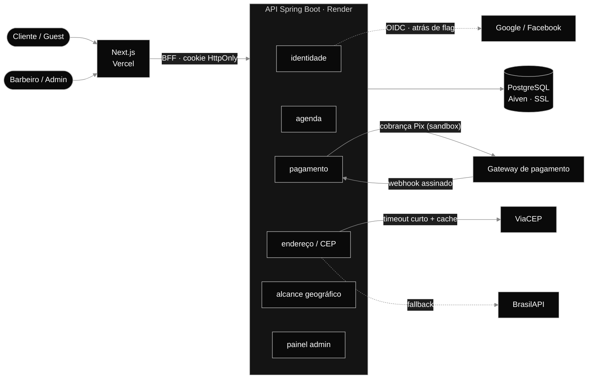
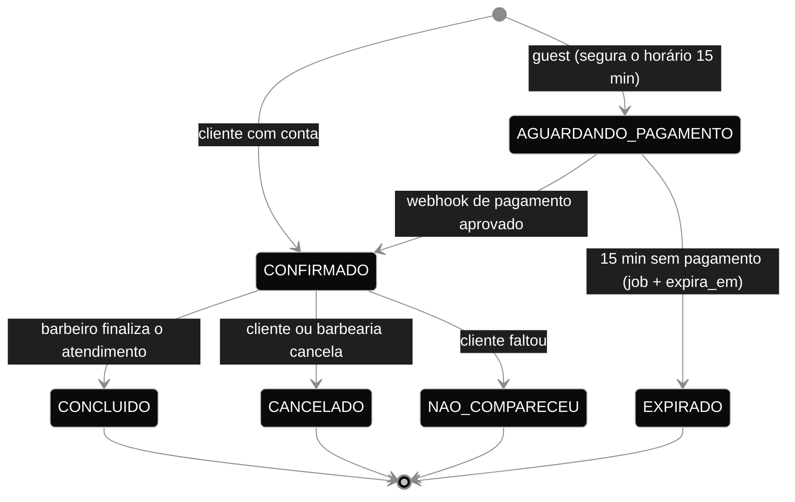
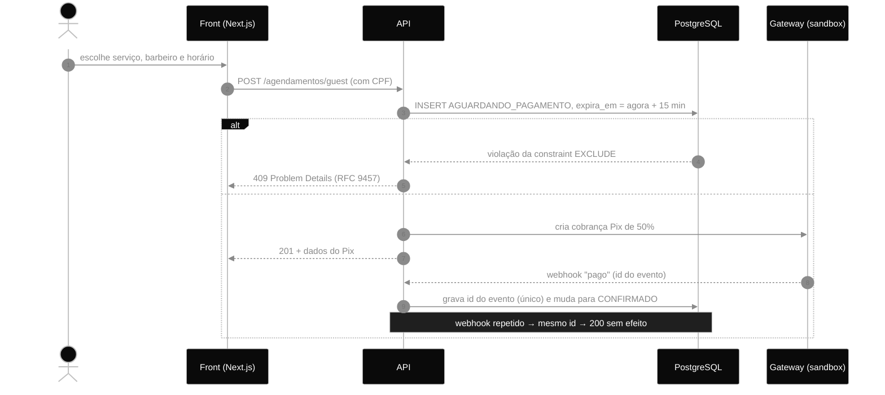
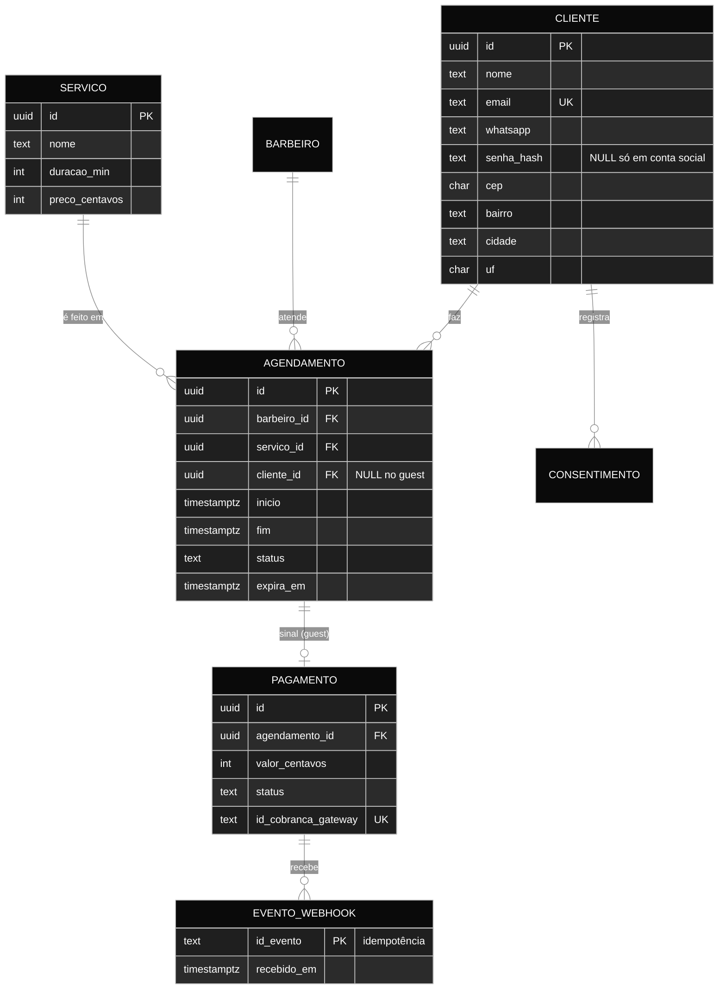

<div align="center">


[](#-roadmap-do-beta)
[](#-roadmap-do-beta)
[](#-usar-como-template)

[](https://openjdk.org/projects/jdk/25/)
[](https://spring.io/projects/spring-boot)
[](https://docs.spring.io/spring-security/reference/)
[](https://www.postgresql.org/)
[](https://testcontainers.com/)
[](https://nextjs.org/)
[](https://www.rfc-editor.org/rfc/rfc9457)
[](https://github.com/k3vinrich4rd/barbearia-altas-horas/commits/main)

[](#-em-30-segundos)
[](#-arquitetura)
[](#-o-agendamento-por-dentro)
[](#-segurança-e-lgpd)
[](#-painel-admin)
[](#-testes-de-ponta-a-ponta)
[](#-roadmap-do-beta)
[](#-usar-como-template)

</div>


> [!IMPORTANT]
> **Projeto em fase de desenho.** Este README descreve o beta **planejado**. Ainda não há código, testes nem deploy: tudo o que aparece abaixo é o plano, e cada item vira realidade numa fatia pequena, testada e revisada. Números (testes, cobertura, desempenho) só entram aqui depois de sair de uma execução real.

## ⚡ Em 30 segundos

| | |
|---|---|
| **Problema** | Na barbearia do bairro, a agenda vive no WhatsApp e no caderno. Horário marcado e não cumprido é cadeira vazia. |
| **Solução** | Agendamento online com disponibilidade em tempo real, **sinal de 50%** para quem marca sem conta e confirmação automática por webhook de pagamento. |
| **Para quem** | Clientes da **Barbearia Altas Horas** (desde 1997), os barbeiros que cuidam da agenda e o **administrador**, que gerencia tudo num painel protegido por senha. |
| **Por que é nível Pleno** | Concorrência resolvida no banco, idempotência de pagamento, degradação graciosa de integração externa, LGPD desde a primeira linha e testes com PostgreSQL real. |
| **Stack** | Java 25 · Spring Boot 4 · Spring Security · JPA · Flyway · PostgreSQL · Testcontainers · Next.js |
| **Deploy planejado** | Vercel (front) · Render (API, Docker) · Aiven (PostgreSQL) — tudo em plano gratuito |

**Três decisões que mostram o raciocínio**
1. **Double booking impossível pelo banco:** constraint `EXCLUDE USING gist` com `tstzrange`. Duas reservas no mesmo horário ao mesmo tempo: o PostgreSQL deixa passar só uma.
2. **Webhook idempotente:** o id do evento do gateway é chave única. O mesmo aviso de pagamento chegando duas vezes não confirma duas vezes.
3. **CEP que não derruba o cadastro:** ViaCEP com fallback BrasilAPI, timeouts curtos e cache. Se as duas caírem, o cliente se cadastra mesmo assim.

## 💈 A barbearia

<details open>
<summary><b>Como funciona para o cliente</b></summary>

<br/>

| Quem | Como agenda | Pagamento | Status inicial |
|---|---|---|---|
| **Cliente com conta** | Escolhe serviço, barbeiro e horário | No balcão | `CONFIRMADO` |
| **Cliente sem conta (guest)** | Informa nome, WhatsApp e e-mail | **Sinal de 50%** online (Pix em sandbox no beta); o CPF é pedido **só aqui**, porque o gateway exige | `AGUARDANDO_PAGAMENTO` por até 15 min |

> [!NOTE]
> O sinal existe para reduzir faltas (*no-show*). As regras de cancelamento, remarcação e devolução do sinal serão definidas com a barbearia antes da implementação.

</details>

## 🛠 Painel admin

Área restrita ao papel `ADMIN`, com login por e-mail e senha, para a barbearia cuidar da operação sem mexer no banco.

| O admin pode | Detalhe |
|---|---|
| Ver a agenda do dia e da semana | por barbeiro, com status de cada horário |
| Gerenciar serviços | nome, duração e preço |
| Gerenciar barbeiros e horários | jornada, folgas e bloqueio de horários |
| Fechar o atendimento | marcar `CONCLUIDO` ou `NAO_COMPARECEU`, cancelar com motivo |
| Acompanhar sinais | pagamentos pendentes, confirmados e expirados |
| Ver o alcance geográfico | só agregados, pós-beta |

> [!IMPORTANT]
> **A senha do admin nunca entra no repositório.** O primeiro admin é criado na inicialização a partir das variáveis de ambiente `ADMIN_EMAIL` e `ADMIN_SENHA`, gravado só como hash (BCrypt ou Argon2). Em `prod` essas variáveis não têm valor padrão: sem elas, a API não cria o admin. O login do admin tem limite de tentativas, e toda ação do painel fica registrada com quem fez e quando.

## 🧱 Arquitetura

**Monólito modular** num monorepo: um deploy só, módulos com fronteiras claras (verificadas por teste de arquitetura) e espaço para extrair um serviço no futuro, se fizer sentido. Linhas tracejadas = planejado para depois do beta.



<details>
<summary><b>Estrutura do monorepo (planejada)</b></summary>

<br/>

```text
barbearia-altas-horas/
├── backend/          # API Java 25 + Spring Boot (monólito modular)
│   └── src/main/java/.../
│       ├── identidade/   # cadastro, login, JWT, refresh, (social atrás de flag)
│       ├── agenda/       # serviços, barbeiros, disponibilidade, agendamentos
│       ├── pagamento/    # cobrança do sinal, webhook idempotente
│       ├── endereco/     # CEP com cache e fallback
│       ├── admin/        # painel: agenda, serviços, barbeiros, sinais
│       └── compartilhado/# erros RFC 9457, segurança, observabilidade
├── frontend/         # Next.js na paleta da barbearia
├── docs/             # contrato da API, ADRs, guias, diagramas
└── compose.yaml      # sobe tudo localmente com 1 comando
```

</details>

## 📅 O agendamento por dentro

<details open>
<summary><b>Máquina de estados</b></summary>

<br/>



</details>

<details>
<summary><b>Fluxo do guest com sinal de 50%</b></summary>

<br/>



</details>

<details>
<summary><b>Modelo de dados resumido (ERD planejado)</b></summary>

<br/>



| Proteção | Como |
|---|---|
| Sem dois clientes no mesmo horário | `EXCLUDE USING gist (barbeiro_id WITH =, tstzrange(inicio, fim) WITH &&)` nos status que ocupam a agenda (extensão `btree_gist`) |
| Painel de alcance rápido | índice composto `(cidade, bairro)` |
| Versionamento do banco | Flyway, `ddl-auto=validate` em produção |
| Dinheiro sem arredondamento | valores em centavos (`int`) |

</details>

<details>
<summary><b>Endpoints planejados (contrato v1.0 em construção)</b></summary>

<br/>

| Método | Rota | O que faz | Acesso |
|---|---|---|---|
| `POST` | `/auth/cadastro` | Cadastro com nome, e-mail, WhatsApp e senha (CEP opcional) | público |
| `POST` | `/auth/login` | Login e emissão de JWT + refresh | público |
| `POST` | `/auth/refresh` | Troca o refresh (rotativo) | cookie |
| `GET` | `/cep/{cep}` | Endereço pelo CEP, com cache | público |
| `GET` | `/servicos` | Serviços, duração e preço | público |
| `GET` | `/disponibilidade` | Horários livres por barbeiro e dia | público |
| `POST` | `/agendamentos` | Agenda como cliente logado | `CLIENTE` |
| `POST` | `/agendamentos/guest` | Agenda sem conta e gera o Pix do sinal | público, com limite |
| `POST` | `/pagamentos/webhook` | Confirmação do gateway (assinada e idempotente) | gateway |
| `GET` / `DELETE` | `/me` | Exportar ou excluir os próprios dados (LGPD) | logado |
| `GET` | `/admin/agenda` | Agenda do dia ou da semana por barbeiro | `ADMIN` |
| `POST` / `PUT` | `/admin/servicos` | Cria ou altera serviço, duração e preço | `ADMIN` |
| `POST` / `PUT` | `/admin/barbeiros` | Cria ou altera barbeiro, jornada e folgas | `ADMIN` |
| `PATCH` | `/admin/agendamentos/{id}/status` | Conclui, marca falta ou cancela | `ADMIN`, `BARBEIRO` |
| `GET` | `/admin/pagamentos` | Sinais pendentes, pagos e expirados | `ADMIN` |
| `GET` | `/barbeiro/alcance` | Agregado por bairro e cidade (pós-beta) | `BARBEIRO`, `ADMIN` |

Todo erro responde `application/problem+json` no padrão **RFC 9457**.

</details>

## 🔐 Segurança e LGPD

| Tema | Decisão planejada |
|---|---|
| Sessão | JWT de acesso curto + refresh rotativo guardado com hash, em cookie `HttpOnly` via BFF no Next.js |
| Acesso a recurso alheio | busca já filtrada pelo dono; responde **404** em vez de confirmar que o id existe |
| Login social | Google e Facebook prontos, mas **desligados por flag** no beta; vínculo de conta só com `email_verified` e prova de posse da conta local |
| CPF | pedido só no pagamento do guest, guardado criptografado, mascarado na tela e **nunca em log** |
| CEP e marketing | finalidade separada: marketing só com consentimento opcional; painel mostra só agregados e esconde grupos com menos de 5 pessoas |
| Admin | login por senha com papel `ADMIN`; senha inicial só por variável de ambiente (`ADMIN_EMAIL`, `ADMIN_SENHA`), guardada como hash; ações do painel auditadas |
| Abuso | limite de tentativas no login (inclusive do admin), no cadastro e na reserva guest |
| CORS | só as origens da Vercel vindas de variável de ambiente, sem `*` |

## 🧭 Decisões técnicas

| # | Decisão | Por quê |
|---|---|---|
| 1 | Monólito modular | um time pequeno, um deploy, fronteiras testadas; extrair serviço só com motivo real |
| 2 | Anti double booking no banco | lock em memória não protege duas instâncias; a constraint vale sempre |
| 3 | Expiração por `expira_em` + job com ShedLock | o horário volta mesmo se o job atrasar, e o job não roda duplicado |
| 4 | Idempotência pelo id do evento do gateway | o gateway reenvia avisos; repetir não pode confirmar duas vezes |
| 5 | Gateway com sandbox gratuito | beta de portfólio sem custo; escolha final registrada em ADR |
| 6 | CEP com cache e degradação graciosa | API externa fora do ar não pode impedir o cadastro |
| 7 | Erros RFC 9457 | padrão atual (substituiu a RFC 7807), igual para o front e para quem integra |
| 8 | Testcontainers com PostgreSQL real | a constraint `EXCLUDE` e o `tstzrange` não existem no H2 |

Os ADRs completos ficarão em `docs/adr/`.

## 🧪 Testes de ponta a ponta

O roteiro passo a passo fica em **[`docs/guia-testes-e2e.md`](docs/guia-testes-e2e.md) (planejado)**: como rodar o projeto e o que testar no backend, no frontend e nos dois juntos, com o resultado esperado de cada passo.

| Camada | Como será testada |
|---|---|
| Backend | unitários (JUnit 5 + Mockito), integração com PostgreSQL real (Testcontainers), segurança 401/403/404 e roteiro de chamadas `curl` |
| Frontend | testes de componentes e roteiro manual das telas do cliente, do guest e do admin |
| Juntos | jornada completa no navegador contra a API local: cadastro, agendamento, guest com Pix de sandbox, webhook e painel admin |

> [!NOTE]
> O guia descreve o comportamento **esperado**. As respostas reais e os números de testes entram conforme cada fatia ficar pronta.

## 🚧 Roadmap do beta

Tudo abaixo está **planejado**. Cada item vira uma fatia pequena, com testes e revisão, na branch `develop`.

- [ ] Contrato da API v1.0, ADRs e modelo de domínio
- [ ] Esqueleto: monorepo, `compose.yaml`, perfis `dev`/`test`/`prod`, CI (build, testes, CodeQL, gitleaks)
- [ ] Agenda: serviços, barbeiros, disponibilidade e agendamento do cliente logado
- [ ] Anti double booking com teste de concorrência
- [ ] Autenticação: cadastro, login, JWT e refresh rotativo
- [ ] Guest com sinal de 50% e CPF sob demanda (gateway em sandbox)
- [ ] Webhook idempotente e expiração automática dos 15 minutos
- [ ] CEP com cache, fallback e degradação graciosa
- [ ] LGPD: consentimento de marketing, exportar e excluir dados, nada pessoal em log
- [ ] Painel admin: login por senha (`ROLE_ADMIN`), agenda, serviços, barbeiros e sinais
- [ ] Guia de testes de ponta a ponta (backend, frontend e juntos) validado a cada fatia
- [ ] Front Next.js na identidade da barbearia
- [ ] Deploy: Vercel + Render + Aiven
- [ ] Pós-beta: login social (ligar a flag), painel de alcance geográfico, lembrete por WhatsApp

## 🚀 Rodar o projeto

> [!NOTE]
> Ainda não há código para rodar. Quando o esqueleto entrar, esta seção terá o `docker compose up` testado do zero, os endereços do Swagger e do front e uma coleção de requisições. O passo a passo completo fica em [`docs/guia-testes-e2e.md`](docs/guia-testes-e2e.md) (planejado).

## 📦 Usar como template

O repositório é pensado para servir de base a outros projetos. Quando o beta estiver pronto:

1. Clique em **Use this template** no GitHub (ou clone o repositório).
2. Renomeie o pacote base e o `artifactId` no `pom.xml`.
3. Troque o domínio de agenda pelo seu e mantenha o que é transversal: `compartilhado/` (erros RFC 9457, segurança, observabilidade), perfis, `compose.yaml`, CI e a estrutura de `docs/`.
4. Ajuste a paleta do front e as variáveis de ambiente (listadas em `docs/`).

<details>
<summary><b>O que vem pronto no template (planejado)</b></summary>

<br/>

- Erros RFC 9457 com `code` estável e validação de campos
- Autenticação JWT + refresh rotativo, login social atrás de flag e admin criado por variável de ambiente
- Guia de testes de ponta a ponta reaproveitável
- Testes com Testcontainers e regras de arquitetura (ArchUnit)
- Perfis `dev`, `test` e `prod` com variáveis obrigatórias sem valor padrão
- Dockerfile multi-estágio para o Render e `compose.yaml` local
- CI com build, testes, CodeQL e varredura de segredos

</details>

## 🤖 Como o projeto é feito

| Quem | Papel |
|---|---|
| **Kevin Richard** | Dono do produto e do código: decide as regras com a barbearia, revisa e aprova cada entrega |
| **Claude Code** | Arquitetura, contrato e código das regras mais difíceis |
| **Gemini** | Pesquisa com fonte e data e revisão crítica da arquitetura |
| **GitHub Copilot** | Apoio no IntelliJ em código repetitivo e testes de cenário |
| **Grok** | Orquestração: divide o trabalho, roda os testes e prepara as entregas |


## 🖤 Homenagem

<div align="center">


**Para o meu pai**, que mantém a cadeira da **Barbearia Altas Horas** girando desde **1997**.
Este projeto é a minha forma de levar para o código o cuidado que ele coloca em cada corte.

**★ 19 ✂ 97 ★**

</div>

## 👤 Autor

**Kevin Richard** · [GitHub @k3vinrich4rd](https://github.com/k3vinrich4rd)

<sub>Logo e identidade visual pertencem à Barbearia Altas Horas.</sub>
