<div align="center">


[](https://barbearia-altas-horas.vercel.app)
[](#-status-das-fatias)
[](https://github.com/k3vinrich4rd/barbearia-altas-horas/actions/workflows/backend-ci.yml)
[](https://github.com/k3vinrich4rd/barbearia-altas-horas/actions/workflows/frontend-ci.yml)
[](https://openjdk.org/projects/jdk/25/)
[](https://spring.io/projects/spring-boot)
[](docs/adr/0003-anti-double-booking-no-banco.md)
[](https://nextjs.org/)
[](https://github.com/k3vinrich4rd/barbearia-altas-horas/actions/runs/44760774211)
[](docs/contrato/openapi.yaml)

<h2>A agenda online da Barbearia Altas Horas, de Osasco: o cliente escolhe o horário, paga na hora e a vaga fica garantida.</h2>

<h2><a href="https://barbearia-altas-horas.vercel.app">🌐 barbearia-altas-horas.vercel.app</a></h2>

<sub>Beta no ar, com pagamento simulado · <a href="https://altas-horas-api.onrender.com/actuator/health">🩺 API</a> · <a href="docs/contrato/openapi.yaml">📑 Contrato</a> · <a href="docs/guia-testes.md">🧪 Testar à mão</a> · <a href="#-rodar-e-testar">🚀 Rodar agora</a></sub>

</div>

<details>
<summary><b>🗂 Índice</b> (clique para abrir)</summary>

<br/>

| Quero... | Vá para |
|---|---|
| entender em 30 segundos | [⚡ Em 30 segundos](#-em-30-segundos) · [🗓 As 3 formas de agendar](#-as-3-formas-de-agendar) · [👥 Quem faz o quê](#-quem-faz-o-quê) |
| ver o produto | [📖 A história](#-a-história) · [🎬 O site no ar](#-o-site-no-ar-beta) · [🏆 Trajetória e prêmios](#-trajetória-e-prêmios) · [💈 A barbearia](#-a-barbearia) |
| saber por que a agenda ajuda | [✂ O que a agenda resolve](#-o-que-a-agenda-resolve) · [💳 Pagamento antecipado](#-pagamento-100-antecipado) · [🔐 Segurança e LGPD](#-segurança-e-lgpd) · [🛠 Painel admin](#-painel-admin) |
| ver como é por dentro | [🧱 Arquitetura](#-arquitetura) · [🧭 Decisões (ADRs)](#-decisões-de-arquitetura-adrs) · [🤖 Como foi feito com IA](#-como-foi-desenvolvido-com-ia) |
| rodar e acompanhar | [🧪 Rodar e testar](#-rodar-e-testar) · [🚀 Deploy](#-deploy-grátis-fatia-8) · [📊 Status das fatias](#-status-das-fatias) · [📚 Documentação](#-documentação) |

</details>


## ⚡ Em 30 segundos

Uma barbearia de bairro que atende por caderno e WhatsApp ganhou uma **agenda online com pagamento antecipado**. Quem marca vê só horários realmente livres, paga em até 3 minutos e, se não pagar, a vaga volta para a agenda. O barbeiro abre o painel e o dia já está organizado.

| 🌐 No ar | 💳 Pagamento | ⏱ Prazo | 🔒 Conflito de horário | 🧪 Testes |
|:-:|:-:|:-:|:-:|:-:|
| [beta na Vercel](https://barbearia-altas-horas.vercel.app) | 100% antecipado, Pix ou cartão (simulado no beta) | 3 min para pagar | impossível, garantido pelo banco | **588** no backend, 0 falhas |

<sub>Os 588 testes vêm do [guia de testes](docs/guia-testes.md#5e-senha-voz-da-barbearia-agenda-nova-e-fluidez-fatia-14b-14c-e-14d-) (rodada final de 24/11/2026, `./mvnw verify` com PostgreSQL real, depois da Fatia 14). Nenhum número desta página é estimativa.</sub>

## 🗓 As 3 formas de agendar

| | Quem | Como marca | O que acontece |
|:-:|---|---|---|
| 👤 | **1. Com cadastro** | faz login e escolhe o serviço e o horário | paga 100% antes; o horário aparece em **Meus agendamentos** |
| 🙋 | **2. Sem cadastro** (visitante) | informa nome, e-mail e WhatsApp | paga 100% antes; recebe o código da reserva e não precisa de senha |
| 💬 | **3. Pelo WhatsApp do barbeiro** | combina a conversa com o barbeiro, fora do app | o barbeiro registra no painel com a **reserva manual**: nasce confirmada, sem cobrança, e o horário sai da agenda |

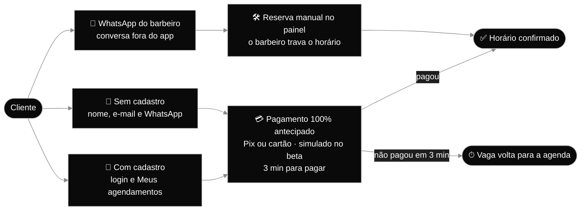

## 👥 Quem faz o quê

| Quem | O que faz | Situação |
|---|---|---|
| 🙋 **Visitante** | vê serviços e horários, agenda e paga sem criar conta | ✅ no ar |
| 👤 **Cliente** | cadastro, login, histórico, exportar e excluir os próprios dados (LGPD) | ✅ no ar |
| 👑 **Dono/Admin** (o Eduardo) | agenda, fecha atendimentos, cadastra serviços e preços, jornada e folgas, vê pagamentos, auditoria e o alcance por região | ✅ no ar |
| ✂️ **Barbeiro convidado** | entra por **convite de uso único** criado pelo dono, vê só a própria agenda e trava horários combinados pelo WhatsApp | 📝 em especificação ([ADR 0013](docs/adr/0013-varios-barbeiros-dono-e-convite.md)) |
| 🗺 **Alcance por nível** | quando um bairro tem menos de 5 clientes, ele sobe para o nível de cima (bairro, cidade, região, UF) em vez de sumir, com consentimento para a região do CEP | 📝 em especificação ([ADR 0014](docs/adr/0014-alcance-k-anonimato-e-consentimento-do-cep.md)) |

<sub>Hoje existe uma só pessoa na cadeira: o Eduardo, com os papéis `ADMIN` e `BARBEIRO`. O convite de barbeiro ainda não tem código; a decisão já está aceita no ADR.</sub>

## 📖 A história

### Quase três décadas de tradição, agora com agenda inteligente


O caminho do **Carlos Eduardo Candido** (o Eduardo), meu pai, na barbearia começou em **1994**, com o primeiro mestre. Três anos depois, em **1997**, ele abriu a **Barbearia Altas Horas** no Jardim Bonança, em Osasco, e desde então comanda a cadeira: quase 30 anos atendendo de terça a sábado, das 7h às 20h, do corte social clássico ao degradê navalhado. Em 2017, esse trabalho foi reconhecido duas vezes, com o **Prêmio Barbeiros do Brasil**, que ele fez questão de trazer para Osasco, e o **Prêmio Master Barber · Êxito Profissional**. Instrutor formado pela Ibel Formação, hoje ele também ensina na **Altas Horas Barbearia Academy**, preparando a próxima geração de barbeiros.

Com o dia dividido entre os clientes e os alunos, a agenda sempre ficou no caderno e no WhatsApp. É aí que aparece um problema clássico da barbearia de bairro: o cliente marca, não aparece, e aquele horário não volta mais. Para quem atende sozinho, cadeira vazia é tempo perdido e dinheiro que deixa de entrar.

**Como desenvolvedor, criei esta agenda para resolver exatamente essa dor:**

- 💳 **Reserva com pagamento antecipado:** o cliente escolhe o serviço e o horário e paga na hora, por Pix ou cartão.
- 🔒 **Vaga garantida, sem conflito:** o horário só entra na agenda depois que o pagamento é confirmado, e dois clientes nunca ficam com o mesmo horário.
- ⏱️ **Liberação automática:** quem não conclui o pagamento em 3 minutos devolve a vaga para o próximo.

No fim, o Eduardo começa a manhã com um painel limpo e o dia já organizado, cada atendimento confirmado. Sobra tempo para o que importa: a cadeira e os alunos.

> [!NOTE]
> **Onde o projeto está:** a API já mostra os horários livres de verdade (descontando almoço, folgas e reservas), impede dois clientes no mesmo horário e tem cadastro, login e um administrador que nasce sem senha no repositório. Também já tem reserva com pagamento simulado, expiração, consulta de CEP e o painel do barbeiro. Também tem privacidade (LGPD): consentimento, exportar e excluir a conta e retenção automática, e o alcance por região (de onde vêm os atendimentos, com agrupamento mínimo de 5). São **387 testes** no backend em PostgreSQL real, 0 falhas ([CI da `develop`](https://github.com/k3vinrich4rd/barbearia-altas-horas/actions/runs/44760774211), merge da PR #68, 20/11/2026). As telas (Fatias 7A e 7B) e o deploy (Fatia 8) já estão no ar em beta: [site](https://barbearia-altas-horas.vercel.app) e [API](https://altas-horas-api.onrender.com/actuator/health). No beta o pagamento é simulado. A Fatia 7C (painel no canvas) está em andamento.

<br clear="right"/>

## 🎬 O site no ar (beta)

Prints reais de [barbearia-altas-horas.vercel.app](https://barbearia-altas-horas.vercel.app), tirados com Playwright em 20/11/2026. O tema segue o do seu GitHub: escuro por padrão, claro com a marca invertida.

<div align="center">
<a href="https://barbearia-altas-horas.vercel.app">
<picture>
  <source media="(prefers-color-scheme: light)" srcset="docs/midia/prints/site-home-claro.png"/>
  
</picture>
</a>
</div>

| A história desde 1997 | Como funciona | No celular | Dúvidas |
|:-:|:-:|:-:|:-:|
|  | 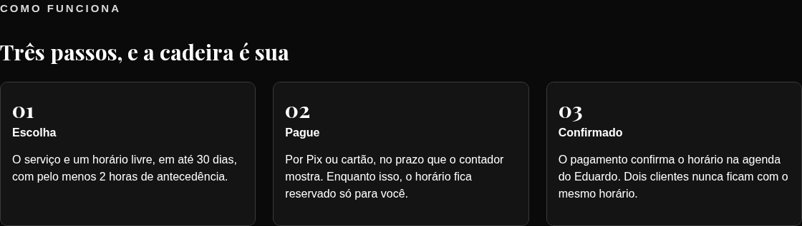 | 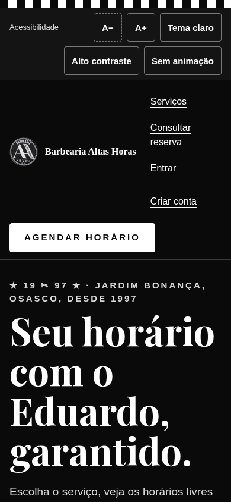 | 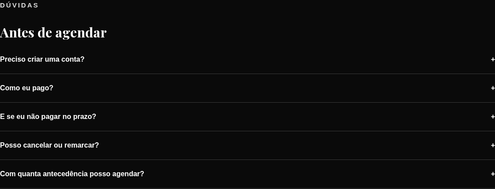 |

As três formas de marcar estão no [diagrama do topo](#-as-3-formas-de-agendar). O fluxo de quem não tem conta, passo a passo:

<details>
<summary><b>🖼 O fluxo de reserva sem cadastro, tela a tela</b> (perfil <code>dev</code> local, dados fictícios)</summary>

<br/>

O catálogo do beta publicado ainda está vazio, então estes prints são do mesmo front rodando na máquina, contra a API no perfil `dev` (serviços e barbeiros de exemplo, cliente e CPF de teste, pagamento simulado).

| 1. Escolher o horário | 2. Seus dados | 3. Pagar em 3 min |
|:-:|:-:|:-:|
| 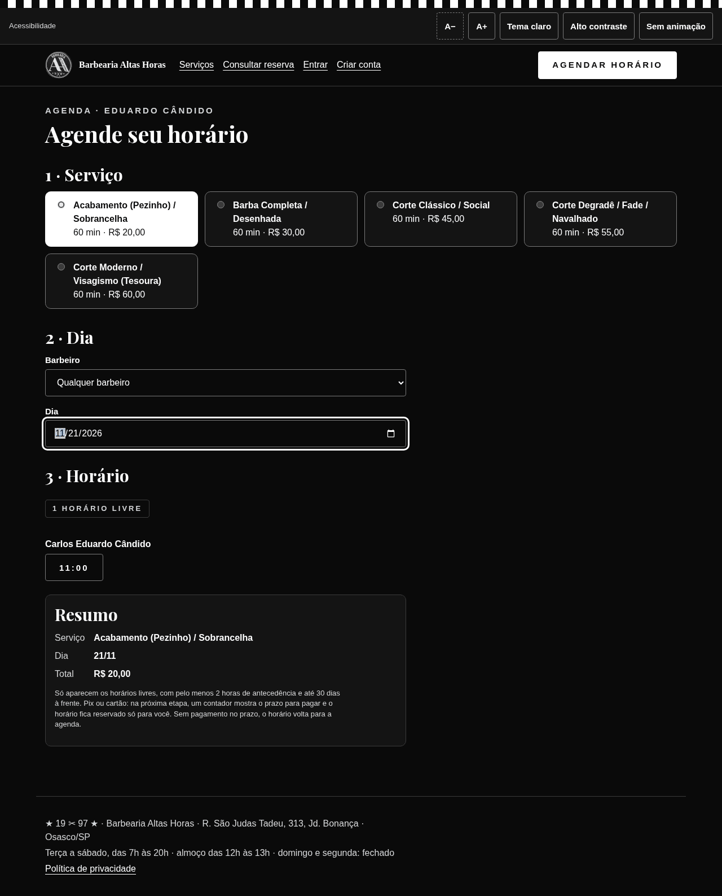 |  |  |

| 4. Pix (simulado) | 5. Horário confirmado |
|:-:|:-:|
| 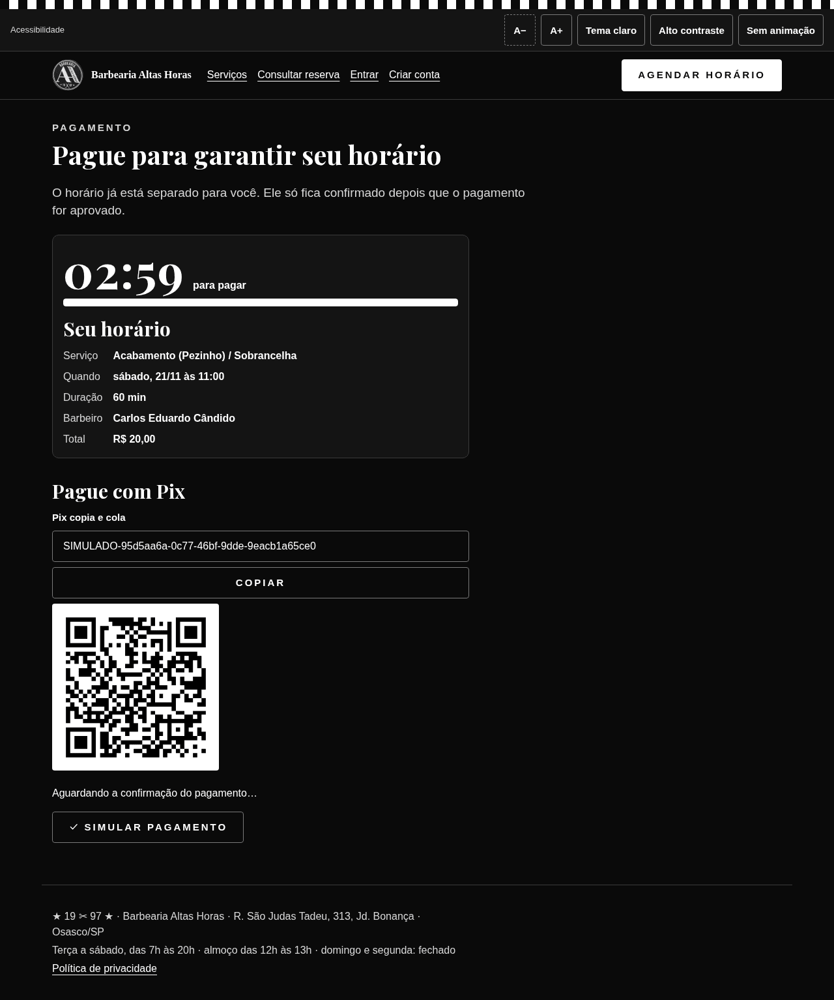 | 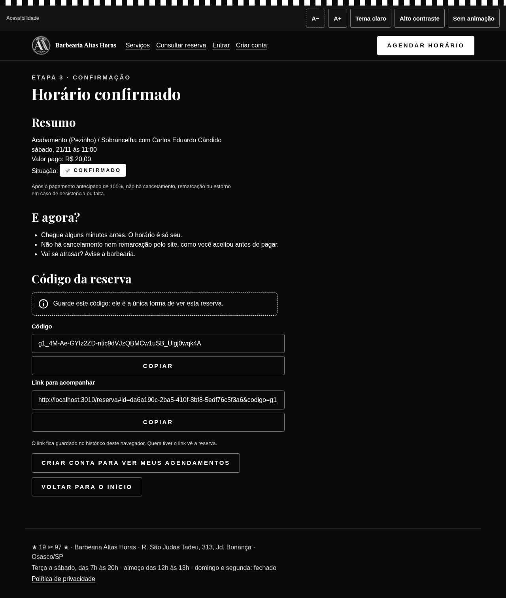 |

</details>

## 🧭 O que tem para quem visita o projeto

- ▶️ **O que já funciona e dá para testar:** catálogo, horários livres, reserva (com e sem conta), pagamento simulado, expiração, conta e sessão, CEP com degradação (6A) e o painel completo. Como rodar e testar à mão, com a saída real de cada passo: **[guia de testes](docs/guia-testes.md)**.
- 🗺 **Alcance por região (6C):** a vitrine pública `GET /alcance` mostra, sem login e sem números, as cidades e os bairros que a barbearia atende (últimos 12 meses); o painel `GET /admin/alcance` dá a contagem e o percentual ao Eduardo. Nenhum grupo com menos de 5 atendimentos aparece com nome. Como testar: [AL1 no guia](docs/guia-testes.md#al1--alcance-por-região-fatia-6c).
- 💬 **WhatsApp e reserva manual (6D):** o site mostra o WhatsApp comercial de cada barbeiro (cadastrado só pelo admin), e o painel trava um horário combinado por fora do app (`POST /admin/agendamentos`: nasce confirmado, sem cobrança, sem WhatsApp do cliente). O prazo de pagamento passou a ser de **3 minutos**.
- 🛤 **Fluxo de ponta a ponta:** visitante, cliente e painel, com rotas, classes e diagramas: **[docs/fluxo-ponta-a-ponta.md](docs/fluxo-ponta-a-ponta.md)**.
- 🧩 **Padrões usados**, cada um com a classe real:

| Padrão | Onde está | Por quê |
|---|---|---|
| Monólito modular | Spring Modulith, verificado por `ModulithTest` | um deploy, fronteiras testadas ([ADR 0001](docs/adr/0001-monolito-modular-com-spring-modulith.md)) |
| Ports & adapters e Strategy | `GatewayDePagamento` → `GatewaySimulado` e `AsaasGateway` (escolhidos por `app.pagamento.modo`) | trocar o gateway sem tocar na regra |
| Fallback | `ProvedorDeCep`: `ViaCepCliente` → `BrasilApiCliente` → degradação | o cadastro segue se os provedores caírem ([ADR 0008](docs/adr/0008-cep-com-cache-e-degradacao.md)) |
| Cache-aside | Caffeine em `CepConfig` (`CaffeineCache` + `SimpleCacheManager`, sem `@Cacheable`) | menos chamadas a API externa, com prazo para achado e para inexistente |
| Máquina de estados | `StatusReserva.podeIrPara` e `TransicoesDeCobranca` | transição fora do mapa não existe |
| Eventos de domínio e outbox | `ReservaExpirada`, `ReservaCancelada`; tabela `event_publication` | o evento nasce na mesma transação e não se perde |
| Facade de módulo | `CepApi`, `PainelDaAgenda`, `conta.Contas` | o outro módulo só enxerga a API pública |
| Repository, Factory Method, Value Object | `ReservaRepository`; `Reserva.nova`; `Cep`, `Cpf`, `Horario` | regra e validação num lugar só |
| Lock otimista e pessimista | `@Version` em `Reserva`, `Cobranca` e outras; `FOR UPDATE`/`FOR SHARE` em `ReservarHorario` e `CadastrosDoPainel` | duas telas ou reserva e folga ao mesmo tempo |
| Idempotência com HMAC | `CriarCobranca` (`X-Idempotency-Key` + hash HMAC-SHA256 do corpo) | repetir o pedido não cobra duas vezes |

- 🤖 **Desenvolvido com IA:** SDD, agentes, RAG da documentação e recuperação por identificador, tudo em [Como foi desenvolvido com IA](#-como-foi-desenvolvido-com-ia).
- 🗺 **Status das fatias:** 1 a 7B, 6D e 8 **no ar em beta** (pagamento simulado); 8B aprovada e em implementação; convite do barbeiro (Fatia 10) implementado na branch `feat/fatia-10-convite-do-barbeiro`, aguardando a PR e o desenho das telas novas; alcance por nível em especificação; notificação ao barbeiro (Fatia 13) implementada na branch `feat/fatia-13-notificacao-ao-barbeiro`; 9 (assistente) pós-beta. Tabela completa em [Status das fatias](#-status-das-fatias).

## 🏆 Trajetória e prêmios

<table>
<tr>
<td align="center" width="50%">

<br/><b>Prêmio Barbeiros do Brasil</b><br/><sub>2017 · trazido para Osasco</sub>
</td>
<td align="center" width="50%">

<br/><b>Prêmio Master Barber · Êxito Profissional</b><br/><sub>2017</sub>
</td>
</tr>
</table>


<div align="center">
<sub><i>"Amor na ponta da tesoura!"</i> · Eduardo Candido, ao receber o Prêmio Barbeiros do Brasil</sub>
</div>

## 💈 A barbearia

📍 R. São Judas Tadeu, 313 · Jd. Bonança · Osasco/SP &nbsp;·&nbsp; 🕖 terça a sábado, 07h às 20h (almoço 12h às 13h) &nbsp;·&nbsp; 📸 [@altashorascabeleireiros](https://www.instagram.com/altashorascabeleireiros/) · [@eduardo_candido_barber](https://www.instagram.com/eduardo_candido_barber/)

Um barbeiro só, que faz todos os serviços. É para esse ritmo que a agenda foi pensada:

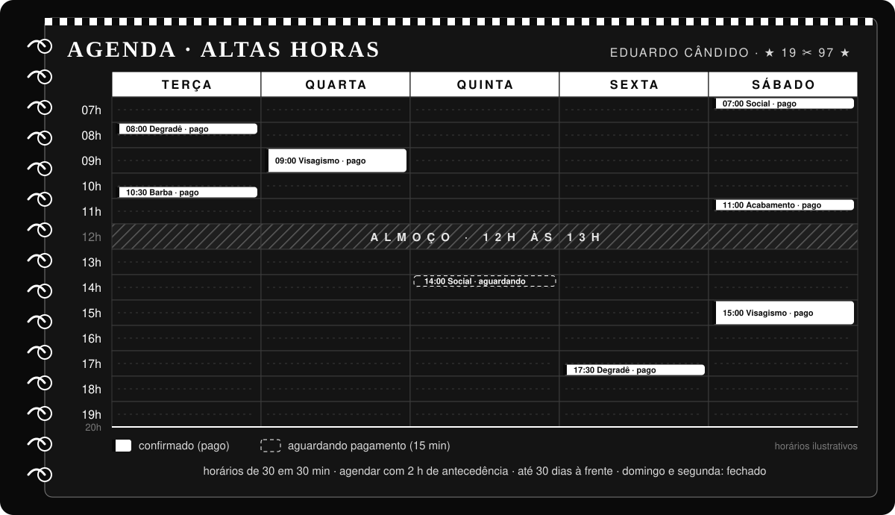

<sub>Os horários marcados na imagem são ilustrativos: mostram como o dia aparece para o Eduardo, com o que está pago e o que ainda aguarda pagamento.</sub>

<details>
<summary><b>📖 Abrir a página de um dia</b> (resposta real da API para uma terça livre)</summary>

<br/>

`GET /disponibilidade` do **Corte Degradê** (60 min, como todos os serviços): **22 horários**.

| Manhã | | | | | Tarde | | | | | |
|:-:|:-:|:-:|:-:|:-:|:-:|:-:|:-:|:-:|:-:|:-:|
| 07:00 | 07:30 | 08:00 | 08:30 | 09:00 | 13:00 | 13:30 | 14:00 | 14:30 | 15:00 | 15:30 |
| 09:30 | 10:00 | 10:30 | 11:00 | | 16:00 | 16:30 | 17:00 | 17:30 | 18:00 | 18:30 |
| | | | | | 19:00 | | | | | |

Com todos os serviços em 60 min, somem o 11:30 (invadiria o almoço) e o 19:30 (passaria das 20h): sobram os mesmos **22** para qualquer serviço do catálogo. Horário reservado, mesmo ainda aguardando pagamento, sai da lista; se o prazo de 15 min vence, ele volta sozinho.

```bash
curl "http://localhost:8080/disponibilidade?servicoId=6f1c2a8e-0000-4000-8000-000000000002&data=2026-12-01"
```

</details>

### Quadro de serviços

<table>
<tr><th align="left">Serviço</th><th>Tempo</th><th align="right">Valor</th></tr>
<tr><td>✂️ Corte Clássico / Social</td><td align="center">60 min</td><td align="right"><kbd>R$ 45,00</kbd></td></tr>
<tr><td>✂️ Corte Degradê / Fade / Navalhado</td><td align="center">60 min</td><td align="right"><kbd>R$ 55,00</kbd></td></tr>
<tr><td>✂️ Corte Moderno / Visagismo (tesoura)</td><td align="center">60 min</td><td align="right"><kbd>R$ 60,00</kbd></td></tr>
<tr><td>🪒 Barba Completa / Desenhada</td><td align="center">60 min</td><td align="right"><kbd>R$ 30,00</kbd></td></tr>
<tr><td>🪒 Acabamento (pezinho) / Sobrancelha</td><td align="center">60 min</td><td align="right"><kbd>R$ 20,00</kbd></td></tr>
<tr><td>✂️ Descoloração / Platinado (química)</td><td align="center">60 min</td><td align="right"><kbd>R$ 80,00</kbd></td></tr>
</table>

<sub>Sem combos. Preços, horários e regras são dados que o Eduardo muda no painel, sem mexer no código.</sub>

### Da cadeira

> **Fatia 12 (site mais fluido):** no site a galeria agora é uma grade de **18 fotos** (as 3 abaixo e 15 novas dos Instagrams do Eduardo e da barbearia, com autorização de imagem confirmada, D158), com a foto inteira ao tocar. A home segue a ordem em que o cliente decide (serviços, barbeiro, galeria, **Trajetória**), tem barra fixa "Agendar horário" no celular e o `/agendar` virou serviço → horário em chips → "Continuar". Detalhes: [spec](docs/sdd/fatia-12-site-fluido.md).

<table>
<tr>
<td align="center" width="33%"><br/><sub>O Eduardo em atendimento</sub></td>
<td align="center" width="33%"><br/><sub>A parede xadrez do logo</sub></td>
<td align="center" width="33%"><br/><sub>Degradê com desenho na navalha</sub></td>
</tr>
</table>

<details>
<summary><b>🚪 A fachada</b></summary>

<br/>
<div align="center">
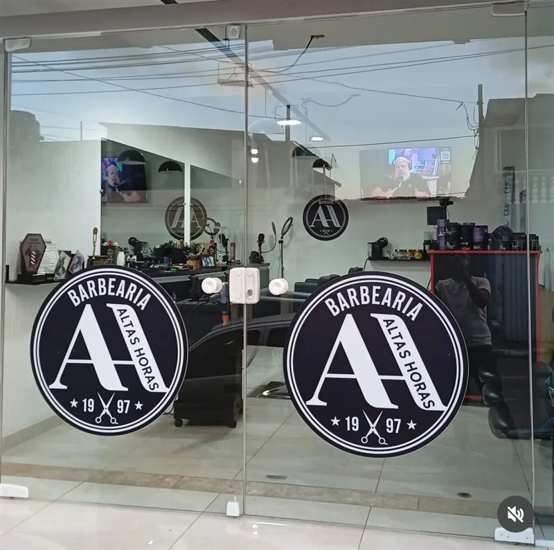
</div>

</details>

<sub>Preto e branco, como o logo e a parede xadrez do salão. Fotos do acervo da barbearia e do Instagram do Eduardo.</sub>

## ✂ O que a agenda resolve

Na prática, a diferença aparece no dia do Eduardo:

| No caderno e no WhatsApp | Na agenda online |
|---|---|
| o cliente manda mensagem e espera o fim de um corte para ter resposta | vê os horários livres na hora, a qualquer hora |
| dois clientes no mesmo horário: quem respondeu primeiro leva | só um consegue, mesmo clicando no mesmo instante |
| o cliente desiste e nem sempre avisa | o horário só é dele depois de pagar; sem pagar em 3 min, a vaga volta |
| a falta vira cadeira vazia e prejuízo | o valor já foi pago antes do corte |
| a agenda de amanhã está espalhada entre caderno e conversas | o Eduardo abre o painel e o dia está pronto |

Por trás de cada linha dessa tabela há uma decisão de engenharia. Abra para ver como cada regra é garantida:

<details>
<summary><b>Dois clientes nunca ficam com o mesmo horário</b></summary>

<br/>

Quem garante é o banco, não um `if` no código: uma constraint `EXCLUDE USING gist` com `tstzrange '[)'` no PostgreSQL. Com duas requisições no mesmo milissegundo, ou duas instâncias da API no ar, o banco deixa passar só uma. O teste coloca 12 conexões disputando o mesmo horário e confere que exatamente uma vence. [ADR 0003](docs/adr/0003-anti-double-booking-no-banco.md)

</details>

<details>
<summary><b>O horário só é confirmado com o dinheiro na conta</b></summary>

<br/>

A reserva nasce `AGUARDANDO_PAGAMENTO` e só vira `CONFIRMADO` quando o meio de pagamento avisa. Esse aviso pode chegar repetido, então o id do evento é chave única: o mesmo aviso duas vezes não confirma duas vezes. E a API não confia só no corpo do aviso: consulta a cobrança antes de confirmar. [ADR 0007](docs/adr/0007-gateway-de-pagamento-sandbox.md)

</details>

<details>
<summary><b>Quem não paga em 3 minutos libera a vaga</b></summary>

<br/>

A reserva guarda o prazo. Passou dele, o horário volta a aparecer como livre na mesma hora, sem esperar nenhuma rotina de limpeza rodar: a consulta de horários já ignora reserva vencida. Importa porque a hospedagem gratuita hiberna, e uma rotina agendada atrasaria.

</details>

<details>
<summary><b>O número do cartão nunca passa pela API</b></summary>

<br/>

O pagamento com cartão acontece na página do próprio meio de pagamento. A API só recebe o resultado, o que tira o projeto do escopo pesado do PCI DSS. O CPF, exigido para gerar a cobrança, é validado, repassado e não fica guardado. [ADR 0009](docs/adr/0009-lgpd-marketing-cpf-e-retencao.md)

</details>

<details>
<summary><b>Preço, horário e regra mudam sem mexer no código</b></summary>

<br/>

Serviços, preços, jornada, almoço e prazo de pagamento são dados no banco (a antecedência mínima e o limite de dias à frente deixaram de existir em 24/11/2026: a agenda só recusa o horário que já passou). O Eduardo muda o horário de almoço no painel e a agenda acompanha, sem depender de uma nova versão do sistema.

</details>

<details>
<summary><b>A senha do administrador nunca passa pelo repositório</b></summary>

<br/>

O primeiro acesso do Eduardo nasce de variáveis de ambiente na hora em que a API sobe, e a senha inicial precisa ser trocada antes de o painel abrir. Sessões se renovam sem pedir senha, e um token de renovação usado duas vezes derruba a sessão inteira: sinal de que alguém copiou. [spec da Fatia 3](docs/sdd/fatia-3-conta-e-acesso.md)

</details>

**Em uma linha, para quem avalia código:** concorrência resolvida no banco, pagamento idempotente, máquina de estados explícita, erros em RFC 9457, LGPD desde a primeira linha e testes com PostgreSQL real, tudo especificado antes de ser escrito ([Spec-Driven Development](#-como-foi-desenvolvido-com-ia)). Stack: Java 25 · Spring Boot 4 · Spring Security · JPA · Flyway · PostgreSQL · Testcontainers · Next.js; deploy planejado em Vercel, Render e Aiven.

## 💳 Pagamento 100% antecipado

| Regra | Como o sistema garante |
|---|---|
| **Todo** agendamento (com conta ou sem conta) paga 100% antes | a reserva nasce `AGUARDANDO_PAGAMENTO` e só vira `CONFIRMADO` pelo webhook do gateway |
| Pix ou cartão de crédito | Pix devolve QR Code e copia e cola; cartão abre o checkout hospedado do gateway (no beta, com o gateway simulado, abre a tela `/pagamento-simulado/{cobrancaId}` do próprio site, que não pede número de cartão) |
| O horário fica travado por **3 min** enquanto o cliente paga | a constraint do banco conta a reserva pendente como ocupada até `expira_em` |
| Não pagou em 3 min | a reserva vira `EXPIRADO` e o horário volta para a agenda |
| **Sem cancelamento, remarcação ou estorno** por desistência ou falta | não há botão nem rota para o cliente cancelar; antes de pagar, ele marca o aceite obrigatório (`aceitePolitica: true`, com a versão do texto gravada) |
| Falta (*no-show*) | o barbeiro marca `NAO_COMPARECEU` no painel; o valor fica com a barbearia |
| Pagamento que chega depois dos 3 min | com o horário ainda livre, confirma normalmente; com o horário já ocupado, vira pendência no painel do admin |

> [!NOTE]
> O CPF é pedido **só** na tela de pagamento, porque o gateway exige. Ele é validado, repassado ao gateway e **não é guardado** no banco.

### Checkout por dentro


### Ciclo de vida do agendamento


<sub>Qualquer transição fora do diagrama responde `422 TRANSICAO_INVALIDA`. Tabela completa em [`docs/dominio/modelo-de-dominio.md`](docs/dominio/modelo-de-dominio.md#2-máquina-de-estados).</sub>

## 🧱 Arquitetura

**Monólito modular** (Spring Modulith): um deploy só, oito módulos com fronteiras verificadas por teste (ArchUnit + `ApplicationModules.verify()`), conversando por API pública e eventos com *outbox*. Detalhes em [`docs/arquitetura/`](docs/arquitetura/README.md).

<details>
<summary><b>🧱 Abrir a arquitetura</b> (visão geral, módulos, deploy e estrutura do monorepo)</summary>

<br/>

### Visão geral

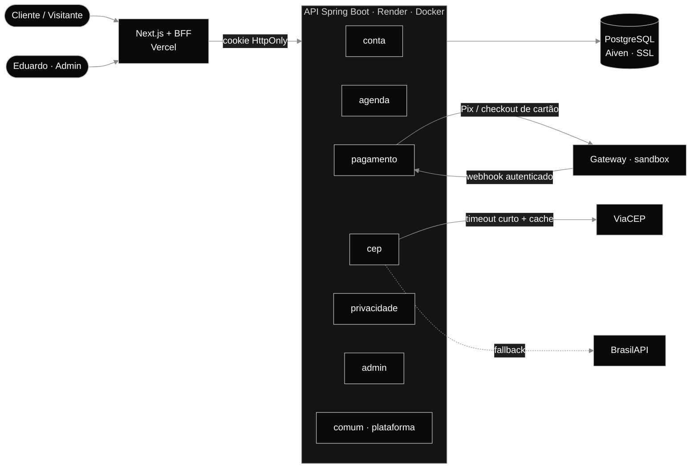

<details>
<summary><b>Estrutura do monorepo</b></summary>

<br/>

```text
barbearia-altas-horas/
├── backend/                         # API Java 25 + Spring Boot 4
│   └── src/main/java/io/github/k3vinrich4rd/altashoras/
│       ├── comum/        # Dinheiro, Cpf, Cep (mascaram no toString), erros RFC 9457
│       ├── plataforma/   # segurança, Clock, observabilidade, ShedLock
│       ├── conta/        # cadastro, login, JWT, refresh rotativo
│       ├── agenda/       # serviços, barbeiro, jornada, disponibilidade, reservas
│       ├── pagamento/    # cobrança 100% (Pix/cartão), webhook idempotente
│       ├── cep/          # ViaCEP → BrasilAPI, cache e degradação
│       ├── privacidade/  # consentimento, exportação e exclusão (LGPD)
│       └── admin/        # painel: agenda, catálogo, pagamentos, auditoria
├── frontend/             # Next.js (BFF guarda os tokens em cookie HttpOnly)
├── docs/                 # contrato, ADRs, domínio, banco, guia de testes
├── render.yaml           # Blueprint do Render (API, plano free; Fatia 8)
└── compose.yaml          # PostgreSQL 18 local para o perfil dev
```

</details>

### Os módulos e quem pode chamar quem

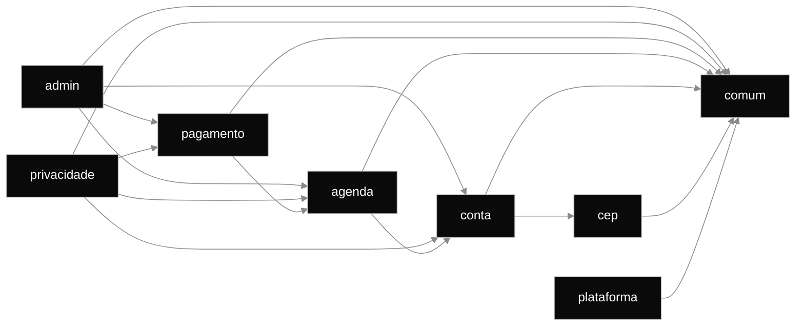

<sub>A seta quer dizer "pode chamar a API pública de". Qualquer outra dependência reprova o `ModulithTest` e o `ArquiteturaTest`. Detalhes em [`docs/arquitetura/`](docs/arquitetura/README.md).</sub>

### Deploy: Vercel, Render e Aiven

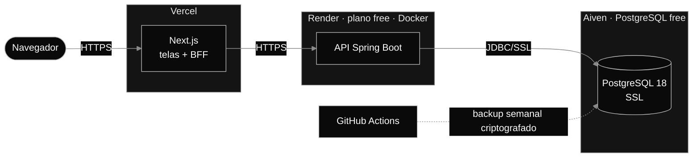

</details>

## 🧭 Decisões de arquitetura (ADRs)

<details>
<summary><b>🧭 Abrir as decisões</b> (cada uma com a alternativa descartada e o ADR)</summary>

<br/>

| Decisão | Alternativa descartada | Por quê | ADR |
|---|---|---|---|
| **Anti double booking no banco** com `EXCLUDE USING gist` + `tstzrange '[)'` + `btree_gist` | `synchronized` / lock em memória / `SELECT` antes do `INSERT` | lock em memória não protege duas instâncias e o `SELECT` tem corrida; a constraint vale para qualquer caminho de escrita | [0003](docs/adr/0003-anti-double-booking-no-banco.md) |
| **Webhook idempotente** pelo id do evento + reconsulta da cobrança | confiar no corpo do aviso | o gateway entrega "pelo menos uma vez"; o corpo pode ser forjado (OWASP API10) | [0007](docs/adr/0007-gateway-de-pagamento-sandbox.md) |
| **Erros RFC 9457** (`application/problem+json`) com `code` e `traceId` | JSON de erro próprio | padrão atual (substitui a RFC 7807); o front decide pelo `code`, não pelo texto | [0005](docs/adr/0005-erros-rfc-9457.md) |
| **Monólito modular** (Spring Modulith) | microsserviços | 1 pessoa, 1 deploy, fronteiras testadas; extrair serviço só com motivo real | [0001](docs/adr/0001-monolito-modular-com-spring-modulith.md) |
| **Hexagonal só onde paga o custo** (regra difícil pura; sistema externo atrás de porta) | hexagonal completo em todo módulo | CRUD com porta, adaptador e mapeador é cerimônia; a regra dos horários, pura, tem 12 testes em milissegundos | [0011](docs/adr/0011-hexagonal-seletivo-no-monolito-modular.md) |
| **Tempo em `timestamptz` + `Clock` injetado; dinheiro em centavos (`long`)** | `LocalDateTime` e `double` | fuso `America/Sao_Paulo` explícito e testes que "adiantam o relógio"; sem erro de arredondamento | [0004](docs/adr/0004-tempo-e-dinheiro.md) |
| **JWT curto + refresh rotativo em cookie `HttpOnly`** via BFF | token no `localStorage` | XSS não rouba sessão; reuso de refresh revoga a família | [0006](docs/adr/0006-sessao-jwt-refresh-cookie-bff.md) |
| **LGPD**: CPF só em trânsito, marketing por consentimento | guardar CPF cifrado | princípio da necessidade (art. 6º, III): o que não é guardado não vaza | [0009](docs/adr/0009-lgpd-marketing-cpf-e-retencao.md) |
| **Testcontainers** com PostgreSQL real | H2 em memória | `EXCLUDE`, `tstzrange` e `SKIP LOCKED` não existem no H2 | [0010](docs/adr/0010-versoes-da-plataforma.md) |

<sub>Todas as decisões com data e fonte: [`docs/planejamento/decisoes.md`](docs/planejamento/decisoes.md).</sub>

</details>

## 🔐 Segurança e LGPD

| Tema | Decisão |
|---|---|
| Sessão | JWT de acesso de 15 min, validado como Resource Server; refresh rotativo guardado só como hash: usado duas vezes, a sessão inteira cai. ✅ |
| Recurso alheio | busca já filtrada pelo dono; responde **404** em vez de confirmar que o id existe (OWASP API1, BOLA) |
| Pagamento | webhook só com o token do gateway; cobrança com `X-Idempotency-Key`; cartão só no checkout do gateway |
| CPF | pedido só no pagamento, validado, repassado e **nunca gravado nem logado** |
| Aceite da política | versão do texto e data gravadas na reserva (prova em caso de contestação) |
| Admin | criado na subida por `ADMIN_EMAIL` / `ADMIN_SENHA` (variáveis de ambiente, só hash), com **troca obrigatória** da senha inicial antes de abrir o painel. ✅ |
| Abuso | limite de tentativas no login (por e-mail + IP e por IP) e no cadastro: `429` com `Retry-After`. ✅ |
| Negar por padrão | só as rotas listadas são públicas; rota nova nasce protegida mesmo que alguém esqueça de pensar em segurança. ✅ |
| Titular | exporta e exclui os próprios dados; marketing só com consentimento opcional e desmarcado |

## 🛠 Painel admin

Área do papel `ADMIN`/`BARBEIRO` (hoje uma pessoa só, o Eduardo). É onde ele vê o dia, fecha os atendimentos e ajusta preços e horários sem depender de mim.

| O admin pode | Detalhe |
|---|---|
| Ver a agenda do dia e da semana | com o status de cada horário |
| Fechar o atendimento | `CONCLUIDO`, `NAO_COMPARECEU` (valor retido) ou cancelar com motivo |
| Gerenciar serviços e preços | nome, duração e preço, sem deploy |
| Editar jornada e folgas | inclusive a pausa de almoço |
| Acompanhar pagamentos | pendentes, confirmados e **pendências de pagamento tardio** |
| Ajustar regras | intervalo entre atendimentos, grade de horários, prazo de pagamento, texto da política |

## 🧪 Rodar e testar

<details>
<summary><b>🧪 Abrir o passo a passo</b> (back, front, contrato e endereços locais)</summary>

<br/>

Precisa de **Docker Desktop** e **JDK 25**. Sem `.env`: o perfil `dev` usa os padrões locais.

```bash
git clone https://github.com/k3vinrich4rd/barbearia-altas-horas.git
cd barbearia-altas-horas
docker compose up -d                                         # PostgreSQL 18 (porta 5433)
cd backend && ./mvnw spring-boot:run -Dspring-boot.run.profiles=dev
```

```bash
cd backend && ./mvnw verify      # 588 testes com PostgreSQL real via Testcontainers (24/11/2026, depois da Fatia 14)
```

O contrato da API ([`docs/contrato/openapi.yaml`](docs/contrato/openapi.yaml)) descreve cada rota, com os erros em pt-BR no formato RFC 9457. Para validar:

```bash
npx @redocly/cli lint docs/contrato/openapi.yaml   # valida o contrato OpenAPI 3.1
```


### Front (Next.js)

Precisa de **Node 22** e da API acima no ar (`http://localhost:8080`). O navegador só fala com o BFF do Next (`/api/**`), que guarda a sessão em cookies `HttpOnly`.

```bash
cd frontend
npm ci
npm run dev                 # http://localhost:3000 (copia as imagens de docs/assets e usa API_URL=http://localhost:8080)
npm run lint && npm run typecheck && npm test                      # testes unitários, um por critério (A1, A2...)
NEXT_PUBLIC_PAGAMENTO_SIMULADO=true npm run build && npx playwright test   # E2E contra a API real e axe (precisa do Postgres e da API no ar)
bash ../scripts/conferir-spec.sh 7 --exigir                              # os 62 critérios da fatia 7 (7A e 7B) têm teste com o número dele
```

O visual vem **só** dos tokens do [design system](frontend/design/README.md) (`frontend/design/tokens.json` gera o `tokens.css`). As variáveis estão em [`frontend/.env.example`](frontend/.env.example). Variáveis `NEXT_PUBLIC_*` entram no **build**.

| O que | Endereço local | |
|---|---|:-:|
| Health | `http://localhost:8080/actuator/health` | ✅ |
| Serviços, política e horários livres | `/servicos` · `/politica-pagamento` · `/disponibilidade` | ✅ |
| Conta e sessão | `/auth/cadastro` · `/auth/login` · `/auth/refresh` · `/auth/logout` · `/me` · `/me/senha` | ✅ |
| Reserva, pagamento (simulado) e painel | `/agendamentos` · `/pagamentos/cobrancas` · `/admin/**` | ✅ |
| CEP | `/cep/{cep}` | ✅ |
| Front (home, reserva, pagamento, conta, privacidade e painel) | `http://localhost:3000` | ✅ Fatia 7A e 7B |

O passo a passo para **testar à mão, sem depender de ninguém** (o que já roda hoje e os cenários de visitante, cliente e admin de cada fatia) está em **[`docs/guia-testes.md`](docs/guia-testes.md)**. A história completa da construção está em **[`docs/como-foi-construido.md`](docs/como-foi-construido.md)**.

</details>

## 🚀 Deploy grátis (Fatia 8)

Plano da Fase 1 (D38), **sem custo e sem cartão**: API no **Render** (web service free, Docker), banco no **Aiven PostgreSQL free** (D66, plano B Neon), front no **Vercel** depois da Fatia 7 e um **backup semanal** (`pg_dump` + gpg AES-256) guardado como artefato do GitHub Actions por 30 dias.

<details>
<summary><b>📦 As peças do deploy</b> (Dockerfile, Blueprint, backup e passo a passo)</summary>

| Peça | Arquivo |
|---|---|
| Imagem da API (JDK 25 no build, JRE 25 e usuário não-root no runtime) | [`backend/Dockerfile`](backend/Dockerfile) |
| Blueprint do Render (segredos gerados pelo Render ou preenchidos no painel, nunca no repositório) | [`render.yaml`](render.yaml) |
| Backup semanal criptografado | [`.github/workflows/backup-banco.yml`](.github/workflows/backup-banco.yml) |
| Passo a passo de ativação, limites do plano free, rollback em 3 degraus, alertas e Secrets do backup | [`docs/planejamento/ativar-deploy.md`](docs/planejamento/ativar-deploy.md) |
| Deploy só com CI verde (`autoDeployTrigger: checksPass`) e health do Render no liveness (Fatia 8B) | [`render.yaml`](render.yaml) |
| Cache AOT do JDK 25 gerado no `docker build` (subida mais curta), liveness/readiness e pool de 3 conexões (Fatia 8B) | [`backend/Dockerfile`](backend/Dockerfile) |
| Banco do Aiven mantido ligado por conexão direta, sem acordar a API (Fatia 8B) | [`.github/workflows/manter-banco.yml`](.github/workflows/manter-banco.yml) |
| Diff do ping do perfil (06:40 a 19:50, ~291 h/mês do Render) para o Kevin aplicar | [`docs/planejamento/ping-perfil.diff.md`](docs/planejamento/ping-perfil.diff.md) |

</details>

```bash
sh scripts/testar-imagem.sh    # docker build + PostgreSQL 18 + API no perfil prod (variáveis falsas): health UP, Flyway, CORS, IP real
sh scripts/testar-backup.sh    # pg_dump, criptografia e restauração num banco novo
sh scripts/horas-render.sh --conferir   # conta de horas do ping no Render (Fatia 8B: ~291 h/mês, limite 300)
sh scripts/verificar-no-ar.sh  # depois de um deploy ou rollback: API, front, CORS e rota de pagamento simulado
```

A Fatia 8B (deploy robusto) mediu, no Docker Desktop, a subida da API em **5,5 s** (mediana de 3, com cache AOT e C1) contra **12,1 s** da imagem da Fatia 8, e com `--cpus=0,25` (estimativa do Render) 27,7 s contra 39,4 s sem cache; os números e o que ainda é roteiro do Kevin estão no [guia de testes](docs/guia-testes.md#5c-deploy-robusto-fatia-8b).

Está no ar em beta desde 18/11/2026: a API no Render ([health](https://altas-horas-api.onrender.com/actuator/health)) e o front na Vercel ([site](https://barbearia-altas-horas.vercel.app)), ainda com pagamento simulado. No plano grátis, a API dorme sem uso e a primeira chamada pode passar de um minuto (em 20/11/2026 levou cerca de 90 segundos). Saída real dos scripts no [guia de testes](docs/guia-testes.md#5b-deploy-grátis-a-imagem-docker-e-o-backup-fatia-8-).

## 🤖 Como foi desenvolvido com IA

Projeto individual: o Kevin (backend Java) usa IA como par de programação, e o que impede a IA de "inventar" é o **método**, não o prompt. Cada peça abaixo é um arquivo que você pode abrir. O que **não** existe ainda está dito como tal.

<div align="center">

| 📐 Fatias com spec | ✅ Critérios `A#` nas specs | 🧪 Testes do backend | 🧭 ADRs | 🧑‍💻 Agentes | 🛠 Skills |
|:-:|:-:|:-:|:-:|:-:|:-:|
| **17** em [`docs/sdd`](docs/sdd/README.md) | **701** linhas `A#` | **588** (`./mvnw verify`) | **14** em [`docs/adr`](docs/adr) | **7** em [`.claude/agents`](.claude/agents) | **3** em [`.claude/skills`](.claude/skills) |

</div>

<sub>Contados no repositório em 25/11/2026: 17 arquivos `fatia-*.md`; 701 linhas de tabela `| A<n> |` nessas specs; 557 `@DisplayName("A…")` no backend e 105 arquivos `*.test.ts(x)` e `*.spec.ts` no frontend; 588 é o resultado de `./mvnw verify` registrado no [guia de testes](docs/guia-testes.md) (24/11/2026, seção 5e).

### O fluxo de uma fatia, da spec ao deploy

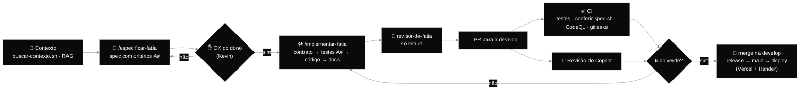

1. **Contexto barato.** Antes de escrever, a IA busca o que já foi decidido (regra, decisão, ADR, spec, teste) em vez de reler tudo.
2. **Spec.** `/especificar-fatia` escreve `docs/sdd/fatia-N-*.md` com objetivo, contrato, decisões e critérios *Dado/Quando/Então*. **Para aí.** Nenhuma linha de produção sem o OK do Kevin.
3. **Implementação.** `/implementar-fatia` segue a ordem contrato, testes (um por critério), código, docs com saída real. Número só de execução real.
4. **Revisão.** O agente `revisor-de-fatia` (só leitura) confere o diff contra a spec; depois o Copilot revisa a PR.
5. **CI.** A PR só entra com testes, `conferir-spec.sh`, CodeQL e gitleaks verdes.
6. **Deploy.** Merge na `develop`, release `develop → main` e publicação (front na Vercel, API no Render, banco na Aiven); o [guia de testes](docs/guia-testes.md) é rodado contra o ambiente publicado.

### 📐 SDD: Spec-Driven Development

Quando a IA escreve boa parte do código, quem garante a qualidade é a **especificação**. Sem spec, a IA preenche lacunas com suposição; com spec, ela implementa critérios que viram testes.

- **Uma spec por fatia** em [`docs/sdd/`](docs/sdd/README.md) (17 arquivos, [modelo](docs/sdd/modelo-de-spec.md) e [checklist de PR](docs/sdd/checklist-pr.md)).
- **Critérios `A#`** em tabela, cada um com o arquivo e o teste que o prova. Ex.: a [Fatia 2](docs/sdd/fatia-2-catalogo-disponibilidade.md) tem 29 critérios e 29 testes.
- **`conferir-spec.sh`** ([`scripts/conferir-spec.sh`](scripts/conferir-spec.sh)): um "eval" determinístico. Para cada linha `| A<n> |`, procura um teste com o número dentro de `@DisplayName("A7…")`, `test("A7…")` ou `it("A7…")`; comentário não conta. Com `--exigir`, falha o CI se faltar algum. Roda em [`backend-ci.yml`](.github/workflows/backend-ci.yml) e [`frontend-ci.yml`](.github/workflows/frontend-ci.yml), e o próprio script tem teste ([`testar-conferir-spec.sh`](scripts/testar-conferir-spec.sh)).
- **OK do dono antes do código.** A spec é aprovada pelo Kevin; só então a skill de implementação roda. Algo que a spec não decide? A IA para e pergunta, e a resposta vira decisão registrada na spec.

### 🔎 RAG e recuperação de contexto

Duas ferramentas, para dois tipos de pergunta, ambas medidas.

| Ferramenta | Para que serve | Como funciona |
|---|---|---|
| [`scripts/buscar-contexto.sh`](scripts/buscar-contexto.sh) `R15` | achar **por identificador** (`R15`, `D40`, `A7`, código de erro): regra, decisão, spec, contrato, ADR e código/teste, com arquivo e linha | `grep` em `docs/` e `backend/src`, com palavra inteira (`R1` não traz `R15`). Sem dependência, instantâneo |
| [`ferramentas/rag`](ferramentas/rag/README.md) | achar **por pergunta solta** ("o cliente pode cancelar depois de pagar?") | Spring AI 2.0.2 + pgvector + embeddings locais (ONNX, sem chave de API). Divide os `.md` por título (390 trechos de 37 arquivos), gera vetores, busca por distância de cosseno; identificador vai para busca exata (**híbrida**) |

Medido em 17 perguntas (17/11/2026): só vetor acerta 10; a busca híbrida, **15**. O vetor errou todos os identificadores (`R15` e `R16` são quase o mesmo texto para o modelo). Por isso o script é a primeira escolha para ID e o RAG fica para a linguagem natural. Os dois erros que sobraram estão registrados, sem maquiar a avaliação ([detalhes](docs/ia/rag-vetorial.md)). O RAG é ferramenta de desenvolvimento, fora da API; o [assistente para clientes](docs/sdd/fatia-9-assistente-de-duvidas.md) (Fatia 9) é spec, sem código ainda.

### 🛠 Skills do Claude Code

Receitas repetíveis em [`.claude/skills/`](.claude/skills/):

| Skill | O que faz |
|---|---|
| [`/especificar-fatia N`](.claude/skills/especificar-fatia/SKILL.md) | escreve a spec SDD da fatia (objetivo, contrato, decisões, critérios `A#` com o teste de cada um) e **para** no OK do Kevin, sem código de produção |
| [`/implementar-fatia N`](.claude/skills/implementar-fatia/SKILL.md) | a partir da spec aprovada: contrato, testes (um por `A#`), código, docs com saída real e PR para a `develop`, explicando os conceitos |
| [`/verificar-contrato`](.claude/skills/verificar-contrato/SKILL.md) | compara controllers, DTOs e códigos de erro com o `openapi.yaml` e lista divergências de rota, campo, tipo, status e erro; só lê e relata |

### 🧑‍💻 Agentes de IA

<details>
<summary><b>Abrir os 7 agentes</b> (papel, limite e ligação com os agentes do Grok)</summary>

<br/>

Cada agente é um arquivo em [`.claude/agents/`](.claude/agents/) com papel e **permissões limitadas** (ferramentas liberadas no cabeçalho). O Kevin também usa o **Grok** como outra IA de apoio: seis destes agentes se declaram "réplica" de um agente de mesmo nome do Grok (está no cabeçalho de cada arquivo). O papel é o mesmo nas duas ferramentas; o que vale para o projeto é o que está nestes arquivos. O `revisor-de-fatia` nasceu aqui.

| Agente | Papel | Pode |
|---|---|---|
| [`alicerce-arquiteto`](.claude/agents/alicerce-arquiteto.md) | escreve e revisa spec, ADR, contrato e decisões, antes de qualquer código | ler e escrever docs; não implementa nem mergeia |
| [`quarteto-dev`](.claude/agents/quarteto-dev.md) | implementa a partir de spec aprovada e roteiro fechado: testes `A#` primeiro, código, docs com saída real | escrever código e dar push; não abre PR nem mergeia |
| [`revisor-de-fatia`](.claude/agents/revisor-de-fatia.md) | segundo par de olhos: diff contra spec, contrato, camadas, segurança e LGPD | só leitura |
| [`prova-real-qa`](.claude/agents/prova-real-qa.md) | sobe API e front e executa os critérios `A#` à mão, gravando a saída real no guia de testes | rodar e documentar |
| [`sentinela-appsec`](.claude/agents/sentinela-appsec.md) | segurança de aplicação: sessão, cookies, CORS, pagamento, webhook, dependências, OWASP | só leitura |
| [`cautelar-lgpd`](.claude/agents/cautelar-lgpd.md) | dado pessoal, consentimento, retenção e alcance por região | só leitura e pesquisa |
| [`decolagem-operacao`](.claude/agents/decolagem-operacao.md) | deploy e operação nos planos grátis: Render, Aiven, Vercel, ping e backup | só leitura |

</details>

### 🤝 O revisor do Copilot

O GitHub Copilot lê as mesmas regras do `CLAUDE.md` por [`.github/copilot-instructions.md`](.github/copilot-instructions.md) e entra de três formas ([`docs/automacao.md`](docs/automacao.md)): sugestões no editor; **revisor de PR**, uma segunda opinião de quem não escreveu o código (não aprova nem mergeia); e agente de código para tarefa pequena e fechada, nunca em pagamento, concorrência ou segurança. O [`copilot-setup-steps.yml`](.github/workflows/copilot-setup-steps.yml) deixa JDK 25 e PostgreSQL prontos para ele. Qualquer PR, de quem for, passa pelo mesmo CI.

### Como a qualidade é garantida

| Parte | Como é feita | Como a qualidade é garantida |
|---|---|---|
| **Especificação** | escrita antes de qualquer código | critérios numerados; nada de código antes do OK |
| **Backend** (Java 25 + Spring Boot 4) | IA como par de programação | um teste por critério, PostgreSQL real (Testcontainers), regras de arquitetura (Spring Modulith + ArchUnit), CodeQL e gitleaks |
| **Frontend** (Next.js) | gerado com IA a partir do contrato OpenAPI e das specs de tela, com revisão humana | tipos gerados do contrato, testes das telas críticas, `conferir-spec.sh` das Fatias 7, 12 e 14 |
| **Deploy** | Vercel + Render + Aiven, IA apoiando os passos | guia de testes rodado contra o ambiente publicado |

<sub>Números e saídas do README vêm de execução real, nunca de estimativa da IA. Mais: [como foi construído](docs/como-foi-construido.md) · [automação](docs/automacao.md) · [`CLAUDE.md`](CLAUDE.md).</sub>

## 📊 Status das fatias

✅ no ar ou pronta · 🔄 em implementação · 📝 em especificação ou planejada. Cada fatia é uma PR para a `develop`, escrita primeiro como especificação (regras, contrato e critérios de aceite) e só depois como código. A fonte da verdade é o [`docs/sdd/README.md`](docs/sdd/README.md).

| Fatia | Status | O que entrega |
|---|:-:|---|
| **0 · Especificação** | ✅ | domínio, máquina de estados, contrato OpenAPI, DDL proposto e ADRs |
| **1 · Esqueleto** | ✅ | Maven, 8 módulos, RFC 9457 com `traceId`, `Clock`, Docker Compose, Flyway V1 com a constraint anti-sobreposição, teste de concorrência, CI (build, CodeQL, gitleaks) |
| **2 · Catálogo e disponibilidade** | ✅ | serviços, política de pagamento e horários livres com almoço, folgas, antecedência e reservas pendentes vencidas ([spec](docs/sdd/fatia-2-catalogo-disponibilidade.md): 29 critérios, 29 testes) |
| **3 · Conta e acesso** | ✅ | cadastro, login, refresh rotativo com detecção de reuso, troca de senha, admin inicial com troca obrigatória, limite de tentativas e negar por padrão ([spec](docs/sdd/fatia-3-conta-e-acesso.md): 44 critérios, 44 testes) |
| **4 · Agendamento e checkout** | ✅ | reserva com trava de 3 min (era 15 até a 6D), cobrança 100% Pix/cartão, aceite, webhook idempotente, expiração ([spec](docs/sdd/fatia-4-agendamento-e-pagamento.md): 45 critérios) |
| **5 · Painel admin** | ✅ | agenda, fechamento, catálogo, pagamentos e auditoria |
| **6A · CEP** | ✅ | ViaCEP, BrasilAPI e degradação |
| **6B · Privacidade (LGPD)** | ✅ | consentimento, exportar e excluir conta, retenção |
| **6C · Alcance por região** | ✅ | CEP opcional do visitante, região na reserva, painel `GET /admin/alcance` e vitrine pública `GET /alcance`, com agrupamento mínimo de 5 (k-anonimato) |
| **6D · WhatsApp e reserva manual** | ✅ | prazo de 3 min, WhatsApp comercial do barbeiro em `GET /barbeiros` e `POST /admin/agendamentos` para travar no painel o horário combinado por WhatsApp, sem cobrança ([spec](docs/sdd/fatia-6d-whatsapp-e-reserva-manual.md), 28 critérios) |
| **7A e 7B · Telas Next.js** | ✅ | [no ar em beta](https://barbearia-altas-horas.vercel.app): home, agendar, checkout com aceite obrigatório, confirmação, conta, privacidade, acessibilidade e o painel do barbeiro (agenda, reserva manual, pendências, cadastros, auditoria e alcance); contrato 1.7.1 ([spec](docs/sdd/fatia-7-telas.md): 62 critérios) |
| **7C · Painel no canvas** | 🔄 | em andamento (branch `wip/fatia-7c-painel-canvas`) |
| **8 · Deploy grátis** | ✅ | API no Render ([health](https://altas-horas-api.onrender.com/actuator/health)), PostgreSQL free na Aiven, front na Vercel e backup semanal criptografado; o pagamento ainda é simulado ([spec](docs/sdd/fatia-8-deploy.md)) |
| **8B · Deploy robusto e econômico** | ✅ | implementada e em PR (deploy só com CI verde, cache AOT, liveness/readiness, `503` limpo com o banco fora, desligamento limpo, rollback e alertas documentados, ping dentro das 750 h); falta o Kevin cadastrar os Secrets do backup e aplicar o diff do ping ([spec](docs/sdd/fatia-8b-deploy-robusto.md), [guia](docs/guia-testes.md#5c-deploy-robusto-fatia-8b)) |
| **Vários barbeiros e convite** | 🚧 | Dono/Admin, isolamento por `barbeiroId` e convite de uso único; implementado na branch `feat/fatia-10-convite-do-barbeiro` (telas aguardando desenho) ([ADR 0013](docs/adr/0013-varios-barbeiros-dono-e-convite.md)) |
| **Alcance por nível** | 📝 | subir de nível em vez de sumir, k = 5 e consentimento para a região do CEP; em especificação ([ADR 0014](docs/adr/0014-alcance-k-anonimato-e-consentimento-do-cep.md)) |
| **13 · Notificação ao barbeiro** | 🔄 | implementada na branch `feat/fatia-13-notificacao-ao-barbeiro` (aguardando a PR, o desenho das telas e o par de chaves VAPID do Kevin): quando o pagamento confirma, o barbeiro da reserva recebe um Web Push e um aviso em Novidades, sem o nome do cliente; e-mail pronto e desligado ([spec](docs/sdd/fatia-13-notificacao-ao-barbeiro.md): 50 critérios) |
| **9 · Assistente de dúvidas** | 📝 | RAG para o cliente, desligado por padrão; pós-beta ([spec](docs/sdd/fatia-9-assistente-de-duvidas.md)) |

## 📚 Documentação

| Documento | O que tem |
|---|---|
| [Contrato da API](docs/contrato/contrato-api.md) · [OpenAPI](docs/contrato/openapi.yaml) | rotas, exemplos, erros e histórico de versões |
| [Dossiê de contexto](docs/contexto.md) | regras de negócio numeradas (R1 a R34) e decisões em aberto |
| [Modelo de domínio](docs/dominio/modelo-de-dominio.md) | agregados, eventos e máquina de estados |
| [Arquitetura](docs/arquitetura/README.md) | módulos, dependências e fluxos críticos |
| [Banco](docs/banco/erd.md) | ERD, constraints e DDL proposto |
| [ADRs](docs/adr/README.md) | as decisões de arquitetura, uma por arquivo |
| [Painel admin](docs/admin/painel-admin.md) | matriz de acesso |
| [Guia de testes](docs/guia-testes.md) | teste você mesmo, à mão: o banco, os erros e os cenários de visitante, cliente e admin |
| [Como foi construído](docs/como-foi-construido.md) | o projeto de ponta a ponta: método, linha do tempo, código arquivo por arquivo, skills e agente de IA |
| [SDD](docs/sdd/README.md) | o processo, o modelo de spec e a spec de cada fatia |
| [Automação](docs/automacao.md) | por que cada Action existe, o papel do Copilot, como o SDD é cobrado e a regra de recuperação de contexto |
| [RAG vetorial](docs/ia/rag-vetorial.md) | como a busca semântica na documentação funciona e o que a avaliação mostrou |
| [Estudos aplicados](docs/estudos-aplicados.md) | minhas metas de estudo (Java/Spring e IA) ligadas a arquivos e testes deste projeto |

## 🔭 E outros barbeiros?

Hoje, não: o projeto é **a agenda do Eduardo Candido na Altas Horas**, e todo o esforço vai para ela funcionar bem.

O que fica pronto para o futuro, sem custo agora: o modelo já tem a entidade `Barbeiro` com jornada própria, a disponibilidade responde por barbeiro e preços e horários são dados do banco. Se um dia entrar outro profissional na cadeira ao lado, é cadastro, não reescrita.


## 🖤 Homenagem

<div align="center">


**Para o meu pai, Eduardo Candido**, que mantém a cadeira da **Barbearia Altas Horas** girando desde **1997** e ensina o ofício na **Altas Horas Barbearia Academy**.
Este projeto é a minha forma de levar para o código o cuidado que ele coloca em cada corte.

**★ 19 ✂ 97 ★**

</div>

## 👤 Autor

**Kevin Richard** · desenvolvedor backend Java · Osasco/SP · [GitHub @k3vinrich4rd](https://github.com/k3vinrich4rd)

Construo backends em Java e Spring com foco em regra de negócio bem protegida: concorrência resolvida no banco, integrações que falham sem derrubar o sistema e testes que provam o que a especificação promete.

<sub>Logo, fotos e identidade visual pertencem à Barbearia Altas Horas. Feito com Spec-Driven Development e apoio de IA; cada decisão tem fonte e data.</sub>
