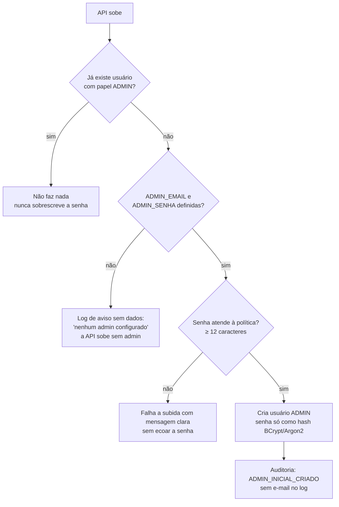

# 🛠 Painel admin

| | |
|---|---|
| 🎯 **Para que serve** | as rotas `/admin/**`, quem pode o quê, como nasce o primeiro admin e como o painel é protegido e auditado |
| 👥 **Área responsável** | backend (módulo `admin`) · front (telas do painel) · arquitetura: Alicerce |
| ⏰ **Quando usar** | antes de criar rota ou tela do painel; ao configurar o deploy |
| 🧰 **Como** | matriz de papéis + rotas do [contrato](../contrato/contrato-api.md#2-endpoints) + regras R20 a R26 do [dossiê](../contexto.md#3-regras-de-negócio) |
| 🚫 **Não cobre** | painel de alcance geográfico (pós-beta) · a tela em si (fatia do front) |

> Status: **proposta (13/11/2026)**. **HIPÓTESE H9:** o barbeiro vê e fecha **só a própria** agenda.

## 1. O que o painel faz no beta

| Área | Rotas | ADMIN | BARBEIRO |
|---|---|:-:|:-:|
| Agenda do dia e da semana | `GET /admin/agenda?data=&visao=DIA\|SEMANA&barbeiroId=` | todos os barbeiros | **só a própria** (H9) |
| Fechar atendimento | `PATCH /admin/agendamentos/{id}/status` (`CONCLUIDO`, `NAO_COMPARECEU`, `CANCELADO` + motivo) | ✅ | só reservas da própria agenda (H9) |
| Reserva manual: travar um horário combinado por WhatsApp (6D) | `POST /admin/agendamentos` (`servicoId`, `barbeiroId`, `inicio`, `nomeCliente?`, `observacao?`) | qualquer barbeiro | **só para si**; só o ADMIN cancela |
| Serviços (nome, duração, preço, ativo) | `GET/POST /admin/servicos`, `PUT /admin/servicos/{id}` | ✅ | ❌ |
| Barbeiros, WhatsApp comercial, jornada e folgas | `GET/POST /admin/barbeiros`, `PUT /admin/barbeiros/{id}`, `PUT .../jornada`, `POST/DELETE .../folgas` | ✅ | ❌ |
| Sinais (pendentes, pagos, expirados, a devolver) | `GET /admin/pagamentos?status=`, `POST /admin/pagamentos/{id}/devolucao` | ✅ | ❌ |
| Eventos de webhook em revisão manual (esgotaram as M tentativas do job, H20; ADR 0007) | rota a definir na fatia S13 (proposta: `GET /admin/pagamentos/eventos-em-revisao`) | ✅ | ❌ |
| Regras configuráveis da agenda (H4 a H12) | `GET/PUT /admin/configuracao` | ✅ | ❌ |
| Auditoria | `GET /admin/auditoria` | ✅ | ❌ |
| Alcance geográfico (só agregados, k ≥ 5) | `GET /admin/alcance` | pós-beta | pós-beta |

## 2. Matriz de acesso (o que cada teste prova)

Status esperado por quem chama. Cada célula vira um teste MockMvc na fatia da rota (API5:2023 e API1:2023).

| Rota | Anônimo | Guest (`X-Guest-Token`) | CLIENTE | BARBEIRO | ADMIN |
|---|:-:|:-:|:-:|:-:|:-:|
| `GET /admin/agenda` (sem `barbeiroId`) | 401 | 401 | 403 | 200 (só a própria) | 200 |
| `GET /admin/agenda?barbeiroId=<outro>` | 401 | 401 | 403 | **404** (H9) | 200 |
| `PATCH /admin/agendamentos/{id}/status` (reserva da própria agenda) | 401 | 401 | 403 | 200 | 200 |
| `PATCH /admin/agendamentos/{id}/status` (reserva de outro barbeiro) | 401 | 401 | 403 | **404** (H9) | 200 |
| `/admin/servicos/**`, `/admin/barbeiros/**`, `/admin/pagamentos/**`, `/admin/configuracao`, `/admin/auditoria` | 401 | 401 | 403 | 403 | 2xx |

Regra da matriz (ADR 0005): **401** sem login, **403** logado sem o papel, **404** quando o recurso existe mas não é seu (não confirma que o id existe). O guest não tem login: para o Spring Security ele é anônimo nas rotas do painel.

## 3. Como nasce o primeiro admin (sem senha no repositório)



| Regra | Detalhe |
|---|---|
| Origem | variáveis de ambiente `ADMIN_EMAIL` e `ADMIN_SENHA` (Render, `.env` local) |
| Sem padrão | nenhum `application*.yml` tem valor para elas, em nenhum perfil; o `.env.example` traz só os nomes |
| Idempotente | só cria se **não existir** admin; trocar a variável depois **não** muda a senha (R25). Troca de senha é feita logado |
| Hash | BCrypt (custo 12, proposta) ou Argon2; a senha nunca vai para log, exceção, auditoria ou resposta |
| Testes | `AdminInicialIT` usa uma senha **gerada no próprio teste** (aleatória), nunca escrita no código |
| Recomendação de operação | depois da primeira subida, apagar `ADMIN_SENHA` do painel do Render (o admin já existe) |
| Perfil `dev` | o seed **não** cria admin: quem roda local define `ADMIN_EMAIL`/`ADMIN_SENHA` no próprio `.env` |

## 4. Login do admin e proteção contra força bruta

- Mesmo endpoint de todos: `POST /auth/login`; o papel vem no token.
- **Limite de tentativas (H14):** 5 erros em 15 min por e-mail + IP → `429 LIMITE_EXCEDIDO` com `Retry-After`. Contador em memória (Caffeine/Bucket4j; uma instância só no Render free). Mesmo erro para e-mail inexistente e senha errada.
- Sessão do admin igual à dos outros (ADR 0006), com acesso curto (H15).
- Pós-beta, se fizer sentido: segundo fator para o papel `ADMIN`.

## 5. Auditoria (quem, o quê, quando)

Toda ação de escrita do painel grava uma linha em `auditoria_admin` **na mesma transação** da mudança:

| Campo | Exemplo |
|---|---|
| `ator_id` | id do admin ou barbeiro |
| `acao` | `SERVICO_CRIADO`, `SERVICO_ALTERADO`, `BARBEIRO_ALTERADO`, `JORNADA_SUBSTITUIDA`, `FOLGA_CRIADA`, `FOLGA_REMOVIDA`, `RESERVA_CONCLUIDA`, `RESERVA_FALTA`, `RESERVA_CANCELADA_ADMIN`, `DEVOLUCAO_REGISTRADA`, `CONFIGURACAO_ALTERADA`, `ADMIN_INICIAL_CRIADO` |
| `recurso` / `recurso_id` | `servico` / id |
| `detalhe` | campos alterados, **sem dado pessoal** (ex.: `{"precoCentavos":{"de":4000,"para":4500}}`) |
| `ip` | IP de origem (segurança; retenção de 1 ano, proposta) |
| `ocorrido_em` | instante UTC |

Leitura em `GET /admin/auditoria` (só ADMIN, paginado). Teste: cada rota de escrita do painel gera exatamente uma linha de auditoria.

## 6. Esboço das telas (fatia do front)

```text
┌──────────────────────────────────────────────────────────────┐
│ ALTAS HORAS · Painel          [Agenda] [Serviços] [Barbeiros] │
│                               [Sinais] [Regras] [Auditoria]   │
├──────────────────────────────────────────────────────────────┤
│ Agenda · terça, 01/12        ◀ dia ▶   (Dia | Semana)        │
│ Barbeiro: [Todos ▾]                                          │
│ 09:00  Corte        Cliente Teste A    CONFIRMADO  [✔][✖][⊘] │
│ 09:30  —                                                     │
│ 10:00  Barba        Visitante (guest)  AGUARDANDO · 12 min   │
│ 11:00  Corte+barba  Cliente Teste B    CONCLUIDO             │
└──────────────────────────────────────────────────────────────┘
 ✔ concluir · ✖ marcar falta · ⊘ cancelar (pede motivo)
```

Paleta: preto `#0A0A0A`, branco `#FFFFFF`, prata `#C0C0C0` e cinza `#8A8A8A`; contraste AA; tudo navegável por teclado.
