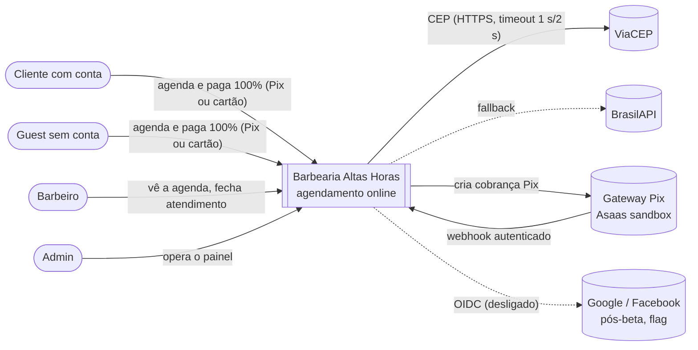
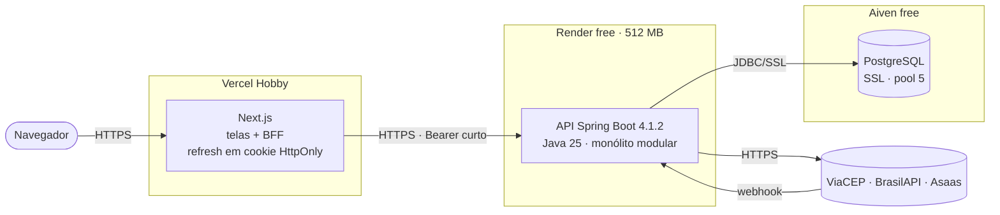
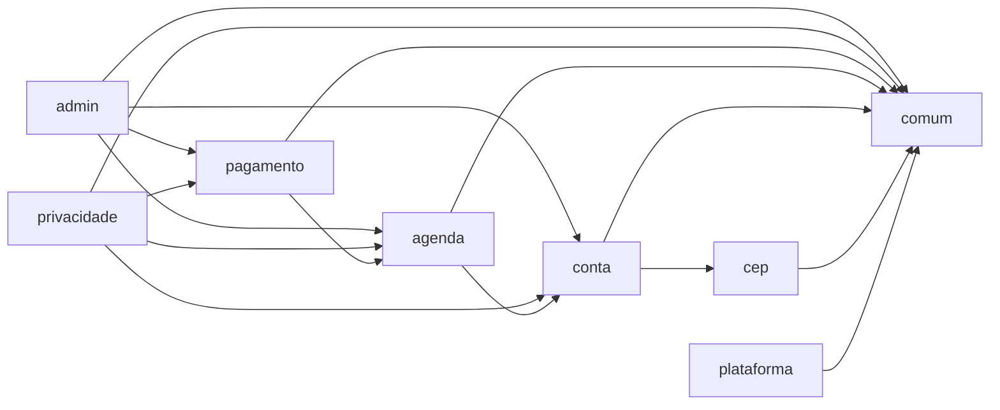
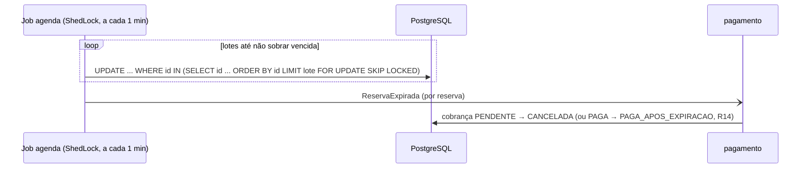
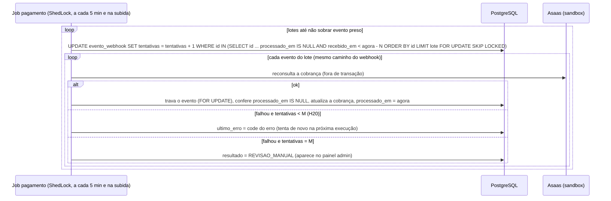

# 🧱 Arquitetura

| | |
|---|---|
| 🎯 **Para que serve** | visão de contexto, containers, módulos, dependências permitidas e fluxos críticos |
| 👥 **Área responsável** | **revisão de arquitetura** é a dona; o Kevin mantém o texto |
| ⏰ **Quando usar** | antes de criar pacote, classe que fala com outro módulo ou integração externa |
| 🧰 **Como** | diagramas Mermaid; as regras viram testes (ArchUnit + Spring Modulith) |
| 🚫 **Não cobre** | colunas ([ERD](../banco/erd.md)) · rotas ([contrato](../contrato/contrato-api.md)) |

> Fonte: proposta de arquitetura de 13/11/2026. Status: **aceita** (ADRs 0001 a 0006, revisão de arquitetura, 13/11/2026). Diagramas mostram o planejado: ainda não há código.

## 1. Contexto (C4 nível 1)



## 2. Containers (C4 nível 2)



## 3. Pacotes e módulos

Pacote raiz: `io.github.k3vinrich4rd.altashoras` (**HIPÓTESE H10**: troca só de nome se o Kevin preferir outro).

```text
io.github.k3vinrich4rd.altashoras
├── AltasHorasApplication
├── comum/        núcleo compartilhado (sem dependência interna)
├── plataforma/   infraestrutura transversal
├── conta/        cadastro, login, JWT, refresh, papéis
├── cep/          ViaCEP + BrasilAPI, cache, degradação
├── agenda/       serviços, barbeiros, jornada, folgas, disponibilidade, reservas
├── pagamento/    cobrança de 100% (Pix ou cartão), sandbox, webhook idempotente
├── privacidade/  consentimentos, exportar/excluir, retenção do guest
└── admin/        painel /admin/**, auditoria das ações
```

Dentro de cada módulo de negócio:

| Pacote | Conteúdo |
|---|---|
| `<modulo>` (raiz) | **API pública**: fachada (`AgendaApi`, `ContaApi`...), records de leitura |
| `<modulo>.eventos` | eventos publicados (`@NamedInterface("eventos")`) |
| `<modulo>.internal.dominio` | entidades e regras |
| `<modulo>.internal.aplicacao` | casos de uso, `@Transactional` |
| `<modulo>.internal.persistencia` | repositórios |
| `<modulo>.internal.web` | controllers e DTOs de entrada e saída |
| `<modulo>.internal.integracao` | clientes HTTP externos (só `cep` e `pagamento`) |

| Módulo | Faz | Expõe | Dono das tabelas |
|---|---|---|---|
| `comum` | Problem Details e catálogo de `code`; `Dinheiro`; `Cpf`, `Telefone`, `Cep` e `Email` que mascaram no `toString`; ids; `Clock` | os próprios tipos | — |
| `plataforma` | `SecurityFilterChain`, JWT só por claims, CORS por env, `GlobalExceptionHandler`, ShedLock, Caffeine, flags, limitador de tentativas | nada aos módulos de negócio | `shedlock`, `event_publication` |
| `conta` | cadastro, login, JWT, refresh rotativo, papéis, admin inicial por env, social atrás de flag | `ContaApi`; `ContaCriada`, `ContaAnonimizada` | `usuario`, `usuario_papel`, `refresh_token`, `identidade_social` |
| `cep` | consulta com timeout 1 s / 2 s, fallback e cache; nunca falha o chamador | `CepApi.buscar(Cep): Optional<Endereco>` | — |
| `agenda` | catálogo, jornada, folgas, disponibilidade, reservas, estados, job de expiração | `AgendaApi`; `ReservaCriada`, `ReservaCancelada`, `ReservaExpirada` | `configuracao_agenda`, `servico`, `barbeiro`, `jornada`, `folga`, `reserva`, `reserva_guest` |
| `pagamento` | cobrança de 100% (Pix ou checkout de cartão), aceite da política, cobrança com `X-Idempotency-Key`, autenticação do webhook, idempotência pelo id do evento | `PagamentoApi`; `PagamentoConfirmado`, `PagamentoFalhou` | `cobranca`, `evento_webhook` |
| `privacidade` | consentimento, `GET /me/dados`, `DELETE /me`, retenção do guest, alcance (pós-beta) | `ExclusaoSolicitada` | `consentimento`, `solicitacao_titular` |
| `admin` | controllers `/admin/**` que orquestram agenda, conta e pagamento; auditoria | nada (folha) | `auditoria_admin` |

> `configuracao_agenda` e `usuario_papel` não estavam na lista da proposta de arquitetura: entram como tabelas da agenda e da conta. Ponto para a revisão dele.

## 4. Dependências permitidas

A seta quer dizer "pode chamar ou conhecer a API pública de". Qualquer outra dependência é proibida.



| Módulo | Pode depender de | Escuta eventos de |
|---|---|---|
| `comum` | nenhum | — |
| `plataforma` | `comum` | — |
| `cep` | `comum` | — |
| `conta` | `cep`, `privacidade`, `plataforma`, `comum` | `privacidade.ExclusaoSolicitada` (síncrono, `@Order` 20) |
| `agenda` | `conta`, `privacidade`, `comum` | `pagamento.PagamentoConfirmado`, `pagamento.PagamentoFalhou`, `privacidade.ExclusaoSolicitada` (síncrono, `@Order` 10, antes da conta) |
| `pagamento` | `agenda`, `privacidade`, `comum` | `agenda.ReservaCancelada`, `agenda.ReservaExpirada` (e publica a limpeza de `evento_webhook`) |
| `privacidade` | `comum` (só publica portas e o evento; conta, agenda, admin e pagamento a usam) | — |
| `admin` | `agenda`, `conta`, `pagamento`, `privacidade`, `comum` | — |

Ouvir um evento depende só do pacote `eventos` do emissor, liberado no `package-info.java` com `allowedDependencies = {"pagamento::eventos", ...}`. Assim `agenda` ouve `pagamento::eventos` sem depender de `pagamento`, e não há ciclo.

## 5. Regras verificadas por teste (ArchUnit + Spring Modulith)

| # | Regra |
|---|---|
| 1 | Sem ciclos entre módulos (`slices().matching("..altashoras.(*)..")`) |
| 2 | Ninguém acessa `..internal..` de outro módulo; só o pacote raiz ou `eventos` |
| 3 | Respeitar a tabela de dependências da seção 4 (uma regra por módulo) |
| 4 | `comum` não depende de nenhum módulo, nem de Spring Web ou Spring Security |
| 5 | `plataforma` não depende de módulo de negócio; o carregamento do usuário fica em `conta` |
| 6 | Ninguém depende de `admin` |
| 7 | `web` não acessa `persistencia`; o controller só chama `aplicacao` |
| 8 | `@Transactional` só em `aplicacao` |
| 9 | `dominio` não depende de `web`, `persistencia`, `integracao` nem de `org.springframework.web..` (anotações JPA permitidas, ADR 0001) |
| 10 | Entidade de um módulo nunca referencia entidade de outro; só pelo id (`UUID`) |
| 11 | `RestClient` só em `cep.internal.integracao` e `pagamento.internal.integracao` |
| 12 | Proibido `Instant.now()`, `LocalDateTime.now()` e `LocalDate.now()` sem argumento fora de `comum`; usar o `Clock` injetado |
| 13 | Classes do login social em `conta.internal.social`, todas com `@ConditionalOnProperty(name = "app.features.social-login", havingValue = "true")` |
| 14 | Proibido `System.out` e `printStackTrace` (dado pessoal em log fica com o teste de PII) |

O teste `ModularidadeTest` chama `ApplicationModules.of(AltasHorasApplication.class).verify()` e gera a documentação dos módulos em `docs/arquitetura/modulos/`.

## 6. Fluxos críticos

### 6.1 Reserva com pagamento antecipado (caminho feliz e de erro)

```mermaid
sequenceDiagram
    autonumber
    actor G as Guest
    participant F as Front/BFF
    participant AG as agenda
    participant PG as pagamento
    participant DB as PostgreSQL
    participant GW as Asaas (sandbox)
    G->>F: escolhe serviço, barbeiro e horário
    F->>AG: POST /agendamentos/guest
    AG->>DB: expira vencidas que conflitam (R16) + INSERT AGUARDANDO_PAGAMENTO
    alt horário ocupado
        DB-->>AG: 23P01 (EXCLUDE)
        AG-->>F: 409 HORARIO_INDISPONIVEL
    else livre
        AG-->>F: 201 + reservaId + tokenGuest + expiraEm
        G->>F: informa CPF
        F->>PG: POST /pagamentos/cobrancas (X-Idempotency-Key, X-Guest-Token)
        PG->>AG: AgendaApi.dadosParaCobranca(reservaId)
        PG->>DB: INSERT cobranca PENDENTE (chave de idempotência + HMAC do corpo, id do provedor NULL, sem CPF)
        Note over PG,DB: chave repetida com id do provedor preenchido → devolve a linha (200), sem chamar o gateway
        PG->>GW: cria cliente (CPF) e cobrança Pix com externalReference = cobranca.id (fora de transação)
        alt gateway fora
            GW-->>PG: timeout
            Note over PG,DB: a cobrança fica PENDENTE com id do provedor NULL; repetir com a mesma chave<br/>procura antes pelo externalReference no Asaas e só cria se não achar
            PG-->>F: 503 GATEWAY_INDISPONIVEL (reserva segue até expirar)
        else ok
            PG->>DB: UPDATE cobranca SET id_cobranca_provedor, pix (mesma linha)
            PG-->>F: 201 + Pix copia e cola
        end
        GW->>PG: POST /pagamentos/webhook (asaas-access-token)
        PG->>DB: INSERT evento_webhook ON CONFLICT DO NOTHING RETURNING id
        alt conflito e processado_em preenchido
            PG-->>GW: 200 (repetido, sem efeito)
        else evento novo ou já gravado com processado_em NULL
            PG->>GW: reconsulta a cobrança (fonte da verdade, fora de transação)
            PG->>DB: trava o evento (FOR UPDATE), confere processado_em IS NULL, cobrança PAGA + event_publication + processado_em = agora
            PG-->>GW: 200
        end
        Note over PG,GW: falha no processamento → 5xx; o Asaas reenvia e o reenvio reprocessa
        PG-)AG: PagamentoConfirmado (depois do commit)
        AG->>DB: reserva CONFIRMADO (se não venceu, R13/R14)
    end
```

### 6.2 Expiração

O job roda a cada minuto e **uma vez logo na subida** (a API hiberna no Render free e o `@Scheduled` não recupera disparos perdidos). A correção da agenda não depende dele: R15 e R16.

Expira **em lotes** (tamanho configurável, proposta: 100), cada lote numa transação curta, até não sobrar vencida:

```sql
UPDATE reserva
   SET status = 'EXPIRADO', version = version + 1, atualizado_em = :agora
 WHERE id IN (SELECT id
                FROM reserva
               WHERE status = 'AGUARDANDO_PAGAMENTO'
                 AND expira_em <= :agora
               ORDER BY id
               LIMIT :lote
                 FOR UPDATE SKIP LOCKED)
RETURNING id;
```

`SKIP LOCKED` pula as linhas que uma inserção ou remarcação já travou (ADR 0003), então o job não disputa trava com o usuário e não entra em deadlock com ele. `:agora` vem do `Clock`. Cada `id` devolvido publica `ReservaExpirada`.




### 6.2.1 Reprocessamento de eventos de webhook presos

Mesmo desenho do job de expiração: **ShedLock**, roda a cada 5 min (configurável) e **uma vez na subida**, `agora` do `Clock`, lotes com `FOR UPDATE SKIP LOCKED`. Pega só eventos com `processado_em IS NULL` e `recebido_em < agora - N min` (**H19**) que ainda não foram para revisão manual. Detalhe no [ADR 0007](../adr/0007-gateway-de-pagamento-sandbox.md).



### 6.3 Excluir conta

`DELETE /me` (só cliente) → `ExcluirConta` abre UMA transação, grava a solicitação e publica `ExclusaoSolicitada`. Os listeners são **síncronos** (`@EventListener`, não o outbox: o `204` precisa significar "acabou") e têm ordem explícita com `@Order`: 1º a agenda (`CancelaReservasDaExclusao`: reserva futura paga bloqueia com `409`; as não pagas viram `CANCELADO` e publicam `ReservaCancelada` pelo outbox), 2º a conta (`AnonimizaContaDaExclusao`: anonimiza, sobe `versao_credencial`, apaga os refresh tokens); por fim a privacidade grava a revogação final do consentimento e conclui a solicitação. Qualquer falha desfaz tudo. O token de acesso já emitido deixa de valer na hora (`ValidadorDeConta`). O registro financeiro fica pelo prazo de H13. A exportação (`GET /me/dados`) usa a porta `FonteDeDadosDoTitular`, implementada por conta e agenda; a retenção usa `LimpezaPorRetencao` (agenda, admin e pagamento).
