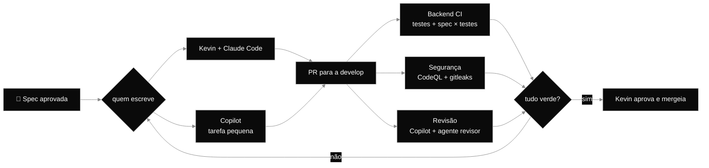

# ⚙️ Automação: Actions, Copilot, SDD e recuperação de contexto

| | |
|---|---|
| 🎯 **Para que serve** | explicar **o que roda sozinho** neste repositório e **por que** cada peça existe |
| 👥 **Para quem** | o Kevin, recrutadores e quem for contribuir |
| 🧭 **Leia junto** | [SDD](sdd/README.md) · [como foi construído](como-foi-construido.md) |

## A ideia em uma frase

Num projeto individual em que a IA escreve boa parte do código, **a automação é o segundo desenvolvedor**: ela não deixa entrar o que não cumpre a spec, não compila, quebra regra de arquitetura ou vaza segredo, seja quem for o autor (eu, o Claude Code ou o Copilot).



## 1. As GitHub Actions

| Workflow | Quando roda | O que faz | Por que existe |
|---|---|---|---|
| [`backend-ci.yml`](../.github/workflows/backend-ci.yml) | toda PR e push na `develop`/`main` | `./mvnw verify` com Java 25 e PostgreSQL 18 via Testcontainers; confere que os testes de banco **não foram pulados**; roda `conferir-spec.sh` (todo critério da spec tem teste) | "funciona na minha máquina" não vale. A regra central (constraint do PostgreSQL) só é provada com banco real, e um teste pulado por falta de Docker passaria em silêncio |
| [`seguranca.yml`](../.github/workflows/seguranca.yml) · CodeQL | toda PR, push e toda segunda-feira | análise estática do Java (injeção, uso inseguro de API) | o app lida com pagamento e dado pessoal; a varredura semanal pega falha descoberta depois do merge |
| [`seguranca.yml`](../.github/workflows/seguranca.yml) · gitleaks | toda PR e push | procura segredo nos commits; [`.gitleaks.toml`](../.gitleaks.toml) libera só dois exemplos fictícios do contrato | repositório público: uma chave commitada por engano precisa ser barrada antes do merge |
| [`copilot-setup-steps.yml`](../.github/workflows/copilot-setup-steps.yml) | quando o agente do Copilot inicia uma tarefa (e ao mudar o arquivo) | deixa JDK 25, dependências e a imagem do PostgreSQL prontos | sem ambiente pronto o agente gasta tempo e requisições tentando compilar |
| [`dependabot.yml`](../.github/dependabot.yml) | semanal | PRs de atualização do Maven e das Actions para a `develop` | correção de segurança de dependência chega por PR, passando pelo mesmo CI |

O que **não** tem Action, de propósito: deploy automático (entra na Fatia 8, com aprovação manual) e merge automático (quem mergeia sou eu).

## 2. O GitHub Copilot no fluxo

| Uso | Como | Limite |
|---|---|---|
| **No editor** (IntelliJ / VS Code) | sugestões e chat seguindo [`.github/copilot-instructions.md`](../.github/copilot-instructions.md) | as mesmas regras do [`CLAUDE.md`](../CLAUDE.md): SDD, `Clock`, centavos, RFC 9457 |
| **Revisão de PR** | o Copilot é pedido como revisor e comenta com base nas instruções ("ao revisar uma PR") | segunda opinião; não aprova nem mergeia |
| **Agente de código** | uma issue pequena e fechada (um critério `A#` da spec, um teste que falta) é atribuída ao Copilot, que abre uma PR | nunca regra de pagamento, concorrência ou segurança; a PR passa pelo mesmo CI e pela minha revisão |

**Por que dois assistentes:** o Claude Code é o par de programação das partes difíceis (spec, concorrência, pagamento) e roda os comandos de verdade; o Copilot é barato e rápido para o repetitivo e funciona como revisor independente, que não escreveu o código. As duas IAs leem as **mesmas regras** em arquivos do repositório, então trocar de ferramenta não muda o padrão.

## 3. Por que SDD, e como está implementado

**Por quê:** a IA preenche lacuna com suposição. Uma spec com critérios numerados transforma "faça a disponibilidade" em 29 afirmações verificáveis, cada uma com um teste.

**Como**, em arquivos que você pode abrir:

| Peça | Onde | O que garante |
|---|---|---|
| Processo e modelo | [`docs/sdd/README.md`](sdd/README.md), [`modelo-de-spec.md`](sdd/modelo-de-spec.md) | toda fatia tem o mesmo formato |
| Spec de cada fatia | [`fatia-1`](sdd/fatia-1-esqueleto.md), [`fatia-2`](sdd/fatia-2-catalogo-disponibilidade.md) | decisões (`E#`) e critérios (`A#`) antes do código |
| Teste por critério | `@DisplayName("A7: ...")` nos testes | rastreabilidade spec → teste |
| **Trava automática** | [`scripts/conferir-spec.sh`](../scripts/conferir-spec.sh) no CI | critério sem teste **quebra o build** (Fatia 1: 10/10 · Fatia 2: 29/29) |
| Receitas para a IA | skills [`/especificar-fatia`](../.claude/skills/especificar-fatia/SKILL.md) e [`/implementar-fatia`](../.claude/skills/implementar-fatia/SKILL.md) | a ordem spec → contrato → teste → código não depende de lembrar |
| Revisão contra a spec | agente [`revisor-de-fatia`](../.claude/agents/revisor-de-fatia.md) | pega "teste que passa sem provar" |

## 4. A regra de recuperação de contexto (o "RAG" do projeto)

**O problema que um RAG resolve:** a IA não lembra do projeto; alguém precisa colocar o trecho certo na frente dela antes de ela responder.

**A regra daqui:** tudo o que importa tem **identificador estável** (`R15`, `D40`, `E7`, `A29`, `HORARIO_INDISPONIVEL`) e fica em Markdown versionado. A recuperação é uma busca exata:

```bash
sh scripts/buscar-contexto.sh R15     # a regra, a decisão, a spec, o contrato e o código que citam R15
```

| | Busca por identificador (usada) | RAG com banco vetorial |
|---|---|---|
| Precisão | exata: `R15` traz `R15`, nunca "algo parecido" | por semelhança: pode trazer a regra vizinha |
| Custo | zero: `grep` | modelo de embeddings + banco vetorial + reindexar a cada mudança |
| Onde ganha | ~50 documentos estruturados, como aqui | muito texto livre sem identificador (histórico de atendimento, manuais) |

**E o vetorial?** Montei para medir ([`docs/ia/rag-vetorial.md`](ia/rag-vetorial.md), Spring AI + pgvector, embeddings locais). Na mesma lista de 17 perguntas:

| Estratégia | Acertos (documento certo entre os 3 primeiros) |
|---|:-:|
| Só vetor | 9 de 17 (errou os 5 identificadores) |
| **Híbrida**: exata para identificador, vetor para pergunta | **14 de 17** |

A regra que saiu da medição: **identificador vai por busca exata; pergunta em linguagem natural vai por vetor.**

## 5. Economia: como gastar pouco sem perder qualidade

| Prática | Efeito |
|---|---|
| Regras no repositório (`CLAUDE.md`, `copilot-instructions.md`) em vez de repetidas no prompt | menos texto por conversa |
| Busca por identificador em vez de mandar a IA ler tudo | só o trecho necessário entra no contexto |
| Skills carregadas sob demanda | o passo a passo só ocupa contexto quando é usado |
| Agente revisor só de leitura, com contexto próprio | a revisão não carrega o histórico inteiro da implementação |
| Tarefas repetitivas para o Copilot | o assistente mais caro fica para o que é difícil |
| Uma fatia por vez, com spec fechada | menos retrabalho, que é o maior custo |
