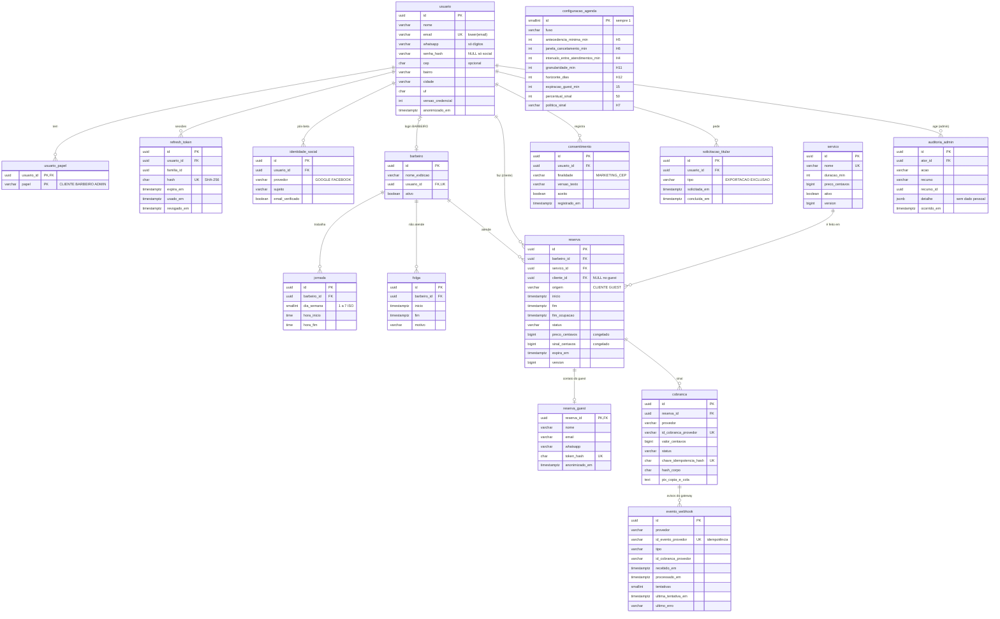

# 🗄️ ERD e DDL do Flyway V1 (proposta)

| | |
|---|---|
| 🎯 **Para que serve** | o modelo de dados do beta, as constraints que protegem as regras e o porquê de cada índice |
| 👥 **Área responsável** | backend · arquitetura: Alicerce |
| ⏰ **Quando usar** | antes de criar entidade JPA, consulta ou migração |
| 🧰 **Como** | ERD em Mermaid + o DDL em [`V1__agenda.proposta.sql`](V1__agenda.proposta.sql), que vira `backend/src/main/resources/db/migration/V1__agenda.sql` na fatia S01 |
| 🚫 **Não cobre** | regras de transição ([domínio](../dominio/modelo-de-dominio.md)) |

> Status: **proposta (13/11/2026)**, aguardando revisão do Alicerce (arquitetura). Os valores iniciais de `configuracao_agenda` são **HIPÓTESES** ([dossiê, seção 4](../contexto.md#4-hipóteses-em-aberto)).

> **Alinhado na Fatia 1 (16/11/2026, D31 a D35, D44)** na migração real [`V1__agenda.sql`](../../backend/src/main/resources/db/migration/V1__agenda.sql): sai `sinal_centavos`, `percentual_sinal`, `politica_sinal` e `janela_cancelamento_min`; entram `metodo` na cobrança, `aceite_politica_versao` e `aceite_politica_em` na reserva e a transição `EXPIRADO → CONFIRMADO`. O diagrama abaixo ainda mostra a proposta de 13/11; a verdade do schema é a migração.

## 1. ERD

Cada cor de módulo é dona das próprias tabelas (arquitetura do Alicerce, seção 3). FKs entre tabelas de módulos diferentes são permitidas no banco; no código, a referência é só pelo id.

Tabelas de infraestrutura do módulo `plataforma`, fora do diagrama: `shedlock` (trava do job) e `event_publication` (registro de eventos do Spring Modulith, que funciona como outbox).

## 2. Constraints que protegem regras

| Constraint | Protege | Regra |
|---|---|---|
| `reserva_sem_sobreposicao`: `EXCLUDE USING gist (barbeiro_id WITH =, tstzrange(inicio, fim_ocupacao, '[)') WITH &&) WHERE (status IN ('AGUARDANDO_PAGAMENTO','CONFIRMADO'))` | nenhum barbeiro com duas reservas sobrepostas, mesmo com requisições simultâneas; exige `btree_gist` | R1, R2 |
| `reserva_origem_ck` | cliente logado sem sinal; guest sem `cliente_id` | R6, R7 |
| `reserva_expiracao_ck` | toda reserva aguardando pagamento tem prazo | R7 |
| `reserva_valores_ck` | sinal entre 0 e o preço congelado | R8 |
| `cobranca_idempotencia_uk` | mesma `X-Idempotency-Key` não cria duas cobranças | R10 |
| `cobranca_ativa_por_reserva_uk` (índice único parcial) | no máximo uma cobrança viva por reserva | R10 |
| `evento_webhook_uk (provedor, id_evento_provedor)` | evento repetido não processa duas vezes (`INSERT ... ON CONFLICT DO NOTHING`). Se o evento já existe mas `processado_em IS NULL` (a API caiu ou falhou depois de gravar), ele é **reprocessado**, senão o pagamento se perderia; o processamento trava a linha (`FOR UPDATE`) e só marca `processado_em` na mesma transação que atualiza a cobrança | R12 |
| `usuario_email_uk` em `lower(email)` | e-mail único sem diferença de maiúsculas | R24 |
| `refresh_token_hash_uk` | refresh localizado pelo hash, nunca pelo valor | R27 |
| `configuracao_agenda_unica_ck` + faixas | uma configuração só, com valores sãos | H4 a H12 |

**Por que `now()` não está no filtro da constraint:** o `WHERE` de uma constraint `EXCLUDE` só aceita expressão imutável. Uma reserva `AGUARDANDO_PAGAMENTO` vencida continua no filtro até virar `EXPIRADO`; por isso existem a expiração preguiçosa na inserção (R16) e o job (R17), e a disponibilidade ignora as vencidas (R15).

## 3. Índices e a consulta que cada um atende

| Índice | Consulta |
|---|---|
| `reserva_barbeiro_inicio_ix (barbeiro_id, inicio)` | agenda do barbeiro no dia/semana; disponibilidade |
| `reserva_inicio_ix (inicio)` | agenda do dia de todos os barbeiros (painel) |
| `reserva_cliente_inicio_ix (cliente_id, inicio DESC)` parcial | "meus agendamentos" |
| `reserva_expiracao_ix (expira_em)` parcial em `AGUARDANDO_PAGAMENTO` | job de expiração |
| `folga_barbeiro_periodo_ix` gist | "há folga neste dia?" na disponibilidade |
| `jornada_barbeiro_dia_ix (barbeiro_id, dia_semana)` | jornada do dia na disponibilidade |
| `usuario_cidade_bairro_ix (cidade, bairro)` | painel de alcance (pós-beta), só agregados |
| `reserva_guest_retencao_ix (criado_em)` parcial | job de retenção do guest |
| `cobranca_devolucao_ix` parcial | painel: sinais a devolver |
| `evento_webhook_cobranca_ix` | histórico de eventos de uma cobrança |
| `auditoria_admin_*` | auditoria por data e por ator |
| `consentimento_usuario_ix` | último consentimento do usuário por finalidade |

Os planos (`EXPLAIN`) das consultas de disponibilidade e da agenda entram no PR da fatia que as cria.

## 4. Validação manual feita nesta etapa

Em 13/11/2026, o coordenador aplicou o DDL num **PostgreSQL 17.12** limpo (imagem `postgres:17` no Docker) e conferiu à mão, com dados fictícios:

| Caso | Resultado observado |
|---|---|
| DDL inteiro com `ON_ERROR_STOP` | aplicado sem erro |
| Reserva 10h00–10h30 e outra 10h15–10h45 do mesmo barbeiro | a segunda falhou com `23P01` em `reserva_sem_sobreposicao` |
| Reserva adjacente 10h30–11h00 | aceita (intervalo `[)`) |
| Reserva `CANCELADO` sobreposta | aceita (fora do filtro) |
| Cliente logado com sinal > 0 | recusada por `reserva_origem_ck` |
| Mesmo evento de webhook duas vezes com `ON CONFLICT DO NOTHING` | uma linha só |
| Duas transações simultâneas no mesmo horário (a primeira segura o commit por 2 s) | a segunda esperou e falhou com `23P01`; ficou 1 reserva |

**Revalidação depois da revisão do Alicerce (13/11/2026, PostgreSQL 17.12 no Docker):** DDL ajustado aplicado sem erro (sem a coluna `devolucao_pendente`, com os índices `cobranca_devolucao_ix` por status e `evento_webhook_pendente_ix`); o `EXPLAIN` das duas instruções de expiração (preguiçosa com `FOR UPDATE` e job com `FOR UPDATE SKIP LOCKED` em lote) passou; o segundo `INSERT ... ON CONFLICT DO NOTHING RETURNING id` do mesmo evento devolveu zero linhas e o `SELECT ... FOR UPDATE` seguinte achou o evento com `processado_em` nulo (caso de reprocessar).

**Revalidação do job de reprocessamento (13/11/2026, PostgreSQL 17.12 no Docker):** DDL com `tentativas`, `ultima_tentativa_em`, `ultimo_erro`, o check `evento_webhook_tentativas_ck` e os índices `evento_webhook_pendente_ix` e `evento_webhook_revisao_ix` aplicado sem erro. Com N = 10 min, a instrução de reivindicação do lote pegou só o evento não processado com 20 min; ignorou o de 2 min, o já processado e o que estava em `REVISAO_MANUAL`, e incrementou `tentativas`. Com outra sessão segurando `FOR UPDATE` num evento elegível, o `SKIP LOCKED` pulou esse evento. `tentativas = -1` foi recusado pelo check.

Isto **não** substitui os testes automatizados: na fatia S01, os mesmos casos viram testes com Testcontainers (`ReservaConstraintIT` e `ReservaConcorrenciaIT`).

**A conferir antes do deploy:** a extensão `btree_gist` no Aiven e a versão do PostgreSQL do plano free (o DDL usa só recursos presentes desde o PostgreSQL 13).
