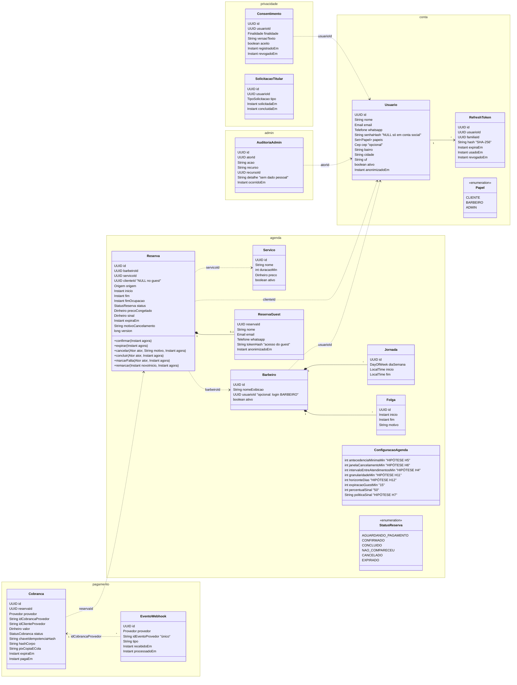
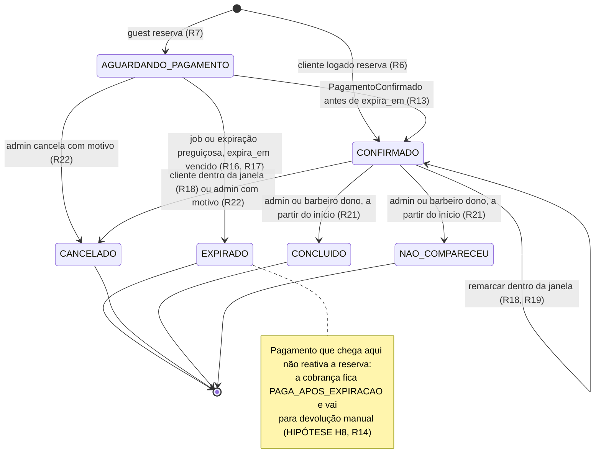
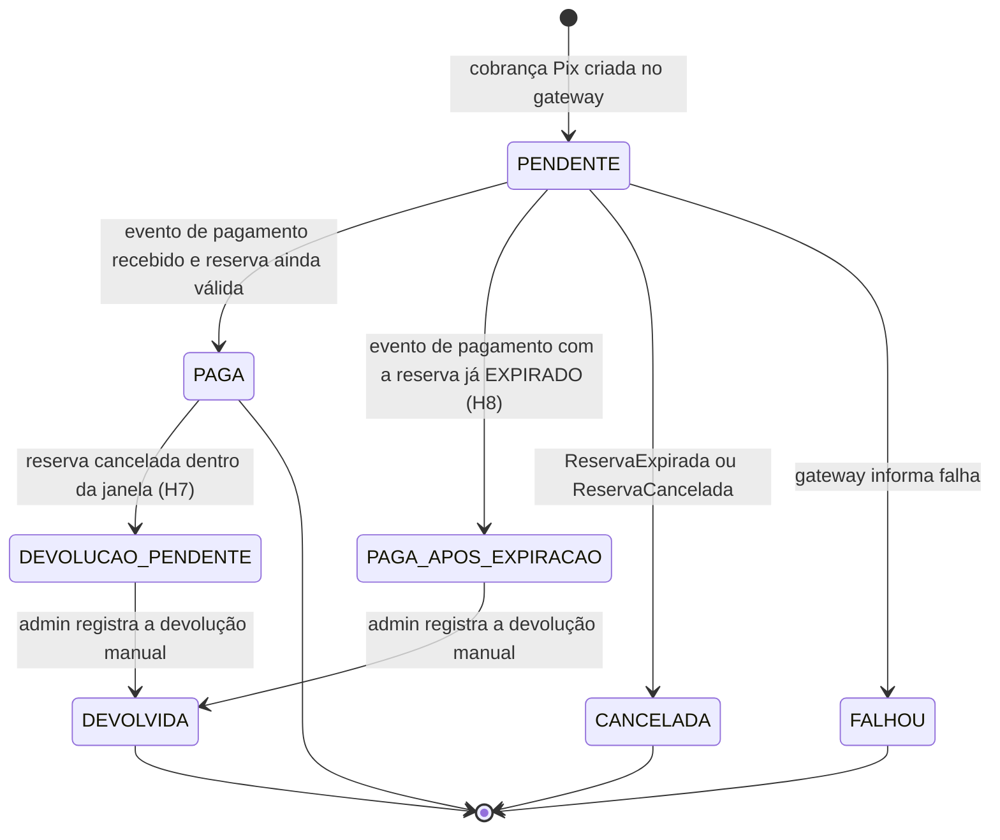

# 🧩 Modelo de domínio e máquina de estados

| | |
|---|---|
| 🎯 **Para que serve** | as entidades, quem é dono de quê (módulo) e as transições de status da reserva, com quem dispara cada uma |
| 👥 **Área responsável** | backend · arquitetura: Alicerce |
| ⏰ **Quando usar** | antes de escrever entidade, migração ou regra de status |
| 🧰 **Como** | diagramas Mermaid + tabela de transições (citada pela regra R20) |
| 🚫 **Não cobre** | colunas e índices ([ERD e DDL](../banco/erd.md)) · rotas ([contrato](../contrato/contrato-api.md)) |

> Status: **proposta (13/11/2026)**, aguardando revisão do Alicerce (arquitetura). Valores marcados **HIPÓTESE** estão na [seção 4 do dossiê](../contexto.md#4-hipóteses-em-aberto).

## 1. Entidades por módulo

Os módulos seguem a [arquitetura do Alicerce](../arquitetura/README.md). Entre módulos, uma entidade **nunca** referencia a outra por objeto (`@ManyToOne`); só pelo id (`UUID`) (regra ArchUnit 10). As setas tracejadas abaixo são referências por id.

**Value objects em `comum`** (Alicerce, seção 3): `Dinheiro` (centavos em `long`, nunca `double`), `Cpf`, `Telefone`, `Cep` e `Email`, que validam, sanitizam (só dígitos) e **mascaram no `toString()`**, para um log descuidado não vazar dado pessoal.

## 2. Máquina de estados

### Tabela de transições (fonte da regra R20)

| De | Para | Quem dispara | Condição | Efeito colateral |
|---|---|---|---|---|
| — | `CONFIRMADO` | cliente logado (`POST /agendamentos`) | horário livre (R1), dentro da jornada (R4), antecedência (R5) | evento `ReservaCriada` |
| — | `AGUARDANDO_PAGAMENTO` | guest (`POST /agendamentos/guest`) | idem + limite por IP (R26) | `expira_em = agora + 15 min`; sinal congelado (R8); `ReservaCriada` |
| `AGUARDANDO_PAGAMENTO` | `CONFIRMADO` | sistema: listener de `PagamentoConfirmado` | `agora < expira_em` | — |
| `AGUARDANDO_PAGAMENTO` | `EXPIRADO` | sistema: job com ShedLock ou expiração preguiçosa na inserção | `expira_em <= agora` | `ReservaExpirada` → pagamento cancela a cobrança pendente |
| `AGUARDANDO_PAGAMENTO` | `CANCELADO` | admin | motivo obrigatório | `ReservaCancelada` → pagamento cancela a cobrança |
| `CONFIRMADO` | `CONFIRMADO` (novo horário) | cliente dono | dentro da janela (H6) e novo horário livre | `version` incrementa |
| `CONFIRMADO` | `CANCELADO` | cliente dono | dentro da janela (H6) | `ReservaCancelada`; se houver sinal pago, a cobrança vira `DEVOLUCAO_PENDENTE` (H7) |
| `CONFIRMADO` | `CANCELADO` | admin | motivo obrigatório | idem |
| `CONFIRMADO` | `CONCLUIDO` | admin; barbeiro dono (H9) | `agora >= inicio` | auditoria |
| `CONFIRMADO` | `NAO_COMPARECEU` | admin; barbeiro dono (H9) | `agora >= inicio` | auditoria; sinal pago fica com a barbearia (H7) |
| qualquer final | qualquer | — | — | `422 TRANSICAO_INVALIDA` |

**Concorrência na transição:** a reserva tem `@Version` (otimista). Duas transições ao mesmo tempo (ex.: webhook confirmando enquanto o job expira) → uma vence e a outra recebe conflito de versão e é reavaliada: se a reserva já expirou, o pagamento cai na regra R14.

### Status da cobrança (módulo `pagamento`)

## 3. Eventos entre módulos

Conforme o ADR 0002: publicados com o registro de publicação do Spring Modulith (funciona como outbox), ouvidos com `@ApplicationModuleListener` (assíncrono, depois do commit, com nova tentativa). **Todo listener é idempotente.**

| Evento | Emissor | Ouvintes | Efeito |
|---|---|---|---|
| `ContaCriada(usuarioId, aceitouMarketing, versaoTexto)` | conta | privacidade | grava o consentimento |
| `ReservaCriada(reservaId, origem)` | agenda | — (reservado para lembretes pós-beta) | — |
| `ReservaCancelada(reservaId)` | agenda | pagamento | cancela cobrança pendente ou marca devolução |
| `ReservaExpirada(reservaId)` | agenda | pagamento | cancela cobrança pendente |
| `PagamentoConfirmado(reservaId, cobrancaId)` | pagamento | agenda | confirma a reserva se ainda válida |
| `PagamentoFalhou(reservaId, cobrancaId)` | pagamento | agenda | nada muda; a reserva expira no prazo |
| `ExclusaoSolicitada(usuarioId)` | privacidade | conta, agenda, pagamento | cada um anonimiza o que é seu |
| `ContaAnonimizada(usuarioId)` | conta | — | fecha a solicitação do titular |

**Pagamento depois da expiração (R14), sem dependência proibida:**
1. O webhook, antes de marcar a cobrança, consulta `AgendaApi.situacao(reservaId)` (chamada síncrona permitida: `pagamento → agenda`).
2. Reserva ainda `AGUARDANDO_PAGAMENTO` e dentro do prazo → cobrança `PAGA` e evento `PagamentoConfirmado`.
3. Reserva `EXPIRADO` (ou com prazo vencido) → cobrança `PAGA_APOS_EXPIRACAO`, sem evento. Aparece no painel entre os sinais a devolver (`PAGA_APOS_EXPIRACAO` ou `DEVOLUCAO_PENDENTE`; o status é a única fonte).
4. Corrida residual (a reserva vence entre o passo 1 e o listener da agenda): a agenda não confirma reserva vencida e publica `ReservaExpirada`; o listener do pagamento encontra a cobrança `PAGA` e a converte para `PAGA_APOS_EXPIRACAO`. Nenhum lado precisa conhecer o outro além do que a tabela de dependências permite.

A forma final fica para a revisão do Alicerce (arquitetura).
