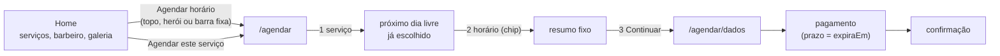
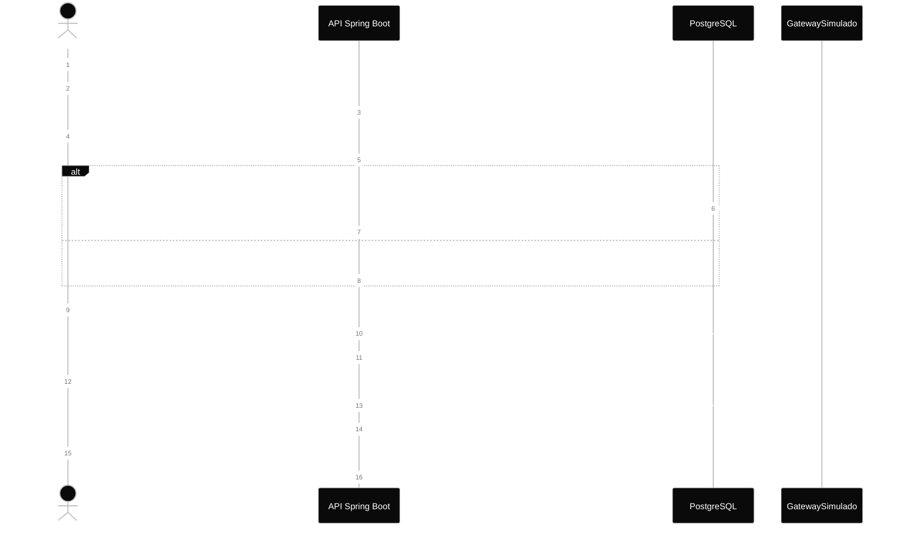
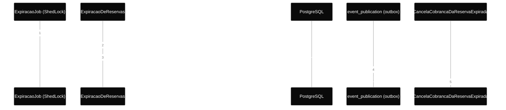
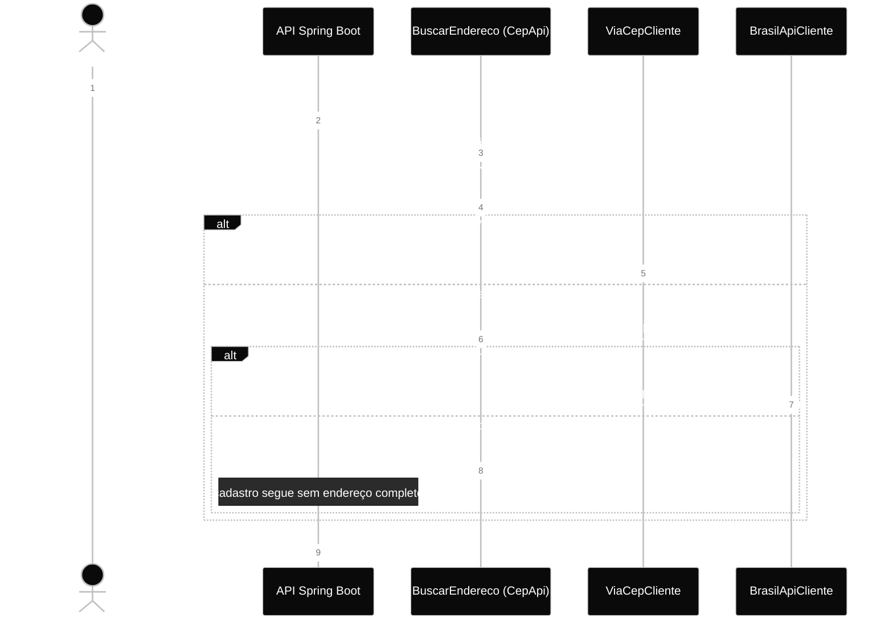
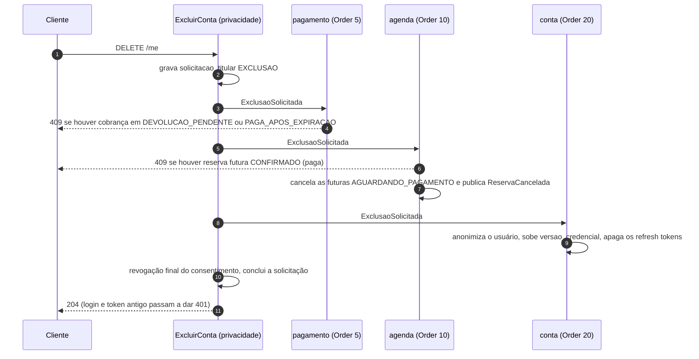

# 🧭 Fluxo de ponta a ponta · Barbearia Altas Horas

O caminho completo de quem usa a agenda: **visitante** (sem conta), **cliente** (com conta) e **painel** (`ADMIN` e `BARBEIRO`). Cada passo diz a rota, a classe que atende e o teste manual que o reproduz no [guia de testes](guia-testes.md). As rotas são as do [`openapi.yaml`](contrato/openapi.yaml).

**Legenda:** ✅ pronto (na `develop` ou na branch da 6C, ainda em revisão) · 🗓 planejado (7, 8, 9).

> [!NOTE]
> As rotas das Fatias 1 a 6 (inclusive a 6C, alcance por região) já têm código e teste. O que está marcado 🗓 (telas, deploy e assistente) vem da spec, não de código rodando.

## Sumário

1. [Os dois estados que você vai ver](#1-os-dois-estados-que-você-vai-ver)
2. [Visitante sem conta](#2-visitante-sem-conta)
3. [Cliente](#3-cliente)
4. [Painel](#4-painel-admin-e-barbeiro)
5. [Por baixo: o que sustenta tudo](#5-por-baixo-o-que-sustenta-tudo)
6. [Como reproduzir cada fluxo](#6-como-reproduzir-cada-fluxo)

## 1. Os dois estados que você vai ver

**Reserva** (`StatusReserva`, enum sem framework: `podeIrPara` diz o que é permitido):

| De | Para | Quem dispara |
|---|---|---|
| `AGUARDANDO_PAGAMENTO` | `CONFIRMADO` | pagamento confirmado (webhook ou conciliação) |
| `AGUARDANDO_PAGAMENTO` | `EXPIRADO` | `ExpiracaoJob`, passados os 3 min (R7) |
| `AGUARDANDO_PAGAMENTO` | `CANCELADO` | painel, com motivo |
| `EXPIRADO` | `CONFIRMADO` | pagamento tardio com o horário ainda livre |
| (nasce) | `CONFIRMADO` | **reserva manual** do painel (6D, `origem = MANUAL`, sem cobrança): não passa por `AGUARDANDO_PAGAMENTO` |
| `CONFIRMADO` | `CONCLUIDO` · `NAO_COMPARECEU` · `CANCELADO` | painel |
| `CONCLUIDO` · `NAO_COMPARECEU` · `CANCELADO` | (nenhum) | estados finais |

O desenho do diagrama está no [README](../README.md#ciclo-de-vida-do-agendamento). Fora dessa tabela: `422 TRANSICAO_INVALIDA`.

**Cobrança** (`StatusCobranca`; as trocas passam todas por `TransicoesDeCobranca`, um `UPDATE` com o status de origem no `WHERE`):

| Status | Quando |
|---|---|
| `PENDENTE` | cobrança criada, aguardando o pagamento |
| `PAGA` | pagamento confirmado a tempo |
| `PAGA_APOS_EXPIRACAO` | dinheiro entrou sem horário livre (vira pendência no painel) |
| `CANCELADA` | reserva expirada ou cancelada com a cobrança ainda pendente |
| `FALHOU` | o gateway recusou |
| `DEVOLUCAO_PENDENTE` | reserva paga cancelada pela barbearia: falta devolver |
| `DEVOLVIDA` | o admin registrou a devolução |

## 2. Visitante sem conta

Todos os serviços duram **60 min**, numa grade de **30 min** (`granularidade_min = 30` na configuração; ver [D94](planejamento/decisoes.md)).

### 2.0 A camada do front (Fatia 7A) ✅

O navegador **só fala com o Next** (`/api/**`, o BFF). O BFF confere a rota contra o contrato, põe o token no cabeçalho e guarda a sessão em cookies `HttpOnly` ([ADR 0006](adr/0006-sessao-jwt-refresh-cookie-bff.md)); nenhum token passa pelo JavaScript da página.

| Passo | Tela | O que o front faz | Chamada do BFF à API |
|---|---|---|---|
| escolher | `/agendar` | serviço, dia (limites de hoje até o horizonte) e horário, no **fuso da barbearia**, agrupados por barbeiro | `GET /servicos` · `GET /barbeiros` · `GET /disponibilidade` |
| reservar | `/agendar/dados` | "Continuar sem conta", nome, e-mail, WhatsApp e CEP opcional (sem a chave `cep` se vazio); `409 HORARIO_INDISPONIVEL` volta à escolha sem o horário; `409 CONFLITO_CONCORRENTE` repete uma vez | `POST /agendamentos/guest` (o BFF guarda o código no cookie `ah_visitante`) |
| pagar | `/agendar/pagamento/{id}` | política inteira, aceite desmarcado, CPF validado no navegador e limpo depois de enviar, Pix (copia e cola e QR gerado no navegador) ou link do cartão, contador a partir do `expiraEm`; `X-Idempotency-Key` reaproveitada nas repetições | `GET /politica-pagamento` · `POST /pagamentos/cobrancas` · `GET /agendamentos/guest/{id}` a cada 3 s · `POST /pagamentos/simulacao/{id}/confirmar` (só simulado) |
| confirmar | `/agendar/confirmacao/{id}` | resumo, aviso sem cancelamento, **código da reserva** com Copiar e link `…/reserva#id=…&codigo=…` (o `#` não vai ao servidor) | `GET /agendamentos/guest/{id}` · `GET /api/visitante` (rota só do BFF) |
| consultar | `/reserva` | lê o fragmento, **apaga o `#`** do endereço e consulta; código errado e reserva inexistente mostram o mesmo texto | `GET /agendamentos/guest/{id}` com `X-Guest-Token` |

### 2.0b O caminho até o formulário em poucos toques (Fatia 12) ✅

Só a primeira parte do fluxo mudou de cara; as rotas, a lógica e o pagamento são os mesmos.



- Da home ao formulário de dados: **no máximo 4 toques** (Agendar horário, serviço, horário, Continuar). Com um só barbeiro ativo, o seletor de barbeiro some; com mais de um, volta como opções.
- O dia vem da tira de 7 dias (o primeiro com horário já selecionado); "Outro dia" cobre até 30 dias; um dia sem horário oferece "Ver o próximo dia com horário".
- Horário indisponível aparece em cinza, com borda tracejada, riscado e a palavra "indisponível" para quem usa leitor de tela.
- A home não promete prazo em minutos: o prazo (3 a 60 min, D121) só aparece no cronômetro da tela de pagamento. Antes de reservar o texto é "prazo curto".

### 2.1 Reservar e pagar ✅



| Passo | Rota | Classes |
|---|---|---|
| Catálogo | `GET /servicos` · `GET /barbeiros` | `CatalogoController` |
| Política | `GET /politica-pagamento` | `PoliticaPagamentoController` |
| Disponibilidade | `GET /disponibilidade` | `DisponibilidadeController` → `ConsultaDisponibilidade` → `CalculadoraDeHorarios` (regra pura, sem banco) |
| Reservar | `POST /agendamentos/guest` | `AgendamentosController` → `ReservarHorario.comoVisitante` (até 3 reservas por hora por IP, `LimitadorDeTentativas`) → `Reserva.nova` |
| CEP opcional ✅ (6C) | o mesmo `POST`, campo `cep` | formato errado: `400 CEP_INVALIDO`, antes do limite e de qualquer chamada. Formato certo: `ReservarHorario.resolverRegiao` pergunta ao `CepApi` **fora da transação** (gasta a cota `cep\|IP` de 30 por minuto) e `Reserva.definirRegiao` copia bairro, cidade e uf (`RegiaoDaReserva`); `ReservaGuest` guarda o `cep`. CEP inexistente, provedor fora ou cota estourada: a reserva sai igual, **sem região** (R31). O log diz só "região resolvida: sim/não" |
| Token | (devolvido na resposta do `POST`) | `TokenGuest`: 32 bytes aleatórios, prefixo `g1_`, só o hash SHA-256 é guardado, conferido com `MessageDigest.isEqual` |
| Cobrança | `POST /pagamentos/cobrancas` | `CobrancaController` → `CriarCobranca` → `GatewayDePagamento` (aqui `GatewaySimulado`) |
| Confirmar (simulado) | `POST /pagamentos/simulacao/{cobrancaId}/confirmar` | `SimulacaoController` (só existe com `app.pagamento.modo=simulado`, o padrão) |
| Checkout do cartão (simulado) ✅ (A63, D149) | `/pagamento-simulado/{cobrancaId}` (tela do front) | o `GatewaySimulado` devolve `urlCheckout` = `app.pagamento.url-checkout-simulado` + `/{cobrancaId}`; `PagamentoSimulado.tsx` não pede cartão e confirma pelo mesmo `POST` da simulação |
| Confirmar (real) | `POST /pagamentos/webhook` | `WebhookController` → `ReceberWebhook` → `ProcessarPagamento` → `Reservas.confirmarPagamento` |
| Consultar | `GET /agendamentos/guest/{id}` | `AgendamentosController` → `ConsultaAgendamentos` |

Pontos que costumam surpreender:

- **O pagamento só é aceito com `aceitePolitica: true`**; a versão do texto e a data ficam gravadas na reserva.
- **Repetir o `POST /pagamentos/cobrancas` com a mesma `X-Idempotency-Key` não cobra duas vezes.** A idempotência compara um hash do corpo (`reservaId|metodo|cpf`) feito com **HMAC-SHA256** e um segredo do ambiente, em `CriarCobranca`; o CPF não é guardado.
- **O webhook não usa HMAC.** `WebhookController` autentica pelo cabeçalho `asaas-access-token` (token compartilhado, comparado em tempo constante com `MessageDigest.isEqual`) e, por segurança, reconsulta a cobrança no gateway em vez de confiar no corpo.
- **Conciliação:** se o webhook atrasou, a leitura da reserva (`ConciliacaoDePagamento`, via `ConciliadorDePagamento` da agenda) reconsulta o gateway, no máximo uma vez a cada 10 s por cobrança, e aplica o mesmo fluxo do webhook.
- **Webhook que falhou no meio:** `ReprocessamentoWebhookJob` retoma os eventos pendentes há mais de 10 min.
- **Cartão no beta:** o link "Ir para o pagamento com cartão" abre `/pagamento-simulado/{cobrancaId}`, uma tela do próprio site sem campo de cartão. Sem o cookie do visitante a confirmação dá `401` e a tela não sai do lugar. Trecho da saída real ([V9b](guia-testes.md#v9b--cartão-simulado-a-tela-pagamento-simuladocobrancaid-a63-d149)):

```
2. POST /api/pagamentos/cobrancas (CARTAO_CREDITO)      -> 201  ... urlCheckout http://localhost:3000/pagamento-simulado/{cobrancaId}
3. GET  /pagamento-simulado/{cobrancaId} (front)        -> 200  h1 "Pagamento com cartão"; campo de cartão no HTML: False
4. POST /api/pagamentos/simulacao/{id}/confirmar SEM cookie -> 401  code NAO_AUTENTICADO
5. POST /api/pagamentos/simulacao/{id}/confirmar (dono) -> 200  status PAGA
7. GET  /api/agendamentos/guest/{id} (token)            -> 200  status CONFIRMADO
```

### 2.2 Não pagou em 3 minutos ✅



O horário **já volta para a agenda antes do job rodar**: a disponibilidade ignora reservas vencidas. O job só arruma o status. Se o pagamento chegar depois, `EXPIRADO` pode voltar a `CONFIRMADO` com o horário livre; com o horário ocupado, a cobrança vira `PAGA_APOS_EXPIRACAO` e aparece em `GET /admin/pagamentos`.

### 2.3 Anonimização depois de 90 dias ✅

Real (6B, critérios A49 a A58 e A61b, testes `RetencaoGuestIT`, `RetencaoJobIT` e `RetencaoNaSubidaIT`): o job `RetencaoDeDados` (módulo `privacidade`) roda **às 3h** (fuso da barbearia) e **uma vez na subida da API**, com ShedLock e respeitando `app.jobs.habilitados`. Ele só chama as portas `LimpezaPorRetencao`; a do visitante é a `RetencaoDeVisitantes` (módulo `agenda`). 90 dias depois do **fim** da reserva (inclusive), em lotes de 500 por transação, troca nome, e-mail e WhatsApp por valores anônimos (`Visitante anonimizado`, `00000000000`) e troca o `token_hash` por um SHA-256 aleatório: `GET /agendamentos/guest/{id}` com o link antigo passa a dar `404`. A reserva e a cobrança não mudam. O prazo vem de `app.privacidade.retencao-guest-dias`. A mesma rotina limpa o IP da auditoria (1 ano, `RetencaoDoIpDaAuditoria`) e os eventos de webhook já processados (1 ano, `RetencaoDeEventosDeWebhook`). Roteiro manual: [rotina dos 90 dias](guia-testes.md#rotina-do-visitante-depois-dos-90-dias--retenção).

## 3. Cliente

### 3.0 A camada do front (Fatia 7A) ✅

| Passo | Tela | O que o front faz | Chamada do BFF à API |
|---|---|---|---|
| cadastrar | `/cadastro` | CEP consultado ao sair do campo (`achou`, `404`, `503`, `429` ou demora de 3 s: o botão **nunca** bloqueia, R31); marketing desmarcado, com o texto e a versão vindos da API | `GET /cep/{cep}` · `GET /politica-privacidade` · `POST /api/auth/cadastro` (BFF: cadastra e já entra) |
| entrar e sair | `/entrar` | uma mensagem só para credencial errada; `CLIENTE` → `voltar` ou Meus agendamentos, `BARBEIRO` e `ADMIN` → `/painel`, senha inicial → troca | `POST /api/auth/login` · `POST /api/auth/logout` |
| renovar | (invisível) | `401` → **uma** renovação do refresh, repetição da chamada uma vez; `REFRESH_*` apaga os cookies e volta ao login | `POST /auth/refresh` (só o BFF) |
| reservar e pagar | `/agendar/dados` → pagamento | sem pedir nome, e-mail nem WhatsApp; o resto é igual ao visitante | `POST /agendamentos` · `GET /agendamentos/{id}` |
| acompanhar | `/meus-agendamentos` | Próximos e Anteriores, status em texto e forma, "Pagar" na pendente, **sem** cancelar nem remarcar (R18) | `GET /me/agendamentos` |
| privacidade | `/minha-conta` | consentimento com a versão vigente da política (repete uma vez se mudou), baixar os dados como `.json`, excluir a conta digitando `EXCLUIR` (`409` explica) | `GET /me/consentimentos` · `PUT /me/consentimentos/marketing` · `GET /me/dados` · `DELETE /me` |

### 3.0b O painel do barbeiro (Fatia 7B) ✅

`ADMIN` e `BARBEIRO` entram em `/painel` (a senha inicial do admin é trocada antes de qualquer tela). O menu mostra cada item só para quem tem o papel; a autorização de verdade continua na API (`403`/`404`).

| Passo | Tela | O que o front faz | Chamada do BFF à API |
|---|---|---|---|
| agenda do dia ou da semana | `/painel` | lista por horário com status em texto e forma, etiqueta "MANUAL · WHATSAPP" ou "PAGO", almoço listrado (a lacuna da jornada), filtro de barbeiro só para o ADMIN | `GET /admin/agenda?data&visao&barbeiroId` · `GET /admin/barbeiros` (ADMIN) · `GET /admin/minha-jornada` (BARBEIRO, 1.7.0) |
| fechar o atendimento | `/painel` | "Concluído" e "Não compareceu" (avisa que o valor fica retido) mandam `status` e `version`; `409` recarrega a agenda | `PATCH /admin/agendamentos/{id}/status` |
| cancelar (só ADMIN) | `/painel` | diálogo com motivo obrigatório de até 300; a cobrança paga vai para devolução pendente | `PATCH /admin/agendamentos/{id}/status` |
| reserva manual | `/painel/reserva-manual` | serviço, barbeiro (o BARBEIRO só o próprio), dia e hora, nome e observação opcionais; vai para a agenda do dia | `POST /admin/agendamentos` |
| pendências | `/painel/pendencias` | devoluções a fazer e avisos do gateway em revisão, com confirmação | `GET /admin/pagamentos` · `POST /admin/pagamentos/{id}/devolucao` · `GET /admin/pagamentos/eventos` · `POST /admin/pagamentos/eventos/{id}/revisao` |
| cadastros (só ADMIN) | `/painel/cadastros` | serviços (preço em centavos), barbeiros com WhatsApp comercial, jornada semanal e folgas, regras da agenda (prazo de pagamento de 3 a 60 min) | `/admin/servicos` · `/admin/barbeiros` (e `/jornada`, `/folgas`) · `/admin/configuracao` |
| auditoria (só ADMIN) | `/painel/auditoria` | tabela paginada, sem IP, nome, motivo nem WhatsApp | `GET /admin/auditoria` |
| alcance | `/painel/alcance` | período e barbeiro (este só para o ADMIN); "menos de 5" sem percentual | `GET /admin/alcance` |

### 3.1 Cadastro com CEP ✅ (6A)



- **Degradação:** o cadastro **nunca** falha por causa do CEP (R31). A rota `GET /cep/{cep}` (`CepController`), essa sim, responde `404 CEP_NAO_ENCONTRADO` ou `503 CEP_INDISPONIVEL`.
- **Classes:** `CadastroController` → `CadastrarCliente` → `CepApi` (fachada do módulo `cep`, implementada por `BuscarEndereco`) → `ProvedorDeCep` (`ViaCepCliente`, `BrasilApiCliente`). O consentimento de marketing vai para `Consentimentos.registrarInicial`.
- **Cache:** feito à mão em `CepConfig` com `CaffeineCache` e `SimpleCacheManager` (um cache para CEP encontrado, outro para inexistente), sem `@Cacheable`.

### 3.2 Login, reserva e "meus agendamentos" ✅

| Passo | Rota | Classes |
|---|---|---|
| Entrar | `POST /auth/login` | `SessaoController` → `Sessoes`; JWT de acesso (`EmissorDeToken`) + refresh em cookie |
| Renovar | `POST /auth/refresh` | `Sessoes.renovar`: refresh **rotativo**, guardado só como hash; reuso derruba a família inteira |
| Sair · perfil · senha | `POST /auth/logout` · `GET /me` · `PUT /me/senha` | `SessaoController` |
| Reservar | `POST /agendamentos` | `AgendamentosController` → `ReservarHorario.comoCliente` (o dono vem do token, nunca do corpo). A região (bairro, cidade e uf do cadastro) vem de `Contas.regiaoDoCliente` e é **copiada** na reserva (6C, `Reserva.definirRegiao`): mudar o endereço depois não muda a reserva |
| Pagar | `POST /pagamentos/cobrancas` | igual ao visitante (Pix ou cartão simulado) |
| Meus agendamentos | `GET /me/agendamentos` · `GET /agendamentos/{id}` | `ConsultaAgendamentos`; reserva de outra pessoa responde `404`, não `403` |
| Cancelar | não existe | não há rota para o cliente cancelar ou remarcar (R18) |

### 3.3 Consentimento, exportar e excluir conta ✅ (6B)

Código real (6B, critérios A23 a A61c, testes em `privacidade/`). O módulo `privacidade` só depende do `comum`: ele publica as portas `FonteDeDadosDoTitular` e `LimpezaPorRetencao` e o evento `ExclusaoSolicitada`; conta, agenda, pagamento e admin as implementam ou escutam.

| Rota | Classes | O que faz |
|---|---|---|
| `GET /me/consentimentos` · `PUT /me/consentimentos/marketing` | `ConsentimentoController` → `Consentimentos` | estado atual (a linha mais recente) e aceitar/revogar; cada mudança é uma linha nova; mesmo estado e mesma versão não grava outra; `versaoTexto` precisa ser a vigente (`400` com `errors[].field`) |
| `GET /me/dados` | `ExportacaoController` → `ExportarDados` → `FonteDeDadosDoTitular` (`DadosDaContaDoTitular` na conta, `DadosDeAgendamentosDoTitular` na agenda) | conta, histórico de consentimentos e só as reservas do titular; `Cache-Control: no-store`; 5 por hora por conta (`429` com `Retry-After`, conta as linhas `EXPORTACAO` de `solicitacao_titular`) |
| `GET /politica-privacidade` | `PoliticaPrivacidadeController` → `TextosDaPolitica` | pública; versão, texto da caixa de marketing e política (arquivos em `resources/privacidade/`, rascunho técnico) |
| `DELETE /me` | `ExclusaoController` → `ExcluirConta` | só `CLIENTE` (`SegurancaConfig`: BARBEIRO e ADMIN `403`); sem pedir a senha no beta |

**Fluxo da exclusão** (uma transação só; `ExcluirConta` grava a solicitação `EXCLUSAO` e publica `ExclusaoSolicitada`; os listeners são **síncronos**, `@EventListener` + `@Order`, e qualquer falha desfaz tudo):



Os `409` são `EXCLUSAO_BLOQUEADA_POR_RESERVA` e nada muda. A cobrança das reservas canceladas vira `CANCELADA` pelo outbox, depois do commit. O token de acesso já emitido deixa de valer na hora (`ValidadorDeConta`, D98). Admin com a senha inicial recebe `403 TROCA_DE_SENHA_OBRIGATORIA` em `/me/dados` e `/me/consentimentos`.

## 4. Painel (ADMIN e BARBEIRO)

Todas as rotas `/admin/**` exigem login e papel; o admin inicial precisa **trocar a senha** antes (`403 TROCA_DE_SENHA_OBRIGATORIA`).

| Passo | Rota | Classes |
|---|---|---|
| Agenda do dia | `GET /admin/agenda` | `AgendaAdminController` → `ConsultarAgendaDoPainel` → `PainelDaAgenda` (fachada do módulo `agenda`) |
| Fechar atendimento | `PATCH /admin/agendamentos/{id}/status` (`CONCLUIDO`, `NAO_COMPARECEU`) | `MudarStatusDoAgendamento` → `PainelDaAgenda.mudarStatus` (trava a reserva com `FOR UPDATE` e confere a `version`: `409` se a tela estiver velha) |
| Cancelar com motivo | mesma rota, status `CANCELADO` + `motivo` | idem; publica `ReservaCancelada` (só o id), e `TrataCobrancaDaReservaCancelada` manda a cobrança paga para `DEVOLUCAO_PENDENTE` |
| Pendências de pagamento | `GET /admin/pagamentos` · `POST /admin/pagamentos/{id}/devolucao` · `GET /admin/pagamentos/eventos` · `POST /admin/pagamentos/eventos/{id}/revisao` | `PagamentosAdminController` → `ListarPendencias`, `RegistrarDevolucao`, `RevisarEvento` |
| Cadastros | `/admin/servicos`, `/admin/barbeiros` (+ `/jornada`, `/folgas`), `/admin/configuracao` | `ServicosAdminController`, `BarbeirosAdminController`, `ConfiguracaoAdminController` → `CadastroDeServicos`, `CadastroDeBarbeiros`, `CadastroDeFolgas`, `ConfigurarAgenda` → `CadastrosDoPainel` |
| Auditoria | `GET /admin/auditoria` | `AuditoriaController`; cada ação grava ator, ação e recurso via `Auditor` |
| Reserva manual ✅ (6D) | `POST /admin/agendamentos` (`servicoId`, `barbeiroId`, `inicio`, `nomeCliente?`, `observacao?`) | `AgendaAdminController` → `CriarReservaManual` (não é `@Transactional`) → `PainelDaAgenda.criarReservaManual` (confere o escopo: BARBEIRO só para si, senão `404`) → `ReservarHorario.comoBarbearia`: a mesma validação e a mesma transação da reserva do cliente (trava `FOR SHARE` do barbeiro, grade, folga, constraint `EXCLUDE` → `409`), com `Reserva.manual` (origem `MANUAL`, `CONFIRMADO`, sem prazo, sem aceite) e, **dentro da mesma transação**, o `Auditor` (`AGENDAMENTO_MANUAL_CRIADO`). Sem cobrança, sem WhatsApp do cliente. Fechar e cancelar usam a rota de status; o cancelamento não cria devolução porque `TransicoesDeCobranca` só troca cobranças que existem. `RetencaoDeReservasManuais` apaga nome e observação 90 dias depois do fim |
| WhatsApp do barbeiro ✅ (6D) | `POST`/`PUT /admin/barbeiros` (campo `whatsapp`, só ADMIN) · `GET /barbeiros` (público) | `CadastroDeBarbeiros` guarda só os dígitos (`barbeiro.whatsapp`); `CatalogoController` devolve `BarbeiroNoCatalogo`; o front monta `https://wa.me/<número>` |
| Alcance por região ✅ (6C) | `GET /admin/alcance?de&ate&barbeiroId` | `AlcanceController` (módulo `admin`) → `AlcanceDaAgenda.painel` (API pública da `agenda`: confere o escopo, o período de até 366 dias e o barbeiro) → `ConsultaAlcance` (uma consulta agrupa `CONFIRMADO` e `CONCLUIDO` por cidade, uf e bairro e agrega em memória). **K-anonimato (k ≥ 5):** bairro com menos de 5 vira "Outros bairros" e cidade com menos de 5 vira "Outras cidades". O ADMIN vê tudo ou filtra por barbeiro; o BARBEIRO vê só os próprios (o `barbeiroId` da query é trocado pelo dele). Nunca em cache |
| Vitrine pública do alcance ✅ (6C) | `GET /alcance` (sem token) | `AlcancePublicoController` (módulo `agenda`): limite de 30 por minuto por IP (`LimitadorDeTentativas`), cache Caffeine de 1 hora com `Ticker` injetável → `AlcanceDaAgenda.publico`: últimos 12 meses, **só nomes** das cidades e dos bairros que passam no k ≥ 5, sem contagens |

### 4.1 Convite e acesso do barbeiro (Fatia 10)

Quem pode o quê: só o **ADMIN** (Dono/Admin) adiciona um barbeiro, gera o convite, o desliga e mexe na agenda de outro (ver, reserva manual, fechar, cancelar); o barbeiro convidado só mexe na própria e recebe `404` igual na de outro.

| Passo | Rota | Classes |
|---|---|---|
| Política de acesso | (toda rota de escopo do painel) | `AcessoAgenda` (módulo `agenda`, a única que liga conta e barbeiro): `alvo`, `alvoDoAlcance`, `exigirDonoDaReserva`, `proprio`; `PainelDaAgenda`, `AlcanceDaAgenda` e `CadastrosDoPainel` só perguntam a ela |
| Gerar convite ✅ (10B) | `POST /admin/barbeiros/{id}/convite` (só ADMIN, sem corpo) | `BarbeirosAdminController` → `ConviteDeBarbeiro` → `Contas.emitirConvite` (código de 32 bytes, SHA-256 em `convite_conta`, 48 h) + `Auditor` na mesma transação |
| Abrir o link | `/convite#<codigo>` (página, sem chamar a API) | `Convite.tsx`: lê o fragmento, tira da barra de endereço |
| Aceitar ✅ (10B) | `POST /api/convite` (BFF) → `POST /auth/convite` | `convite()` no BFF (token da sessão só se houver) → `ConviteController` → `AceitarConvite` (limite por IP, `SELECT ... FOR UPDATE`, conta nova ou H32) → evento `ConviteAceito` → `VinculoDoConvite` (agenda liga `barbeiro.usuario_id`) e `AuditoriaDoConvite` (painel audita) |
| Desligar ✅ (10B) | `PUT /admin/barbeiros/{id}` com `ativo: false` | `CadastroDeBarbeiros.alterar` → `Contas.revogarConvite` e `Contas.desligarContaDeEquipe` (tira o papel, anonimiza a conta só de equipe); `ContaEmUso` barra o token antigo; histórico mantido (D153) |
| Retenção | job `RetencaoDeDados` | `RetencaoDeBarbeiroDesligado`: pseudônimo no `nome_exibicao` 5 anos depois da última reserva |

## 5. Por baixo: o que sustenta tudo

**Eventos e outbox.** Os módulos conversam por API pública (`Reservas`, `PainelDaAgenda`, `CepApi`, `Contas`, `PendenciasDePagamento`) e por eventos (`ReservaExpirada`, `ReservaCancelada`). O Spring Modulith grava cada evento na tabela `event_publication` (migração `V3__eventos.sql`) **na mesma transação** da mudança; o listener (`@ApplicationModuleListener`) completa depois. Se a API cair no meio, o evento não se perde. As fronteiras são conferidas por `ModulithTest` (por exemplo, `agendaEPagamentoSoPelaApiPublica`: a agenda não depende do pagamento).

**Jobs com ShedLock.** `ExpiracaoJob` (`expiracao-reservas`) e `ReprocessamentoWebhookJob` (`reprocessamento-webhook`) têm `@Scheduled` + `@SchedulerLock`, então só uma instância roda por vez; o lote usa `FOR UPDATE SKIP LOCKED`. Os jobs se ligam e desligam por `app.jobs.habilitados`.

**Concorrência, em três camadas.**

| Mecanismo | Onde | Protege |
|---|---|---|
| `EXCLUDE USING gist` (`reserva_sem_sobreposicao`, `V1__agenda.sql`) | banco | dois clientes no mesmo horário (erro `23P01` vira `409 HORARIO_INDISPONIVEL`) |
| `FOR SHARE` na linha do barbeiro | `ReservarHorario` | reserva não passa por cima de folga criada ao mesmo tempo |
| `FOR UPDATE` na linha do barbeiro | `CadastrosDoPainel`, `PainelDaAgenda` (folga) | folga e reserva se esperam; uma enxerga o que a outra gravou |
| `@Version` | `Reserva`, `Cobranca`, `Servico`, `Barbeiro`, `ConfiguracaoAgenda` | duas telas ou o job e o painel editando a mesma linha: o segundo recebe `409 CONFLITO_DE_VERSAO` |

**Erros RFC 9457.** Tudo sai como `application/problem+json` com `code` e `traceId`, montado em `TratadorGlobalDeErros` a partir de `ExcecaoDeNegocio`/`CodigoErro`; o limite de tentativas sai como `429` com `Retry-After`. O `traceId` vem de `RastreioFilter`. Decisão: [ADR 0005](adr/0005-erros-rfc-9457.md).

## 6. Como reproduzir cada fluxo

No [guia de testes](guia-testes.md): suba o banco e a API na [seção 0](guia-testes.md#0-subir-o-projeto).

| Fluxo | Seção do guia |
|---|---|
| Catálogo, política e horários livres | [V1](guia-testes.md#v1--ver-os-serviços), [V2](guia-testes.md#v2--ler-a-política-de-pagamento), [V3](guia-testes.md#v3--ver-os-horários-livres) |
| Reserva de visitante e consulta pelo token | [V4](guia-testes.md#v4--reservar-sem-conta), [V5](guia-testes.md#v5--acompanhar-a-reserva-pelo-token), [V6](guia-testes.md#v6--o-horário-sumiu-da-agenda) |
| Pagamento, aceite e idempotência | [V7](guia-testes.md#v7--pagar-sem-aceitar-a-política), [V8](guia-testes.md#v8--gerar-o-pix-e-repetir-sem-cobrar-duas-vezes), [V9](guia-testes.md#v9--confirmar-o-pagamento-simulado) |
| Expiração de 3 minutos | [V10](guia-testes.md#v10--não-pagar-em-3-minutos) |
| WhatsApp do barbeiro e reserva manual (6D) | [D1 a D4](guia-testes.md#d1--fatia-6d-whatsapp-reserva-manual-e-prazo-de-3-min) |
| Dois clientes no mesmo horário (banco) | [2.2](guia-testes.md#22--dois-clientes-não-pegam-o-mesmo-horário) |
| Erros padronizados | [3](guia-testes.md#3-erros-padronizados-rfc-9457) |
| Cadastro, login, refresh rotativo | [C1 a C7](guia-testes.md#c1--criar-a-conta) |
| Reservar com conta, meus agendamentos, cartão | [C8 a C12](guia-testes.md#c8--reservar-com-a-conta) |
| Alcance por região (6C): CEP do visitante, painel e vitrine | [AL1](guia-testes.md#al1--alcance-por-região-fatia-6c) (saída real a preencher no fluxo manual) |
| CEP com e sem provedores | [B3](guia-testes.md#b3--cep-com-os-provedores-ligados-fatia-6a), [B4](guia-testes.md#b4--cep-com-os-provedores-desligados-fatia-6a) |
| Dados, consentimento e exclusão da conta (6B) | [C13](guia-testes.md#c13--fatia-6b-dados-consentimento-e-exclusão-da-conta-fluxo-manual-no-perfil-dev) ✅ (saída real em 18/11/2026) · [rotina dos 90 dias](guia-testes.md#rotina-do-visitante-depois-dos-90-dias--retenção) ✅ |
| Painel: agenda, fechar, cancelar, devolver, auditoria | [AD1 a AD9b](guia-testes.md#ad1--criar-o-primeiro-admin) |
| Painel: cadastros, folga, configuração, pagamento tardio | [AD10 a AD14](guia-testes.md#ad10--serviços-criar-repetir-o-nome-editar-e-desativar) |
| RAG da documentação | [9](guia-testes.md#9-rag-perguntar-à-documentação) |
