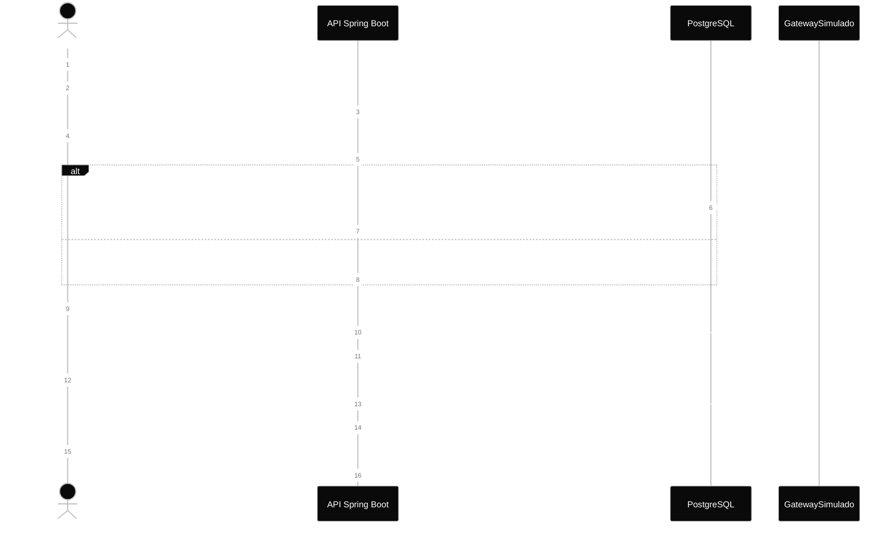
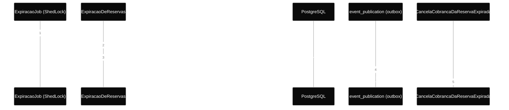
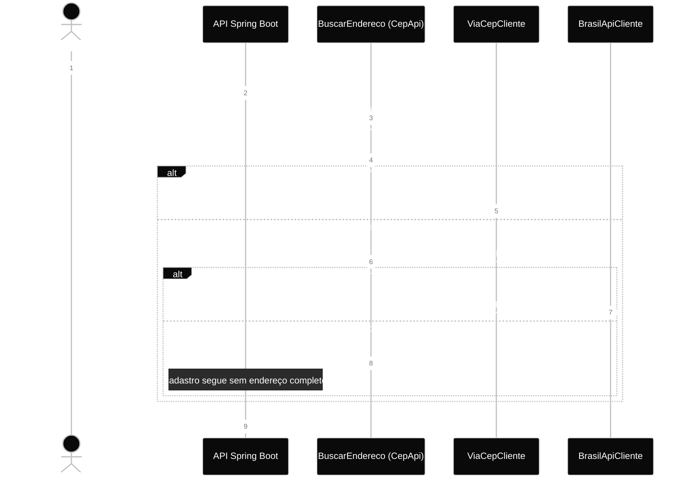

# 🧭 Fluxo de ponta a ponta · Barbearia Altas Horas

O caminho completo de quem usa a agenda: **visitante** (sem conta), **cliente** (com conta) e **painel** (`ADMIN` e `BARBEIRO`). Cada passo diz a rota, a classe que atende e o teste manual que o reproduz no [guia de testes](guia-testes.md). As rotas são as do [`openapi.yaml`](contrato/openapi.yaml).

**Legenda:** ✅ pronto (na `develop`) · 🚧 em andamento (Fatia 6B, branch `feat/fatia-6b-privacidade`, ainda não mergeada; descrito pela [spec da Fatia 6](sdd/fatia-6-cep-e-privacidade.md)) · 🗓 planejado (6C, 7, 8, 9).

> [!NOTE]
> As rotas da 6B e da 6C já estão no contrato, mas **o código delas ainda não está na `develop`**. Hoje o módulo `privacidade` só tem `Consentimentos.registrarInicial`, usado pelo cadastro para gravar o consentimento de marketing. Tudo marcado 🚧 ou 🗓 abaixo vem da spec, não de código rodando.

## Sumário

1. [Os dois estados que você vai ver](#1-os-dois-estados-que-você-vai-ver)
2. [Visitante sem conta](#2-visitante-sem-conta)
3. [Cliente](#3-cliente)
4. [Painel](#4-painel-admin-e-barbeiro)
5. [Por baixo: o que sustenta tudo](#5-por-baixo-o-que-sustenta-tudo)
6. [Como reproduzir cada fluxo](#6-como-reproduzir-cada-fluxo)

## 1. Os dois estados que você vai ver

**Reserva** (`StatusReserva`, enum sem framework: `podeIrPara` diz o que é permitido):

| De | Para | Quem dispara |
|---|---|---|
| `AGUARDANDO_PAGAMENTO` | `CONFIRMADO` | pagamento confirmado (webhook ou conciliação) |
| `AGUARDANDO_PAGAMENTO` | `EXPIRADO` | `ExpiracaoJob`, passados os 15 min |
| `AGUARDANDO_PAGAMENTO` | `CANCELADO` | painel, com motivo |
| `EXPIRADO` | `CONFIRMADO` | pagamento tardio com o horário ainda livre |
| `CONFIRMADO` | `CONCLUIDO` · `NAO_COMPARECEU` · `CANCELADO` | painel |
| `CONCLUIDO` · `NAO_COMPARECEU` · `CANCELADO` | (nenhum) | estados finais |

O desenho do diagrama está no [README](../README.md#ciclo-de-vida-do-agendamento). Fora dessa tabela: `422 TRANSICAO_INVALIDA`.

**Cobrança** (`StatusCobranca`; as trocas passam todas por `TransicoesDeCobranca`, um `UPDATE` com o status de origem no `WHERE`):

| Status | Quando |
|---|---|
| `PENDENTE` | cobrança criada, aguardando o pagamento |
| `PAGA` | pagamento confirmado a tempo |
| `PAGA_APOS_EXPIRACAO` | dinheiro entrou sem horário livre (vira pendência no painel) |
| `CANCELADA` | reserva expirada ou cancelada com a cobrança ainda pendente |
| `FALHOU` | o gateway recusou |
| `DEVOLUCAO_PENDENTE` | reserva paga cancelada pela barbearia: falta devolver |
| `DEVOLVIDA` | o admin registrou a devolução |

## 2. Visitante sem conta

Todos os serviços duram **60 min**, numa grade de **30 min** (`granularidade_min = 30` na configuração; ver [D94](planejamento/decisoes.md)).

### 2.1 Reservar e pagar ✅

| Passo | Rota | Classes |
|---|---|---|
| Catálogo | `GET /servicos` · `GET /barbeiros` | `CatalogoController` |
| Política | `GET /politica-pagamento` | `PoliticaPagamentoController` |
| Disponibilidade | `GET /disponibilidade` | `DisponibilidadeController` → `ConsultaDisponibilidade` → `CalculadoraDeHorarios` (regra pura, sem banco) |
| Reservar | `POST /agendamentos/guest` | `AgendamentosController` → `ReservarHorario.comoVisitante` (até 3 reservas por hora por IP, `LimitadorDeTentativas`) → `Reserva.nova` |
| Token | (devolvido na resposta do `POST`) | `TokenGuest`: 32 bytes aleatórios, prefixo `g1_`, só o hash SHA-256 é guardado, conferido com `MessageDigest.isEqual` |
| Cobrança | `POST /pagamentos/cobrancas` | `CobrancaController` → `CriarCobranca` → `GatewayDePagamento` (aqui `GatewaySimulado`) |
| Confirmar (simulado) | `POST /pagamentos/simulacao/{cobrancaId}/confirmar` | `SimulacaoController` (só existe com `app.pagamento.modo=simulado`, o padrão) |
| Confirmar (real) | `POST /pagamentos/webhook` | `WebhookController` → `ReceberWebhook` → `ProcessarPagamento` → `Reservas.confirmarPagamento` |
| Consultar | `GET /agendamentos/guest/{id}` | `AgendamentosController` → `ConsultaAgendamentos` |

Pontos que costumam surpreender:

- **O pagamento só é aceito com `aceitePolitica: true`**; a versão do texto e a data ficam gravadas na reserva.
- **Repetir o `POST /pagamentos/cobrancas` com a mesma `X-Idempotency-Key` não cobra duas vezes.** A idempotência compara um hash do corpo (`reservaId|metodo|cpf`) feito com **HMAC-SHA256** e um segredo do ambiente, em `CriarCobranca`; o CPF não é guardado.
- **O webhook não usa HMAC.** `WebhookController` autentica pelo cabeçalho `asaas-access-token` (token compartilhado, comparado em tempo constante com `MessageDigest.isEqual`) e, por segurança, reconsulta a cobrança no gateway em vez de confiar no corpo.
- **Conciliação:** se o webhook atrasou, a leitura da reserva (`ConciliacaoDePagamento`, via `ConciliadorDePagamento` da agenda) reconsulta o gateway, no máximo uma vez a cada 10 s por cobrança, e aplica o mesmo fluxo do webhook.
- **Webhook que falhou no meio:** `ReprocessamentoWebhookJob` retoma os eventos pendentes há mais de 10 min.

### 2.2 Não pagou em 15 minutos ✅

O horário **já volta para a agenda antes do job rodar**: a disponibilidade ignora reservas vencidas. O job só arruma o status. Se o pagamento chegar depois, `EXPIRADO` pode voltar a `CONFIRMADO` com o horário livre; com o horário ocupado, a cobrança vira `PAGA_APOS_EXPIRACAO` e aparece em `GET /admin/pagamentos`.

### 2.3 Anonimização depois de 90 dias 🚧

Spec (E19 e critérios A49 a A58, testes `RetencaoGuestIT`): 90 dias depois do **fim** da reserva (inclusive), o job `RetencaoDeDados` (diário, 03:00, ShedLock, lotes de 500) troca nome, e-mail e WhatsApp por valores anônimos e invalida o token (`GET /agendamentos/guest/{id}` passa a dar `404`). A reserva e a cobrança não mudam. O prazo vem de `app.privacidade.retencao-guest-dias`. **Ainda não existe em código na `develop`.**

## 3. Cliente

### 3.1 Cadastro com CEP ✅ (6A)

- **Degradação:** o cadastro **nunca** falha por causa do CEP (R31). A rota `GET /cep/{cep}` (`CepController`), essa sim, responde `404 CEP_NAO_ENCONTRADO` ou `503 CEP_INDISPONIVEL`.
- **Classes:** `CadastroController` → `CadastrarCliente` → `CepApi` (fachada do módulo `cep`, implementada por `BuscarEndereco`) → `ProvedorDeCep` (`ViaCepCliente`, `BrasilApiCliente`). O consentimento de marketing vai para `Consentimentos.registrarInicial`.
- **Cache:** feito à mão em `CepConfig` com `CaffeineCache` e `SimpleCacheManager` (um cache para CEP encontrado, outro para inexistente), sem `@Cacheable`.

### 3.2 Login, reserva e "meus agendamentos" ✅

| Passo | Rota | Classes |
|---|---|---|
| Entrar | `POST /auth/login` | `SessaoController` → `Sessoes`; JWT de acesso (`EmissorDeToken`) + refresh em cookie |
| Renovar | `POST /auth/refresh` | `Sessoes.renovar`: refresh **rotativo**, guardado só como hash; reuso derruba a família inteira |
| Sair · perfil · senha | `POST /auth/logout` · `GET /me` · `PUT /me/senha` | `SessaoController` |
| Reservar | `POST /agendamentos` | `AgendamentosController` → `ReservarHorario.comoCliente` (o dono vem do token, nunca do corpo) |
| Pagar | `POST /pagamentos/cobrancas` | igual ao visitante (Pix ou cartão simulado) |
| Meus agendamentos | `GET /me/agendamentos` · `GET /agendamentos/{id}` | `ConsultaAgendamentos`; reserva de outra pessoa responde `404`, não `403` |
| Cancelar | não existe | não há rota para o cliente cancelar ou remarcar (R18) |

### 3.3 Consentimento, exportar e excluir conta 🚧 (6B)

Só spec (E10 a E17, critérios da 6B), nada disso roda na `develop` ainda:

| Rota | O que faz |
|---|---|
| `GET /me/consentimentos` · `PUT /me/consentimentos/marketing` | ver o estado atual e revogar/aceitar; cada mudança é uma linha nova (histórico) |
| `GET /me/dados` | exporta conta, consentimentos e agendamentos; limite de 5 por hora |
| `DELETE /me` | só `CLIENTE`; **anonimiza** a conta (a linha fica, sem dado pessoal) numa transação; cancela reservas futuras não pagas; **bloqueia** com `409 EXCLUSAO_BLOQUEADA_POR_RESERVA` se houver reserva futura paga |
| `GET /politica-privacidade` | texto versionado |

## 4. Painel (ADMIN e BARBEIRO)

Todas as rotas `/admin/**` exigem login e papel; o admin inicial precisa **trocar a senha** antes (`403 TROCA_DE_SENHA_OBRIGATORIA`).

| Passo | Rota | Classes |
|---|---|---|
| Agenda do dia | `GET /admin/agenda` | `AgendaAdminController` → `ConsultarAgendaDoPainel` → `PainelDaAgenda` (fachada do módulo `agenda`) |
| Fechar atendimento | `PATCH /admin/agendamentos/{id}/status` (`CONCLUIDO`, `NAO_COMPARECEU`) | `MudarStatusDoAgendamento` → `PainelDaAgenda.mudarStatus` (trava a reserva com `FOR UPDATE` e confere a `version`: `409` se a tela estiver velha) |
| Cancelar com motivo | mesma rota, status `CANCELADO` + `motivo` | idem; publica `ReservaCancelada` (só o id), e `TrataCobrancaDaReservaCancelada` manda a cobrança paga para `DEVOLUCAO_PENDENTE` |
| Pendências de pagamento | `GET /admin/pagamentos` · `POST /admin/pagamentos/{id}/devolucao` · `GET /admin/pagamentos/eventos` · `POST /admin/pagamentos/eventos/{id}/revisao` | `PagamentosAdminController` → `ListarPendencias`, `RegistrarDevolucao`, `RevisarEvento` |
| Cadastros | `/admin/servicos`, `/admin/barbeiros` (+ `/jornada`, `/folgas`), `/admin/configuracao` | `ServicosAdminController`, `BarbeirosAdminController`, `ConfiguracaoAdminController` → `CadastroDeServicos`, `CadastroDeBarbeiros`, `CadastroDeFolgas`, `ConfigurarAgenda` → `CadastrosDoPainel` |
| Auditoria | `GET /admin/auditoria` | `AuditoriaController`; cada ação grava ator, ação e recurso via `Auditor` |
| Alcance por região | `GET /admin/alcance` (painel) e `GET /alcance` (vitrine pública) | 🗓 **6C, planejado.** Só spec: cidades e bairros dos atendimentos, com agrupamento mínimo de 5 (k-anonimato). **O k-anonimato ainda não existe em código** |

## 5. Por baixo: o que sustenta tudo

**Eventos e outbox.** Os módulos conversam por API pública (`Reservas`, `PainelDaAgenda`, `CepApi`, `Contas`, `PendenciasDePagamento`) e por eventos (`ReservaExpirada`, `ReservaCancelada`). O Spring Modulith grava cada evento na tabela `event_publication` (migração `V3__eventos.sql`) **na mesma transação** da mudança; o listener (`@ApplicationModuleListener`) completa depois. Se a API cair no meio, o evento não se perde. As fronteiras são conferidas por `ModulithTest` (por exemplo, `agendaEPagamentoSoPelaApiPublica`: a agenda não depende do pagamento).

**Jobs com ShedLock.** `ExpiracaoJob` (`expiracao-reservas`) e `ReprocessamentoWebhookJob` (`reprocessamento-webhook`) têm `@Scheduled` + `@SchedulerLock`, então só uma instância roda por vez; o lote usa `FOR UPDATE SKIP LOCKED`. Os jobs se ligam e desligam por `app.jobs.habilitados`.

**Concorrência, em três camadas.**

| Mecanismo | Onde | Protege |
|---|---|---|
| `EXCLUDE USING gist` (`reserva_sem_sobreposicao`, `V1__agenda.sql`) | banco | dois clientes no mesmo horário (erro `23P01` vira `409 HORARIO_INDISPONIVEL`) |
| `FOR SHARE` na linha do barbeiro | `ReservarHorario` | reserva não passa por cima de folga criada ao mesmo tempo |
| `FOR UPDATE` na linha do barbeiro | `CadastrosDoPainel`, `PainelDaAgenda` (folga) | folga e reserva se esperam; uma enxerga o que a outra gravou |
| `@Version` | `Reserva`, `Cobranca`, `Servico`, `Barbeiro`, `ConfiguracaoAgenda` | duas telas ou o job e o painel editando a mesma linha: o segundo recebe `409 CONFLITO_DE_VERSAO` |

**Erros RFC 9457.** Tudo sai como `application/problem+json` com `code` e `traceId`, montado em `TratadorGlobalDeErros` a partir de `ExcecaoDeNegocio`/`CodigoErro`; o limite de tentativas sai como `429` com `Retry-After`. O `traceId` vem de `RastreioFilter`. Decisão: [ADR 0005](adr/0005-erros-rfc-9457.md).

## 6. Como reproduzir cada fluxo

No [guia de testes](guia-testes.md): suba o banco e a API na [seção 0](guia-testes.md#0-subir-o-projeto).

| Fluxo | Seção do guia |
|---|---|
| Catálogo, política e horários livres | [V1](guia-testes.md#v1--ver-os-serviços), [V2](guia-testes.md#v2--ler-a-política-de-pagamento), [V3](guia-testes.md#v3--ver-os-horários-livres) |
| Reserva de visitante e consulta pelo token | [V4](guia-testes.md#v4--reservar-sem-conta), [V5](guia-testes.md#v5--acompanhar-a-reserva-pelo-token), [V6](guia-testes.md#v6--o-horário-sumiu-da-agenda) |
| Pagamento, aceite e idempotência | [V7](guia-testes.md#v7--pagar-sem-aceitar-a-política), [V8](guia-testes.md#v8--gerar-o-pix-e-repetir-sem-cobrar-duas-vezes), [V9](guia-testes.md#v9--confirmar-o-pagamento-simulado) |
| Expiração de 15 minutos | [V10](guia-testes.md#v10--não-pagar-em-15-minutos) |
| Dois clientes no mesmo horário (banco) | [2.2](guia-testes.md#22--dois-clientes-não-pegam-o-mesmo-horário) |
| Erros padronizados | [3](guia-testes.md#3-erros-padronizados-rfc-9457) |
| Cadastro, login, refresh rotativo | [C1 a C7](guia-testes.md#c1--criar-a-conta) |
| Reservar com conta, meus agendamentos, cartão | [C8 a C12](guia-testes.md#c8--reservar-com-a-conta) |
| CEP com e sem provedores | [B3](guia-testes.md#b3--cep-com-os-provedores-ligados-fatia-6a), [B4](guia-testes.md#b4--cep-com-os-provedores-desligados-fatia-6a) |
| Dados e exclusão da conta (6B) | [C13](guia-testes.md#c13--fatia-6-dados-e-exclusão-da-conta) (⏳ ainda não roda) |
| Painel: agenda, fechar, cancelar, devolver, auditoria | [AD1 a AD9b](guia-testes.md#ad1--criar-o-primeiro-admin) |
| Painel: cadastros, folga, configuração, pagamento tardio | [AD10 a AD14](guia-testes.md#ad10--serviços-criar-repetir-o-nome-editar-e-desativar) |
| RAG da documentação | [9](guia-testes.md#9-rag-perguntar-à-documentação) |
