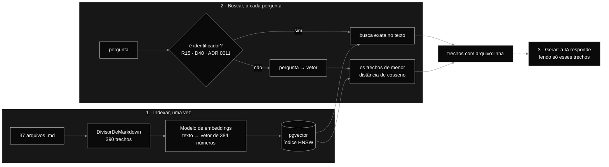

# 🔎 RAG vetorial da documentação (Spring AI + pgvector)

| | |
|---|---|
| 🎯 **Para que serve** | perguntar à documentação do projeto **em linguagem natural** ("o cliente pode cancelar depois de pagar?") e receber os trechos certos, com arquivo e linha |
| 🧰 **Feito com** | Java 25 · Spring Boot 4.1.2 · **Spring AI 2.0.2** · PostgreSQL 18 + **pgvector** · embeddings locais (ONNX), sem chave de API e sem custo |
| 📦 **Onde** | [`ferramentas/rag/`](../../ferramentas/rag) : ferramenta de desenvolvimento, **separada da API** da barbearia (não vai para produção) |
| 🔒 **Privacidade** | o texto nunca sai da máquina; só a documentação pública é indexada (a área interna da equipe, fora do repositório, fica de fora) |

## O que é RAG, em uma figura



**R**etrieval (recuperar) + **A**ugmented (colocar o trecho no prompt) + **G**eneration (a IA responde). Este módulo faz o **R**, que é a parte que decide a qualidade; o **G** é qualquer assistente (Claude Code, Copilot) lendo os trechos devolvidos.

## Rodar

```bash
docker compose --profile rag up -d rag-db        # PostgreSQL 18 com pgvector, porta 5434
cd ferramentas/rag
./mvnw -q spring-boot:run -Dspring-boot.run.arguments=indexar
./mvnw -q spring-boot:run "-Dspring-boot.run.arguments=buscar 'o cliente pode cancelar depois de pagar?'"
./mvnw -q spring-boot:run -Dspring-boot.run.arguments=avaliar
```

Na primeira execução o Spring AI baixa o modelo (118 MB) e o tokenizador (9 MB) para `ferramentas/rag/.cache/` (fora do Git).

Saída real da indexação (17/11/2026): `indexados 390 trechos de 37 arquivos`, em menos de 30 s.

## As peças

| Arquivo | Papel | Conceito |
|---|---|---|
| [`DivisorDeMarkdown`](../../ferramentas/rag/src/main/java/io/github/k3vinrich4rd/altashoras/rag/DivisorDeMarkdown.java) | corta cada `.md` por título, em blocos de até 1.200 caracteres, sem partir linha de tabela; guarda título e linha | **chunking**: o tamanho do trecho decide o que a busca enxerga |
| [`Indexador`](../../ferramentas/rag/src/main/java/io/github/k3vinrich4rd/altashoras/rag/Indexador.java) | gera o vetor de cada trecho e grava com os metadados (`arquivo`, `titulo`, `linha`) | **embedding** e `VectorStore.add` |
| [`Buscador`](../../ferramentas/rag/src/main/java/io/github/k3vinrich4rd/altashoras/rag/Buscador.java) | busca **híbrida**: identificador por texto exato; pergunta por vetor | `similaritySearch`, distância de cosseno |
| [`Avaliador`](../../ferramentas/rag/src/main/java/io/github/k3vinrich4rd/altashoras/rag/Avaliador.java) + [`avaliacao.tsv`](../../ferramentas/rag/src/main/resources/avaliacao.tsv) | mede quantas perguntas acham o documento esperado entre os 3 primeiros | **eval** de recuperação (acerto@3) |
| [`application.yml`](../../ferramentas/rag/src/main/resources/application.yml) | modelo multilíngue quantizado, 384 dimensões, índice HNSW, cosseno | configuração do Spring AI |

**Modelo:** `paraphrase-multilingual-MiniLM-L12-v2` (quantizado, 118 MB). O padrão do Spring AI (`all-MiniLM-L6-v2`) é treinado em inglês; como a documentação é em português, o multilíngue foi a escolha.

## O que a avaliação mostrou (números reais, 17/11/2026)

17 perguntas em [`avaliacao.tsv`](../../ferramentas/rag/src/main/resources/avaliacao.tsv): 12 em linguagem natural e 5 identificadores. Medição com 390 trechos de 37 arquivos.

| Estratégia | Linguagem natural (12) | Identificadores (5) | Total |
|---|:-:|:-:|:-:|
| Só vetor | 10 | **0** | 10 de 17 |
| **Híbrida** (exata para identificador, vetor para o resto) | 10 | **5** | **15 de 17** |

**A lição:** para o modelo, `R15` e `R16` são textos quase idênticos, então o vetor sozinho errou **todos** os identificadores. E a busca exata não responde "o cliente pode cancelar depois de pagar?". Nenhuma das duas resolve sozinha; **a combinação resolve**. É a medição que sustenta a regra do projeto: identificador estável + busca exata para o que tem código, vetor para o que é pergunta.

> O número oscila quando a documentação muda (na primeira medição, com 379 trechos, foi 9 e 14 de 17): por isso a avaliação é um comando, não uma frase. Mudou os documentos ou o modelo? Rode `indexar` e `avaliar` de novo.

Os 2 erros que ficaram (registrados como estão, sem ajustar a avaliação para parecer melhor):

| Pergunta | Esperado | Leitura |
|---|---|---|
| como eu rodo os testes do projeto? | guia de testes | trechos curtos que falam de "testes" (checklist de PR, como-foi-construído) ganharam do guia, que é longo e dividido em muitos trechos |
| qual é o horário de funcionamento da barbearia? | dossiê | o README, que veio em primeiro, também traz a resposta certa; a expectativa era estreita |

## Limites e próximos passos

- É recuperação, não um chatbot: devolve trechos, não redige resposta.
- Reindexar é manual (`indexar` apaga e regrava tudo): suficiente para ~40 arquivos.
- Melhorias a medir com a mesma avaliação: sobreposição entre trechos, *reranking*, e combinar as duas buscas por pontuação (em vez de escolher uma).
- Uso planejado no produto (pós-beta): assistente de agendamento com `@Tool` consultando `GET /disponibilidade`, só leitura, com design doc e evals antes do código ([estudos aplicados](../estudos-aplicados.md)).
