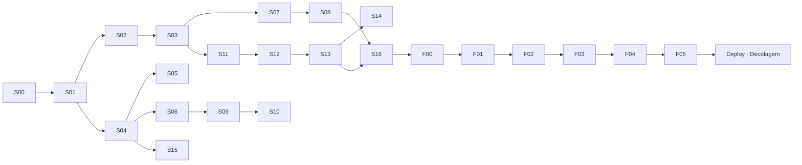

# 🗺 Plano de fatias do beta

| | |
|---|---|
| 🎯 **Para que serve** | a ordem do trabalho em fatias verticais (issues de até 1 dia), cada uma com "pronto quando", testes e a IA responsável |
| 👥 **Quem usa** | o coordenador (abre as issues e revisa os PRs), as IAs executoras e o Kevin (acompanha e aprova releases) |
| ⏰ **Quando usar** | ao abrir a próxima issue e ao revisar um PR de fatia |
| 🧰 **Como** | cada fatia cita as regras (R#) do [dossiê](../contexto.md#3-regras-de-negócio), as rotas do [contrato](../contrato/contrato-api.md) e os passos do [guia e2e](../guia-testes-e2e.md) |
| 🚫 **Não cobre** | estimativa em horas (sem histórico ainda) · deploy (fica para a fatia de deploy, com a Decolagem) |

> Status: **proposta (13/11/2026)**. Fatias que dependem de HIPÓTESE (H#) usam o valor da hipótese como **dado configurável**; quando o Kevin responder, muda o dado, não o código.

## Pronto quando (vale para toda fatia)

Além do "pronto quando" próprio, toda fatia só entra na `develop` com:

- testes de integração verdes com PostgreSQL real (Testcontainers);
- erros em RFC 9457 com teste (`code` e `traceId`);
- rota nova com teste de 401, 403 ou 404 (matriz do [painel](../admin/painel-admin.md#2-matriz-de-acesso-o-que-cada-teste-prova));
- nenhum dado pessoal em log;
- ArchUnit e Spring Modulith `verify()` verdes;
- CI verde (build, testes, CodeQL, gitleaks);
- contrato, ADR (se mudou decisão) e passos do guia e2e atualizados; o passo do guia deixa de ser "Planejado" com o comando e a resposta reais.

## Quem faz o quê

| IA | Papel nas fatias | Reserva |
|---|---|---|
| **Claude Code** | fatias de domínio difícil: agenda, concorrência, expiração, pagamento, webhook, refresh | Copilot com `claude-sonnet-5.5` (o login do Claude Code expirou em 13/11/2026; voltar exige rodar `claude` no PC) |
| **GitHub Copilot** | CRUD, DTOs, mapeamentos, testes de cenários já listados; coding agent em issue bem especificada | Claude |
| **Gemini** (`agy`) | pesquisa com fonte e data antes da fatia (ex.: payload real do Asaas) e ataque ao desenho | Claude |
| **Coordenador (Grok)** | abre as issues com contexto mínimo, roda build e testes, revisa o PR contra o contrato | — |
| **Kevin** | decide as HIPÓTESES, aprova merges e o release `develop → main` | — |

## Fatias do backend

| Fatia | Entrega | Pronto quando | Testes obrigatórios (feliz + erro) | IA |
|---|---|---|---|---|
| **S00** Esqueleto | `pom.xml` (Spring Boot 4.1.2, Java 25), `compose.yaml`, `application*.yml`, pacotes dos 8 módulos, `GlobalExceptionHandler` 9457, `Clock` injetado, CI | `./mvnw verify` verde; `GET /actuator/health` 200 com Postgres do compose (B1); as 14 regras ArchUnit rodando | `ContextoSobeIT` (Testcontainers) · `ErroPadraoTest` (404 de rota inexistente em `problem+json`) · `ArquiteturaTest` + `ModulithTest` | Claude (reserva: Copilot) |
| **S01** Banco V1 | `V1__agenda.sql` a partir da [proposta](../banco/V1__agenda.proposta.sql); schema da `event_publication` conferido com a versão do Modulith | Flyway aplica do zero; constraint e índices existem | `V1MigracaoIT` · `SobreposicaoConstraintIT` (dois inserts sobrepostos: o segundo falha com `23P01`; encostados `[)` passam) · `ConcorrenciaReservaIT` (N threads, uma vence) · reserva `CANCELADO` não bloqueia | Claude |
| **S02** Catálogo e configuração | `GET /servicos`, `GET /barbeiros`; leitura de `configuracao_agenda` (H4 a H12) | catálogo só com ativos; valores vêm do banco, nenhum fixo no código (B2) | `CatalogoIT` (só ativos) · serviço inativo não aparece · `ConfiguracaoAgendaTest` | Copilot |
| **S03** Disponibilidade | `GET /disponibilidade` (jornada, folgas, granularidade H11, horizonte H12, antecedência H5, fuso `America/Sao_Paulo`) | horários batem com a jornada; vencidas não ocupam (R15) (B8) | `DisponibilidadeIT` · `422 FORA_DO_HORIZONTE` · `404` serviço inexistente · `DisponibilidadeExpiracaoIT` (R15) · teste de virada de dia no fuso | Claude |
| **S04** Cadastro e login | `POST /auth/cadastro`, `POST /auth/login`, `GET /me`, JWT curto (H15) | e-mail único sem diferença de maiúsculas (R24) (B5 a B7) | `CadastroIT` · `409 EMAIL_JA_CADASTRADO` · `401 CREDENCIAIS_INVALIDAS` com a mesma mensagem para e-mail inexistente · senha só como hash | Copilot |
| **S05** Refresh e logout | `POST /auth/refresh` rotativo, `POST /auth/logout` (ADR 0006) | refresh de uso único; reuso revoga a família (R27) | `RefreshRotativoIT` · `401 REFRESH_REUTILIZADO` · `401 REFRESH_INVALIDO` vencido (Clock) | Claude |
| **S06** Admin inicial e acesso | admin por `ADMIN_EMAIL`/`ADMIN_SENHA` (R25), limite de login (R26, H14), matriz 401/403/404 | primeiro admin criado só uma vez; 429 com `Retry-After` (B19 a B21) | `AdminInicialIT` (senha gerada no teste; segunda subida não sobrescreve) · `LimiteTentativasIT` · `MatrizAcessoAdminIT` | Claude (reserva: Copilot) |
| **S07** Reserva do cliente | `POST /agendamentos` (`CONFIRMADO`), expiração preguiçosa com lock ordenado (R16, ADR 0003) | 409 na colisão, inclusive simultânea (B9 a B11, B17) | `ReservaClienteIT` · `409 HORARIO_INDISPONIVEL` · `422 FORA_DO_EXPEDIENTE` / `ANTECEDENCIA_INSUFICIENTE` · `ExpiracaoPreguicosaIT` · `409 CONFLITO_CONCORRENTE` quando o `40P01` persiste depois do retry (deadlock simulado) · `401` sem token | Claude |
| **S08** Meus agendamentos | `GET /me/agendamentos`, `GET /agendamentos/{id}`, cancelar e remarcar (R18, R19, H6) | dono vê, outro recebe 404 (B18) | `CancelamentoTest` · `422 JANELA_CANCELAMENTO_ENCERRADA` · `RemarcacaoIT` (atômica) · `ReservaBolaIT` (R23) | Copilot (remarcação: Claude) |
| **S09** Admin: catálogo, jornada, folgas, auditoria | `/admin/servicos`, `/admin/barbeiros`, jornada, folgas, `/admin/configuracao`, `/admin/auditoria` | toda escrita gera uma linha de auditoria (B22) | `AdminServicoIT` · `409 NOME_JA_EXISTE` · `422 JORNADA_SOBREPOSTA` · `422 FOLGA_COM_RESERVAS` · `409 CONFLITO_DE_VERSAO` · `AuditoriaIT` · 403 para BARBEIRO | Copilot |
| **S10** Agenda e fechamento | `GET /admin/agenda`, `PATCH /admin/agendamentos/{id}/status` (R20 a R22, H9) | barbeiro vê e fecha só a própria agenda (B23) | `ReservaStatusTest` (todas as transições) · `422 TRANSICAO_INVALIDA` · `422 MOTIVO_OBRIGATORIO` · `FechamentoAtendimentoIT` · `404` barbeiro na agenda de outro | Claude |
| **S11** Reserva guest | `POST /agendamentos/guest` (`AGUARDANDO_PAGAMENTO`, `expira_em`, `tokenGuest` com hash), `GET /agendamentos/guest/{id}` | token mostrado uma vez; sem token, 404 (B12a) | `ReservaGuestIT` · `404` token errado · `429` por IP (R26) · `409` horário ocupado | Claude |
| **S12** Cobrança do sinal | `POST /pagamentos/cobrancas` no sandbox do Asaas (ADR 0007), `X-Idempotency-Key`, CPF só em trânsito (ADR 0009) | Pix do sinal criado no sandbox; repetição devolve a mesma cobrança (B12b) | `CobrancaIdempotenciaIT` (WireMock) · `422 IDEMPOTENCIA_CONFLITO` · `400 CPF_INVALIDO` · `422 RESERVA_EXPIRADA` · `503 GATEWAY_INDISPONIVEL` com timeout · CPF não aparece no banco nem no log | Claude |
| **S13** Webhook e pagamento tardio | `POST /pagamentos/webhook` (token `asaas-access-token` + reconsulta), `evento_webhook`, R11 a R14, conciliação no `GET` do guest | evento confirmado vira `CONFIRMADO`; repetido não faz nada; tardio vira `PAGA_APOS_EXPIRACAO` (B13 a B15) | `WebhookAssinaturaIT` (401) · `WebhookIdempotenciaIT` · `ConfirmacaoPagamentoIT` · `PagamentoTardioIT` (H8) · teste manual registrado no sandbox | Claude |
| **S14** Job de expiração | job com ShedLock a cada minuto e na subida; `ReservaExpirada` (R17) | vencidas viram `EXPIRADO` e o horário volta (B16) | `ExpiracaoJobIT` (Clock adiantado) · job concorrente não roda duas vezes (ShedLock) · cobrança paga depois do evento vira `PAGA_APOS_EXPIRACAO` | Claude |
| **S15** CEP | `GET /cep/{cep}`: ViaCEP → BrasilAPI, cache Caffeine, timeout curto (ADR 0008) | CEP preenche bairro e cidade; com as duas fora, o cadastro continua (B3, B4) | `CepIT` (WireMock) · `400 CEP_INVALIDO` · `404 CEP_NAO_ENCONTRADO` · `CepDegradacaoIT` (R31) · cache evita segunda chamada | Copilot |
| **S16** Privacidade | consentimentos, `GET /me/dados`, `DELETE /me`, retenção do guest (H13), teste de PII no log | titular exporta e apaga; nenhum CPF, telefone ou CEP no log (B24, B26) | `ConsentimentoIT` (R28) · `ExportacaoDadosIT` · `ExclusaoContaIT` (login falha depois) · `RetencaoGuestIT` (R29) · `SemDadoPessoalNoLogIT` (R30) | Claude (reserva: Copilot) |

## Fatias do front (depois do backend verde)

| Fatia | Entrega | Pronto quando | Testes | IA |
|---|---|---|---|---|
| **F00** Esqueleto Next.js + BFF | Next.js, paleta preto/branco/prata, BFF que guarda o refresh em cookie `HttpOnly` (ADR 0006) | sobe local e fala com a API; token fora do `localStorage` (F1, F3) | teste do BFF (cookie `HttpOnly`, `Secure`, `SameSite`) · erro 401 leva ao login | Copilot (BFF: Claude) |
| **F01** Catálogo e agenda | serviços, barbeiros, disponibilidade, reserva do cliente | fluxo F4 e F5 com mensagem amigável no 409 | componentes + erro 409 | Copilot |
| **F02** Cadastro, login, conta | cadastro com CEP, consentimento desmarcado, minha conta | F2, F3, F7 | validação + CEP fora | Copilot |
| **F03** Guest e Pix | reserva guest, CPF só no pagamento, contagem de 15 min, status por consulta | F6 com o sandbox | expiração da contagem · token guest só em memória da sessão | Claude |
| **F04** Painel | agenda, fechamento, serviços, barbeiros, sinais, regras, auditoria | F8, F9 | acesso negado para cliente · fechamento | Copilot |
| **F05** Acessibilidade e celular | contraste AA, teclado, layout mobile | F10 | checagem automática de acessibilidade | Copilot |

## Depois do beta

| Item | Quando |
|---|---|
| **Deploy** (Dockerfile, flags da JVM medidas com 512 MB, CORS de produção, `render.yaml`, Aiven, Vercel, README final) | fatia própria com a **Decolagem**, depois da agenda verde |
| Login social (Google, Microsoft) | atrás de flag (R32), pós-beta |
| Painel de alcance geográfico (agregados com k ≥ 5) | pós-beta, com consentimento |
| Estorno automático do pagamento tardio | pós-beta (hoje manual, H8) |

## Dependências entre fatias

