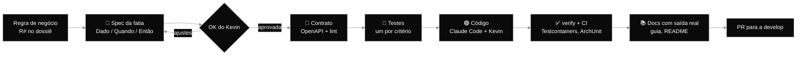

# 📐 Spec-Driven Development (SDD) na Barbearia Altas Horas

| | |
|---|---|
| 🎯 **Para que serve** | mostrar como cada fatia nasce: primeiro a **especificação**, depois o contrato, o teste e só então o código |
| 👥 **Para quem** | recrutador, revisor e qualquer IA que for ajudar no código (Claude Code, assistentes de front) |
| ⏰ **Quando usar** | antes de abrir qualquer PR de código |
| 🚫 **Não cobre** | regras de negócio (estão no [dossiê](../contexto.md)) e decisões (estão em [decisoes.md](../planejamento/decisoes.md)) |

## Por que SDD

Projeto **individual**: o Kevin Richard faz o backend com o Claude Code como par de programação, e o frontend é gerado com IA. Quando a IA escreve boa parte do código, o que garante a qualidade não é "pedir bem": é ter uma **especificação verificável** que a IA segue e que os testes cobram. Sem spec, a IA preenche lacunas com suposições; com spec, ela implementa critérios de aceite que viram testes.

| | Sem SDD (prompt solto) | Com SDD |
|---|---|---|
| Fonte da verdade | o histórico do chat | `docs/sdd/fatia-N-*.md` + contrato OpenAPI |
| Ambiguidade | a IA decide sozinha (e muda de ideia) | decidida na spec, com data e motivo |
| Prova de pronto | "parece funcionar" | cada critério Dado/Quando/Então tem um teste com nome |
| Revisão | ler todo o diff | conferir o diff contra a spec |
| Troca de ferramenta de IA | perde o contexto | o contexto está no repositório |

## O fluxo de cada fatia

1. **Spec** (`docs/sdd/fatia-N-*.md`, a partir do [modelo](modelo-de-spec.md)): escopo, regras citadas, contrato, decisões de desenho, **critérios de aceite numerados** e o teste que prova cada um.
2. **Aprovação**: o Kevin lê e dá o OK. Nenhuma linha de código de produção antes disso.
3. **Contrato**: rota, schema e erros no [`openapi.yaml`](../contrato/openapi.yaml), com `redocly lint` sem erro.
4. **Testes primeiro**, com o nome do critério (`A3: ...`) no `@DisplayName`.
5. **Código** até os testes passarem; **docs** só com saída de execução real.
6. **PR** para a `develop` com o [checklist](checklist-pr.md). A `main` só recebe release.

## Specs

| Fatia | Spec | Status |
|---|---|---|
| 1 · Esqueleto + Flyway V1 + Compose | [fatia-1-esqueleto.md](fatia-1-esqueleto.md) | ✅ implementada (26 testes) |
| 2 · Catálogo + disponibilidade | [fatia-2-catalogo-disponibilidade.md](fatia-2-catalogo-disponibilidade.md) | ✅ implementada (69 testes no total) |
| 3 · Conta e acesso | [fatia-3-conta-e-acesso.md](fatia-3-conta-e-acesso.md) | ✅ implementada (115 testes no total) |
| 4 · Agendamento e pagamento | [fatia-4-agendamento-e-pagamento.md](fatia-4-agendamento-e-pagamento.md) | ✅ aprovada (17/11) · 4A pronta (A1 a A21) · 4B em seguida |
| 5 · Painel do barbeiro e do admin | [fatia-5-painel-do-barbeiro.md](fatia-5-painel-do-barbeiro.md) | ✅ concluída (17/11): 5A e 5B, 71/71 critérios |
| 6 · CEP e privacidade (LGPD) | [fatia-6-cep-e-privacidade.md](fatia-6-cep-e-privacidade.md) | ✅ aprovada (17/11) · **6A CEP (A1 a A22): pronta (revisada, fluxo manual B3 e B4)** · **6B privacidade (A23 a A61): implementada, aguardando revisão** · **6C alcance por região (A62 a A75): pronta, aguardando revisão** |
| 6D · Prazo de 3 min, WhatsApp do barbeiro e reserva manual | [fatia-6d-whatsapp-e-reserva-manual.md](fatia-6d-whatsapp-e-reserva-manual.md) | ✅ aprovada pelo Kevin (18/11/2026) · implementada (28 critérios, A1 a A28) |
| 7 · Telas em Next.js | [fatia-7-telas.md](fatia-7-telas.md) | ✅ aprovada (18/11) · **7A e 7B prontas, aguardando revisão** (62 critérios com teste: A1 a A62; acabamento visual V1 a V12 implementado; contrato 1.7.0 com `GET /admin/minha-jornada`) |
| 8 · Deploy grátis | [fatia-8-deploy.md](fatia-8-deploy.md) | ✅ preparada e no ar em beta |
| 8B · Deploy robusto e econômico | [fatia-8b-deploy-robusto.md](fatia-8b-deploy-robusto.md) | ✅ aprovada pelo Kevin (23/11/2026) · implementada na branch `feat/fatia-8b-deploy-robusto`, aguardando PR (CI verde antes do deploy, subida mais rápida, health sem falso alarme, ping dentro das 750 h, rollback, backup) |
| 9 · Assistente de dúvidas (RAG) | [fatia-9-assistente-de-duvidas.md](fatia-9-assistente-de-duvidas.md) | 📝 pós-beta, desligada por padrão |
| Catálogo inicial (V8) | [fatia-catalogo-inicial.md](fatia-catalogo-inicial.md) | ✅ implementada (20/11/2026): 5 serviços, o barbeiro e a jornada no banco, A1 a A7 (D152) |
| 10 · Convite e login do barbeiro terceiro (10A isolamento, 10B convite) | [fatia-10-convite-do-barbeiro.md](fatia-10-convite-do-barbeiro.md) | ✅ aprovada (23/11) |
| 11 · Alcance por estado, município e região (k = 5, consentimento sem CEP) | [fatia-11-alcance-por-nivel.md](fatia-11-alcance-por-nivel.md) | ✅ aprovada (23/11) |
| 12 · Site mais fluido e mais completo (home, agendar, galeria, Trajetória) | [fatia-12-site-fluido.md](fatia-12-site-fluido.md) | ✅ aprovada (23/11) com as 12 propostas · implementada (12A, 12B e 12C, 27 critérios com teste; LCP medido 2,46 a 2,63 s, ver guia de testes 7.5) |
| 13 · Notificação ao barbeiro quando o cliente marca horário (Web Push, aviso no painel, e-mail preparado) | [fatia-13-notificacao-ao-barbeiro.md](fatia-13-notificacao-ao-barbeiro.md) | ✅ aprovada em 24/11/2026 (implementando) |
| 14 · Experiência premium (mais 1 minuto no Pix, olhinho na senha, mensagens, Trajetória, fluidez) e agenda nova do painel | [fatia-14-experiencia-premium.md](fatia-14-experiencia-premium.md) | ⏸ aguarda aprovação do Kevin (24/11/2026) |

## A IA no processo

| Recurso | Para quê | Onde |
|---|---|---|
| **Claude Code** (par de programação do backend) | escreve spec, testes e código com o Kevin; roda `./mvnw verify`, Docker e lint de verdade antes de afirmar qualquer número | terminal / app |
| **Skills do projeto** | receitas repetíveis: `/especificar-fatia`, `/implementar-fatia`, `/verificar-contrato` | [`.claude/skills/`](../../.claude/skills/) |
| **Agente `revisor-de-fatia`** | revisão independente, só leitura, do código contra a spec | [`.claude/agents/`](../../.claude/agents/revisor-de-fatia.md) |
| **Eval do processo** | `scripts/conferir-spec.sh N --exigir`: todo critério `A#` da spec tem teste com esse número; roda no CI para as fatias implementadas | [`scripts/`](../../scripts/conferir-spec.sh) |
| **Contexto no repositório** | o [`CLAUDE.md`](../../CLAUDE.md) diz onde está cada coisa; `scripts/buscar-contexto.sh R15` traz a regra, a decisão e os testes ligados a ela | raiz do repositório |
| **IA no frontend** | o Next.js é gerado com IA a partir do contrato OpenAPI e das specs de tela; o Kevin revisa e os testes cobram | Fatia 7 |

### Por que não um RAG com banco vetorial

Para o dia a dia, a **recuperação por identificador** continua sendo a regra: o conhecimento cabe em ~40 arquivos com identificadores estáveis (R1 a R32, D1 a D50, códigos de erro, A1 a A29), e `buscar-contexto.sh` encontra a linha exata, de graça.

Depois eu montei o RAG vetorial mesmo assim, para **medir** em vez de opinar ([`docs/ia/rag-vetorial.md`](../ia/rag-vetorial.md)): numa lista de 17 perguntas, o vetor sozinho acertou 10 e errou **todos** os identificadores; a busca híbrida (exata para identificador, vetor para pergunta em linguagem natural) acertou 15. Conclusão: as duas se completam, e o identificador estável segue sendo o que mais ajuda a IA.
