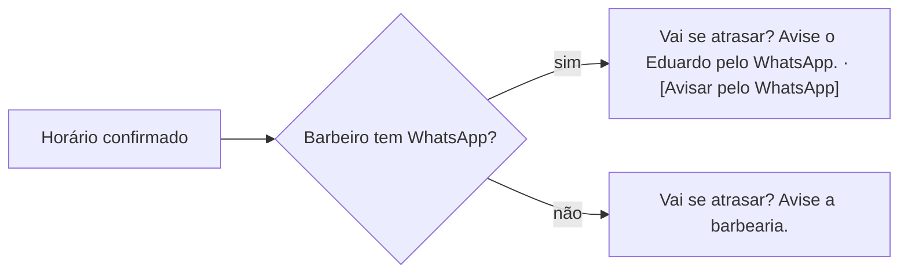

# Confirmação: avisar atraso pelo WhatsApp

**Objetivo:** na confirmação da reserva, trocar o convite genérico por "Vai se atrasar? Avise o Eduardo pelo WhatsApp." com o botão "Avisar pelo WhatsApp", como no PDF.
**Usuários:** cliente com conta e visitante, já com o horário pago.
**Fora do escopo:** mensagem pronta de atraso, lembrete automático, cancelar ou remarcar (não existe, e o cliente aceitou isso antes de pagar).

## Referências (link + o que copiar)
- PDF *Site · Barbearia Altas Horas*, p.12 ("Vai se atrasar? Avise o Eduardo pelo WhatsApp." e os botões "Avisar pelo WhatsApp", "Criar conta para ver meus agendamentos" e "Voltar para o início") e p.14 (consulta da reserva: "Vai se atrasar? Avise o Eduardo." + "Avisar pelo WhatsApp").
- Laws of UX, Peak-End: https://lawsofux.com/ · o fim da jornada pesa na lembrança; a ação útil fica à mão.

## Situação no código
`Confirmacao.tsx:103` "Vai se atrasar? Avise a barbearia." e, logo abaixo (`:105`), o `ContatoWhatsapp`, que diz "Prefere combinar pelo WhatsApp? Falar com Eduardo no WhatsApp". Depois de pago, "prefere combinar" não faz sentido.

## Fluxo


## Telas
**Celular:**
```
E agora?
• Chegue alguns minutos antes. O horário é só seu.
• Não há cancelamento nem remarcação pelo site, como você aceitou antes de pagar.
• Vai se atrasar? Avise o Eduardo pelo WhatsApp.
[ AVISAR PELO WHATSAPP ]   ← <a>, abre o WhatsApp
```
**Desktop:** igual, o botão alinhado à esquerda.
- O primeiro nome vem de `nomeExibicao` do barbeiro da reserva (`r.barbeiro.id` em `GET /barbeiros`), e o número, de `whatsapp`. Nada fixo no código.
- O link é `https://wa.me/55<número>` **sem** texto pronto (o PDF não traz mensagem de atraso).
- O `ContatoWhatsapp` ganha uma variante com rótulo próprio, ou a confirmação usa `linkDoWhatsapp` direto. O "Prefere combinar pelo WhatsApp?" sai desta tela.

## Estados
- Sem número: só o texto "Vai se atrasar? Avise a barbearia." (o de hoje), sem botão.
- Barbeiros ainda carregando: mostra o texto sem botão e acrescenta o botão quando chegar, sem pular layout (reservar a altura).
- Erro ao carregar barbeiros: igual a "sem número".

## Conteúdo e microcopy
| Lugar | Texto | Fonte |
|---|---|---|
| Item da lista | "Vai se atrasar? Avise <primeiro nome> pelo WhatsApp." | PDF p.12 |
| Botão | "Avisar pelo WhatsApp" · nome acessível "Avisar pelo WhatsApp (abre o WhatsApp)" | PDF p.12 |
| Sem número | "Vai se atrasar? Avise a barbearia." | texto atual |

## Acessibilidade
2.4.4 (propósito do link), 2.5.3 (nome acessível contém o texto visível), 2.5.8 (alvo ≥ 44 px pelo PDF p.22).

## Dados e LGPD
Nenhum dado novo; o link não leva dado da reserva.

## Critérios de aceite (Dado/Quando/Então)
| # | Dado | Quando | Então |
|---|---|---|---|
| CA-1 | reserva paga, barbeiro "Eduardo Candido" com WhatsApp | abre a confirmação | lê "Vai se atrasar? Avise o Eduardo pelo WhatsApp." e vê o link "Avisar pelo WhatsApp" com `href` `https://wa.me/55<número da API>` sem `?text=` |
| CA-2 | o mesmo | procura "Prefere combinar pelo WhatsApp?" | não existe nesta tela |
| CA-3 | barbeiro sem WhatsApp (mock) | abre a confirmação | lê "Vai se atrasar? Avise a barbearia." e não há link |
| CA-4 | leitor de tela | foca o link | ouve "Avisar pelo WhatsApp (abre o WhatsApp)" |
| CA-5 | 360×800 e 1280×800 | roda o axe | 0 violações |

Testes: Vitest (`confirmacao-whatsapp.test.tsx`: CA-1 a CA-4), Playwright (`e2e/e2e-visitante.spec.ts`: CA-1 e CA-5 no pagamento simulado).

## Métricas de sucesso
Sem medição hoje. O barbeiro diz se os avisos de atraso passam a chegar pelo WhatsApp.

## Riscos e perguntas abertas
- Título da confirmação (**decisão de 27/11**): "Fechado! Seu horário está garantido." vira "Agendado! Seu horário está garantido." (`textos.ts:28`, `mensagens-voz.test.ts:131` e os e2e que procuram o título, entre eles `e2e/e2e-visitante.spec.ts:43`). Vai em PR próprio; esta spec não muda o título, mas o e2e dela deve procurar o texto que estiver na `develop`.
- A consulta da reserva (`/reserva`, PDF p.14) tem a mesma frase curta ("Avise o Eduardo."). Fica para depois, se o Kevin quiser igualar.
- Arquivos prováveis: `frontend/src/telas/Confirmacao.tsx` (98-106), `frontend/src/componentes/ContatoWhatsapp.tsx`, `frontend/src/telas/confirmacao-whatsapp.test.tsx`, `frontend/e2e/e2e-visitante.spec.ts`.

## Decisões de implementação

- O título da confirmação permanece o que está na `develop` ("Fechado! Seu horário está garantido."). A troca para "Agendado! Seu horário está garantido." fica em PR próprio.
- A consulta da reserva em `/reserva` não foi alterada (fica para depois, se o Kevin quiser igualar).
- A confirmação usa `linkDoWhatsapp` de `ContatoWhatsapp` direto, sem `?text=`. O componente `ContatoWhatsapp` (e o "Prefere combinar pelo WhatsApp?") sai desta tela; nas outras, o convite continua igual.
- O primeiro nome e o número vêm de `GET /barbeiros` pelo `r.barbeiro.id`. Nenhum número está escrito no código. Nos testes unitários o número fictício é `11900000001`.
- A altura do botão fica reservada em `.aviso-atraso-acao` (`min-height: var(--space-12)`), para o layout não pular quando a lista de barbeiros chegar. Sem número, ou com erro no carregamento, permanece o texto "Vai se atrasar? Avise a barbearia." e o espaço vazio.
- No desktop o botão principal desta ação alinha à esquerda (`justify-content: flex-start`).
