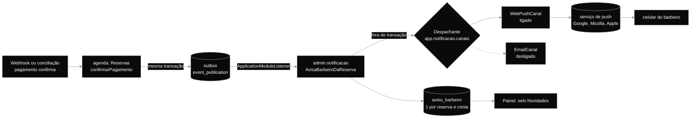

# 📐 Spec · Fatia 13 · Notificação ao barbeiro quando um cliente marca horário

| | |
|---|---|
| **Status** | 📝 aguarda aprovação do Kevin |
| **Origem** | pedido do Kevin em 24/11/2026: quando um cliente marca horário pelo app (**com cadastro** ou **sem cadastro, como visitante**), o **barbeiro daquela reserva** recebe uma notificação. Em geral é o Eduardo (Dono/Admin), mas o barbeiro convidado da [Fatia 10](fatia-10-convite-do-barbeiro.md) também recebe as dos clientes dele. A reserva manual por WhatsApp é feita pelo próprio barbeiro e **não avisa** |
| **Escolhas do Kevin** | **Canal:** Web Push (notificação no celular, grátis e sem conta externa) **mais** um aviso dentro do painel. **Momento:** quando o **pagamento confirma**; reserva que expira sem pagar não gera aviso. **Preparado para e-mail:** uma porta `CanalDeNotificacao`, com o Web Push ligado e o e-mail **desligado por padrão** (mesmo padrão do `GatewayDePagamento`: `GatewaySimulado` ligado, `AsaasGateway` desligado) |
| **Entrega** | uma branch (`feat/fatia-13-notificacao-ao-barbeiro`) com commits separados: **13A** · evento `ReservaConfirmada` e aviso no painel (sem push) · **13B** · porta `CanalDeNotificacao`, Web Push e inscrição · **13C** · telas, service worker e manifesto (PWA) · **13D** · e-mail stub e documentação |
| **Regras** | R13 e R14 (pagamento confirma a reserva), R23 (alheio = `404`), R30 (nada pessoal em log), R33 (reserva manual não avisa), D121 (prazo do pagamento), D148 (visual pelo canvas, comportamento pela spec), D151 e D155 (acesso por barbeiro) |
| **ADRs** | [0002](../adr/0002-comunicacao-entre-modulos.md) (eventos entre módulos, outbox), [0007](../adr/0007-gateway-de-pagamento.md) e [0011](../adr/0011-hexagonal-seletivo-no-monolito-modular.md) (porta e adaptador), [0009](../adr/0009-lgpd-marketing-cpf-e-retencao.md) (LGPD), [0013](../adr/0013-varios-barbeiros-dono-e-convite.md) (vários barbeiros) |
| **Depende de** | [Fatia 10](fatia-10-convite-do-barbeiro.md) (já na `develop`: vínculo conta ↔ barbeiro e desligamento) · [Fatia 11](fatia-11-alcance-por-nivel.md) e [12](fatia-12-site-fluido.md) **em andamento**: só disputam **número de migração** e **versão do contrato** (ver E15 e E16) |
| **Contrato** | `1.8.0 → 1.9.0`, só acréscimos (**conferir na implementação**: a Fatia 11 também planeja a `1.9.0`; quem mergear depois leva a `1.10.0`) |
| **Migração** | a **próxima livre** no momento da implementação, planejada como `V12__notificacao_ao_barbeiro.sql` (**conferir na implementação**: hoje a `develop` termina na `V9`, a Fatia 11 usa a `V11` em diante e a 12 usa a `V10`) |
| **Decisões** | **D170 a D176**, todas marcadas **conferir** (o último número da `develop` é D156; a numeração real segue `decisoes.md` na implementação) |
| **Custo** | **zero**: Web Push não tem conta externa nem mensalidade; a chave VAPID é gerada uma vez, de graça. O e-mail fica desligado até o Kevin criar a conta num provedor gratuito |
| **Não cobre** | aviso ao **cliente** (lembrete, confirmação) · aviso de reserva cancelada, remarcada ou paga fora do prazo · SMS e WhatsApp automáticos (R33 e a política do WhatsApp seguem como estão) · app nativo · ligar o e-mail de verdade |

## 1. Objetivo

O barbeiro **sabe na hora** que entrou um cliente novo, sem abrir a agenda: o celular recebe "Novo horário: Corte Degradê, qui 27/11 às 10:00" e, dentro do painel, um selo "Novidades" mostra as confirmações recentes. O aviso só sai **depois do pagamento confirmado** (a reserva já é dele) e **só para o barbeiro da reserva**: o barbeiro A nunca recebe o aviso da reserva do barbeiro B. Trocar o canal (Web Push, e-mail) é **configuração**, não código.



## 2. Contrato

Versão **1.9.0** do [`openapi.yaml`](../contrato/openapi.yaml) e do [`contrato-api.md`](../contrato/contrato-api.md) (`redocly lint` com 0 erros). Só acréscimos. Todas as rotas são `🛠` (ADMIN **ou** BARBEIRO); o **CLIENTE** recebe `403 ACESSO_NEGADO`. O escopo é **sempre a conta do token**: nenhuma rota recebe `usuarioId` nem `barbeiroId`.

| Método | Rota | O que faz | Sucesso | Erros |
|---|---|---|---|---|
| `GET` | `/admin/notificacoes/chave-publica` | a chave pública VAPID, para o navegador criar a inscrição: `{ "disponivel": true, "chavePublica": "B..." }`. Sem VAPID configurada: `{ "disponivel": false }` (a tela mostra "notificações indisponíveis") | `200` | `401`, `403` |
| `POST` | `/admin/notificacoes/inscricao` | guarda a inscrição do aparelho **na conta de quem chama**: `{ "endpoint": "https://...", "chaves": { "p256dh": "...", "auth": "..." } }`. Idempotente por `endpoint` | `204` | `400 VALIDACAO_INVALIDA`, `400 CAMPO_DESCONHECIDO`, `401`, `403` |
| `DELETE` | `/admin/notificacoes/inscricao` | remove a inscrição do aparelho: corpo `{ "endpoint": "..." }` (o endpoint **não vai na URL**, para não cair em log de acesso). Endpoint que não é da conta responde `204` igual, sem apagar nada | `204` | `400`, `401`, `403` |
| `GET` | `/admin/notificacoes` | "Novidades": os avisos **da conta de quem chama**, do mais novo ao mais antigo (`limite` de 1 a 50, padrão 20): `{ "naoLidas": 2, "itens": [{ "id", "reservaId", "servico", "inicio", "criadoEm", "lido" }] }`. **Sem nome nem WhatsApp do cliente** (E10) | `200` | `400`, `401`, `403` |
| `POST` | `/admin/notificacoes/marcar-lidas` | marca como lidos todos os avisos da conta de quem chama | `204` | `401`, `403` |
| `POST` | `/admin/notificacoes/teste` | manda um aviso de teste ("Notificações ativadas neste aparelho") só para os aparelhos da conta de quem chama; serve para o Kevin conferir o iPhone. **Limite de 5 por hora por conta** | `204` | `401`, `403`, `429 LIMITE_EXCEDIDO` |

- **Sem código de erro novo**: inscrição inválida é `400 VALIDACAO_INVALIDA` (nunca um `422` que revele a lista de hosts aceitos além do necessário).
- `AvisoDoPainel` é o schema novo da lista; `InscricaoPush` e `ChavePublicaPush` são os de entrada e saída. Exemplos **reais** (perfil `dev`) nas respostas, como as fatias anteriores.
- **Nenhum campo novo** nos schemas existentes. O front consome estas rotas pelo BFF genérico (`/api/[...rota]`), sem rota nova no Next.

### Configuração (`application.yml`, sem segredo no repositório)

| Propriedade | Variável de ambiente | Padrão | Para quê |
|---|---|---|---|
| `app.notificacao.canais` | `APP_NOTIFICACAO_CANAIS` | `webpush` | lista dos canais **ligados**, separados por vírgula: `webpush`, `email`. Vazio = só o aviso no painel. Nome desconhecido = **a aplicação não sobe** (E7) |
| `app.notificacao.webpush.vapid-publica` | `APP_NOTIFICACAO_VAPID_PUBLICA` | vazio | chave pública (vai ao navegador pela rota acima) |
| `app.notificacao.webpush.vapid-privada` | `APP_NOTIFICACAO_VAPID_PRIVADA` | vazio | **segredo**: nunca no Git, nunca em log (R30); `sync: false` no `render.yaml` |
| `app.notificacao.webpush.assunto` | `APP_NOTIFICACAO_VAPID_ASSUNTO` | `https://barbearia-altas-horas.vercel.app` | o "contato" do VAPID: a URL do site, **não** o e-mail pessoal de ninguém |
| `app.notificacao.retencao-avisos-dias` | — | `30` | quanto tempo o aviso fica no painel (E13) |
| `app.notificacao.email.*` | — | desligado | só quando o canal `email` for ligado (E12) |

### Banco · migração `V12__notificacao_ao_barbeiro.sql` (**conferir o número na implementação**)

```sql
CREATE TABLE inscricao_push (
    id              UUID PRIMARY KEY,
    usuario_id      UUID NOT NULL REFERENCES usuario(id) ON DELETE CASCADE,
    endpoint        TEXT NOT NULL,
    chave_p256dh    TEXT NOT NULL,
    chave_auth      TEXT NOT NULL,
    criada_em       TIMESTAMPTZ NOT NULL,
    ultimo_envio_ok TIMESTAMPTZ,
    CONSTRAINT inscricao_push_endpoint_unico UNIQUE (endpoint)
);
CREATE INDEX inscricao_push_usuario_idx ON inscricao_push (usuario_id);

CREATE TABLE aviso_barbeiro (
    id          UUID PRIMARY KEY,
    usuario_id  UUID NOT NULL REFERENCES usuario(id) ON DELETE CASCADE,
    reserva_id  UUID NOT NULL,                 -- sem FK: a agenda é de outro módulo (ADR 0002)
    servico     TEXT NOT NULL,                 -- nome do serviço no momento do aviso
    inicio      TIMESTAMPTZ NOT NULL,
    criado_em   TIMESTAMPTZ NOT NULL,
    lido_em     TIMESTAMPTZ,
    push_enviado_em TIMESTAMPTZ,               -- null = falta entregar (E6)
    CONSTRAINT aviso_barbeiro_um_por_reserva UNIQUE (reserva_id, usuario_id)
);
CREATE INDEX aviso_barbeiro_lista_idx ON aviso_barbeiro (usuario_id, criado_em DESC);
```

Sem dado de cliente em nenhuma das duas tabelas. `endpoint` e chaves pertencem ao **aparelho do barbeiro** (E11). Migração já mergeada nunca é editada.

## 3. Decisões de desenho

| # | Decisão | Por quê |
|---|---|---|
| E1 | **Evento `ReservaConfirmada(UUID reservaId, UUID barbeiroId, Instant inicio)`**, público no pacote `agenda` (como `ReservaCancelada` e `ReservaExpirada`). **Hoje ele não existe**: a confirmação (`Reservas.confirmarPagamento`) só devolve `ResultadoConfirmacao` e o pagamento decide a cobrança. É publicado **dentro da transação** da confirmação, só quando o status **muda** para `CONFIRMADO` (a chamada repetida, que já encontra `CONFIRMADO`, **não publica**), pelo outbox do Spring Modulith (`event_publication`, V3) | o aviso não pode se perder se o app cair entre a confirmação e o envio; e a idempotência começa na origem. O webhook, a conciliação de leitura (E25 da Fatia 4) e a simulação passam todos por `confirmarPagamento`: **um ponto só** |
| E2 | **O evento não traz dado pessoal**: só ids e o instante (R30). O nome do serviço é lido pelo ouvinte (ele já existe em `Reservas.resumos`, mas o ouvinte usa só o `servico` e o `inicio`, **nunca** `contatoNome` nem `contatoWhatsapp`) | o outbox grava o evento em JSON; nome e WhatsApp de cliente não podem ficar lá |
| E3 | **Onde mora o código: subpacote `admin.notificacao`**, dentro do módulo Admin (o "painel"), sem módulo novo. O `admin` já pode depender de `agenda`, `conta` e `comum`. A agenda **não** conhece o `admin`: o `admin` escuta o evento que a agenda publica | os **8 módulos** do Spring Modulith ficam como estão; um 9º módulo só se justificaria com regra própria de domínio, e aqui é entrega de aviso ao painel. Alternativa na D-1 |
| E4 | **Quem recebe**: a **conta ligada ao `barbeiroId` do evento** (a mesma ligação que a `AcessoAgenda` usa), e **só ela**. O dono **não** recebe o aviso da reserva do barbeiro convidado (ele vê tudo na agenda; push de tudo viraria ruído). Barbeiro desligado, inativo ou sem conta ligada: sem aviso, sem erro, evento concluído. Será preciso um método **público e pequeno** na agenda para o `admin` achar a conta do barbeiro (**conferir na implementação**: `Reservas` ou o `CadastrosDoPainel` que já existem; **não** abrir o `BarbeiroRepository`) | R23 e ADR 0013: um barbeiro não enxerga a agenda do outro, então também não é avisado dela |
| E5 | **Listener `@ApplicationModuleListener`** (assíncrono, transação própria, reentrega pelo outbox, como `CancelaCobrancaDaReservaExpirada`): `AvisaBarbeiroDaReserva`. Passos: **(1)** numa transação curta, lê o serviço e a conta do barbeiro e grava o aviso com `INSERT ... ON CONFLICT (reserva_id, usuario_id) DO NOTHING`, e carrega as inscrições da conta (máximo 10); **(2)** **fora de qualquer transação**, chama cada canal ligado; **(3)** numa transação curta, marca `push_enviado_em` e `ultimo_envio_ok` | **só 3 conexões** no banco: nenhuma chamada de rede segura conexão (mesma regra do gateway de pagamento, E27 da Fatia 4) |
| E6 | **Idempotência: um aviso por reserva confirmada e por conta.** A `UNIQUE (reserva_id, usuario_id)` garante uma linha só, mesmo se o outbox reentregar. O **envio** só repete enquanto `push_enviado_em` for nulo: falha **transitória** (rede, `429`, `5xx`) deixa o evento **pendente** (a exceção sobe e o Modulith republica); sucesso em ao menos um aparelho, **ou nenhum aparelho inscrito**, marca como entregue. Falha só **definitiva** (`404`, `410`) não repete | não perder o aviso nem encher o celular de repetidos. Limite conhecido: se 1 de 2 aparelhos falhar de forma transitória e outro entregar, o aviso não é reenviado ao primeiro (aceito; o painel sempre tem o aviso) |
| E7 | **Porta `CanalDeNotificacao`** (interface **sem framework**, no pacote `admin.notificacao.canal`): `Canal canal()` e `ResultadoDoEnvio enviar(AvisoParaEnvio aviso, DestinoDoAviso destino)`. `ResultadoDoEnvio` ∈ `ENVIADO`, `TENTAR_DEPOIS`, `DESTINO_INVALIDO`, `NAO_CONFIGURADO`. `AvisoParaEnvio` = título, texto e link relativo (sem dado de cliente). O **Despachante** recebe todas as implementações como beans e **usa só as de `app.notificacao.canais`**; nome fora da lista de canais conhecidos faz a aplicação **falhar na partida** com mensagem clara. Canais vazio = só o painel. Trocar o canal é editar a variável de ambiente | mesmo desenho do `GatewayDePagamento`/`GatewaySimulado`/`AsaasGateway` (ADR 0007 e 0011). Como a seleção é por lista (e não por uma flag por classe), ligar os dois canais ao mesmo tempo também é só configuração |
| E8 | **`WebPushCanal` (ligado)**: um **único** `java.net.http.HttpClient` (sem pool novo), timeout de conexão e de resposta de **5 s**, `TTL` de 1 hora e `Urgency: high`. Criptografa o corpo (RFC 8291, `aes128gcm`) e assina com VAPID (RFC 8292). **Biblioteca**: proposta de `nl.martijndwars:web-push` (usa BouncyCastle); a alternativa de escrever a criptografia com o JDK é a D-2. Só **uma classe** importa a biblioteca (travado pelo `ArquiteturaTest`, A47). `404` e `410` do serviço de push = `DESTINO_INVALIDO` (a inscrição é **apagada**); `429`, `5xx` e timeout = `TENTAR_DEPOIS`; `201` = `ENVIADO` | limpar a inscrição morta evita enviar para sempre a quem desinstalou ou revogou a permissão |
| E9 | **Só hosts de serviço de push são aceitos** como `endpoint` (https obrigatório): `fcm.googleapis.com`, `updates.push.services.mozilla.com`, `*.push.apple.com`, `*.notify.windows.com`. Lista em `app.notificacao.webpush.hosts-permitidos` (**conferir os nomes na implementação**, pelos documentos dos navegadores). Qualquer outro host é `400 VALIDACAO_INVALIDA` e **nunca é chamado** | o backend faz uma requisição para uma URL que **o usuário informou**: sem a lista, é um SSRF (OWASP API Top 10). Mesmo o dono é só um usuário autenticado |
| E10 | **Conteúdo mínimo.** Push: título `Altas Horas`, texto `Novo horário: <serviço>, <dia da semana abreviado> <dd/MM> às <HH:mm>` no fuso `America/Sao_Paulo` (exemplo: **"Novo horário: Corte Degradê, qui 27/11 às 10:00"**), link relativo `/painel`, `tag` = o id da reserva (o sistema operacional junta repetidos). **Sem nome, WhatsApp, e-mail, CPF, valor pago nem o id da reserva no texto.** O nome do cliente **não entra** no push nem na lista "Novidades" (D-3); o barbeiro vê o nome abrindo a agenda, que já é autenticada e isolada por barbeiro. Corpo do push com no máximo **3 KB** (o limite do protocolo é 4 KB) | o push passa por Google, Mozilla ou Apple (embora criptografado de ponta a ponta); minimização (LGPD art. 6º, III) e R30 |
| E11 | **Inscrição**: `endpoint` é **único** no banco. Repetir o mesmo `endpoint` na mesma conta é idempotente; o mesmo `endpoint` chegando por **outra conta** (o mesmo aparelho, outro login) **passa para a conta nova**: quem fez o login por último é quem usa o aparelho, e a conta antiga **deixa de receber** nele. **Limite de 10 aparelhos por conta**: a 11ª substitui a mais antiga. Desligar o barbeiro (Fatia 10) ou excluir a conta **apaga** as inscrições e os avisos dele; o `ON DELETE CASCADE` cobre a exclusão, e o **desligamento** precisa de uma chamada explícita (**conferir na implementação** o evento que a Fatia 10 já publica, `ConviteAceito` e `RetencaoDeBarbeiroDesligado` são os vizinhos) | `endpoint` + chaves identificam o aparelho de uma pessoa: dado pessoal do barbeiro, com ciclo de vida igual ao da conta (H33) |
| E12 | **Canal de e-mail desligado**: `EmailCanal` implementa a porta como **stub**: sem `app.notificacao.email.*` e sem `email` em `canais`, o despachante nem o chama; se for ligado **sem configuração**, devolve `NAO_CONFIGURADO` e registra uma linha sem dado pessoal. É **provado com um falso** (um `JavaMailSender` ou cliente HTTP de teste que só grava o que recebeu), nunca com um provedor real. A documentação (`docs/planejamento/notificacao-por-email.md`, na 13D) diz **o que falta para ligar**: conta num provedor gratuito (proposta: **Brevo**, plano grátis, **conta criada pelo Kevin**), domínio ou e-mail remetente verificado (SPF e DKIM), chave de API como segredo no Render, e a decisão de qual e-mail da conta usar (o de login do barbeiro, que ele mesmo digitou, D154) | deixar a porta pronta sem mexer na política de dados nem depender de serviço externo agora |
| E13 | **Retenção e limpeza**: o aviso do painel vale **30 dias** (`retencao-avisos-dias`); um job diário (ShedLock, como os outros) apaga avisos mais velhos e inscrições **sem nenhum envio com sucesso há 90 dias**. Inscrição inválida (`404`/`410`) é apagada **na hora** pelo próprio envio | LGPD: não guardar o que não serve mais (ADR 0009) |
| E14 | **Memória e conexões** (Aiven Free, 3 conexões na API): **nenhuma consulta pesada**. A lista "Novidades" é **uma** consulta indexada (`aviso_barbeiro_lista_idx`) mais **uma** contagem; **sem polling**: o selo atualiza ao abrir o painel, ao voltar o foco para a aba e quando o service worker avisa que chegou um push. O envio é **sequencial** (no máximo 10 aparelhos), sem fila nova nem pool novo. O limite de 50 itens evita lista enorme | o ambiente é pequeno e a barbearia tem poucas reservas por dia; o custo de uma confirmação é 2 transações curtas e N chamadas HTTP fora delas |
| E15 | **Migração**: a **próxima livre** no momento da implementação (planejada `V12`; **conferir**). Se a `V10` ou a `V11` ainda não tiverem entrado, **não renumerar a de ninguém**: a numeração segue a ordem real do merge | as Fatias 11 e 12 estão em andamento |
| E16 | **Contrato**: `1.9.0` (**conferir**; a Fatia 11 também planeja a `1.9.0`). `openapi.yaml` e `contrato-api.md` com a seção nova **4.13 Notificações do barbeiro (1.9, Fatia 13)**, o histórico de versões e `redocly lint` em 0 erros | ordem de merge decide quem leva qual número |

### Decisões a registrar em `decisoes.md` (**conferir os números na implementação**; o último da `develop` é D156)

| # | Decisão | Vem de |
|---|---|---|
| D170 | Notificação ao barbeiro por **Web Push mais aviso no painel**, disparada **quando o pagamento confirma** (reserva que expira não avisa; reserva manual não avisa) | pedido do Kevin, 24/11 |
| D171 | Evento público `ReservaConfirmada` (só ids e instante), publicado pelo outbox só na mudança para `CONFIRMADO`; um aviso por reserva e conta | E1, E2, E6 |
| D172 | Porta `CanalDeNotificacao`: Web Push ligado, e-mail desligado por padrão; a troca é por `app.notificacao.canais` | E7, E12 |
| D173 | Só o barbeiro da reserva é avisado (o dono não recebe os do convidado); o push e as Novidades **não** levam o nome do cliente | E4, E10 |
| D174 | `endpoint` de push só de hosts de serviço de push, em https (contra SSRF); inscrição pertence à conta, com limite de 10 aparelhos | E9, E11 |
| D175 | Chave VAPID privada por variável de ambiente (`sync: false`), gerada uma vez pelo Kevin; a pública sai pela API | seção "Chaves VAPID" |
| D176 | PWA mínimo (`manifest.webmanifest` e `sw.js` só para push, sem cache offline); no iPhone exige a Tela de Início e iOS 16.4+ | seção "Front" |

### Chaves VAPID (o que o Kevin faz, uma vez)

- O par VAPID é um par de chaves de **curva elíptica P-256**. O `generateValue` do Render só gera texto aleatório, **não serve** para isso.
- **Gerar uma vez**, no computador do Kevin, com a ferramenta oficial da biblioteca de referência: `npx web-push generate-vapid-keys` (a implementação confere o comando exato e deixa no guia). O resultado são duas linhas: a **pública** e a **privada**.
- **Cadastrar no painel do Render** (serviço da API): `APP_NOTIFICACAO_VAPID_PRIVADA` (segredo, `sync: false` no `render.yaml`) e `APP_NOTIFICACAO_VAPID_PUBLICA`. A pública não é segredo e vai ao front pela rota `GET /admin/notificacoes/chave-publica`; assim **não existe cópia dela no front**, e o par nunca fica dessincronizado.
- **Guardar a privada** num cofre (gerenciador de senhas). **Trocar o par invalida todas as inscrições**: cada barbeiro precisa tocar em "Ativar" de novo. Por isso o par **não** deve ser regenerado a cada deploy.
- O **assunto** do VAPID é a URL do site, não o e-mail pessoal de ninguém.

### Front (Next.js) · só comportamento; **o visual espera o desenho (D148)**

- **`manifest.webmanifest`** (pelo recurso de manifesto do Next, `src/app/manifest.ts`): `name` "Barbearia Altas Horas", `short_name` "Altas Horas", `start_url` `/painel`, `scope` `/`, `display` `standalone`, cores dos tokens (`frontend/design/tokens.json`), ícones 192 e 512 (incluindo `maskable`). **Os ícones precisam ser desenhados pelo Kevin** (D-6); até lá vale o logotipo existente.
- **Service worker `public/sw.js`** (a pasta `frontend/public` ainda não existe e é criada aqui): trata `push` (mostra a notificação com título e texto do payload; payload ilegível mostra o texto padrão "Novo horário no painel"), `notificationclick` (foca a aba do painel se existir, senão abre `/painel`) e avisa as abas abertas por `postMessage` para atualizar o selo. **Sem cache de página, sem rota offline**: ele existe só para o push. Servido com `Cache-Control: no-cache` e `Service-Worker-Allowed: /`.
- **Tela "Notificações" do painel** (ativação), com estes estados: `sem-suporte` · `ios-fora-da-tela-inicial` · `permissao-negada` · `desligado` · `ativo`. A **permissão só é pedida depois de um toque** do barbeiro (regra dos navegadores). Ativar = registrar o service worker, pedir permissão, `pushManager.subscribe` com a chave pública da API, `POST /admin/notificacoes/inscricao`. Desativar = `unsubscribe` + `DELETE`. Botão "Enviar um teste" chama `POST /admin/notificacoes/teste`.
- **iPhone**: o Web Push só funciona com o site **adicionado à Tela de Início** (PWA) e **iOS 16.4 ou mais novo**. A tela detecta o iPhone ou iPad fora do modo `standalone` e mostra a instrução: *"No iPhone, toque em Compartilhar, depois em Adicionar à Tela de Início, e abra o Altas Horas pelo ícone novo. Só então dá para ativar as notificações."* Versão do iOS antiga: *"Atualize o iPhone para o iOS 16.4 ou mais novo."* Nada disso vale para Android e computador.
- **Selo "Novidades"** no menu do painel (contagem de `naoLidas`) e a **lista**: serviço, dia e hora, "há 5 min", link para a agenda do dia. Abrir a lista chama `marcar-lidas`.

## 4. Critérios de aceite

> **Regra de teste:** o envio usa um **`CanalDeNotificacao` falso** (`CanalFalso`, grava o que recebeu) nos testes de integração. **Nenhum teste fala com a rede real.** O `WebPushCanal` é provado contra um **servidor HTTP local falso** (o `HttpServer` do JDK), no próprio teste.

### 13A · O evento e o aviso no painel

| # | Dado | Quando | Então | Teste |
|---|---|---|---|---|
| A1 | reserva `AGUARDANDO_PAGAMENTO` de cliente **com cadastro**, com cobrança | o pagamento é confirmado (webhook simulado) | `Reservas.confirmarPagamento` vira `CONFIRMADO` e **uma** publicação de `ReservaConfirmada` fica no outbox, com `reservaId`, `barbeiroId` e `inicio`; o JSON gravado **não contém** nome, WhatsApp, e-mail nem CPF | `ReservaConfirmadaEventoIT` |
| A2 | reserva de **visitante** (sem cadastro) | o pagamento é confirmado | o mesmo evento, uma vez | `ReservaConfirmadaEventoIT` |
| A3 | reserva já `CONFIRMADO` | o webhook chega de novo e a leitura do agendamento concilia (E25) | **nenhum** evento novo: no total, um | `ReservaConfirmadaEventoIT` |
| A4 | reserva `EXPIRADO` que foi paga depois, com o horário **livre** | o pagamento chega (R14) | vira `CONFIRMADO` e publica **um** evento | `ReservaConfirmadaEventoIT` |
| A5 | reserva `EXPIRADO` paga depois, com o horário **já de outra pessoa** (`HORARIO_OCUPADO`) | o pagamento chega | continua `EXPIRADO`, **nenhum** evento, nenhum aviso | `ReservaConfirmadaEventoIT` |
| A6 | reserva que expirou sem pagar, e outra cancelada pelo painel | o job de expiração e o cancelamento rodam | **nenhum** `ReservaConfirmada`, **nenhum** aviso | `SemAvisoSemPagamentoIT` |
| A7 | barbeiro com WhatsApp | `POST /admin/agendamentos` (reserva manual, R33) | a reserva nasce `CONFIRMADO` e **não** publica o evento nem gera aviso | `SemAvisoSemPagamentoIT` |
| A8 | evento `ReservaConfirmada` de uma reserva do Eduardo (serviço Corte Degradê, qui 27/11 às 10:00, `America/Sao_Paulo`) | o ouvinte processa | **um** `aviso_barbeiro` para a conta do Eduardo com o texto "Novo horário: Corte Degradê, qui 27/11 às 10:00" | `AvisaBarbeiroDaReservaIT` |
| A9 | o mesmo evento **entregue duas vezes** pelo outbox | o ouvinte processa as duas | **uma** linha em `aviso_barbeiro` e **um** envio por canal no `CanalFalso` | `AvisaBarbeiroDaReservaIT` |
| A10 | reserva de um barbeiro **desligado**, ou sem conta ligada | o ouvinte processa | nenhum aviso, nenhuma exceção, evento concluído (sem reentrega infinita) | `AvisaBarbeiroDaReservaIT` |
| A11 | o barbeiro **sem nenhum aparelho inscrito** | o ouvinte processa | o aviso do painel existe, **nenhum** canal é chamado, `push_enviado_em` preenchido, evento concluído | `AvisaBarbeiroDaReservaIT` |
| A12 | o `CanalFalso` lança falha **transitória** (`TENTAR_DEPOIS`) | o ouvinte processa | o aviso do painel **continua gravado**, o evento fica **pendente** para a republicação, e a reserva **continua `CONFIRMADO`** (o aviso não desfaz o pagamento); na reentrega seguinte o canal é chamado de novo e **não** nasce segundo aviso | `AvisaBarbeiroDaReservaIT` |
| A13 | a conta com 2 aparelhos e o falso falha no primeiro com `DESTINO_INVALIDO` | o ouvinte processa | o segundo aparelho **recebe**; a inscrição do primeiro é **apagada** | `AvisaBarbeiroDaReservaIT` |
| A14 | qualquer envio | o `CanalFalso` verifica `TransactionSynchronizationManager.isActualTransactionActive()` | **falso** dentro do `enviar`: nenhuma chamada de rede segura conexão (E5) | `AvisaBarbeiroDaReservaIT` |

### 13B · A porta, o canal de Web Push e a inscrição

| # | Dado | Quando | Então | Teste |
|---|---|---|---|---|
| A15 | `app.notificacao.canais=webpush` (padrão) | a aplicação sobe | só o `WebPushCanal` é chamado pelo despachante; o `EmailCanal` existe como bean e **não** é chamado | `DespachanteDeCanaisIT` |
| A16 | `canais=webpush,email` com os dois falsos | um aviso sai | os **dois** recebem o mesmo `AvisoParaEnvio` (sem dado de cliente); o resultado de um não impede o outro | `DespachanteDeCanaisIT` |
| A17 | `canais` vazio | um aviso sai | só o painel; nenhum canal é chamado; a aplicação sobe sem erro | `DespachanteDeCanaisIT` |
| A18 | `canais=sms` (nome desconhecido) | a aplicação sobe | **falha na partida** com mensagem que cita a propriedade e a lista dos nomes válidos | `DespachanteDeCanaisTest` |
| A19 | `canais=webpush` **sem** `vapid-privada` | a aplicação sobe | falha na partida com mensagem clara que **não imprime** nenhum valor de chave | `DespachanteDeCanaisTest` |
| A20 | `WebPushCanal` com um servidor HTTP local falso devolvendo `201` | envia | `ENVIADO`; o servidor viu `Authorization: vapid ...`, `Content-Encoding: aes128gcm`, `TTL`, `Urgency` e um corpo **criptografado** (o texto do aviso **não aparece** em claro) | `WebPushCanalTest` |
| A21 | o falso devolve `404`, depois outro cenário com `410` | envia | `DESTINO_INVALIDO` nos dois | `WebPushCanalTest` |
| A22 | o falso devolve `429`, depois `503`, depois demora 10 s | envia | `TENTAR_DEPOIS` nos três, e o terceiro volta em **até ~6 s** (timeout de 5 s, E8) | `WebPushCanalTest` |
| A23 | um aviso qualquer | monta o payload | texto no formato "Novo horário: serviço, dia dd/MM às HH:mm", link `/painel`, corpo ≤ 3 KB, **sem** nome, WhatsApp, e-mail nem valor | `WebPushCanalTest` |
| A24 | inscrição com `endpoint` de host **fora** da lista (ex.: `https://exemplo.interno/x`, `http://fcm.googleapis.com/...`, um IP, `localhost`) | o `WebPushCanal` ou a inscrição são usados | `400` na inscrição e **nenhuma chamada de rede** é feita ao host (o servidor falso não vê requisição) | `InscricaoDePushIT` |
| A25 | BARBEIRO ou ADMIN autenticado | `POST /admin/notificacoes/inscricao` com endpoint permitido e chaves válidas | `204`; uma linha em `inscricao_push` **da conta do token** (o corpo não escolhe a conta) | `InscricaoDePushIT` |
| A26 | a mesma inscrição enviada duas vezes | `POST` duas vezes | `204` nas duas, **uma** linha | `InscricaoDePushIT` |
| A27 | `endpoint` já guardado na conta A | a conta B (o mesmo aparelho, outro login) faz `POST` com ele | `204`; o `endpoint` passa a ser **de B**, e uma confirmação de reserva de A **não** é mais enviada a esse aparelho | `InscricaoDePushIT` |
| A28 | corpo sem `chaves`, `p256dh` ou `auth` vazios/gigantes, campo desconhecido | `POST` | `400 VALIDACAO_INVALIDA` ou `400 CAMPO_DESCONHECIDO`, **sem** ecoar os valores | `InscricaoDePushIT` |
| A29 | conta com 10 aparelhos | o 11º se inscreve | `204`; o **mais antigo** é substituído (continuam 10) | `InscricaoDePushIT` |
| A30 | aparelho inscrito | `DELETE /admin/notificacoes/inscricao` com o `endpoint` | `204` e a linha some; com o `endpoint` **de outra conta** ou inexistente: `204` igual e **nada** é apagado | `InscricaoDePushIT` |
| A31 | CLIENTE logado e sem token | cada rota de `/admin/notificacoes/**` | `403 ACESSO_NEGADO` e `401`, respectivamente, **sem corpo de dado** | `InscricaoDePushIT` |
| A32 | VAPID configurada e outra aplicação sem VAPID | `GET /admin/notificacoes/chave-publica` | `{ disponivel: true, chavePublica }` · `{ disponivel: false }` (e **nunca** a chave privada em resposta, log ou erro) | `InscricaoDePushIT` |
| A33 | conta com aparelhos | `POST /admin/notificacoes/teste` | `204` e o `CanalFalso` recebe "Notificações ativadas neste aparelho" **só** para os aparelhos dela; o 6º em uma hora é `429 LIMITE_EXCEDIDO` | `InscricaoDePushIT` |
| A34 | barbeiro **desligado** (Fatia 10) e outra conta **excluída** (LGPD) | o desligamento e a exclusão terminam | as inscrições e os avisos dessas contas **não existem mais** | `LimpezaDeNotificacoesIT` |
| A35 | avisos com 31 dias e inscrição sem envio ok há 91 dias, mais itens recentes | o job diário roda | só os velhos somem; os recentes ficam | `LimpezaDeNotificacoesIT` |

### 13C · O aviso no painel e as telas

| # | Dado | Quando | Então | Teste |
|---|---|---|---|---|
| A36 | 3 avisos do Eduardo, 1 já lido | `GET /admin/notificacoes` | `naoLidas = 2`; `itens` do mais novo ao mais antigo, com `servico`, `inicio`, `criadoEm`, `lido`, `reservaId`; **sem** nome nem WhatsApp do cliente; `limite` 1 a 50 (fora disso `400`) | `AvisosDoPainelIT` |
| A37 | 100 avisos da conta | a lista é pedida | **2 consultas** ao banco (lista + contagem), medidas por contador de comandos, e no máximo 20 itens por padrão | `AvisosDoPainelIT` |
| A38 | avisos não lidos | `POST /admin/notificacoes/marcar-lidas` | `204` e `naoLidas = 0` | `AvisosDoPainelIT` |
| A39 | manifesto do site | `GET /manifest.webmanifest` | `200`, `start_url` `/painel`, `display` `standalone`, ícones 192 e 512 e um `maskable` | `manifesto.test.ts` |
| A40 | o `sw.js` com o evento `push` simulado | recebe o payload do A23, depois um payload ilegível | mostra a notificação com título e texto do payload; o ilegível mostra o texto padrão; o `notificationclick` foca a aba do painel ou abre `/painel`; o arquivo é servido sem cache | `sw.test.ts` |
| A41 | navegador sem `PushManager` · iPhone fora do modo `standalone` · iOS < 16.4 · permissão `denied` · permissão `default` · inscrição ativa | a tela de ativação é aberta em cada um | o estado correto da seção "Front", com a **instrução do iPhone** no segundo e no terceiro, e a **permissão só pedida após o toque** em "Ativar" | `AtivarNotificacoes.test.tsx` |
| A42 | o selo "Novidades" com 2 não lidos | o painel abre, e depois a lista é aberta | o selo mostra 2, e some após a lista chamar `marcar-lidas`; a mensagem do service worker atualiza a contagem **sem** polling | `NovidadesDoPainel.test.tsx` |
| A43 | fluxo ponta a ponta com a API real (perfil `dev`, pagamento simulado) | visitante e cliente com cadastro marcam com o Eduardo e pagam, e o barbeiro convidado entra | o selo do Eduardo mostra as 2 novidades; o do convidado, **nenhuma** | `notificacao.spec.ts` (E2E) |

### 13D · Isolamento e a porta do e-mail

| # | Dado | Quando | Então | Teste |
|---|---|---|---|---|
| A44 | barbeiros **A** e **B**, cada um com um aparelho inscrito | a reserva de **B** é confirmada (cliente com cadastro, e outra de **visitante**) | o `CanalFalso` recebe **só o aparelho de B**; **zero** envios e **zero** avisos para A, nas duas reservas | `IsolamentoDeNotificacoesIT` |
| A45 | o mesmo cenário, nos dois sentidos, e o ADMIN (Eduardo) como um terceiro inscrito | confirma uma reserva do **convidado B** | só B recebe; o Eduardo **não** recebe (E4) | `IsolamentoDeNotificacoesIT` |
| A46 | avisos de A e de B | A chama `GET /admin/notificacoes`, `marcar-lidas`, `DELETE inscricao` com o endpoint de B, e tenta `?usuarioId=` ou `?barbeiroId=` | A vê **só os seus**; os de B continuam não lidos; a inscrição de B continua lá; os parâmetros estranhos são ignorados **sem sinal** (como o `barbeiroId` do alcance, E36 da 6C) | `IsolamentoDeNotificacoesIT` |
| A47 | o código do backend | roda o `ArquiteturaTest` e o `ModulithTest` | `agenda` **não** depende de `admin`; `admin.notificacao` só usa a API pública da `agenda` e da `conta`; **só** `WebPushCanal` importa a biblioteca de Web Push; nenhuma classe de `admin.notificacao` abre `BarbeiroRepository` | `ArquiteturaTest`, `ModulithTest` |
| A48 | `EmailCanal` (stub) com um **falso** no lugar do cliente de e-mail | ligado em `canais` **com** configuração falsa | recebe o aviso e o e-mail da conta, **sem** nome de cliente; ligado **sem** configuração devolve `NAO_CONFIGURADO` e registra uma linha sem dado pessoal; **desligado** (padrão) nunca é chamado | `EmailCanalTest` |
| A49 | uma execução completa dos testes A1 a A48 | captura de log | nenhuma linha contém `endpoint`, `p256dh`, `auth`, chave VAPID, nome, WhatsApp ou e-mail (R30) | `LogsSemDadoPessoalIT` |
| A50 | `openapi.yaml` 1.9.0 · `scripts/conferir-spec.sh 13 --exigir` | lint e conferência | 0 erros; cada `A#` tem teste com o número; exemplos reais nos schemas novos | CI |

## 5. Entregas

**13A** · agenda e painel (sem push)
- [ ] `ReservaConfirmada` em `agenda` e a publicação em `Reservas.confirmarPagamento`, só quando o status muda (A1 a A7)
- [ ] migração (a próxima livre) só com `aviso_barbeiro` nesta etapa, ou as duas tabelas de uma vez (decisão na implementação)
- [ ] `admin.notificacao`: `AvisaBarbeiroDaReserva`, `AvisosDoPainel` e o controller (A8 a A14, A36 a A38)
- [ ] método público mínimo da agenda para achar a conta do barbeiro (E4)

**13B** · canais e inscrição
- [ ] porta `CanalDeNotificacao`, `Despachante`, `CanalFalso` de teste (A15 a A19)
- [ ] `WebPushCanal` com `HttpClient` único e timeouts, lista de hosts (A20 a A24)
- [ ] inscrição, remoção, chave pública, teste e limites (A25 a A33)
- [ ] job de limpeza e apagar no desligamento e na exclusão (A34 e A35)
- [ ] `render.yaml` com as variáveis `sync: false`, `application.yml` e `.env.example`

**13C** · front (**as telas esperam o desenho do Kevin**, D148; até lá, layout neutro só com os tokens)
- [ ] `manifest.ts`, ícones, `public/sw.js` e os cabeçalhos do service worker (A39 e A40)
- [ ] tela "Notificações" com os 5 estados e a instrução do iPhone (A41)
- [ ] selo e lista "Novidades" no painel (A42 e A43)

**13D** · porta do e-mail e documentação
- [ ] `EmailCanal` stub e o teste com o falso (A48)
- [ ] `docs/planejamento/notificacao-por-email.md`: o que falta para ligar (E12)
- [ ] testes de isolamento e de log (A44 a A49)
- [ ] contrato 1.9.0, decisões D170 a D176 em `decisoes.md`, guia de testes com saída real, guia curto de "como ativar no iPhone e no Android" e o passo a passo da chave VAPID para o Kevin

### Telas (design system) · **aguardam desenho**

| Tela | O que muda | Mensagem principal |
|---|---|---|
| Painel · menu | selo "Novidades" com a contagem | número de não lidos |
| Painel · Novidades | lista dos avisos | "Novo horário: Corte Degradê, qui 27/11 às 10:00" |
| Painel · Notificações | os 5 estados, botão Ativar e Enviar um teste | instrução do iPhone (seção "Front") |
| Ícones do app | 192, 512 e maskable | logotipo da barbearia |

## 6. Riscos e cuidados

| Risco | O que fazer |
|---|---|
| **iPhone**: o Web Push só funciona com o site na Tela de Início (iOS 16.4+) | a tela explica o passo a passo; o aviso **no painel** continua funcionando em qualquer aparelho; o Kevin testa uma vez num iPhone real (**não dá para provar em teste automático**) |
| **O push não chega** (permissão revogada, economia de bateria, serviço de push fora) | o aviso do painel é a garantia; a inscrição morta (`404`/`410`) é apagada; a tela mostra o botão "Enviar um teste" |
| **SSRF pelo `endpoint`** | lista de hosts, https obrigatório, nenhuma chamada fora dela (E9, A24) |
| **Biblioteca com BouncyCastle** aumenta o consumo de memória e o tamanho do jar | medir na implementação (o app roda com pouca memória); se pesar, a alternativa é escrever só a parte do RFC 8291 com o JDK (D-2) |
| **Reentrega do outbox** duplica o aviso | `UNIQUE (reserva_id, usuario_id)` e `push_enviado_em` (E6, A9 e A12) |
| **Conexões do banco (3)** presas por chamada de rede | envio **fora de transação** (E5, A14) e timeout de 5 s (A22) |
| **Trocar o par VAPID** invalida todas as inscrições | documentar no guia e **não** regenerar sem necessidade (aviso na seção "Chaves VAPID") |
| **Chave privada vazando** em log ou resposta | `toString` sem a chave, teste de log (A49), segredo `sync: false` no Render |
| **Aviso a quem não deve** (barbeiro errado) | destinatário vem **só** do `barbeiroId` do evento; testes A44 a A46 |
| **Visual das telas e dos ícones** | não decidir aqui (D148); layout neutro até o desenho |

### Checklist LGPD (aplicando o `cautelar-lgpd`; **não substitui parecer jurídico**, e as fontes oficiais (planalto.gov.br, gov.br/anpd) ainda precisam ser consultadas pelo Cautelar antes do merge)

| Ponto | Situação | Observação |
|---|---|---|
| Minimização (texto do aviso) | 🟢 ok | sem nome, WhatsApp, e-mail, CPF nem valor; só serviço, dia e hora (E10) |
| Dado do cliente no outbox | 🟢 ok | o evento só tem ids e instante (E2, A1) |
| Dado pessoal do **barbeiro** (endpoint e chaves do aparelho) | 🟠 risco | identifica o aparelho; apagar no desligamento e na exclusão, **30 dias** para os avisos e **90 dias** sem uso para a inscrição (E11 e E13); base legal e prazos para o Cautelar confirmar (H33 segue dependendo do advogado) |
| Serviços de push (Google, Mozilla, Apple) | 🟠 risco | o conteúdo vai **criptografado** (RFC 8291), mas o `endpoint` e o fato de haver um aviso passam por eles; **um parágrafo na política de privacidade** (para barbeiros) precisa citar isso; texto pelo Cautelar |
| Consentimento do barbeiro | 🟢 ok | o barbeiro **ativa** e **desativa** quando quiser; a permissão é pedida pelo navegador, depois de um toque |
| Nome do cliente no aviso | 🟠 risco | **fora** por padrão (D-3). Colocá-lo no push é tratamento a mais e depende do Cautelar |
| Logs | 🟢 ok | R30: nada de endpoint, chave ou dado de cliente (A49) |
| Direitos do titular (exportar e excluir) | 🟠 risco | a exportação do barbeiro precisa listar as inscrições (sem as chaves); a exclusão apaga tudo (A34) |

## 7. Dúvidas para o Kevin

| # | Dúvida | Proposta (padrão se o Kevin aprovar sem mexer) |
|---|---|---|
| D-1 | O código mora em `admin.notificacao` (sem módulo novo) ou em um **9º módulo** `notificacao` (com ADR)? | **`admin.notificacao`**: respeita os 8 módulos, e o aviso é parte do painel. Se o e-mail crescer (lembrete ao cliente, por exemplo), a gente extrai um módulo com ADR |
| D-2 | **Biblioteca** de Web Push ou criptografia escrita com o JDK? | **Biblioteca** (`nl.martijndwars:web-push`, licença e versão a conferir na implementação): criptografia é fácil de errar. Se o consumo de memória pesar na medição, escrevo só o RFC 8291 e o VAPID com o JDK, atrás da mesma porta |
| D-3 | O push e a lista "Novidades" mostram o **nome do cliente**? | **Não.** Só serviço, dia e hora. O nome aparece ao abrir a agenda (já autenticada e isolada). Se o Kevin quiser o nome, o Cautelar revisa antes, e entra como opção por barbeiro |
| D-4 | O **dono** (Eduardo) também recebe os avisos dos barbeiros convidados? | **Não.** Cada barbeiro recebe os da própria agenda (E4). Ele vê tudo na agenda do painel. Se o Kevin quiser, vira uma opção ("Receber também os avisos dos outros barbeiros") numa fatia futura |
| D-5 | Mensagem de reserva **cancelada** ou **remarcada** também avisa? | **Não nesta fatia** (o pedido é só o horário novo). Fica registrado como próxima melhoria, com o mesmo canal e outro texto |
| D-6 | **Ícones do app** (192, 512, maskable) e o nome na tela inicial | **O Kevin desenha (ou aprova o logotipo atual).** Até lá, o logotipo existente, sem fundo mascarável. Nome: "Altas Horas" |
| D-7 | **Retenção** do aviso no painel (30 dias) e da inscrição sem uso (90 dias) | **30 e 90**, em configuração. O Kevin confirma com o parecer do advogado junto da H33 |
| D-8 | O **e-mail** quando for ligado vai para o e-mail de login do barbeiro (o que ele digitou no convite)? E qual provedor? | **Sim, o e-mail do login** (D154). **Brevo** (plano grátis), com a conta **criada pelo Kevin**; remetente verificado e chave de API no Render. Fica **desligado** até ele decidir |
| D-9 | **Ordem de merge e numeração** com as Fatias 11 e 12 | **Fatia 10 (já) → Fatia 11 → 12 → 13.** A migração (`V12` planejada) e o contrato (`1.9.0` ou `1.10.0`) seguem o merge real; a decisão numerada D170 em diante também |
| D-10 | O envio de **teste** (`POST /admin/notificacoes/teste`) fica? | **Sim**, com limite de 5 por hora por conta: é o jeito de conferir o iPhone sem esperar um cliente real |

## 8. O que o Kevin precisa fazer (resumo)

1. **Aprovar** esta spec (ou pedir ajustes nas D-1 a D-10).
2. **Gerar o par de chaves VAPID uma vez** e **cadastrar no Render** `APP_NOTIFICACAO_VAPID_PRIVADA` (segredo) e `APP_NOTIFICACAO_VAPID_PUBLICA`; guardar a privada no cofre. O `generateValue` do Render **não serve** para esta chave.
3. **Definir os ícones** do app (D-6) e **aprovar as telas** quando o desenho sair (D148).
4. **Testar no iPhone** (iOS 16.4+, site na Tela de Início) e no Android, usando o botão "Enviar um teste".
5. **Não precisa** criar conta em nenhum serviço agora: o e-mail (Brevo) só entra se ele decidir ligar depois.

## 9. Pronto quando

- [ ] todos os critérios A1 a A50 com teste verde (backend no `./mvnw verify`, front no vitest e no E2E; `scripts/conferir-spec.sh 13 --exigir` confere 50 de 50)
- [ ] testes de integração só com `CanalFalso` e servidor HTTP local, **sem rede real**
- [ ] contrato `1.9.0` (ou a próxima minor livre) com `redocly lint` em 0 erros e o histórico de versões atualizado
- [ ] a confirmação de pagamento de visitante e de cliente com cadastro aciona o aviso **só** do barbeiro da reserva; a manual e a que expira **não** acionam
- [ ] migração com o número livre na hora, sem editar nenhuma anterior
- [ ] decisões D170 a D176 em `decisoes.md` (números conferidos)
- [ ] documento do e-mail (`notificacao-por-email.md`) e guia do iPhone e do Android escritos
- [ ] **telas desenhadas** e o visual trocado (hoje layout neutro): depende do desenho do Kevin
- [ ] parágrafo da política de privacidade sobre notificações revisado pelo Cautelar
- [ ] [checklist da PR](checklist-pr.md) completo na abertura da PR (o Kevin abre)
