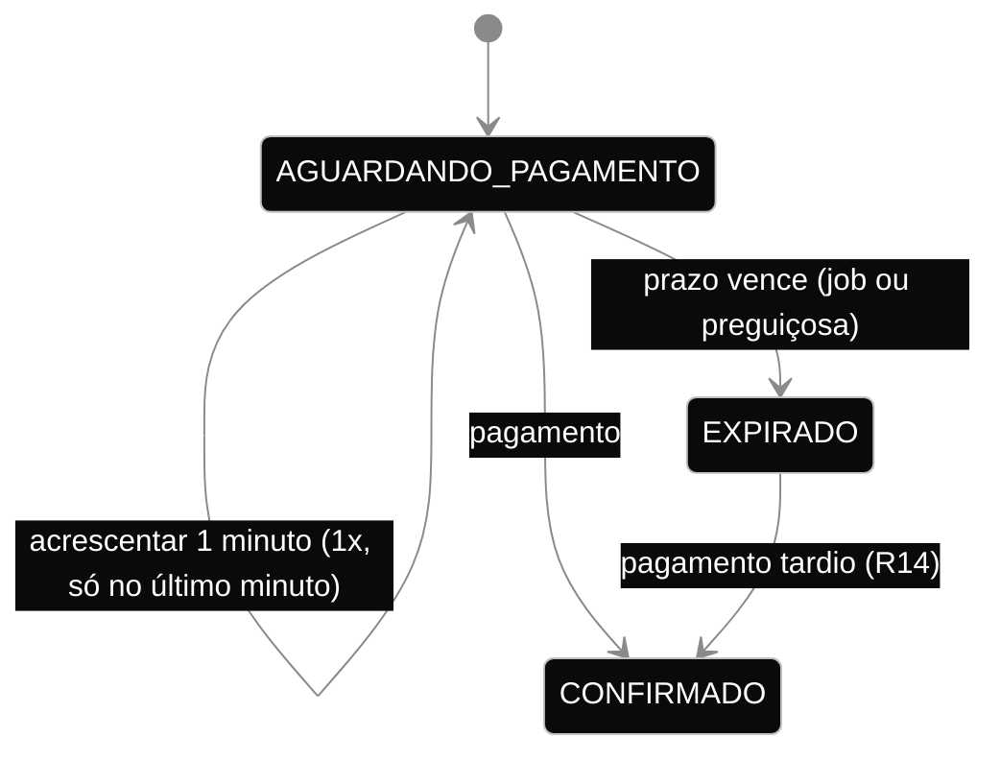

# 📐 Spec · Fatia 14 · Experiência premium e agenda nova do painel

| | |
|---|---|
| **Status** | **✅ implementada em 24/11/2026**: 14A (A1 a A27) e 14B, 14C e 14D (A28 a A62), todos com teste (guia de testes 5d e 5e; D199 e D200) · ✅ **APROVADA em 24/11/2026** pelo Kevin, com as respostas da seção 10 (mais 1 minuto só no último minuto, tempo extra fixo, e agenda sem antecedência mínima nem horizonte) |
| **Origem** | pedidos do Kevin em 24/11/2026: (1) **mais 1 minuto no Pix**, uma vez por reserva · (2) **olhinho** em todo campo de senha · (3) **mensagens** no padrão de uma barbearia de excelência · (4) **história do Eduardo** reescrita só com fatos do repositório · (5) site **mais fluido e interativo** (no máximo 8 melhorias) · (6) **agenda do painel nova**, com a grade do dia e o calendário do mês, no lugar do filtro "Dia anterior · Hoje · Próximo dia · Dia · Semana" |
| **Não muda** | as 3 formas de agendar (com cadastro, sem cadastro e WhatsApp com reserva manual, R33) · o pagamento 100% antecipado (R6 a R8) · o prazo vindo do `expiraEm` (D121, 3 a 60 min) · o horário confirmado não é cancelado pelo cliente · a paleta, a tipografia e os tokens (`frontend/design/tokens.json`) · as regras de fechar e cancelar atendimento (R21, R22) · o isolamento por barbeiro (D151, D155, R23) |
| **Entrega em quatro PRs** | **14A** · mais 1 minuto no Pix e agenda sem antecedência nem horizonte (API e telas) · **14B** · olhinho, mensagens e Trajetória (só front) · **14C** · agenda nova do painel (2 rotas de leitura e telas) · **14D** · fluidez do site (as melhorias que o Kevin aprovar, depois do desenho) |
| **Regras** | R7 (prazo do pagamento), R13 e R14 (pagamento confirma; pagamento tardio), R15 a R17 (expiração), R18 (sem cancelar nem remarcar), R21 e R22 (fechar e cancelar), R23 (alheio = `404`), R30 (nada pessoal em log), R33 (reserva manual), D121 (prazo configurável), D148 (visual pelo canvas, comportamento pela spec) |
| **ADRs** | [0002](../adr/0002-comunicacao-entre-modulos.md) (eventos e outbox), [0003](../adr/0003-anti-double-booking-no-banco.md) (constraint e expiração preguiçosa), [0005](../adr/0005-erros-rfc-9457.md) (erros RFC 9457, texto só no front), [0013](../adr/0013-varios-barbeiros-dono-e-convite.md) (vários barbeiros) |
| **Depende de** | [Fatia 4](fatia-4-agendamento-e-pagamento.md) (reserva, expiração, cobrança, R14) · [Fatia 7](fatia-7-telas.md) (tela de pagamento, painel) · [Fatia 10](fatia-10-convite-do-barbeiro.md) (barbeiro convidado, isolamento) · [Fatia 12](fatia-12-site-fluido.md) (home, `/agendar` em chips, resumo fixo) · [Fatia 13](fatia-13-notificacao-ao-barbeiro.md) (já na `main`, com a 8B: V13 e contrato 1.10.1) |
| **Contrato** | `1.10.1 → 1.11.0`, **só acréscimos**: 2 rotas da prorrogação, 2 rotas de leitura da agenda, 1 código de erro e 1 campo no `Agendamento`; e a revogação da antecedência e do horizonte (`FORA_DO_HORIZONTE`, `antecedenciaMinimaMin` e `horizonteDias` ficam `deprecated`, seção 2.1) |
| **Migração** | `V14__prorrogacao_e_agenda_sem_limites.sql` (a `develop` termina na `V13__notificacao_ao_barbeiro.sql`) |
| **Decisões** | **D188 a D197**, aceitas em 24/11/2026 em [`decisoes.md`](../planejamento/decisoes.md); a D197 revoga a antecedência mínima (H5) e o horizonte (H12) |
| **Custo** | **zero**: nenhuma conta, serviço ou biblioteca nova. O `.ics` e o link do WhatsApp são gerados no navegador |
| **Não cobre** | cancelar ou remarcar pelo cliente (R18 continua) · lembrete automático ao cliente · avaliações com nota · arrastar e soltar reservas na grade do painel · mudar a paleta ou o design system · tradução |

## 1. Objetivo

O cliente sente que está sendo **atendido**, não processado: se o Pix demora, ele pede **mais 1 minuto** sem perder o horário; vê a senha que digitou; lê mensagens que falam como o Eduardo falaria no balcão, sempre com o próximo passo; conhece a história real do barbeiro; e chega ao horário com menos toques e menos espera. O Eduardo (e o barbeiro convidado) abre o painel e **vê o dia pronto**: a grade por horário com o que está livre, ocupado, de almoço e de folga, e um calendário do mês com quantos clientes há em cada dia.

## 2. Contrato (1.11.0, aplicado depois da aprovação)

`openapi.yaml` e `contrato-api.md` na mesma PR do código (`redocly lint` com 0 erros). Só acréscimos.

### 2.1 Acrescentar 1 minuto no Pix e agenda sem limite de antecedência nem de dias (14A)

| Método | Rota | Quem | Sucesso | Erros |
|---|---|---|---|---|
| `POST` | `/agendamentos/{id}/prorrogacao` | cliente logado, dono da reserva (`sub` do token) | `201` com o `Agendamento` (novo `expiraEm`); **`200` na repetição**, com o mesmo corpo e **sem** somar tempo | `401` · `404` (inexistente, alheia, manual) · `409 CONFLITO_CONCORRENTE` · `422 PRORROGACAO_FORA_DA_JANELA` (**novo**) · `422 RESERVA_EXPIRADA` · `422 TRANSICAO_INVALIDA` |
| `POST` | `/agendamentos/guest/{id}/prorrogacao` | visitante, com `X-Guest-Token` | igual | igual, sem `401`; token errado ou ausente = `404` (R23) |

- **Sem corpo.** Corpo com qualquer campo é `400 CAMPO_DESCONHECIDO` (padrão do projeto). Nada de `Idempotency-Key`: a rota é **idempotente pela natureza** (a prorrogação é um recurso único da reserva; repetir devolve o que já existe, E3).
- A rota do visitante entra na lista pública do `SegurancaConfig` **só para `POST`** (como `POST /agendamentos/guest`).
- **Código novo** `PRORROGACAO_FORA_DA_JANELA` (`422`, "Fora da janela de prorrogação", "Só dá para acrescentar tempo no último minuto."): o pedido chegou **antes** do último minuto. Linha nova na tabela de erros do `contrato-api.md`.

**Campo novo em `Agendamento`** (vale também para `AgendamentoGuest` e `AgendamentoAdmin`, que estendem o schema):

```yaml
prorrogacao:
  description: |
    Acrescentar tempo para pagar (1.11.0, D188). Nulo quando não se aplica: reserva manual ou reserva que não
    está AGUARDANDO_PAGAMENTO dentro do prazo.
  oneOf:
    - type: 'null'
    - type: object
      required: [usada, segundos, abreEm, fechaEm]
      properties:
        usada:   { type: boolean, description: 'true depois da única prorrogação permitida' }
        segundos: { type: integer, example: 60, description: 'quanto tempo a prorrogação acrescenta (fixo em 60 na aplicação, D190)' }
        abreEm:  { type: string, format: date-time, description: 'início do último minuto (expiraEm - 60 s)' }
        fechaEm: { type: string, format: date-time, description: 'fim da janela, exclusivo: o próprio expiraEm' }
```

**Agenda sem limites (D197, revoga a antecedência mínima e o horizonte):** "pagou, a agenda é sua e não pode cancelar, então o barbeiro não perde nunca". A **única** regra de tempo para reservar é **o início depois de agora**, no fuso `America/Sao_Paulo`: dá para marcar para daqui a 5 minutos, para hoje mais tarde ou para qualquer data futura. No contrato 1.11.0:

- `GET /disponibilidade` e `POST /agendamentos`, `/agendamentos/guest` e `/admin/agendamentos` aceitam **qualquer data de hoje em diante**. Data **anterior a hoje** ou início que **já passou** é `422 ANTECEDENCIA_INSUFICIENTE` (descrição nova: "o horário já passou"; o nome do código **não muda**, para não quebrar o front).
- `FORA_DO_HORIZONTE` fica no enum como **`deprecated`** (a API deixa de usar; o front mantém um texto genérico para ele).
- `ConfiguracaoAgenda` **deixa de ter** `antecedenciaMinimaMin` e `horizonteDias` na resposta; no `PUT /admin/configuracao` os dois ficam **opcionais, `deprecated` e ignorados** (um front antigo que ainda os envia não recebe `400` durante o deploy).
- A dúvida da home, a mensagem de erro e a nota de `/agendar` mudam (seção 5 e A37).

### 2.2 Agenda nova do painel (14C)

| Método | Rota | Quem | Sucesso | Erros |
|---|---|---|---|---|
| `GET` | `/admin/agenda/mes?mes=2026-12&barbeiroId=` | ADMIN (todos ou o filtrado) · BARBEIRO (só o próprio) | `200` `ResumoDoMes` | `400` (mês fora do formato `AAAA-MM`) · `401` · `403` (CLIENTE) · `404` (barbeiro inexistente, alheio ou conta sem vínculo) |
| `GET` | `/admin/agenda/dia?data=2026-12-01&barbeiroId=` | igual | `200` `GradeDoDia` | igual (`data` em ISO) |

```yaml
ResumoDoMes:
  type: object
  required: [mes, dias]
  properties:
    mes: { type: string, pattern: '^\d{4}-\d{2}$', example: '2026-12' }
    dias:
      type: array          # um item por dia do mês, em ordem (28 a 31)
      items:
        type: object
        required: [data, reservas, folga, expediente]
        properties:
          data:       { type: string, format: date }
          reservas:   { type: integer, minimum: 0, description: 'CONFIRMADO, CONCLUIDO, NAO_COMPARECEU e AGUARDANDO_PAGAMENTO ainda no prazo (E14)' }
          folga:      { type: boolean, description: 'alguma folga cobre parte do dia' }
          expediente: { type: boolean, description: 'a jornada tem intervalo neste dia da semana' }
GradeDoDia:
  type: object
  required: [data, granularidadeMin, colunas]
  properties:
    data: { type: string, format: date }
    granularidadeMin: { type: integer, example: 30 }
    colunas:
      type: array          # uma por barbeiro visível, na ordem do nome
      items:
        type: object
        required: [barbeiroId, nomeExibicao, horarios, agendamentos]
        properties:
          barbeiroId:   { type: string, format: uuid }
          nomeExibicao: { type: string }
          horarios:
            type: array    # do primeiro início ao último fim da jornada do dia, de granularidade em granularidade
            items:
              type: object
              required: [inicio, situacao]
              properties:
                inicio:   { type: string, example: '09:00', description: 'HH:mm no fuso da barbearia' }
                situacao: { type: string, enum: [LIVRE, OCUPADO, ALMOCO, FOLGA] }
                agendamentoId: { type: [string, 'null'], format: uuid, description: 'só em OCUPADO' }
          agendamentos:
            type: array
            items: { $ref: '#/components/schemas/AgendamentoAdmin' }
```

`GET /admin/agenda` (visões `DIA` e `SEMANA`) **continua** como está (E17). As duas rotas novas ficam sob `/admin/**`, já protegido por `painel()`; o escopo vem **sempre** do token (o `barbeiroId` só filtra o que o ADMIN pode ver).

### 2.3 O que não muda no contrato

Nenhuma rota de senha, mensagem, Trajetória ou fluidez (14B e 14D): é só front. Os textos de erro continuam **no front, por `code`** (ADR 0005): a API não muda `title` nem `detail` por causa da voz nova.

## 3. Acrescentar 1 minuto: a regra (aprovada em 24/11/2026)



Exemplo com o padrão (`expiracaoPagamentoMin = 3`, tempo extra fixo de 60 s): reserva criada às **10:00:00**, `expiraEm` **10:03:00**.

| Momento | O que acontece |
|---|---|
| antes de 10:02:00 | `422 PRORROGACAO_FORA_DA_JANELA`; o botão nem aparece |
| 10:02:00 a 10:02:59 (último minuto do contador) | acrescenta: `expiraEm` = **10:03:00 + 60 s = 10:04:00**. Exemplo do Kevin: com o contador em 0:30, o toque leva para **1:30** |
| a partir de 10:03:00 (o prazo acabou), com a reserva ainda `AGUARDANDO_PAGAMENTO` ou já `EXPIRADO` | `422 RESERVA_EXPIRADA`. **Não existe** pedido de mais tempo nem reabertura depois do fim |
| depois de acrescentar uma vez | repetir devolve `200` com o mesmo `expiraEm`; quando esse prazo vencer, `422 RESERVA_EXPIRADA` |

**Fórmula:** janela = `[expiraEm − 60 s, expiraEm)`; novo prazo = `expiraEm + 60 s`. O tempo extra **soma ao que está correndo**.

## 4. Decisões de desenho

| # | Pergunta | Decisão | Por quê |
|---|---|---|---|
| E1 | Onde mora a regra? | No módulo **`agenda`**: caso de uso `ProrrogarPagamento` (pacote `agenda.reserva`), chamado pelo `AgendamentosController` nas duas rotas. O dono é conferido como hoje (`sub` do token ou `X-Guest-Token` com hash), **antes** de qualquer outra checagem | a reserva e o `expiraEm` são da agenda; a cobrança só acompanha (E6) |
| E2 | Como garantir "uma única vez"? | Coluna nova `reserva.prorrogada_em timestamptz NULL` (V14). O `UPDATE` só acontece `WHERE prorrogada_em IS NULL AND status = 'AGUARDANDO_PAGAMENTO' AND expira_em > :agora`; depois de preenchida, nunca volta a nulo. CHECK `reserva_prorrogacao_ck`: `prorrogada_em IS NULL OR origem <> 'MANUAL'` | o banco é a última linha de defesa, como a constraint EXCLUDE |
| E3 | Idempotência | A rota é **idempotente sem chave**: a prorrogação é um recurso único da reserva. A 1ª chamada que acrescenta devolve `201`; qualquer repetição com `prorrogada_em` preenchida e a reserva ainda `AGUARDANDO_PAGAMENTO` no prazo devolve `200` com o estado atual, **sem somar tempo**. Duplo clique, reenvio do navegador e nova tentativa depois de queda de rede dão o mesmo resultado | é o mesmo padrão `201`/`200` da cobrança; o front pode repetir com segurança (D139) |
| E4 | Concorrência | Uma transação: `SELECT ... FOR UPDATE` na linha da reserva, decide e grava. Como só se acrescenta **antes** de `expiraEm`, o **job** de expiração (que pega só `expira_em <= agora`, com `SKIP LOCKED`) não disputa uma reserva no prazo; na fronteira (pedido às 10:02:59, job às 10:03:00) ele pula a linha travada e, depois do commit, o prazo já é 10:04:00. A **expiração preguiçosa** de outro cliente (`FOR UPDATE` sem `SKIP`) espera o commit e vê o prazo novo. Duas prorrogações simultâneas: a segunda espera o lock e cai no `200` do E3. Deadlock (`40P01`) repete como o `ReservarHorario` (E4 da Fatia 4) e, esgotado, vira `409 CONFLITO_CONCORRENTE` | mesma estratégia já provada na Fatia 4 (ADR 0003) |
| E5 | E depois que o prazo acaba? | **Nada**: não há carência nem reabertura (decisão do Kevin, 24/11/2026). Reserva `EXPIRADO`, ou `AGUARDANDO_PAGAMENTO` com `expira_em <= agora` que o job ainda não passou, recebe `422 RESERVA_EXPIRADA`. A máquina de estados **não muda** | regra simples; quem perdeu o prazo escolhe de novo |
| E6 | E a cobrança? | A agenda publica `PrazoDaReservaProrrogado(reservaId, expiraEmAnterior, expiraEmNovo)` no **outbox**, na mesma transação. O `pagamento` ouve (`AcompanhaPrazoProrrogado`, `@ApplicationModuleListener`) e atualiza `cobranca.expira_em` da cobrança `PENDENTE` da reserva. O **gateway não é chamado**: o Pix já gerado continua o mesmo (no Asaas o `dueDate` é por **dia**, e o simulado não tem prazo) | a agenda não conhece o pagamento (ADR 0002); o cliente não precisa gerar outro Pix |
| E7 | "Respeita a cobrança" | (1) Pagamento **nunca se perde**: o `ProcessarPagamento` já aceita cobrança `PENDENTE` e `CANCELADA` (R14), então um Pix que cai no meio da prorrogação confirma a reserva normalmente. (2) Só reserva `AGUARDANDO_PAGAMENTO` no prazo pode ganhar tempo; `CONFIRMADO`, `CONCLUIDO`, `NAO_COMPARECEU` e `CANCELADO` dão `422 TRANSICAO_INVALIDA` sem mudar nada. Sem reabertura, **não há porta nova** entre agenda e pagamento | o estado da cobrança nunca contradiz o da reserva |
| E8 | Ordem das checagens | `404` (dono) → `422 TRANSICAO_INVALIDA` (status final) → `200` (já prorrogada e no prazo) → `422 RESERVA_EXPIRADA` (`EXPIRADO`, ou prazo vencido) → `422 PRORROGACAO_FORA_DA_JANELA` (antes do último minuto) → grava (`201`) | ordem fixa = teste determinístico e nenhum vazamento de existência (R23) |
| E9 | Tempo | Só pelo `Clock` injetado. A janela é calculada no servidor e devolvida pronta (`abreEm`, `fechaEm`), no fuso da barbearia com offset, como o `expiraEm`. O front mostra o botão pelo relógio local, mas **quem decide é a API** (um `422` faz o botão sumir) | o relógio do celular pode estar errado |
| E10 | Tempo extra fixo | **60 s fixos** (decisão do Kevin): propriedade `app.agenda.prorrogacao-pagamento: PT60S` no `application.yml` (lida como `Duration`), **sem** coluna em `configuracao_agenda` e sem campo no painel. O limite de **1 vez** também é fixo. O front lê o número de `prorrogacao.segundos` para não duplicar a constante | é regra de produto, não ajuste do dia a dia; a propriedade deixa o teste trocar o valor sem mexer no código |
| E11 | Auditoria | A `auditoria_admin` é do painel (exige `ator_id` de conta) e o visitante não tem conta, então a trilha é: (1) `reserva.prorrogada_em` (quando); (2) o evento `PrazoDaReservaProrrogado` no `event_publication` (prazo anterior e novo); (3) uma linha de log técnica `reserva.prorrogada id=<uuid>`, **sem** nome, e-mail, WhatsApp, CPF ou token (R30). O `AgendamentoAdmin` mostra `prorrogacao.usada` para o Eduardo entender um pagamento que chegou perto do fim | rastreável sem dado pessoal e sem tabela nova |
| E12 | Disponibilidade | A prorrogação não muda nada no `GET /disponibilidade`: ela já trata como ocupada a `AGUARDANDO_PAGAMENTO` com `expira_em > agora` (R15), e o prazo estendido continua ocupando sem intervalo | uma regra só para ocupação |
| E13 | Tela de pagamento | O `Cronometro` continua (o Kevin gostou). No **último minuto** e com `usada = false`, aparece o botão **"Acrescentar 1 minuto"** (número de `segundos`). Depois do sucesso: o contador soma o minuto ao que está correndo (0:30 vira 1:30), o botão some, uma mensagem `role="status"` diz "Pronto, mais 1 minuto no contador." e o foco vai para ela. O Pix na tela **não muda**. Quando o contador zera, o botão some e a tela segue o fluxo de hoje (consulta o status uma vez) | o cliente não precisa sair da tela nem gerar outro Pix |
| E13b | **Agenda sem antecedência mínima e sem horizonte** (D197, mudança de regra pedida pelo Kevin) | **Tirar as duas regras**, não só zerar números: (1) a `V14` deixa `antecedencia_minima_min` e `horizonte_dias` **sem uso** (com `DEFAULT`; o código deixa de ler). *Ajuste da D199: a remoção física (`DROP COLUMN`) fica para uma migração futura, depois de uma release estável, para o rollback da API anterior não quebrar*; (2) `ReservarHorario` (cliente, visitante **e** manual) recusa só `inicio <= agora` com `422 ANTECEDENCIA_INSUFICIENTE`; data anterior a hoje também cai aqui; não há limite de data futura; (3) `ConsultaDisponibilidade` recusa só data anterior a hoje (`422 ANTECEDENCIA_INSUFICIENTE`) e aceita qualquer data futura; a `CalculadoraDeHorarios` usa `primeiroPermitido = agora` e só mostra inícios **depois** de agora; (4) contrato como na seção 2.1 (`FORA_DO_HORIZONTE` e os dois campos `deprecated`); (5) front: some `NEXT_PUBLIC_HORIZONTE_DIAS` (código e Vercel), o seletor "Outro dia" tem só `min` = hoje (sem `max`), saem os textos "até {data}" e "dias à frente", e os dois campos saem da tela de configuração; (6) "Ver o próximo dia com horário" continua procurando **30 dias por vez** (limite da **busca**, não regra): sem horário nesse trecho, mostra "Procurar mais 30 dias" e "Escolher em Outro dia"; (7) `docs/contexto.md`: R5 reescrita e H5 e H12 marcadas como revogadas | só zerar deixaria o admin religar uma regra que o dono revogou; "agenda fácil e prática" |
| E14 | O que conta como "reserva" no calendário do mês | `CONFIRMADO`, `CONCLUIDO`, `NAO_COMPARECEU` e `AGUARDANDO_PAGAMENTO` **ainda no prazo**. Fora: `EXPIRADO`, `CANCELADO` e aguardando vencida. A reserva manual conta (é cliente na cadeira). O dia é o **dia civil no fuso da barbearia**, nunca o UTC | é o que ocupa a cadeira; uma reserva às 23:30 do dia 31 não pode cair no dia 1º |
| E15 | Como montar a grade do dia | `horarios` vai do primeiro início ao último fim da jornada do barbeiro **naquele dia da semana**, de `granularidadeMin` em `granularidadeMin`. Cada início é `OCUPADO` se cai dentro de `[inicio, fimOcupacao)` de uma reserva que ocupa (E14); `FOLGA` se cai numa folga; `ALMOCO` se cai no vão entre dois intervalos da jornada; senão `LIVRE`. Prioridade: `OCUPADO` > `FOLGA` > `ALMOCO` > `LIVRE` (uma reserva manual dentro de uma folga continua visível). Dia sem jornada: `horarios` vazio. Uma reserva fora da jornada (jornada mudou depois) continua em `agendamentos` | "livre" independe do serviço; é o que o Eduardo enxerga de relance |
| E16 | Isolamento e N+1 | As duas rotas usam o mesmo `Escopo` do `PainelDaAgenda` (ADMIN vê todos; BARBEIRO só o barbeiro da própria conta; `barbeiroId` alheio, inexistente ou conta sem vínculo = `404`, R23). O mês é **uma** consulta `GROUP BY` do dia no fuso, mais uma de folgas e uma de jornadas; o dia é uma consulta de reservas, uma de folgas e uma de jornadas, **qualquer que seja o número de barbeiros** | o convidado nunca vê a agenda do Eduardo; o tempo não cresce com a equipe |
| E17 | E a rota antiga? | `GET /admin/agenda` (`DIA`/`SEMANA`) **fica** (testes e compatibilidade). O front deixa de usar a visão `SEMANA` e os botões "Dia anterior", "Próximo dia", "Dia" e "Semana". Remover a rota é outra fatia, se um dia fizer sentido | nada quebra; o contrato só cresce |
| E18 | Painel no celular | Calendário do mês em cima (ou recolhido em "Ver o mês"), grade do dia embaixo; com "Todos" os barbeiros, **uma coluna por vez** com seletor no celular e colunas lado a lado a partir de 1024 px. A URL guarda o estado (`/painel?data=2026-12-01&barbeiro=<id>`) para o botão Voltar e para compartilhar entre abas | o Eduardo usa o painel no celular, entre um cliente e outro |
| E19 | Número de migração e de contrato | A Fatia 13 já está na `main` (com a 8B): a `develop` termina na `V13` e no contrato `1.10.1`. Esta fatia usa **`V14__prorrogacao_e_agenda_sem_limites.sql`** e **`1.11.0`**; nunca editar migração mergeada | números definidos, sem disputa |
| E20 | Senha visível: um componente | `CampoSenha` (em `componentes/`), extraído do que o `Convite.tsx` já faz: envolve o `Campo`, com um botão `type="button"`, `aria-pressed`, `aria-controls` apontando o `id` do campo, rótulo "Mostrar a senha"/"Esconder a senha" que muda junto. Clicar **mantém o foco no botão** e o valor do campo. `autoComplete` (`current-password` ou `new-password`) **não muda** com o estado. Ao enviar o formulário, o campo volta a escondido **antes** do envio (o gerenciador de senhas reconhece o campo, e a senha não fica exposta se a tela mostrar um erro). Cada campo tem o seu botão (inclusive "Repita a senha" no convite e "Senha atual" e "Nova senha" na troca) | um padrão só no site todo; é o padrão de campo de senha de sistemas de design públicos (ex.: o do governo britânico) |
| E21 | Voz das mensagens | Regras: (1) calorosa e direta, como o Eduardo no balcão, **sem gíria forçada**; (2) **nunca** as palavras "servidor", "sessão", "requisição", "token", "API", "erro interno", "inválido" e "falha"; (3) **sempre** o próximo passo (um verbo de ação: escolha, toque, confira, entre, espere, chame...); (4) não culpa quem usa ("não foi você" quando é nosso); (5) **nenhum número de regra configurável** fixo no texto (antecedência, horizonte, prazo): o número vem da API ou some; (6) sem emoji e sem exclamação em erro; (7) textos de tela de leitor (`role="status"`, `role="timer"`) curtos | é o pedido do Kevin; a regra (5) corrige dois textos de hoje que fixam "2 horas" e "30 dias" |
| E22 | História do Eduardo | Reescrita **só com os fatos da seção 6.1**, cada um com a fonte no repositório. O que for suposição vira pergunta (seção 10) e **não entra** até o Kevin confirmar | o pedido diz "não invente fatos" |
| E23 | Fluidez sem mudar a identidade | As melhorias da seção 7 usam só tokens e componentes existentes. Animações só em `transform` e `opacity`, de 150 a 200 ms, e **zeradas** com o "Sem animação" do painel de acessibilidade **ou** com `prefers-reduced-motion: reduce`. O que precisa de desenho está marcado 🎨 e espera o canvas (D148) | o visual vem do design system; movimento não pode atrapalhar quem é sensível a ele |

## 5. Mensagens: os 20 textos mais vistos (14B)

**Como "mais vistos" foi estimado:** o site **não tem** analytics (LGPD, D128), então a lista segue a **ordem do fluxo** (home → agendar → dados → pagamento → confirmação → painel) e o que aparece em toda consulta (carregar, acordar). Se o Kevin tiver outra percepção do balcão, a lista muda sem mudar a regra E21.

| # | Onde aparece | Hoje | Proposto |
|---|---|---|---|
| 1 | toda consulta (`EstadoDaConsulta`) | Carregando… | Só um instante, já estamos trazendo. *(e skeleton no lugar, M4)* |
| 2 | API dormindo (`API_INDISPONIVEL`, `TEXTO_ACORDANDO`) | O servidor está acordando. Aguarde alguns segundos. | A agenda estava descansando e já está acordando. Leva uns segundos, e a gente tenta de novo sozinho. |
| 3 | banco acordando (`BANCO_INDISPONIVEL`, 503) | A agenda está acordando. Aguarde alguns segundos e tente de novo. | A agenda está acordando. Espere uns segundos e toque em Tentar de novo. |
| 4 | consulta sem resposta (`TEXTO_SEM_RESPOSTA`) | O servidor não respondeu. Tente de novo em instantes. | A agenda não respondeu desta vez. Toque em Tentar de novo; se continuar, chame a gente no WhatsApp. |
| 5 | horário pego (`HORARIO_INDISPONIVEL`) | Esse horário acabou de ser reservado por outra pessoa. Escolha outro. | Alguém pegou esse horário agorinha. Escolha outro logo abaixo. |
| 6 | dia cheio (`/agendar`) | Sem horários neste dia. | Esse dia já está cheio. Veja o próximo dia com horário. |
| 7 | horário que já passou (`ANTECEDENCIA_INSUFICIENTE`, D197) | É preciso agendar com pelo menos 2 horas de antecedência. | Esse horário já passou. Escolha um horário mais para frente. |
| 8 | nota de `/agendar` e `FORA_DO_HORIZONTE` (agora `deprecated`) | Só aparecem os horários livres, com pelo menos 2 horas de antecedência e até {HORIZONTE} dias à frente. · Só dá para agendar com até 30 dias de antecedência. | Só aparecem os horários livres. Pode marcar para hoje ou para qualquer data futura. · Essa data não está disponível. Escolha outra em Outro dia. |
| 9 | campos (`VALIDACAO_INVALIDA`) | Confira os campos marcados. | Falta ajustar os campos marcados. Confira e envie de novo. |
| 10 | e-mail repetido (`EMAIL_JA_CADASTRADO`) | Já existe uma conta com este e-mail. Entre ou use outro. | Esse e-mail já tem conta aqui. Entre com ele, ou use outro e-mail. |
| 11 | login (`CREDENCIAIS_INVALIDAS`) | E-mail ou senha incorretos. | E-mail ou senha não conferem. Confira e tente de novo; o botão Mostrar a senha ajuda. |
| 12 | conta que saiu sozinha (`REFRESH_INVALIDO`) | Sua sessão terminou. Entre de novo. | Por segurança, você saiu da conta depois de um tempo parado. Entre de novo para continuar. |
| 13 | CPF (`CPF_INVALIDO`) | CPF inválido. Confira os números. | Esse CPF não confere. Confira os 11 números. |
| 14 | pagamento fora (`GATEWAY_INDISPONIVEL`) | Não conseguimos gerar o pagamento agora. Seu horário continua reservado até o fim do prazo; tente de novo. | Não conseguimos gerar o pagamento agora. Seu horário continua separado até o fim do contador: toque em Pagar de novo. |
| 15 | esperando o Pix (`Pagamento`) | Aguardando a confirmação do pagamento… | Assim que o pagamento cair, a gente confirma aqui. Pode deixar esta tela aberta. |
| 16 | último minuto (`Cronometro`) | Falta menos de 1 minuto. | Menos de 1 minuto. Se precisar, toque em Acrescentar 1 minuto. *(só com a prorrogação disponível; sem ela: "Menos de 1 minuto para pagar.")* |
| 17 | prazo zerado (`Cronometro`) | Conferindo o prazo com o servidor. | Conferindo se o pagamento chegou… |
| 18 | tempo acabou (`Pagamento`, `RESERVA_EXPIRADA`) | O tempo acabou e o horário voltou para a agenda. Nada foi cobrado. | O tempo para pagar acabou e o horário voltou para a agenda. Nada foi cobrado. Escolha um horário de novo. |
| 19 | rede caiu na reserva (`ReservaDados`) | Não sabemos se a reserva foi criada. Confira… | A conexão caiu no meio do caminho e não sabemos se a reserva entrou. Confira em Meus agendamentos antes de tentar de novo. |
| 20 | erro nosso (`ERRO_INTERNO` e genérica) | Algo deu errado do nosso lado. Tente de novo. · Algo deu errado. Tente de novo. | Deu um problema do nosso lado, não foi você. Tente de novo; se continuar, chame a gente no WhatsApp. |

**Também revistos (fora do top 20, mesma regra):** `ACESSO_NEGADO` → "Esta área é só da equipe da barbearia. Volte para o início." · `NAO_AUTENTICADO` → "Entre na sua conta para continuar." (mantém) · confirmação "Horário confirmado" → "Fechado! Seu horário está garantido." (único ponto de exclamação: é sucesso, não erro) · painel "Sem agendamentos neste dia." → "Nenhum cliente marcado neste dia ainda." · `PRORROGACAO_FORA_DA_JANELA` (novo) → "Ainda não é hora de acrescentar tempo. O botão aparece no último minuto." · `CONFLITO_CONCORRENTE` → "Muita gente marcando ao mesmo tempo. Toque de novo em um instante." · dúvida da home "Com quanta antecedência posso agendar?" (hoje: "Com pelo menos 2 horas de antecedência e até 30 dias à frente.") → "Quando quiser: para hoje mesmo, desde que o horário ainda não tenha passado, ou para qualquer data futura. Pagou, o horário é seu." (D197) · busca sem horário (hoje: "Não há horários livres nos próximos {HORIZONTE} dias. Tente mais tarde.") → "Não achamos horário livre nos próximos 30 dias. Procure mais 30 dias ou escolha em Outro dia."

Os testes antigos que conferem o texto exato mudam **só de valor** (como na D129): nenhuma asserção sai.

## 6. História do Eduardo (14B)

### 6.1 Fatos que já estão no repositório (só estes entram)

| Fato | Fonte |
|---|---|
| Nome completo: **Carlos Eduardo Candido** (sem acento), "o Eduardo" nas outras menções; o nome de exibição no catálogo segue "Eduardo Candido" (fonte: o Kevin, em 25/11/2026) | `README.md`, `frontend/src/conteudo/historia.ts` |
| Começou no ofício em **1994**, com o primeiro mestre (fonte: o Kevin, em 25/11/2026, que corrige o 1995 anterior) | `README.md` ("O caminho do Eduardo..."), `historia.ts` (`MARCOS`) |
| Abriu a Barbearia Altas Horas em **1997**, no **Jardim Bonança, Osasco** | `README.md`, `historia.ts` |
| Atende de **terça a sábado, 7h às 20h**, almoço de 12h às 13h | `README.md` (rodapé do "Onde estamos"), `FATOS_DA_HOME` |
| Do **corte social clássico ao degradê navalhado**; a galeria mostra também platinado, corte infantil e barba | `README.md`, `GALERIA` (Fatia 12) |
| **2017**: Prêmio Barbeiros do Brasil (que "fez questão de trazer para Osasco") e Prêmio Master Barber · Êxito Profissional | `README.md`, `historia.ts`, `docs/assets/premios/` |
| Frase ao receber o Prêmio Barbeiros do Brasil: "Amor na ponta da tesoura!" | `README.md`, `SecoesDaHome.tsx` |
| **Instrutor formado pela Ibel Formação**; ensina na **Altas Horas Barbearia Academy** | `README.md`, `historia.ts` |
| A agenda era **caderno e WhatsApp**; o dia é dividido entre **clientes e alunos** | `README.md` |
| Endereço: R. São Judas Tadeu, 313 · Jd. Bonança · Osasco/SP | `README.md` |
| É **pai do Kevin**, que fez a agenda | `README.md` ("meu pai"); o Kevin autorizou citar no site (P-7, 24/11/2026) |

### 6.2 Texto proposto

O texto da Trajetória desta seção **foi substituído pela versão 3**, em [`docs/sdd/historia-v3-aprovada.txt`](historia-v3-aprovada.txt). O bloco abaixo é o texto antigo e não vai mais para o site.

**Trajetória** (texto antigo, substituído pela v3; o título "Quase três décadas na mesma cadeira", a linha do tempo e os prêmios ficam):

> O Carlos Eduardo Candido (o Eduardo) começou no ofício em 1994, aprendendo com o primeiro mestre. Três anos depois, em 1997, abriu a Barbearia Altas Horas no Jardim Bonança, em Osasco, e de lá não saiu mais: são quase 30 anos na mesma cadeira, de terça a sábado.
>
> Do corte social clássico ao degradê navalhado, passando pelo platinado e pelo corte das crianças, o trabalho fala por ele. Em 2017 veio o reconhecimento em dobro: o Prêmio Barbeiros do Brasil, que ele fez questão de trazer para Osasco, e o Prêmio Master Barber · Êxito Profissional. Ao receber o primeiro, resumiu tudo numa frase: "Amor na ponta da tesoura!".
>
> Instrutor formado pela Ibel Formação, hoje ele também ensina o ofício na Altas Horas Barbearia Academy. Com o dia dividido entre clientes e alunos, a agenda saiu do caderno e do WhatsApp e veio para cá, feita pelo filho dele, o Kevin: você escolhe, paga e o horário é seu.

**Texto do barbeiro** (`BarbeiroDaHome`; o texto antigo era "Barbeiro e professor, na cadeira desde 1995.", corrigido pela [D201](../planejamento/decisoes.md)):

> Barbeiro desde 1994 e dono da Altas Horas desde 1997. Professor na Academy e duas vezes premiado em 2017.

**Marco "Hoje"** (linha do tempo): "Barbeiro na cadeira e professor na Altas Horas Barbearia Academy. A agenda sai do caderno e vem para a internet." (só troca "vai" por "vem", ponto de vista do site).

**Nada novo entra** sem resposta da seção 10.1 (nome do mestre, ano da Academy, número de alunos, corte preferido): melhoria futura, sem bloquear.

## 7. Site mais fluido: 8 melhorias propostas (14D)

Referências (padrão de experiência, **não** de marca; nada copiado): Booksy, Fresha, Trinks, AppBarber e Calendly, já citados na pesquisa da [Fatia 12](fatia-12-site-fluido.md) (seção 2), mais o padrão do Calendly de **horários agrupados e confirmação com "adicionar à agenda"** (comportamento conhecido do produto; **não foi refeita** pesquisa nesta spec). 🎨 = precisa de tela desenhada no canvas antes de codar.

| # | Melhoria | Por que (impacto) | Desenho |
|---|---|---|---|
| M1 | **Horários em chips por período**: Manhã (antes das 12:00), Tarde (12:00 a 17:59), Noite (18:00 em diante); período vazio não aparece | um dia de 7h às 20h tem até 24 chips; agrupado, o olho acha "de tarde" em um passo (Fresha e Booksy agrupam assim) | 🎨 cabeçalho do grupo |
| M2 | **"Próximo horário livre"** no topo de `/agendar` e no cartão do serviço: "Próximo livre: qua 02/12 às 07:00", um toque seleciona dia e horário | quem só quer "o mais cedo possível" fecha em 2 toques; reaproveita a busca que o "Ver o próximo dia com horário" já faz | 🎨 cartão |
| M3 | **Resumo fixo até o pagamento**: o resumo (serviço, dia e hora, preço) que hoje existe só em `/agendar` continua em `/agendar/dados`, com "Alterar" | o cliente confere o que está comprando em todos os passos; menos volta | 🎨 variação do resumo |
| M4 | **Skeletons** no lugar de "Carregando…" em serviços, horários, Meus agendamentos e na agenda do painel, com `aria-busy` e texto acessível curto | a tela não "pula" quando os dados chegam (CLS) e parece mais rápida no acordar da API | 🎨 forma dos blocos |
| M5 | **Microanimações**: chip escolhido, troca de dia, visto da confirmação, entrada do aviso; 150 a 200 ms, só `transform`/`opacity`, **zeradas** com "Sem animação" ou `prefers-reduced-motion` | dá resposta ao toque (sensação de app) sem custo de desempenho | 🎨 tempos e curvas no design system |
| M6 | **"Adicionar à minha agenda" (.ics)** na confirmação, gerado no navegador: título "Serviço · Barbearia Altas Horas", início e fim em UTC, endereço; **sem** nome, e-mail, WhatsApp nem código do visitante | o cliente não esquece o horário, sem lembrete pago nem dado pessoal novo (o Calendly faz isso) | só botão (componente existente) |
| M7 | **"Mandar no WhatsApp"** na confirmação: abre `https://wa.me/?text=` com serviço, dia, hora e endereço; **sem** código do visitante nem nome | o cliente avisa quem quiser (esposa, mãe do menino do corte infantil) e o endereço chega junto; divulgação de graça | só botão |
| M8 | **"Agendar de novo"** em Meus agendamentos e na confirmação: abre `/agendar` com o mesmo serviço e barbeiro já marcados | cliente de barbearia volta sempre para o mesmo corte; é o "rebook" do Booksy e do AppBarber | 🎨 botão no cartão |

Ficaram de fora (podem virar fatia própria): lista de espera, fidelidade, lembrete automático (custa SMS ou WhatsApp pago) e escolher vários serviços numa reserva (muda a regra de duração).

## 8. Agenda nova do painel (14C)

| Bloco | Conteúdo | Vem de |
|---|---|---|
| Barra de cima | **"Hoje"** (atalho) · **seletor de data** (`input type="date"`) · filtro de barbeiro (só ADMIN: "Todos" ou um) | estado na URL |
| Calendário do mês | grade de 7 colunas (seg a dom), cada dia um botão com o número e a contagem ("3"); folga marcada com a palavra "Folga"; dia sem expediente com "Fechado" (continua clicável); mês anterior e seguinte; dia aberto destacado | `GET /admin/agenda/mes` |
| Grade do dia | uma linha por horário (`granularidadeMin`), uma coluna por barbeiro; **Livre** (com "Marcar aqui", que abre a reserva manual já com barbeiro, dia e hora), **reserva** (nome, serviço, etiqueta de status, "Mais 1 minuto usado" quando houver), **Almoço** listrado, **Folga** marcada | `GET /admin/agenda/dia` |
| Ações | Concluído · Não compareceu · Cancelar pela barbearia (só ADMIN, com motivo) — **as mesmas** da 7B, mesmas regras e mensagens | `PATCH /admin/agendamentos/{id}/status` |

Acessibilidade: o calendário segue o padrão de grade de datas do WAI-ARIA (setas movem o foco entre dias, `Home`/`End` na semana, `PageUp`/`PageDown` trocam o mês) e cada dia tem nome completo ("terça, 1 de dezembro, 3 reservas, folga"). A grade do dia é uma tabela com cabeçalhos de linha (horário) e de coluna (barbeiro). 🎨 **Tudo isto precisa de tela desenhada** (seção 11).

## 9. Critérios de aceite

Back: IT com PostgreSQL real (`PostgresTestcontainers`) e `Clock` fixo, `@DisplayName("A<n>: ...")`. Front: Vitest com Testing Library (`it("A<n>: ...")`), Playwright e axe nos E2E. Para o `conferir-spec.sh` não contar critérios de outras fatias (D129, D186), **todos os testes desta fatia ficam em classes e arquivos novos**. Datas conferidas com código: ter **01/12/2026**, qua 02/12, dom 06/12, seg 07/12, qui 31/12. Configuração padrão nos critérios: prazo 3 min, prorrogação 60 s, granularidade 30 min, jornada do Eduardo ter a sáb 07:00–12:00 e 13:00–20:00.

### 14A · Acrescentar 1 minuto no Pix e agenda sem limites (API)

Reserva de cliente criada às **10:00:00** de ter 01/12/2026 (horário 15:00), `expiraEm` **10:03:00**, cobrança Pix `PENDENTE`.

| # | Dado | Quando | Então | Teste |
|---|---|---|---|---|
| A1 | relógio 10:02:30 (contador em 0:30) | `POST /agendamentos/{id}/prorrogacao` | `201`; `expiraEm` **10:04:00** (o contador vai a 1:30); `prorrogacao.usada = true`; no banco `prorrogada_em = 10:02:30` e `version + 1` | `ProrrogacaoDoPagamentoIT` |
| A2 | relógio 10:01:59 (o último minuto começa às 10:02:00) | acrescentar | `422 PRORROGACAO_FORA_DA_JANELA`; `expiraEm` continua 10:03:00 e `prorrogada_em` nulo | `ProrrogacaoDoPagamentoIT` |
| A3 | a reserva do A1 | acrescentar de novo às 10:02:40 | `200` com o mesmo corpo; `expiraEm` continua **10:04:00** (não 10:05:00); nenhum evento novo | `ProrrogacaoDoPagamentoIT` |
| A4 | relógio 10:02:30 | **duas** chamadas ao mesmo tempo (duas threads, `CountDownLatch`) | uma `201` e uma `200`; `expiraEm` 10:04:00; **um** `PrazoDaReservaProrrogado` no outbox | `ProrrogacaoConcorrenciaIT` |
| A5 | relógio **10:03:00** com a reserva ainda `AGUARDANDO_PAGAMENTO` (o job não passou) · reserva já `EXPIRADO`, relógio 10:03:30 | acrescentar | `422 RESERVA_EXPIRADA` nos dois; nada muda (sem carência, sem reabertura) | `ProrrogacaoDoPagamentoIT` |
| A6 | a prorrogação do A1 | o listener do pagamento processa o evento | a cobrança continua `PENDENTE`, com `expira_em` **10:04:00** e o **mesmo** `pix_copia_e_cola`; o gateway **não** é chamado | `ProrrogacaoCobrancaIT` |
| A7 | **sem antecedência e sem horizonte**: relógio 09:55 de ter 01/12/2026, Eduardo com jornada ter a sáb | `GET /disponibilidade` de hoje · reservar 10:00 de hoje como cliente · reservar 10:30 de hoje como visitante · `GET /disponibilidade` e reservar qua **05/01/2028** às 10:00 (**400 dias** à frente) | 10:00 aparece livre · `201` · `201` · 10:00 livre e `201` | `AgendaSemLimitesIT` |
| A8 | relógio **10:05** de ter 01/12/2026 | `GET /disponibilidade` de **ontem** (seg 30/11) · reservar ontem às 10:00 · reservar **hoje às 10:00** (já passou) · reservar hoje às **10:00** com o relógio em **10:00:00** exato | `422 ANTECEDENCIA_INSUFICIENTE` nos quatro (o início precisa ser **depois** de agora, no fuso de São Paulo); e o `GET /disponibilidade` de hoje às 10:05 **não** mostra 10:00 | `AgendaSemLimitesIT` |
| A9 | reserva prorrogada (prazo 10:04:00) que expirou; relógio 10:04:20 | acrescentar | `422 RESERVA_EXPIRADA`; nada muda (não há segunda vez) | `ProrrogacaoDoPagamentoIT` |
| A10 | reserva `CONFIRMADO` · `CANCELADO` · `CONCLUIDO` | acrescentar | `422 TRANSICAO_INVALIDA` nas três; nada muda | `ProrrogacaoDoPagamentoIT` |
| A11 | reserva de **outro** cliente · id inexistente · reserva **manual** · visitante com `X-Guest-Token` **errado** · sem token na rota do cliente | acrescentar | `404` · `404` · `404` · `404` · `401` | `ProrrogacaoDoPagamentoIT` |
| A12 | reserva de **visitante**, relógio 10:02:15 | `POST /agendamentos/guest/{id}/prorrogacao` com o token certo e **sem** bearer | `201`, `expiraEm` 10:04:00, `prorrogacao.usada = true` | `ProrrogacaoDoVisitanteIT` |
| A13 | a migração nova (configuração como hoje: antecedência 120, horizonte 30) | sobe a API | `antecedencia_minima_min` e `horizonte_dias` **continuam**, com `DEFAULT` e sem uso (D199: expandir → contrair), e todas as colunas mantêm os valores; `reserva.prorrogada_em` existe; `reserva_prorrogacao_ck` recusa prorrogação em reserva `MANUAL`; **não** existe coluna de prorrogação na configuração | `V14MigracaoIT` |
| A14 | reserva prorrogada (prazo 10:04:00) | o webhook do Pix chega às 10:03:30 | reserva `CONFIRMADO`, cobrança `PAGA`, **um** `ReservaConfirmada` (Fatia 13) | `ProrrogacaoConcorrenciaIT` |
| A15 | prorrogação e webhook **ao mesmo tempo** (latch), relógio 10:02:30 | rodar os dois | estado final `CONFIRMADO` em qualquer ordem; nunca `AGUARDANDO_PAGAMENTO` depois de pago; a prorrogação devolve `201` (veio antes) ou `422 TRANSICAO_INVALIDA` (veio depois) | `ProrrogacaoConcorrenciaIT` |
| A16 | a prorrogação segura o lock da linha às 10:02:59; o relógio chega a 10:03:00 | o job de expiração roda nesse momento | o job **pula** a linha (`SKIP LOCKED`); depois do commit a reserva continua `AGUARDANDO_PAGAMENTO` até 10:04:00 e o job só a expira a partir daí | `ProrrogacaoConcorrenciaIT` |
| A17 | `GET /agendamentos/{id}` às 10:01:00 · da reserva manual · da reserva `EXPIRADO` | ler | `prorrogacao = {usada: false, segundos: 60, abreEm: 10:02:00, fechaEm: 10:03:00}` · `null` · `null` | `ProrrogacaoDoPagamentoIT` |
| A18 | `GET` e `PUT /admin/configuracao` | ler · enviar com `antecedenciaMinimaMin: 120` e `horizonteDias: 30` (front antigo) | a resposta **não** tem os dois campos · `200`, os dois são ignorados e o A7 continua valendo | `ConfiguracaoSemLimitesIT` |
| A19 | reserva manual (R33), relógio 09:55 de ter 01/12/2026 | `POST /admin/agendamentos` para 10:00 de hoje · para qua 05/01/2028 às 10:00 · para 09:30 de hoje (já passou) | `201` · `201` · `422 ANTECEDENCIA_INSUFICIENTE` | `AgendaSemLimitesIT` |
| A20 | o fluxo do A1 | ler o outbox e o log | `PrazoDaReservaProrrogado` com `reservaId`, `expiraEmAnterior` e `expiraEmNovo`; a linha `reserva.prorrogada` com o id; **nenhum** nome, e-mail, WhatsApp, CPF ou token no JSON nem no log (R30) | `ProrrogacaoSemDadoPessoalIT` |
| A21 | módulos e contrato | `./mvnw verify` e `redocly lint` | `ModulithTest` e `ArquiteturaTest` verdes (agenda não depende de pagamento); 0 erros no lint; `PRORROGACAO_FORA_DA_JANELA` existe no `CodigoErro` e na tabela do `contrato-api.md`; `FORA_DO_HORIZONTE`, `antecedenciaMinimaMin` e `horizonteDias` marcados `deprecated` | `ProrrogacaoModulosTest` |

### 14A · Telas (pagamento e agendar)

| # | Dado | Quando | Então | Teste |
|---|---|---|---|---|
| A22 | reserva com `prorrogacao` (`abreEm` 10:02:00, `fechaEm` 10:03:00) e relógio 10:01:30 · 10:02:10 · 10:03:00 · `usada: true` | abro o pagamento | o botão "Acrescentar 1 minuto" **não** aparece · **aparece** · não aparece · não aparece | `pagamento-prorrogacao.test.tsx` |
| A23 | botão visível | toco "Acrescentar 1 minuto" | **um** `POST` (botão desabilitado enquanto envia); mensagem `role="status"` "Pronto, mais 1 minuto no contador." recebe o foco; o botão some; o QR e o copia e cola do Pix **não mudam** | `pagamento-prorrogacao.test.tsx` |
| A24 | contador em **0:30** (`expiraEm` 10:03:00, relógio 10:02:30) | toco o botão e a API devolve `expiraEm` 10:04:00 | o contador mostra **1:30** e continua correndo | `pagamento-prorrogacao.test.tsx` |
| A25 | toque no último instante e a API responde `422 RESERVA_EXPIRADA` · `422 PRORROGACAO_FORA_DA_JANELA` | a resposta chega | o botão some e aparece o texto de expirado com "Escolher outro horário" · o botão some até o último minuto | `pagamento-prorrogacao.test.tsx` |
| A26 | `/agendar`, hoje ter 01/12/2026 | abro "Outro dia" e leio a página | o seletor tem `min="2026-12-01"` e **nenhum** `max`; escolher 05/01/2028 busca a disponibilidade dessa data; **não** aparece "dias à frente", "até {data}" nem "antecedência"; o código não lê `NEXT_PUBLIC_HORIZONTE_DIAS` | `agendar-sem-limites.test.tsx` |
| A27 | o fluxo inteiro com a API real | reservar como visitante, gerar Pix, esperar o último minuto, acrescentar 1 minuto e simular o pagamento | confirmação aberta; a reserva `CONFIRMADO` | `prorrogacao-pix.spec.ts` (E2E) |

### 14B · Olhinho na senha

| # | Dado | Quando | Então | Teste |
|---|---|---|---|---|
| A28 | as telas Entrar (1 campo), Cadastro (1), Trocar senha (2) e Convite (2) | abro cada uma | **cada** campo de senha tem um botão "Mostrar a senha" com `type="button"`, `aria-pressed="false"` e `aria-controls` igual ao `id` do campo | `campo-senha.test.tsx` |
| A29 | um campo com "segredo1" digitado | toco "Mostrar a senha" | o campo vira `type="text"` com o mesmo valor; o botão diz **"Esconder a senha"** com `aria-pressed="true"`; o **foco continua no botão**; tocar de novo volta tudo | `campo-senha.test.tsx` |
| A30 | os campos | leio o `autoComplete` com a senha escondida e visível | Entrar e "Senha atual": `current-password`; Cadastro, "Nova senha" e Convite: `new-password`; **igual** nos dois estados | `campo-senha.test.tsx` |
| A31 | senha visível | envio o formulário (Enter ou botão) | o campo volta a `type="password"` **antes** do envio; o botão de mostrar **não** envia o formulário | `campo-senha.test.tsx` |
| A32 | só teclado | `Tab` a partir do campo | o próximo foco é o botão de mostrar; `Enter` e `Espaço` alternam | `campo-senha.test.tsx` |
| A33 | as 4 telas, com a senha escondida e visível | rodo o axe | **0 violações** | `senha-visivel.spec.ts` (E2E com axe) |

### 14B · Mensagens e Trajetória

| # | Dado | Quando | Então | Teste |
|---|---|---|---|---|
| A34 | o catálogo `MENSAGENS`, `MENSAGEM_GENERICA`, `TEXTO_ACORDANDO` e `TEXTO_SEM_RESPOSTA` | procuro as palavras proibidas (E21: servidor, sessão, requisição, token, API, erro interno, inválido, falha) | **nenhuma** ocorrência | `mensagens-voz.test.ts` |
| A35 | cada texto de erro do catálogo | procuro um verbo de ação da lista do E21 | **todos** têm um (próximo passo) | `mensagens-voz.test.ts` |
| A36 | o catálogo | procuro número de regra configurável (`\d+ (hora|horas|dia|dias|minuto|minutos)`) | nenhum (só o `{n}` do `LIMITE_EXCEDIDO`) | `mensagens-voz.test.ts` |
| A37 | os 20 textos da seção 5 e os "também revistos" | comparo com a tabela aprovada | iguais, palavra por palavra | `mensagens-voz.test.ts` |
| A38 | todo `code` do `CodigoErro` do contrato 1.11.0 | procuro no catálogo | todos têm texto próprio (inclusive `PRORROGACAO_FORA_DA_JANELA`) | `mensagens-voz.test.ts` |
| A39 | a home | leio a Trajetória e o bloco do barbeiro | os textos são os de `docs/sdd/historia-v3-aprovada.txt`; cada ano, nome e prêmio citado está na tabela 6.1 | `trajetoria-texto.test.tsx` |

### 14C · Agenda nova do painel

Eduardo (ADMIN e BARBEIRO) e Bruno (BARBEIRO convidado, Fatia 10, mesma jornada). Reservas do Eduardo em dezembro de 2026: ter 01/12 às 09:00 Corte 60 min `CONFIRMADO`, às 10:00 `CONCLUIDO`, às 15:00 `AGUARDANDO_PAGAMENTO` no prazo, às 16:00 `EXPIRADO`, às 17:00 `CANCELADO`; qui 31/12 às **22:00** (01:00 UTC de 01/01/2027) `CONFIRMADO`, inserida direto no banco (simula uma jornada antiga que ia até mais tarde; E15). Folga do Eduardo qua 02/12 das 14:00 às 16:00. Bruno: ter 01/12 às 11:00 `CONFIRMADO`.

| # | Dado | Quando | Então | Teste |
|---|---|---|---|---|
| A40 | ADMIN | `GET /admin/agenda/mes?mes=2026-12&barbeiroId=<Eduardo>` | **31** dias em ordem; 01/12 `reservas = 3`; 02/12 `folga = true`; dom 06/12 e seg 07/12 `expediente = false`; 31/12 `reservas = 1` e o resumo de 2027-01 tem 01/01 com `reservas = 0` (dia civil no fuso, não o UTC) | `AgendaDoMesIT` |
| A41 | ADMIN | o mesmo mês **sem** `barbeiroId` | 01/12 `reservas = 4` (Eduardo 3 + Bruno 1) | `AgendaDoMesIT` |
| A42 | conta do Bruno · com `barbeiroId` do Eduardo · conta CLIENTE · sem token | `GET /admin/agenda/mes` e `/admin/agenda/dia` | só as reservas do Bruno (01/12 `reservas = 1`) · `404` · `403` · `401`, nas **duas** rotas | `AgendaIsolamentoIT` |
| A43 | ADMIN | `mes=2026-13` · `mes=12-2026` · `data=2026-02-30` | `400 VALIDACAO_INVALIDA` nos três | `AgendaDoMesIT` |
| A44 | ADMIN | `GET /admin/agenda/dia?data=2026-12-01&barbeiroId=<Eduardo>` | `granularidadeMin = 30`; **26** horários de 07:00 a 19:30; `09:00`, `09:30`, `10:00`, `10:30`, `15:00` e `15:30` são `OCUPADO` com o `agendamentoId`; `12:00` e `12:30` são `ALMOCO`; os outros **18** são `LIVRE` (16:00 e 17:00 estão livres: expirada e cancelada não ocupam); `agendamentos` tem as 3 reservas que ocupam | `GradeDoDiaIT` |
| A45 | ADMIN | `GET /admin/agenda/dia?data=2026-12-02` do Eduardo | `14:00`, `14:30`, `15:00` e `15:30` são `FOLGA`; dom 06/12: `horarios` vazio | `GradeDoDiaIT` |
| A46 | ADMIN com 1 barbeiro e com 2 barbeiros | conto as consultas SQL de cada rota | o número é o **mesmo** nos dois casos (sem N+1) | `AgendaSemNMaisUmIT` |
| A47 | o painel | abro `/painel` | aparecem o **calendário do mês** e a **grade de hoje**; **não existem** os botões "Dia anterior", "Próximo dia", "Dia" nem "Semana" | `painel-agenda-nova.test.tsx` |
| A48 | o calendário de dezembro | leio e toco o dia 1 | o botão tem o nome "terça, 1 de dezembro, 3 reservas"; o dia 2 inclui "folga"; tocar abre a grade de 01/12 e a URL vira `?data=2026-12-01`; as setas movem o foco entre os dias e `PageDown` vai para janeiro | `painel-agenda-mes.test.tsx` |
| A49 | o seletor de data e o "Hoje" | escolho 15/01/2027 · toco "Hoje" | carrega o mês 2027-01 e a grade de 15/01 · volta para hoje (mês e dia) | `painel-agenda-mes.test.tsx` |
| A50 | a grade de 01/12 | leio | "Livre" nos livres (com "Marcar aqui" levando à reserva manual com barbeiro, dia e hora), o nome, o serviço e a etiqueta de status nas reservas, "Almoço" e "Folga" nos seus horários | `painel-agenda-dia.test.tsx` |
| A51 | uma reserva de 01/12 já iniciada | marco Concluído · Não compareceu · (ADMIN) Cancelar pela barbearia com motivo | as mesmas chamadas e mensagens da 7B; depois, a grade e a contagem do mês se atualizam; o BARBEIRO **não vê** "Cancelar" | `painel-agenda-dia.test.tsx` |
| A52 | ADMIN com 2 barbeiros · BARBEIRO | abro o painel | ADMIN: filtro "Todos" com uma coluna por barbeiro (lado a lado ≥ 1024 px; um por vez no celular); BARBEIRO: **sem** filtro | `painel-agenda-dia.test.tsx` |
| A53 | a agenda nova, com a API real | rodo o axe e navego só pelo teclado | **0 violações**; dá para abrir um dia e fechar um atendimento sem mouse | `painel-agenda-nova.spec.ts` (E2E com axe) |

### 14D · Fluidez (só as melhorias aprovadas; as marcadas 🎨 esperam o desenho)

| # | Dado | Quando | Então | Teste |
|---|---|---|---|---|
| A54 | horários 07:00 a 19:30 livres (M1) | escolho o dia | grupos "Manhã" (07:00 a 11:30), "Tarde" (12:00 a 17:30) e "Noite" (18:00 a 19:30), cada um com `role="group"` e nome; grupo sem horário não aparece | `agendar-periodos.test.tsx` |
| A55 | o próximo livre é qua 02/12 às 07:00 (M2) | abro `/agendar` com um serviço | aparece "Próximo livre: qua 02/12 às 07:00"; um toque seleciona o dia e o horário e habilita "Continuar" | `agendar-proximo-livre.test.tsx` |
| A56 | serviço e horário escolhidos (M3) | vou para `/agendar/dados` | o resumo fixo mostra serviço, dia e hora e preço, com "Alterar" voltando para `/agendar` com tudo marcado | `agendar-resumo-dados.test.tsx` |
| A57 | consulta em andamento (M4) | olho serviços, horários e a agenda do painel | skeleton com `aria-busy="true"` e um texto acessível curto; **nenhum** "Carregando…" | `skeleton.test.tsx` |
| A58 | `prefers-reduced-motion: reduce` **ou** "Sem animação" ligado (M5) | escolho um chip e confirmo | `transition-duration` e `animation-duration` calculados são **0 s** nos elementos animados | `movimento-reduzido.spec.ts` (E2E) |
| A59 | a confirmação de Corte Degradê em ter 01/12/2026 às 09:00, 60 min (M6) | toco "Adicionar à minha agenda" | baixa um `.ics` com `DTSTART:20261201T120000Z`, `DTEND:20261201T130000Z`, `SUMMARY:Corte Degradê · Barbearia Altas Horas` e o endereço; **sem** nome, e-mail, WhatsApp nem código do visitante | `confirmacao-ics.test.tsx` |
| A60 | a mesma confirmação (M7) | leio o botão "Mandar no WhatsApp" | `href` começa com `https://wa.me/?text=` e o texto decodificado tem serviço, dia, hora e endereço, **sem** código do visitante nem nome; `target="_blank"` e `rel="noopener noreferrer"` | `confirmacao-whatsapp.test.tsx` |
| A61 | um agendamento concluído em Meus agendamentos (M8) | toco "Agendar de novo" | vou a `/agendar?servicoId=<id>&barbeiroId=<id>` com os dois marcados | `agendar-de-novo.test.tsx` |
| A62 | a home e `/agendar` depois da 14D | rodo o Lighthouse móvel da Fatia 12 | os mesmos orçamentos (A24 da 12: Desempenho ≥ 90, Acessibilidade ≥ 95, LCP ≤ 2,7 s, CLS ≤ 0,1, TBT ≤ 200 ms) | `lighthouse-14.test.ts` (Vitest sobre o `lighthouserc.json`; a medição roda no CI) |

**Conta do A44:** jornada 07:00–12:00 (10 inícios) + 13:00–20:00 (14 inícios) + almoço 12:00 e 12:30 (2) = **26**. Ocupados: 09:00 e 09:30 (Corte 60 min), 10:00 e 10:30 (concluído, 60 min), 15:00 e 15:30 (aguardando no prazo) = 6. Livres: 26 − 6 − 2 = **18**.

## 10. Respostas do Kevin (24/11/2026)

| # | Pergunta | Resposta e o que mudou |
|---|---|---|
| P-1 e P-2 | Carência depois do fim? Quando o botão aparece? | Botão **"Acrescentar 1 minuto"** só no **último minuto do contador, antes de o prazo acabar**; soma 1 minuto ao tempo que está correndo (0:30 vira 1:30). Depois de expirar, **nada**: sem carência e sem reabertura (E5). Uma vez por reserva. Saíram a reabertura de `EXPIRADO`, a porta `PagamentoDaReserva` e o `409 HORARIO_INDISPONIVEL` da rota |
| P-3 | Configurável? | **Fixo em 60 s**, como propriedade da aplicação (E10); sem coluna `prorrogacao_pagamento_seg` |
| P-4 | Rótulo do olhinho | sem resposta: fica a proposta (rótulo que muda + `aria-pressed`) |
| P-5 | Voz das mensagens | sem objeção: fica a proposta (seção 5) |
| P-6 | Fatos do Eduardo (mestre, Academy, Ibel, corte preferido) | o Kevin não tem as respostas agora: o texto usa **só** os fatos da 6.1; as perguntas ficam como **melhoria futura** (seção 10.1), sem bloquear |
| P-7 | Mencionar o filho? | **Sim**: a Trajetória diz que a agenda foi feita pelo filho dele (6.2) |
| P-8 | As 8 melhorias | **aprovadas** (M1 a M8) |
| P-9 | "Marcar aqui" e mês recolhido no celular | sem resposta: ficam as propostas |
| P-10 | Quatro PRs | sem resposta: fica a proposta (14A, 14B, 14C, 14D) |
| P-11 | Antecedência na dúvida da home | **mudança de regra (com a correção do Kevin):** não existe antecedência mínima **nem** limite de dias à frente. "Pagou, a agenda é sua e não pode cancelar, então o barbeiro não perde nunca." A única regra é não agendar no passado (E13b, D197, A7, A8, A13, A18, A19, A26). Mudam a dúvida da home, as mensagens, a nota de `/agendar`, a tela de configuração e o contrato |

### 10.1 Melhoria futura (não bloqueia)

Quando o Kevin tiver as respostas, a Trajetória pode ganhar: o nome e o lugar do **primeiro mestre**; **desde quando** existe a Academy e quantos alunos passaram; o **ano** da formação de instrutor na Ibel; o corte de que o Eduardo **mais se orgulha**. Cada fato novo entra com a fonte na tabela 6.1 e no teste A39.

## 11. Telas para a sessão de design (o Kevin repassa)

Em **390 × 844** e **1280 × 800**, temas escuro e claro, alto contraste e "Sem animação", **sempre com estados**:

1. **Pagamento** com o botão "Acrescentar 1 minuto" (só no último minuto do contador) e depois do uso ("Pronto, mais 1 minuto no contador"); **`/agendar`** com o "Outro dia" sem limite de data e a busca "Procurar mais 30 dias".
2. **`CampoSenha`**: escondido, visível, com erro, com foco no botão (o ícone de olho é **novo** no `Icone`: precisa do desenho, D131).
3. **Agenda do painel**: barra (Hoje, data, barbeiro), calendário do mês (dia com reservas, folga, fechado, hoje, selecionado, foco), grade do dia (livre, ocupado por status, almoço, folga, "Marcar aqui"), com 1 e com 2 barbeiros, e o celular com o mês recolhido.
4. **`/agendar`**: chips por período (M1), "Próximo livre" (M2) e resumo em `/agendar/dados` (M3).
5. **Skeletons** (M4) de serviços, horários e agenda; **tempos e curvas** das microanimações (M5) no design system.
6. **Confirmação** com "Adicionar à minha agenda", "Mandar no WhatsApp" e "Agendar de novo" (M6 a M8).

## 12. Entregas

| PR | Módulo | O que entra |
|---|---|---|
| **14A** | `agenda` | `ProrrogarPagamento`, rotas no `AgendamentosController`, `PrazoDaReservaProrrogado`, `prorrogacao` no `AgendamentoResposta`, propriedade `app.agenda.prorrogacao-pagamento`; `ReservarHorario`, `ConsultaDisponibilidade` e `CalculadoraDeHorarios` sem antecedência nem horizonte (E13b) |
| | `pagamento` | `AcompanhaPrazoProrrogado` (listener) |
| | `admin` | `ConfiguracaoAdmin` e `ConfiguracaoRequest` sem os dois campos (o request os aceita `deprecated` e ignora) |
| | banco e contrato | `V14__prorrogacao_e_agenda_sem_limites.sql`, `PRORROGACAO_FORA_DA_JANELA`, `deprecated` em `FORA_DO_HORIZONTE`, `openapi.yaml` e `contrato-api.md` 1.11.0, `SegurancaConfig` (rota do visitante) |
| | front | botão no `Cronometro`/`Pagamento`; `/agendar` sem `HORIZONTE` (seletor só com `min`, nota e busca novas); configuração sem os dois campos; `schema.d.ts` regenerado. **O Kevin apaga `NEXT_PUBLIC_HORIZONTE_DIAS` no Vercel** depois do deploy |
| **14B** | front | `CampoSenha` nas 4 telas, catálogo de mensagens revisto, `historia.ts` e `BarbeiroDaHome` |
| **14C** | `admin` + `agenda` | `GET /admin/agenda/mes` e `/admin/agenda/dia` (`PainelDaAgenda` ganha as duas consultas) |
| | front | `PainelAgenda` refeito: calendário do mês, grade do dia, URL com estado |
| **14D** | front | as melhorias aprovadas (M1 a M8), depois do desenho |
| todas | docs | `decisoes.md` (D188 a D197), `docs/contexto.md` (R5 reescrita, H5 e H12 revogadas), FAQ da home, `guia-testes.md`, `como-foi-construido.md`, README do SDD |

## 13. Riscos e cuidados

| Risco | Cuidado |
|---|---|
| Reserva para muito longe (ex.: 400 dias) | aceito de propósito (D197): o cliente pagou e não cancela; o painel do mês mostra qualquer data (14C) |
| Horário no passado por fuso errado | E13b: sempre `Clock` e `America/Sao_Paulo`; A8 com o relógio exato |
| O job expira no meio da prorrogação | E4: `FOR UPDATE` contra `SKIP LOCKED`; A16 |
| Pagamento chega no meio da prorrogação | E7: cobrança `PENDENTE` e `CANCELADA` recebem pagamento; A14 e A15 |
| Relógio do celular errado | E9: o botão só aparece pelo relógio local; quem decide é a API (`422` volta o botão a sumir) |
| Texto "premium" que vira gíria forçada ou promessa falsa | E21; P-5; A37 congela a versão aprovada |
| Inventar fato sobre o Eduardo | E22; seção 6.1 com fonte; P-6 |
| Grade lenta com vários barbeiros | E16; A46 |
| Barbeiro convidado vendo a agenda do Eduardo | E16; A42 |
| Animação que incomoda | E23; A58 |
| Decidir visual sem desenho | 🎨 em cada item; seção 11 (D148) |

## 14. Pronto quando

- [x] o Kevin aprovou a spec em 24/11/2026 (respostas na seção 10)
- [x] todos os critérios A1 a A62 das PRs entregues com teste (IT, Vitest, Playwright, axe, Lighthouse)
- [x] `scripts/conferir-spec.sh 14 --exigir` passa com os 62 critérios (sem `--ate`, no `frontend-ci.yml`)
- [ ] `redocly lint` com 0 erros no 1.11.0; `ModulithTest` e `ArquiteturaTest` verdes
- [ ] decisões D188 a D197 aceitas em `decisoes.md`; R5, H5 e H12 atualizadas no `contexto.md`; `NEXT_PUBLIC_HORIZONTE_DIAS` apagada no Vercel
- [ ] [checklist da PR](checklist-pr.md) completo; `docs/sdd/README.md` atualizado
