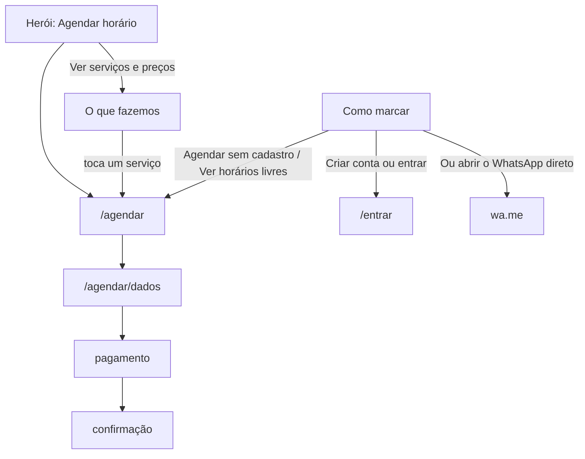

# Fatia 16 · Fluxo sem repetição (home e caminho até a reserva)

**Status:** aprovada pelo Kevin em 27/11/2026 (decisões na seção 9; o Kevin pode rever) · **Base:** `develop` · **PRs:** `feature/ux-fluxo-f1` a `feature/ux-fluxo-f7` (seção 10)

## 1. Objetivo · Usuários · Fora do escopo
- **Objetivo:** cada seção e cada página tem **uma finalidade só**, em ordem de conversa: **quem somos → o que fazemos → como marcar → onde estamos**. Cada informação aparece **num lugar só** e cada tela tem **um botão principal**. Pedido do Kevin (27/11): "um site com fluxo melhor, onde não pareça repetitivo e cada coisa tenha sua devida finalidade, assim como o backend foi construído".
- **Usuários:** cliente novo no celular (principal); cliente antigo que só usa WhatsApp; quem chega por link (LinkedIn, Instagram) no computador.
- **Fora do escopo:**
  - Texto da Trajetória (v3, [`historia-v3-aprovada.txt`](historia-v3-aprovada.txt)) e a narração ([`trajetoria-narracao-audio.md`](trajetoria-narracao-audio.md)): não mudam.
  - Pagamento, confirmação, minha conta e painel.
  - Backend, contrato e CSP.
  - **Fotos com rosto.** Ficam fora do site, inclusive as que já estão no Instagram (decisão jurídica de 27/11). Só podem voltar no futuro, com **termo de autorização de imagem assinado** por cada pessoa e com spec própria. Fotos de crianças não voltam.
  - **Galeria de cortes (cenário B):** parada (F8, seção 9).

## 2. Diagnóstico (site no ar, 27/11/2026, 360 e 1280 px)
| # | O que se repetia | Evidência |
|---|---|---|
| R1 | 10 botões para `/agendar` na home do celular; 2 "Agendar horário" visíveis juntos na primeira tela (topo e barra fixa) | links e posições medidos com Playwright |
| R2 | A história do Eduardo contada 5 vezes (fatos do herói, bio do Barbeiro, Trajetória, linha do tempo, bloco dos prêmios); retrato 2 vezes; "Amor na ponta da tesoura!" 2 vezes | texto da home |
| R3 | "Como funciona e como pagar" 5 vezes (subtítulo, faixa dos 3 passos, apoio dos serviços, 2 dúvidas, último parágrafo da Trajetória) | idem |
| R4 | A mesma foto da porta no herói e na galeria; endereço e horário no herói e no rodapé | idem |
| R5 | `/servicos` igual à seção da home; rodapé completo dentro do agendamento e do login; 3 botões de WhatsApp na home; seção de alcance vazia ("Em breve") | idem |

## 3. O novo fluxo
| # | Seção (`id`) | Única finalidade | CTA |
|---|---|---|---|
| 0 | Topo | Marca, as 4 seções na ordem da página e a conta | "Agendar horário" no computador só quando o herói e "Como marcar" estão fora da tela; nunca nas telas de agendamento e de conta |
| 1 | Herói (`inicio`) | Promessa: título e subtítulo do PDF, **sem foto** | **Agendar horário** (principal) + link "Ver serviços e preços" |
| 2 | 01 · Quem somos (`quem-somos`) | A história, uma vez: player, texto v3, um retrato, linha do tempo com os prêmios em 2017 | nenhum |
| 3 | 02 · O que fazemos (`servicos`) | Preços: cada linha leva ao agendamento com o serviço escolhido | a própria linha |
| 4 | 03 · Como marcar (`como-marcar`) | Os três jeitos de marcar e as regras antes de pagar | **Agendar sem cadastro** (principal); os outros dois em contorno |
| 5 | 04 · Onde estamos (`onde-estamos`) | Endereço e mapa, horário, WhatsApp e Instagram, a foto do salão | nenhum |
| 6 | Rodapé | Consultar reserva, privacidade, crédito, voltar ao topo (e "Onde estamos" fora da home) | nenhum |

Saem da home: faixa "Como funciona", fatos do herói, foto e legenda do herói, WhatsApp do herói, seção Barbeiro, bloco "Reconhecido duas vezes em 2017", citação em destaque, alcance sem dado, seção Dúvidas (as 3 perguntas que não se repetem vão para "Antes de pagar"), "Ver todos os serviços e preços" e a galeria (cenário A). `/servicos` redireciona para `/#servicos`. A seção de alcance só aparece com dado que passa no k (ADR 0014), antes de "Onde estamos".

## 4. Microcopy (aprovada em 27/11)
Sobretítulos "01 · Quem somos", "02 · O que fazemos", "03 · Como marcar", "04 · Onde estamos". Subtítulo do herói (PDF p.1): "Escolha o serviço, veja os horários livres e pague na hora, por Pix ou cartão, com conta ou sem cadastro. Pagou, o horário é seu." Cartões "Três jeitos de marcar" do PDF (spec 09). "Cada serviço dura N min. Toque em um para ver os horários." (só quando todos têm a mesma duração). "Antes de pagar". "A porta da barbearia." Menu: "Entrar ou criar conta". Login: "Só quer marcar? Agende sem cadastro".

## 5. Acessibilidade e desempenho
WCAG 2.2 AA (axe `wcag22aa`); alvos de 44 px; foco visível e não coberto; reflow a 320 px; o CTA escondido fica `inert`. Core Web Vitals: LCP ≤ 2,5 s (o orçamento do Lighthouse CI continua o da Fatia 12), CLS ≤ 0,1, INP ≤ 200 ms. Movimento de 150 a 250 ms, só `transform` e `opacity`, zerado por `prefers-reduced-motion` e "Sem animação". CSP: **nenhum `style=` novo**; mostrar e esconder é por atributo e classe.

## 6. Dados e LGPD
Sem total de clientes em nenhuma tela. Fotos de clientes (cenário B, futuro) ficam **fora do repositório**, num storage externo; nenhuma imagem de cliente em `docs/assets` nem em `frontend/public`.

## 7. Fotos para o Eduardo tirar ou separar (cenário B, futuro)
Sem rosto (nem olho, nem perfil nítido), sem criança, sem TV ligada, sem espelho com gente: nuca de costas (degradê), lateral da orelha para trás (disfarce), costas e topo (social), close do risco ou desenho, barba do queixo ao pescoço sem olhos, acabamento do pezinho, topo platinado, ferramentas na bancada, cadeira vazia. Cada foto só com o ok do cliente e a avaliação jurídica.

## 8. Critérios de aceite
| # | Dado | Quando | Então | Teste |
|---|---|---|---|---|
| A1 | a home a 360 e a 1280 | rola de cima a baixo | no máximo **1** "Agendar horário" visível e clicável ao mesmo tempo | `home-fluxo-topo.spec.ts` |
| A2 | a home a 360 | herói ou "Como marcar" na tela | a barra fixa fica escondida e `inert`; fora deles, aparece | `home-fluxo-topo.spec.ts` |
| A3 | a home a 1280 | herói na tela | o "Agendar horário" do topo fica escondido e `inert`; nas outras páginas (fora do agendamento e da conta) ele aparece | `home-fluxo-topo.spec.ts` |
| A4 | a home | lê a ordem | `inicio`, `quem-somos`, `servicos`, `como-marcar`, (`alcance`, só com dado), `onde-estamos` | `home-ordem.test.tsx` |
| A5 | o texto da home | conta | "R. São Judas Tadeu, 313", "Terça a sábado" e o WhatsApp formatado 1× cada, em `onde-estamos`; "Amor na ponta da tesoura" 1×; "Prêmio Barbeiros do Brasil" no máximo 2×, em `quem-somos` | `home-fluxo.test.tsx` |
| A6 | a home | procura o retrato do Eduardo e a seção Barbeiro | 1 retrato, em `quem-somos`; `#barbeiro` não existe | `home-fluxo.test.tsx` |
| A7 | a home | procura a foto do salão | 1×, em `onde-estamos`; o herói não tem foto | `home-fluxo.test.tsx` |
| A8 | a home | procura "Como funciona", "Quem corta o seu cabelo", "Reconhecido duas vezes", o alcance sem dado e "Ver todos os serviços" | nada disso existe | `home-fluxo.test.tsx` |
| A9 | "O que fazemos" | toca uma linha | abre `/agendar?servicoId=<id>` com o serviço marcado; não há "Agendar este serviço" | `home-fluxo.spec.ts` |
| A10 | a lista de serviços | todos com a mesma duração | a duração aparece 1× no apoio; com durações diferentes, em cada linha; nome e preço em cada linha | `servicos-home.test.tsx` |
| A11 | "Como marcar" | lê | 3 cartões; só "Agendar sem cadastro" é principal; "Antes de pagar" com 3 perguntas; sem WhatsApp na API, some "Ou abrir o WhatsApp direto" | `como-marcar.test.tsx` |
| A12 | a home | conta links `wa.me` | no máximo 2: "Ou abrir o WhatsApp direto" e o contato em `onde-estamos` | `home-fluxo.test.tsx` |
| A13 | o menu | lê | Quem somos, O que fazemos, Como marcar, Onde estamos (nessa ordem) e a conta | `navegacao.test.tsx` |
| A14 | um link de seção | toca | o título da seção aparece inteiro na tela | `home-fluxo.spec.ts` |
| A15 | `/agendar`, `/agendar/dados`, pagamento, `/entrar`, `/cadastro` | carrega | o topo não tem "Agendar horário"; o rodapé é enxuto, com "Onde estamos" | `navegacao.test.tsx` |
| A16 | `/entrar` | lê | "Criar conta" só nas abas; há "Só quer marcar? Agende sem cadastro" | `entrar-fluxo.test.tsx` |
| A17 | a galeria sem fotos de corte (cenário A) | carrega a home | a seção e o link "Galeria" não existem | `galeria.test.tsx` |
| A18 | cenário B (1, 2, 3 e 6 fotos de corte) | carrega | parado com o F8 | — |
| A19 | qualquer foto nova | revisão do PR | só corte, sem rosto, sem criança, com ok jurídico | revisão manual |
| A20 | o repositório | lista as imagens | nenhuma imagem de cliente: a pasta da galeria não tem arquivo fora da lista aprovada; o CI falha se um PR acrescentar imagem em `docs/assets/galeria` | `fotos-no-repositorio.test.ts` |
| A21 | qualquer tela pública | procura total de clientes | não existe | `home-fluxo.test.tsx` |
| A22 | a Trajetória | carrega | texto v3 idêntico e o player logo abaixo do título | `home-historia.test.tsx` |
| A23 | home e caminho até a reserva, a 360 e 1280 | axe `wcag22aa` | 0 violações; sem rolagem lateral; alvos ≥ 44 px | `site-fluido-axe.spec.ts` |
| A24 | `prefers-reduced-motion: reduce` | rola a home | barra e botão do topo mudam sem transição | `movimento-reduzido.spec.ts` |
| A25 | o código do front | procura `style={` | nenhum estilo inline em componente | `sem-estilo-inline.test.ts` |
| A26 | Lighthouse móvel da home | roda | sem piora em relação à `develop` (orçamento da Fatia 12) | Lighthouse CI |
| A27 | `/servicos` | abre | vai para `/#servicos` | `home-fluxo.spec.ts` |
| A28 | links antigos `/#trajetoria`, `/#historia`, `/#barbeiro` e `/#duvidas` | abre | vai para `quem-somos` (os três primeiros) e `como-marcar` (`#duvidas`) | `home-fluxo.spec.ts` |
`conferir-spec.sh 16` no CI pula A18, A19 e A26 (sem teste com número: parado, manual e Lighthouse).

## 9. Decisões do Kevin (27/11/2026) · o Kevin pode rever
1. A foto sai do herói e fica só em "Onde estamos" ("deixe sem").
2. `/servicos` redireciona para a home (`/#servicos`).
3. O último parágrafo do texto v3 fica.
4. Os sobretítulos ficam de 01 a 04.
5. O site fica sem galeria (cenário A); o F8 está parado.
O registro em `decisoes.md` (inclusive a mudança na D157 e na E10 da Fatia 12) fica no PR de docs da arquitetura.

## 10. Fatiamento (PRs pequenos para a `develop`, empilhados nesta ordem)
| # | PR | Critérios |
|---|---|---|
| F1 | Alcance some sem dado + esta spec + conferir-spec da fatia 16 no CI | A8 (alcance), A21, A25 |
| F7 | Guarda do repositório contra fotos de clientes | A20 |
| F2 | Topo, menu e barra fixa sem CTA duplicado; rodapé enxuto no agendamento e na conta | A1 a A3, A13, A15, A16, A24 |
| F3 | Herói sem foto + Como marcar (substitui o C2) | A7 (herói), A8, A11, A12, A28 (`#duvidas`) |
| F4 | Quem somos (Barbeiro + Trajetória) | A5 (história), A6, A22, A28 |
| F5 | O que fazemos, sem galeria, e `/servicos` para a home | A9, A10, A17, A27 |
| F6 | Onde estamos na home + rodapé enxuto | A4, A5, A7, A12, A14, A23 |
