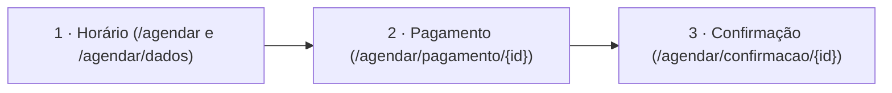

# Indicador de 3 passos do agendamento

**Objetivo:** mostrar em todas as telas do agendamento pago onde a pessoa está: "1 · Horário", "2 · Pagamento" e "3 · Confirmação", como no PDF.
**Usuários:** cliente com conta e visitante.
**Fora do escopo:** mudar rotas, a ordem das seções de `/agendar` ("1 · Serviço", "2 · Dia", "3 · Horário"), o pagamento e o modo WhatsApp (que não tem pagamento nem confirmação no site).

## Referências (link + o que copiar)
- PDF *Site · Barbearia Altas Horas*, p.10 ("✓ 1 · Horário · 2 · Pagamento · 3 · Confirmação") e p.12 (os dois primeiros com ✓). Decisão do Kevin de 20/11/2026: 3 passos.
- GOV.UK Design System, padrões: https://design-system.service.gov.uk/patterns/ · progresso curto em texto, sem depender de cor.
- NN/g, 10 heurísticas: https://www.nngroup.com/articles/ten-usability-heuristics/ · visibilidade do estado do sistema.

## Situação no ar (26/11/2026)
`/agendar` e `/agendar/dados` não têm indicador. `Pagamento.tsx:205` mostra só o sobretítulo "Pagamento". `Confirmacao.tsx:63` mostra "Etapa 3 · Confirmação".

## Fluxo


## Telas
**Celular:**
```
✓ 1 · Horário   2 · Pagamento   3 · Confirmação     ← uma linha; quebra se não couber
Pague para garantir seu horário                     ← h1 da página continua o mesmo
```
**Desktop:** a mesma linha, acima do h1.
- Componente novo `IndicadorDePassos` com `passoAtual: 1 | 2 | 3`.
- HTML: `<nav aria-label="Etapas do agendamento"><ol>…</ol></nav>`; o passo atual tem `aria-current="step"`; os concluídos têm "✓" e o texto oculto "concluído".
- Diferença sem cor: concluído com "✓", atual em negrito e sublinhado, futuro em texto normal (PDF p.22: "Sem vermelho nem verde").
- O sobretítulo "Pagamento" de `Pagamento.tsx:205` e o "Etapa 3 · Confirmação" de `Confirmacao.tsx:63` saem, porque o indicador os substitui. O sobretítulo "Agenda · Eduardo Candido" de `/agendar` fica.
- `/agendar` e `/agendar/dados`: passo 1. Pagamento: passo 2. Confirmação: passo 3, com 1 e 2 concluídos.

## Estados
- Tempo esgotado ou erro no pagamento: o indicador continua no passo 2.
- Confirmação sem reserva encontrada (`h1` "Confirmação" de `Confirmacao.tsx:50`): sem indicador.
- Modo WhatsApp (outra spec): sem indicador.

## Conteúdo e microcopy
"1 · Horário", "2 · Pagamento", "3 · Confirmação" (PDF p.10). Texto oculto: "concluído" e "etapa atual" (proposta, o Kevin revisa no PR).

## Acessibilidade
1.3.1 (lista ordenada), 1.4.1 (sem depender de cor), 2.4.8 de referência (localização; nível AAA, só como boa prática), 4.1.2 (`aria-current`).

## Dados e LGPD
Nenhum dado.

## Critérios de aceite (Dado/Quando/Então)
| # | Dado | Quando | Então |
|---|---|---|---|
| IP-1 | qualquer pessoa | abre `/agendar` | vê "1 · Horário", "2 · Pagamento" e "3 · Confirmação", com "1 · Horário" em `aria-current="step"` |
| IP-2 | horário escolhido | abre `/agendar/dados` | o passo atual continua "1 · Horário" |
| IP-3 | reserva criada | está no pagamento | o passo 1 tem "✓" e o texto oculto "concluído"; "2 · Pagamento" é o atual; o sobretítulo "Pagamento" não aparece mais |
| IP-4 | pagamento aprovado (pagamento simulado do beta) | vê a confirmação | 1 e 2 concluídos; "3 · Confirmação" atual; "Etapa 3 · Confirmação" não aparece mais |
| IP-5 | leitor de tela | entra no `nav` "Etapas do agendamento" | ouve a lista com 3 itens e qual é a etapa atual |
| IP-6 | 320 px e zoom de 200% | abre qualquer passo | sem rolagem horizontal |
| IP-7 | as 4 telas, 360×800 e 1280×800 | roda o axe | 0 violações |

Testes: Vitest (novo `indicador-de-passos.test.tsx`: IP-1 a IP-5), Playwright (`e2e/e2e-visitante.spec.ts` e `e2e-cartao-simulado.spec.ts` ganham a checagem do passo; IP-6, IP-7).

## Métricas de sucesso
Sem medição de uso hoje. Verificar no teste com 5 pessoas se elas dizem em que passo estão.

## Riscos e perguntas abertas
- Os testes que procuram o sobretítulo "Pagamento" ou "Etapa 3 · Confirmação" precisam mudar junto.
- Arquivos prováveis: novo `frontend/src/componentes/IndicadorDePassos.tsx`, `frontend/src/telas/Agendar.tsx` (212-213), `frontend/src/telas/ReservaDados.tsx` (54 e 125), `frontend/src/telas/Pagamento.tsx` (205), `frontend/src/telas/Confirmacao.tsx` (63), `frontend/src/estilos/navegacao.css`, novo `frontend/src/componentes/indicador-de-passos.test.tsx`, os E2E citados.

## Decisões da implementação

**Data:** 27/11/2026 (America/Sao_Paulo)

**Decisão:** o componente `IndicadorDePassos` entra acima do h1 em `/agendar`, `/agendar/dados`, `/agendar/pagamento/{id}`, `/pagamento-simulado/{id}` e `/agendar/confirmacao/{id}` quando a reserva é encontrada. O sobretítulo "Agenda · Eduardo Candido" de `/agendar` permanece. Os sobretítulos "Pagamento" e "Etapa 3 · Confirmação" saem. A tela de checkout simulado do cartão também fica no passo 2, porque ainda é pagamento.

**Por quê:** o PDF mostra os 3 passos em todas as telas do fluxo pago. Sem indicador na tela do cartão simulado, a pessoa perderia o estado do sistema no meio do passo 2.

**Decisão:** os textos ocultos "concluído" e "etapa atual" (proposta, para revisão no PR) ficam num elemento `.so-leitor` dentro do item da lista, junto do "✓" visual nos passos concluídos e de `aria-current="step"` no atual. A diferença de estado não usa cor.

**Decisão:** as decisões desta melhoria ficam nesta spec, não em `docs/planejamento/decisoes.md`. Esta branch inclui o merge de `fix/resumo-fixo-sem-cobrir-foco`.
