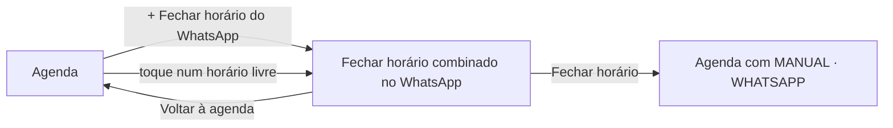

# Painel: "Fechar horário combinado no WhatsApp"

**Objetivo:** usar no painel os nomes do PDF para a ação de travar um horário combinado pelo WhatsApp.
**Usuários:** dono (ADMIN) e barbeiro (BARBEIRO).
**Fora do escopo:** a rota (`/painel/reserva-manual` continua), a API (`POST /admin/agendamentos`), os campos, as regras e o item "Reserva manual" do menu lateral, que o PDF mantém (p.7 e p.9).

## Referências (link + o que copiar)
- PDF *Site · Barbearia Altas Horas*, p.7 (botão "+ FECHAR HORÁRIO DO WHATSAPP" na agenda) e p.9 (título "Fechar horário combinado no WhatsApp", texto de apoio e botões "FECHAR HORÁRIO" e "VOLTAR À AGENDA").
- Laws of UX, Lei de Jakob: https://lawsofux.com/ · usar a palavra que o dono já usa no dia a dia.

## Situação no código (painel não aberto no ar: exige login)
- `PainelReservaManual.tsx:119` h1 "Reserva manual"; `:120` "Para quem combinou pelo WhatsApp. A reserva já nasce confirmada e sem cobrança."; `:199` botão "Criar reserva".
- `PainelAgenda.tsx:256-258` botão "Reserva manual".
- `app/painel/reserva-manual/page.tsx:4` título da aba "Reserva manual".

## Fluxo

## Telas
**Celular e desktop:** só textos mudam; layout igual.
| Lugar | Hoje | Passa a ser | Fonte |
|---|---|---|---|
| Botão na agenda | "Reserva manual" | "+ Fechar horário do WhatsApp" (caixa alta pelo estilo do botão, não no texto) | PDF p.7 |
| Título da aba | "Reserva manual" | "Fechar horário combinado no WhatsApp" | PDF p.9 |
| h1 | "Reserva manual" | "Fechar horário combinado no WhatsApp" | PDF p.9 |
| Texto de apoio | "Para quem combinou pelo WhatsApp. A reserva já nasce confirmada e sem cobrança." | "O cliente pediu o horário pelo WhatsApp e você confirmou na conversa? Feche o horário aqui. Confira na agenda se ele ainda está livre. A reserva nasce confirmada, sem pagamento pelo app, e o horário sai na hora da lista de horários livres." | PDF p.9 |
| Botão de enviar | "Criar reserva" | "Fechar horário" | PDF p.9 |
| Link de volta | "Voltar à agenda" | igual | PDF p.9 |
| `aria-label` do form | "Reserva manual" | "Fechar horário combinado no WhatsApp" | consequência |
| Menu lateral | "Reserva manual" | igual | PDF p.7 e p.9 |

O "+" do botão é decorativo (`aria-hidden`); o nome acessível é "Fechar horário do WhatsApp".

## Estados
Sem mudança: carregando, `409 HORARIO_INDISPONIVEL`, `422 ANTECEDENCIA_INSUFICIENTE`, sucesso e "Aguarde N s" continuam com os textos de hoje.

## Conteúdo e microcopy
Tabela acima, palavra por palavra do PDF.

## Acessibilidade
2.4.2 (título da página), 2.4.6 (títulos e rótulos descritivos), 2.5.3 (o nome acessível contém o texto visível).

## Dados e LGPD
Nenhum dado novo.

## Critérios de aceite (Dado/Quando/Então)
| # | Dado | Quando | Então |
|---|---|---|---|
| PF-1 | ADMIN logado na agenda | procura a ação | existe o link "Fechar horário do WhatsApp" e leva a `/painel/reserva-manual` |
| PF-2 | ADMIN ou BARBEIRO | abre `/painel/reserva-manual` | o `<title>` e o h1 são "Fechar horário combinado no WhatsApp" e o texto de apoio é o do PDF p.9 |
| PF-3 | formulário preenchido | toca em "Fechar horário" | `POST /admin/agendamentos` com o mesmo corpo de hoje e volta para a agenda com o bloco MANUAL · WHATSAPP |
| PF-4 | menu lateral | lê os itens | continua "Agenda", "Reserva manual", "Alcance", "Novidades", "Notificações" (`painel-acesso.test.tsx:55`) |
| PF-5 | 360×800 e 1280×800 | roda o axe no painel | 0 violações, incluindo `label-content-name-mismatch` |

Testes: Vitest (`painel-reserva-manual.test.tsx`: PF-2, PF-3; `painel-agenda.test.tsx`: PF-1), Playwright (`e2e/e2e-painel.spec.ts`: troca "Criar reserva" por "Fechar horário"; PF-5).

## Métricas de sucesso
O dono acha a ação sem ajuda no teste com ele (tarefa: "feche o horário que o Seu Jorge pediu no WhatsApp").

## Riscos e perguntas abertas
- A trilha da auditoria continua "Reserva manual criada" (`PainelAuditoria.tsx:13`), como no PDF p.15. Não muda.
- Arquivos prováveis: `frontend/src/telas/painel/PainelReservaManual.tsx` (119-123, 196-200), `frontend/src/telas/painel/PainelAgenda.tsx` (256-258), `frontend/src/app/painel/reserva-manual/page.tsx` (4), `frontend/src/telas/painel/painel-reserva-manual.test.tsx`, `frontend/src/telas/painel/painel-agenda.test.tsx`, `frontend/e2e/e2e-painel.spec.ts`.

## Decisões da implementação

**Data:** 27/11/2026 (America/Sao_Paulo)

**Decisão:** só os textos da agenda, do título da aba, do h1, do texto de apoio, do botão de enviar e do `aria-label` do formulário mudam para os nomes do PDF. O item "Reserva manual" do menu lateral, a rota `/painel/reserva-manual`, a API `POST /admin/agendamentos` e a trilha "Reserva manual criada" ficam iguais.

**Por quê:** o PDF mantém "Reserva manual" no menu (p.7 e p.9) e na auditoria (p.15). O "+" do botão da agenda é só visual (`aria-hidden`); o nome acessível é "Fechar horário do WhatsApp".

**Decisão:** as decisões desta melhoria ficam nesta spec, não em `docs/planejamento/decisoes.md`.
