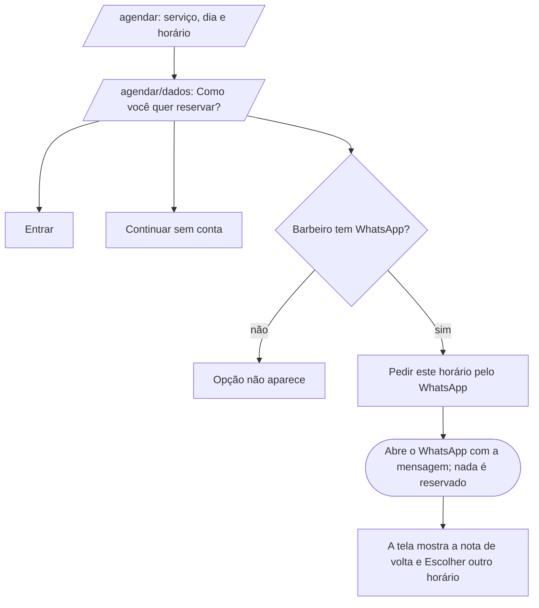

# Pedir o horário escolhido pelo WhatsApp

**Objetivo:** completar o terceiro jeito de marcar do PDF. Depois de escolher serviço, dia e horário, a pessoa pode pedir esse horário ao Eduardo pelo WhatsApp com a mensagem já escrita, sem criar reserva e sem pagar pelo app.
**Usuários:** cliente que prefere conversar; o barbeiro, que recebe o pedido e fecha o horário no painel.
**Fora do escopo:** segurar o horário, criar reserva pendente, mudar a API, a home ou o pagamento.

## Referências (link + o que copiar)
- WhatsApp, "How to use click to chat" (aberto em 26/11/2026): https://faq.whatsapp.com/5913398998672934 · `https://wa.me/<número>?text=<texto em URL encoding>` abre a conversa com a mensagem pronta.
- PDF *Site · Barbearia Altas Horas*, p.1 e p.6: cartão "3 · PELO WHATSAPP · Combinar com o Eduardo pelo WhatsApp · Veja os horários livres agora e peça o seu direto na conversa. Sem pagar pelo app." e "Ou abrir o WhatsApp direto".
- NN/g, 10 heurísticas: https://www.nngroup.com/articles/ten-usability-heuristics/ · dizer a verdade sobre o estado (o horário não fica guardado).

## Situação no ar (26/11/2026)
`/agendar/dados` pergunta "Como você quer reservar?" e oferece só "Entrar" e "Continuar sem conta" (`ReservaDados.tsx:149-160`). O WhatsApp aparece só como "Prefere combinar pelo WhatsApp? Falar com Eduardo no WhatsApp", sem a mensagem do horário (`ContatoWhatsapp.tsx`).

## Fluxo


## Telas
**Celular:**
```
Como você quer reservar?
[ ENTRAR ]
[ CONTINUAR SEM CONTA ]
── ou ──
Pelo WhatsApp
O horário só fica seu quando o Eduardo confirmar. Até lá, outra pessoa pode marcar pelo site.
[ PEDIR ESTE HORÁRIO PELO WHATSAPP ]   ← <a> de verdade, abre o WhatsApp
```
**Desktop:** as três opções lado a lado no mesmo bloco, na mesma ordem.
- O link é `<a href target="_blank" rel="noopener noreferrer">`, com nome acessível terminando em "(abre o WhatsApp)".
- O primeiro nome do barbeiro vem de `nomeExibicao` (`GET /barbeiros`); o número, de `whatsapp`. Nada escrito no código.
- Para quem está logado (hoje vai direto ao "Reservar"), a opção do WhatsApp aparece abaixo do botão, com o mesmo aviso.

## Estados
- Sem número do barbeiro: a opção não aparece (como o `ContatoWhatsapp` faz hoje).
- Depois de tocar no link: a tela continua igual e mostra, num `role="status"`, a nota de volta e o link "Escolher outro horário".
- Horário passou ou foi pego enquanto a pessoa estava no WhatsApp: nada muda no site; o barbeiro recebe `409` no painel (já tratado).
- Erro ao carregar os barbeiros: a opção não aparece; as outras duas seguem.

## Conteúdo e microcopy (pt-BR)
| Lugar | Texto | Fonte |
|---|---|---|
| Rótulo do grupo | "Pelo WhatsApp" | PDF p.6 ("3 · PELO WHATSAPP") |
| Aviso | "O horário só fica seu quando o Eduardo confirmar. Até lá, outra pessoa pode marcar pelo site." (o nome vem da API) | spec do fluxo de agendamento de 20/11, §7 |
| Botão | "Pedir este horário pelo WhatsApp" | idem |
| Mensagem pronta | "Olá, Eduardo! Quero marcar <serviço> na <dia da semana>, <dd/mm>, às <hh:mm>. Esse horário está livre?" (sábado e domingo usam "no") | **decisão de 27/11** (o Kevin aprovou o texto de 20/11 como está) |
| Nota de volta | "Mandou a mensagem? Agora é com o Eduardo: ele confirma na conversa." · link "Escolher outro horário" | **decisão de 27/11** (o Kevin aprovou o texto de 20/11 como está) |

A mensagem **não** leva link do painel, id de reserva nem dado pessoal.

## Acessibilidade
2.4.4 (propósito do link, com "(abre o WhatsApp)"), 3.2.2 (nada muda sozinho), 4.1.3 (nota de volta em `role="status"`), 2.5.8 (alvo ≥ 44 px, PDF p.22).

## Dados e LGPD
Não pede nem guarda nada. A mensagem tem só serviço, dia e hora. O texto vai para o WhatsApp do aparelho da pessoa, não passa pelo BFF.

## Critérios de aceite (Dado/Quando/Então)
| # | Dado | Quando | Então |
|---|---|---|---|
| WA-1 | barbeiro com WhatsApp, horário escolhido (Corte Clássico / Social, sexta 27/11, 07:00) | abre `/agendar/dados` sem sessão | vê três caminhos: "Entrar", "Continuar sem conta" e o link "Pedir este horário pelo WhatsApp" |
| WA-2 | WA-1 | inspeciona o link | `href` começa com `https://wa.me/55<número da API>?text=` e o texto decodificado é exatamente a mensagem com serviço, "na sexta, 27/11" e "às 07:00" |
| WA-3 | WA-1 | toca no link | nenhuma chamada `POST /agendamentos` nem `/agendamentos/guest` é feita (Playwright observa a rede) e aparece a nota de volta em `role="status"` |
| WA-4 | barbeiro sem WhatsApp (`whatsapp: null`, mock) | abre `/agendar/dados` | a opção não existe e as outras duas continuam |
| WA-5 | horário num sábado | gera a mensagem | o texto usa "no sábado, dd/mm" |
| WA-6 | leitor de tela | foca o link | ouve "Pedir este horário pelo WhatsApp (abre o WhatsApp)" |
| WA-7 | 360×800 e 1280×800 | roda o axe | 0 violações |

Testes: Vitest + Testing Library (novo `agendar-whatsapp.test.tsx`: WA-1, 2, 4, 5, 6), Playwright (`e2e/agendar-fluido.spec.ts`: WA-3 e WA-7).

## Métricas de sucesso
Cliques em "Pedir este horário pelo WhatsApp" contra reservas pagas (só se houver medição sem cookies, que ainda não existe). Sem isso, o barbeiro conta os pedidos que chegam com a mensagem pronta.

## Riscos e perguntas abertas
- Corrida: o horário não fica guardado. É a regra já decidida; o aviso diz isso antes do botão.
- Texto da mensagem pronta e da nota de volta: aprovado como está (decisão de 27/11).
- Arquivos prováveis: `frontend/src/componentes/ContatoWhatsapp.tsx` (`linkDoWhatsapp` ganha o texto opcional, 9-13), `frontend/src/telas/ReservaDados.tsx` (149-160), `frontend/src/conteudo/textos.ts`, novo `frontend/src/telas/agendar-whatsapp.test.tsx`, `frontend/e2e/agendar-fluido.spec.ts`.

## Decisões da implementação

**Data:** 27/11/2026 (America/Sao_Paulo)

**Decisão:** o `linkDoWhatsapp` ganha um texto opcional (`?text=`), e a mensagem pronta monta "na" ou "no" pelo dia da semana (sábado e domingo usam "no"). O primeiro nome e o número vêm de `GET /barbeiros`. Nenhum número fica escrito no código. Se o barbeiro não tem WhatsApp, ou a lista falha, a opção some e "Entrar" / "Continuar sem conta" seguem.

**Decisão:** depois do toque no link (que abre numa aba nova), a tela mostra a nota de volta em `role="status"` e o link "Escolher outro horário". Nada é enviado a `POST /agendamentos` nem `/agendamentos/guest`. Quem já entrou vê a mesma opção abaixo de "Reservar".

**Decisão:** os textos da mensagem pronta e da nota de volta são proposta, para revisão no PR. O nome "Eduardo" das frases de exemplo é trocado pelo primeiro nome que a API devolver.

**Decisão:** as decisões desta melhoria ficam nesta spec, não em `docs/planejamento/decisoes.md`. Esta branch inclui o merge de `fix/indicador-de-passos`.
