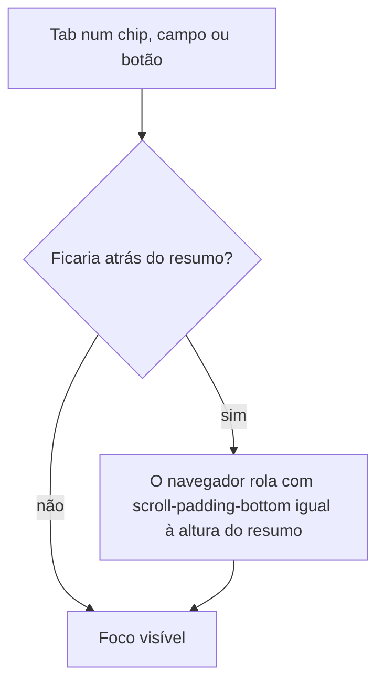

# Resumo fixo do agendamento sem cobrir o foco

**Objetivo:** no celular, o resumo fixo de `/agendar` e `/agendar/dados` não pode esconder o elemento focado e deve ocupar menos tela.
**Usuários:** cliente e visitante no celular, sobretudo quem usa teclado, leitor de tela, zoom ou fonte maior (A+).
**Fora do escopo:** mudar o que o resumo mostra no desktop, os textos, a ordem das seções, o contrato e o pagamento.

## Referências (link + o que copiar)
- WCAG 2.2, 2.4.11 Foco não escondido (mínimo): https://www.w3.org/TR/WCAG22/ · o elemento focado não pode ficar todo coberto por conteúdo do autor, como barra fixa.
- MDN, `scroll-padding`: https://developer.mozilla.org/en-US/ · reservar no rolamento a altura da barra fixa.
- GOV.UK Design System: https://design-system.service.gov.uk/ · uma ação principal por tela, sem texto longo na barra.

## Situação no ar (26/11/2026, 360×800)
- O resumo (`aside.resumo-fixo`) tem 243 px em `/agendar`, ou 30% da tela, e vai de y 557 a 800.
- Num teste por teclado com 60 Tabs a partir do serviço, 34 focos ficaram escondidos, todo ou em parte, atrás dele (ex.: chip "07:00" em y 732–780).
- No desktop (≥ 48rem) ele é `sticky` no fim do conteúdo, com 225 px. Não é alvo desta spec.

## Fluxo


## Telas
**Celular (até 48rem):**
```
┌ conteúdo da página (rola) ────────────┐
│ ... chips de horário ...               │
├ resumo fixo (≤ 128 px) ───────────────┤
│ Corte Clássico / Social · R$ 45,00     │  ← 1 linha; quebra em 2 no máximo
│ sexta, 27/11 às 07:00                  │
│ [ CONTINUAR ]                          │  ← 48 px de altura
└────────────────────────────────────────┘
```
- A nota "Pagamento antecipado por Pix ou cartão…" (`Agendar.tsx:433-436`) sai da barra e passa para o fluxo da página, logo acima do "Prefere combinar pelo WhatsApp?", com o mesmo texto.
- Rótulos "Serviço", "Quando" e "Total" continuam no HTML (`dl`) e ficam só para leitor de tela no celular (`so-leitor`); no desktop continuam visíveis.
- `html { scroll-padding-bottom: <altura do resumo + margem> }` só nas páginas com resumo e só abaixo de 48rem. A altura vem de um token ou de uma custom property atualizada pelo próprio CSS, sem JavaScript se possível.
- Em `/agendar/dados`, o mesmo tratamento: o botão "Alterar" fica na barra; serviço, quando e total numa linha.

**Desktop:** sem mudança.

## Estados
- Vazio (nada escolhido): "Escolha o serviço" e "Escolha o horário" na linha; botão desabilitado como hoje.
- Carregando ou erro: a barra não muda de altura (sem CLS).
- Texto longo (nome de serviço comprido, A+ ligado): quebra em 2 linhas no máximo e o `scroll-padding` acompanha.
- Sucesso: igual a hoje.

## Conteúdo e microcopy
Nenhum texto novo. Os textos atuais só mudam de lugar.

## Acessibilidade
2.4.11 (foco não escondido), 2.4.7 (foco visível), 1.4.10 (reflow em 320 px), 1.4.4 (texto a 200%), 2.5.8 (alvo do botão ≥ 24 px; o desenho pede 44).

## Dados e LGPD
Nenhum dado novo.

## Critérios de aceite (Dado/Quando/Então)
| # | Dado | Quando | Então |
|---|---|---|---|
| RF-1 | `/agendar` em 360×800, serviço e dia com horários escolhidos | a pessoa navega por Tab do primeiro serviço até o "Continuar" | nenhum elemento focado fica com a caixa toda abaixo do topo do resumo (Playwright compara `getBoundingClientRect` do foco com o do `aside`) |
| RF-2 | o mesmo cenário | mede a altura do `aside.resumo-fixo` | ≤ 128 px sem A+; ≤ 176 px com A+ ligado |
| RF-3 | `/agendar/dados` em 360×800, modo sem conta | Tab por nome, e-mail, WhatsApp, caixinha e "Reservar" | nenhum foco escondido pelo resumo (igual a RF-1) |
| RF-4 | 1280×800 | abre `/agendar` | o resumo continua como hoje (`position: sticky`), com Serviço, Quando e Total visíveis |
| RF-5 | qualquer tamanho | roda o axe (WCAG 2.2 AA) em `/agendar` e `/agendar/dados` | 0 violações |
| RF-6 | leitor de tela | lê o resumo | ouve "Resumo", "Serviço", "Quando" e "Total" com os valores |
| RF-7 | 320 px de largura e zoom de 200% | abre `/agendar` | sem rolagem horizontal |

Testes: Playwright (`e2e/teclado.spec.ts`, novo caso para RF-1 a RF-3 e RF-7, Chromium e WebKit), Vitest em `agendar-resumo.test.tsx` (RF-6), axe (RF-5).

## Métricas de sucesso
Foco escondido: de 34 em 60 para 0. Altura da barra: de 243 px para até 128 px.

## Riscos e perguntas abertas
- Se `scroll-padding` não bastar no WebKit, usar `scroll-margin-bottom` nos chips e campos.
- Arquivos prováveis: `frontend/src/estilos/globais.css` (895-925 e 1216-1225), `frontend/src/telas/Agendar.tsx` (413-440), `frontend/src/telas/ReservaDados.tsx` (127-145), `frontend/src/telas/agendar-resumo.test.tsx`, `frontend/e2e/teclado.spec.ts`.

## Decisões da implementação

**Data:** 27/11/2026 (America/Sao_Paulo)

**Decisão:** no celular (abaixo de 48rem) a barra compacta esconde visualmente os rótulos "Serviço", "Quando" e "Total" com o mesmo recorte do `.so-leitor`, mas eles ficam no HTML. Serviço e total aparecem na primeira linha (com " · " entre eles, no máximo 2 linhas); a data fica na segunda. A nota de pagamento antecipado sai da barra e fica no fluxo da página, logo acima do convite do WhatsApp, com o mesmo texto.

**Por quê:** a barra de 243 px cobria o foco (WCAG 2.4.11). Tirar a nota e os rótulos visuais cabe no teto de 128 px (176 px com A+). No desktop (≥ 48rem) nada muda: o resumo continua `sticky`, com os três rótulos visíveis.

**Decisão:** `html:has(.resumo-fixo)` recebe `scroll-padding-bottom` igual à altura ampliada da barra mais uma margem (`--resumo-fixo-altura-ampliada` + `--space-4`), só abaixo de 48rem. Os campos e botões também ganham `scroll-margin-bottom` com o mesmo valor, como reserva para o WebKit.

**Por quê:** a spec pede CSS sem JavaScript. Usar sempre o teto com A+ (176 px, `calc((var(--space-16) * 2) + var(--space-12))`) evita medir a barra em tempo real e cobre o zoom do A+ (110%, 125% e 150%). As medidas novas são tokens derivados (`--resumo-fixo-altura`, `--resumo-fixo-altura-ampliada`, `--alvo-toque`), sem pixel solto, para o verificador de tokens passar.

**Decisão:** as decisões desta melhoria ficam nesta spec, não em `docs/planejamento/decisoes.md`.

**Por quê:** essa lista estava em outro PR aberto no momento da implementação.
